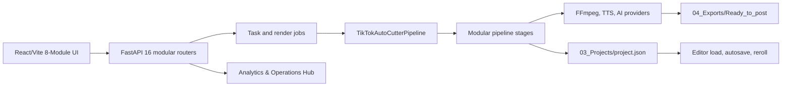

# OmniCut Pro Studio Architecture

เอกสารนี้อธิบายโครงสร้างสถาปัตยกรรมที่ใช้งานจริง ณ วันที่ 2026-09-12 หากสถานะงานหรือผลทดสอบต่างจากเอกสารนี้ ให้ยึด [TODO.md](TODO.md) และโค้ดปัจจุบันเป็นหลัก

## ภาพรวมระบบ

ค่ามาตรฐานของไฟล์โพสต์จริงคือ 1080x1920 (9:16), H.264, AAC, 30 FPS และ `+faststart` ส่วน Draft ใช้ 720x1280 เพื่อทดสอบเร็วขึ้น

## เมนูและการนำทางฝั่ง Frontend (8 โมดูลหลัก)

ระบบจัดหมวดหมู่การทำงานเป็น 8 เมนูหลักใน `frontend/src/components/Sidebar.jsx`:

1. **1. สินค้า → คลิป (`ProductToClip.jsx`):** วิเคราะห์สินค้าด้วย AI (ลิงก์/สเปก/รูป) สร้าง Content Matrix 4-10 สคริปต์ พร้อมระบุ TikTok Product ID / ลิงก์ปักตะกร้า
2. **2. แทร็กเกอร์ 4 เฟส (`ContentTrackerHub.jsx`):** จัดการสเตจงาน 4 ขั้น (สคริปต์พร้อม, เลือกคลิป, กำลังตัดต่อ, ตัดต่อเสร็จ) พร้อม Shot List Modal และ Mobile Filming Page
3. **3. ตัดต่อ & สร้างคลิป (`editor/EditorShell.jsx`):** สตูดิโอตัดต่อไทม์ไลน์ Multi-track, SequencePlayer (Canvas 2D), Inspector ปรับแต่ง Overlay/Motion/Subtitles
4. **4. Export Gallery (`ExportGallery.jsx`):** คลังวิดีโอสำเร็จรูป, พรีวิว, Post Studio (สร้างปก 3:4/9:16, reveal file ใน Explorer, คัดลอกแคปชั่น, ส่งต่อ TikTok Auto-post, มาร์คว่าโพสต์แล้ว)
5. **5. Media Assets Hub (`MediaAssetsHub.jsx`):** ศูนย์รวมฟอนต์, BGM, SFX, สติกเกอร์/ป้ายกำกับ, และ Color LUTs
6. **6. สถิติ & วิเคราะห์รวม (`analytics/AnalyticsHub.jsx`):** แดชบอร์ดวิเคราะห์ 4 มิติ (Production, Tokens, Storage, Inventory) ด้วย Pure SVG Glassmorphic Charts (AreaLine, Donut, Funnel, ProgressRing)
7. **7. ตั้งค่าระบบ (`SystemSettings.jsx`):** ตรวจสอบ System Health, AI Providers, เสียงพากย์ Edge-TTS/Gemini, และการเชื่อมต่อมือถือผ่าน QR Code
8. **8. คู่มือใช้งาน (`UserGuide.jsx`):** Interactive Knowledge Base สำหรับผู้ใช้ (Sticky TOC, เช็กลิสต์ติ๊กได้พร้อมความจำ localStorage, การ์ดเมนู 8 ข้อ, โฟลว์ 7 ขั้นกดเปิดเมนูได้, Quick Action ปุ่มลัดแก้ปัญหา, FAQ ค้นหาได้)

## Backend (FastAPI 16 Routers)

Entry point คือ `scripts/api_server.py` ทำหน้าที่สร้าง FastAPI app, ตรวจสอบ API Key security, ตั้ง CORS, และ mount router โดเมนต่างๆ รวม 125 routes (ตรวจสอบจริงผ่าน `len(app.routes)`):

| ลำดับ | โมดูล Router | หน้าที่หลัก |
| :--- | :--- | :--- |
| 1 | `scripts/api_phase1.py` | Project lifecycle, AI script generator, partial reroll |
| 2 | `scripts/api_editor.py` | Timeline manifest load/save, filmstrip thumbnails |
| 3 | `scripts/api_tokens.py` | Token ledger, usage breakdown, daily aggregates |
| 4 | `scripts/api_voice.py` | Edge-TTS / Gemini TTS voice synthesize & audio preview |
| 5 | `scripts/api_videos.py` | Raw video library, upload multipart, file reveal |
| 6 | `scripts/api_covers.py` | Post Studio Cover generation (3:4, 9:16 jpg export) |
| 7 | `scripts/api_tiktok_autopost.py` | TikTok auto-post extension bridge & upload queue |
| 8 | `scripts/api_schedule_queue.py` | Schedule agenda & auto-queue slots |
| 9 | `scripts/api_products.py` | Product queue, scraping, TikTok Product ID extraction/resolution |
| 10 | `scripts/api_exports.py` | Export gallery scan, mark posted, media info probe |
| 11 | `scripts/api_tasks.py` | Background async tasks & progress tracking |
| 12 | `scripts/api_render.py` | Full video assembly, render jobs, queue runner |
| 13 | `scripts/api_posts.py` | Post log, publication tracker, performance metrics |
| 14 | `scripts/api_shot_lists.py` | Shot List builder & filming task assignment |
| 15 | `scripts/api_recording.py` | Mobile filming stream & upload ingest |
| 16 | `scripts/api_analytics.py` | Aggregated metrics 4 มิติ สำหรับ Analytics Hub |

การเปลี่ยน route, method, request หรือ response ต้องตรวจสอบความเข้ากันได้กับ `frontend/src/api.js` เสมอ

## Pipeline การเรนเดอร์

`scripts/pipeline.py` เป็น orchestrator ภายนอก ส่วน state ระหว่าง stage อยู่ใน `scripts/pipeline_context.py`

ลำดับหลัก (8 Stages):

1. `SourceResolutionStage` ตรวจและเตรียมวิดีโอ/รูปต้นทางจาก `01_Raw/`
2. `ScriptStage` สร้างหรือใช้สคริปต์ที่กำหนด พร้อมระบบทำความสะอาดคำห้าม/วรรณยุกต์
3. `VoiceStage` สร้างเสียงพากย์ Edge-TTS (+15%) และ timing alignment
4. `SubtitleStage` สร้าง cues, overlays, kinetic highlight และไฟล์ ASS
5. `AudioMixStage` รวม Voice, BGM, SFX และ clip audio ตามระดับสัดส่วนมาตรฐาน
6. `ShotMatchingStage` จับคู่ภาพกับบทด้วย AI เมื่อเปิดใช้
7. `VideoAssemblyStage` ประกอบและ export ผ่าน FFmpeg 1080x1920 30FPS H.264
8. `ProjectManifest` บันทึก state และ artifact paths แบบ atomic/versioned (`03_Projects/project.json`)

Reroll ใช้ stage เดียวกับ Full Render ผ่าน `resume_from` จึงต้องรักษา `ProjectManifest.should_run()` และ artifact reuse contract ห้ามสร้าง branch ประมวลผลสำรองอีกชุด

## Editor State & Save Queue

`frontend/src/components/editor/EditorShell.jsx` เป็น composition shell งาน state และคำสั่งสำคัญแยกออกเป็นโมดูลเฉพาะทาง:

| หน้าที่ | โมดูล |
| :--- | :--- |
| Manifest → Editor state / Save payload | `frontend/src/lib/editorProjectState.js` |
| Autosave, flush, page unload | `frontend/src/hooks/useProjectAutosave.js` |
| Latest-save-wins queue | `frontend/src/lib/projectSaveQueue.js` |
| Project loading and stale response guard | `frontend/src/hooks/useProjectLoader.js` |
| Render polling/resume/cleanup | `frontend/src/hooks/useRenderJob.js` |
| Undo/redo | `frontend/src/hooks/useEditorHistory.js` |
| Clip/caption/overlay commands | `frontend/src/hooks/useEditorCommands.js` |
| Selection and shortcuts | `useEditorSelection.js`, `useEditorShortcuts.js` |

Manual Save และ Autosave ต้องเรียก serializer เดียวกัน ห้ามประกอบ payload ซ้ำใน component การสลับโปรเจกต์ต้อง flush pending save ก่อน และ response เก่าต้องไม่เปลี่ยน state ของโปรเจกต์ใหม่

## Timeline และ Keyframes

`frontend/src/lib/timelineSchema.js` กำหนด Timeline Document v2 พร้อม in-memory migration จาก manifest รุ่นเก่า โดยยังไม่เขียนทับไฟล์เก่าจนผู้ใช้บันทึก

- `timelineMath.js` จัดการเวลา, trim, split, transition, snap และ ripple math
- `timelineTrackModel.js` จัดการ track layout และ audio/video/overlay track state
- `keyframeModel.js` และ `scripts/keyframe_engine.py` ต้องรักษาสูตร interpolation ให้ตรงกัน
- `Timeline.jsx` ประกอบ ruler, lanes, playhead และ context menu จาก component ย่อยใน `editor/timeline/`

## Preview และ Render Parity (กฎเหล็ก)

ภาพเดียวกันมีสอง implementation คู่ขนานที่ต้องให้ภาพตรงกัน 100%:

- **Preview:** Canvas 2D ใน `frontend/src/components/SequencePlayer.jsx`
- **Render:** ASS/libass ใน `scripts/subtitle_engine.py` และโมดูลใต้ `scripts/subtitle/`

Overlay model มี mirrored pair คือ `frontend/src/lib/overlayModel.js` และ `scripts/overlay_model.py` การแก้ geometry, font, color, alpha, outline, motion, wrapping หรือ timing ต้องแก้ทั้งคู่และทำตาม [.agents/rules/preview_render_parity.md](.agents/rules/preview_render_parity.md)

Subtitle modules ปัจจุบัน:

- `subtitle/font_metrics.py` วัด glyph advance และ font mapping
- `subtitle/translation_service.py` แปลและ wrap ข้อความ
- `subtitle/motion_effects.py` สร้าง ASS motion/keyframes
- `subtitle/overlay_events.py` สร้าง event สำหรับ hook/text overlays
- `subtitle/badge_plate_renderer.py` สร้าง plate/badge drawing
- `subtitle/word_layout.py` คำนวณ per-word coordinate layout

## ข้อมูลบนดิสก์

- `00_Inbox/` ไฟล์ดิบ ไอเดีย สคริปต์ย่อ และไฟล์วิดีโอที่ sync จากมือถือ
- `01_Raw/` วัตถุดิบต้นฉบับแยกตามโฟลเดอร์ ห้ามลบหรือเขียนทับโดยไม่ได้รับอนุญาต
- `02_Assets/` Media Assets ส่วนกลาง (Fonts, Music, SFX, Stickers, LUTs)
- `03_Projects/<project>/project.json` คือ manifest หลัก ใช้ atomic temp-file replace
- `04_Exports/Ready_to_post/` เก็บไฟล์ export จริง และ `04_Exports/Posted/` เก็บไฟล์ที่โพสต์แล้ว
- `05_Covers_Thumbnails/` เก็บปกคลิป 3:4 และ 9:16 ที่สร้างจาก Cover Studio
- `06_Archive/` พื้นที่จัดเก็บไฟล์เก่าสำรอง
- `_Docs/post_log.json` และ `_Docs/products.json` เป็น runtime data ของระบบ

## สถานะการทดสอบปัจจุบัน (Verification Gates)

- **Python Scripts Compilation:** ผ่าน 100% (`python -m compileall -q scripts`)
- **FastAPI Endpoints:** 125 routes รวม 16 modular domain routers
- **Python Pytest Suite:** 1,073 tests collected (`pytest tests/`)
- **Frontend Vitest Suite:** 151 tests passed, 0 failures (`npm test`)
- **Vite Production Build:** ผ่านเรียบร้อย (~3.2s) 1,995 modules transformed

