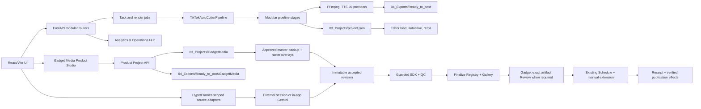

# OmniCut Pro Studio Architecture

เอกสารนี้อธิบายโครงสร้างสถาปัตยกรรมที่ใช้งานจริง ณ วันที่ 2026-10-11 (ปรับปรุงล่าสุด) หากสถานะงานหรือผลทดสอบต่างจากเอกสารนี้ ให้ยึด [TODO.md](TODO.md) และโค้ดปัจจุบันเป็นหลัก

## Multi-channel ownership และ recovery

ดำเนินการโดย: Codex (GPT-6)

- `channel_store` เป็น registry; `channel_scope`, `channel_route_policy` และ `channel_ownership` ตรวจ request กับเจ้าของ record/path ก่อนอ่านหรือเขียน. Media ที่สร้างในโปรเจกต์/export/cover ส่ง `?channel=` เพราะ native video/img/download ไม่ใช้ Axios header; วัตถุดิบและ assets ที่อนุญาตยังเป็น shared references
- Frontend `ChannelProvider` ใช้ runtime revision เพื่อ recover invalid link แม้เลือก main ที่เป็น internal default อยู่แล้ว. Workspace remount ตาม channel; captured request tokens, storage adapters และ project revisions ป้องกัน response/cache/autosave ของช่องเดิมเขียนช่องใหม่. Dirty participants รอ save ที่ค้างและบล็อก switch เมื่อ save ล้มเหลว; แบบร่างที่เก็บ local แยกตามช่อง
- `channel_identity` สร้าง snapshot ของงาน; Global Editor, pipeline, Gadget และ HyperFrames ใช้ snapshot เดียวกัน. การแก้ profile ไม่เปลี่ยนคลิปเก่า; missing secondary snapshot ไม่ fallback เป็นตัวตน main
- `posting_jobs` เป็น durable protocol: job/lease/account fence, fresh platform confirmation และ idempotent receipt repair. Published receipt ซ่อม PostLog/export ได้โดยไม่ publish ซ้ำ. การแก้ current angle ต้องผ่าน compare-and-set ใน transaction ของ ProductStore; competing export ที่ลำดับกำกวมคง angle เดิมไว้. Companion moves ใช้ exact export basename; receipt ไม่ autoarchive mutable project ที่ไม่มี frozen ownership
- Migration fingerprint ครอบคลุม nested manifests และทุกตาราง SQLite พร้อม intent; rollback ปฏิเสธเมื่อมีข้อมูลใหม่. Backup ใช้ consistent SQLite backup และตรวจ checksum/path ก่อน restore; restore ลง root ใหม่ที่ว่างนอก active workspace เท่านั้น. ไม่ใช้ in-place restore เป็น workflow UI

สถานะ full gates, AC01–AC17 และ cutover ของบัญชี TikTok อยู่ใน [รายงาน audit](_Docs/Reports/CODEX_GEMINI_MULTI_CHANNEL_AUDIT_20261011.md); metadata binding ไม่แทนการตรวจบัญชีใน browser จริง

## ภาพรวมระบบ

### HyperFrames integrated workflow

ดำเนินการโดย: Codex (GPT-6) + delegated agents (Codex GPT-6)

`api_hyperframes_workflow` เชื่อม `hyperframes_project` → fenced `hyperframes_authoring` → immutable revisions → `hyperframes_render` → recoverable `hyperframes_finalize` โดยทุกขั้นผูก channel/source revision และ saved source facts. `hyperframes_sources` รองรับ product/Angle, standalone และ actual Gadget project/optional campaign slot โดยไม่สร้าง ProductStore parents ปลอม. Trusted SDK worker ที่ `tools/hyperframes_render_worker.mjs` ติดตั้ง request guard ก่อนรัน composition; runtime dependencies ตรึงด้วย scoped package lock. QC-ready ไม่เท่ากับ export ที่ผู้ใช้ยืนยัน และ scheduling receipt ไม่เท่ากับ actual publication

Finalize เก็บ export ใน Ready_to_post แยกช่อง ลง Registry/canonical manifest/Angle แล้ว Gallery อ่าน frozen publish package ของ export นั้น ส่งต่อ Schedule และ extension เดิม; `publication_observations`/`publication_effects` บันทึกการเผยแพร่จริงแบบ idempotent จาก original receipt. ActivityCenter เป็น read-only projection ของ durable HF jobs. Startup recovery ไม่สร้างตารางตอน import และไม่เริ่มโพสต์เอง

`hyperframes_ai_provider`/`api_hyperframes_ai` ใช้ Gemini configuration เดิม พร้อม explicit start/cancel, lease/heartbeat/fence, limits และ startup recovery ที่ไม่เริ่ม paid request เอง. `hyperframes_overlay`/`api_hyperframes_overlay` สำรอง approved master แบบ immutable แล้วสร้าง raster overlays ที่ล็อกภาพ/เสียง/ความยาวและ hash ผ่าน worker guard; ยังคง manual revision acceptance/QC/Review

`hyperframes_publish_readiness` บังคับ exact export bytes และ Gadget approved artifact ก่อนคิว/prepare. `hyperframes_publication` ทำงานใน durable publication effect phase เดิม บันทึก artifact เดิมและ campaign slot ที่ยังตรง frozen identity เท่านั้น; master ใหม่ไม่รับผลโพสต์ของคลิปเก่า. Gadget repository ใช้ shared RLock ครอบ read-modify-write เพื่อรักษา artifact/publication history

Backup รวม sealed dependencies และ referenced review artifacts พร้อม hash; finalized previews ใช้ canonical export ที่ตรวจ hash. HF7 เพิ่ม source/AI/approved-master overlays แล้ว ดู [คู่มือ](_Docs/HYPERFRAMES_WORKFLOW_GUIDE.md), [แผนหลัก](_Docs/Plans/PLAN_HYPERFRAMES_INTEGRATED_FLOW_20261011.md) และ [แผน HF7](_Docs/Plans/PLAN_HYPERFRAMES_HF7_20261012.md)

ค่ามาตรฐานของไฟล์โพสต์จริงคือ 1080x1920 (9:16), H.264, AAC, 30 FPS และ `+faststart` ส่วน Draft ใช้ 720x1280 เพื่อทดสอบเร็วขึ้น

## เมนูและการนำทางฝั่ง Frontend (9 รายการ: เมนู 0-8)

ระบบมี 9 เมนูหลักใน `frontend/src/components/Sidebar.jsx` ตั้งแต่ `producer` ถึง `guide` เมนู `creative` และ `gadget` ถูกถอดตามคำสั่งผู้ใช้ 2026-10-12/13; saved tab และ navigation เก่าจะกลับไป Tracker:

0. **คลังไอเดีย (`producer/ProducerHub.jsx` + `producer/QuickRefPage.jsx`):** เก็บ Idea & Ref Vault เท่านั้น: จดไอเดีย แนบลิงก์/ภาพ ปักหมุด แก้ไข คัดลอก และใช้ AI กับเรฟตามคำสั่งผู้ใช้ ข้อมูลแยกช่องและซิงก์ผ่าน `scripts/api_producer.py` ส่วน greeting/quota/mission/queue/retrospective/targets ถูกถอดจากหน้านี้ 2026-10-13
1. **1. สินค้า → คลิป (`ProductToClip.jsx`):** วิเคราะห์สินค้าด้วย AI (ลิงก์/สเปก/รูป) สร้าง Content Matrix 4-10 สคริปต์ พร้อมระบุ TikTok Product ID / ลิงก์ปักตะกร้า และสไตล์การตัดต่อ 10 แบบที่ผูกกับ Hook Style 1-to-1
2. **2. แทร็กเกอร์ 4 เฟส (`ContentTrackerHub.jsx`):** จัดการสเตจงาน 4 ขั้น (สคริปต์พร้อม, เลือกคลิป, กำลังตัดต่อ, ตัดต่อเสร็จ) พร้อม Shot List Modal และ Mobile Filming Page
3. **3. ตัดต่อ & สร้างคลิป (`editor/EditorShell.jsx`):** สตูดิโอตัดต่อไทม์ไลน์ Multi-track, SequencePlayer (Canvas 2D), Inspector ปรับแต่ง Overlay/Motion/Subtitles
4. **4. Export Gallery (`ExportGallery.jsx`):** คลังวิดีโอสำเร็จรูป, พรีวิว, Post Studio (สร้างปก 3:4/9:16, reveal file ใน Explorer, คัดลอกแคปชั่น, ส่งต่อ TikTok Auto-post, มาร์คว่าโพสต์แล้ว)
5. **5. Media Assets Hub (`MediaAssetsHub.jsx`):** ศูนย์รวมฟอนต์, BGM, SFX, สติกเกอร์/ป้ายกำกับ, และ Color LUTs
6. **6. สถิติ & วิเคราะห์รวม (`analytics/AnalyticsHub.jsx`):** แดชบอร์ดวิเคราะห์ 5 แท็บ (`analytics/tabs/`) — Production (Funnel 4 เฟส), Performance (ผลงาน TikTok + คลิปปัง), Tokens, Storage (รวม Safe Cache Cleaner) และ Inventory — ด้วย Pure SVG Glassmorphic Charts (AreaLine, Donut, Funnel, ProgressRing)
7. **7. ตั้งค่าระบบ (`SystemSettings.jsx`):** ตรวจสอบ System Health, AI Providers, เสียงพากย์ Edge-TTS/Gemini, และการเชื่อมต่อมือถือผ่าน QR Code
8. **8. คู่มือใช้งาน (`UserGuide.jsx`):** Interactive Knowledge Base สำหรับผู้ใช้ (Sticky TOC, เช็กลิสต์ติ๊กได้พร้อมความจำ localStorage, การ์ดเมนู 0-7, โฟลว์ 7 ขั้นกดเปิดเมนูได้, Quick Action ปุ่มลัดแก้ปัญหา, FAQ ค้นหาได้)

Gadget Media UI (`GadgetMediaHub.jsx` / Product Studio / Campaign และ Analytics) ถูกถอดจากเมนูและ App route แล้ว แต่ backend models/repository/API, approved master และ storage เดิมยังอยู่ การถอดเมนูไม่ได้ย้ายสถานะหรือข้อมูล Gadget เข้า Tracker อัตโนมัติ

## Backend (FastAPI 26 Routers)

Entry point คือ `scripts/api_server.py` ทำหน้าที่สร้าง FastAPI app, ตรวจสอบ API Key security, ตั้ง CORS, และ mount router โดเมนต่างๆ รวม 208 routes (ตรวจสอบจริงผ่าน `len(app.routes)` = 208 โดยเป็น HTTP API route 204 รายการ ที่เหลือเป็น docs/openapi):

| ลำดับ | โมดูล Router | หน้าที่หลัก |
| :--- | :--- | :--- |
| 1 | `scripts/api_phase1.py` | Project lifecycle, AI script generator, partial reroll |
| 2 | `scripts/api_editor.py` | Timeline manifest load/save, filmstrip thumbnails |
| 3 | `scripts/api_tokens.py` | Token ledger, usage breakdown, daily aggregates |
| 4 | `scripts/api_voice.py` | Edge-TTS / Gemini TTS voice synthesize & audio preview |
| 5 | `scripts/api_videos.py` | Raw video library, upload multipart, file reveal |
| 6 | `scripts/api_covers.py` | Post Studio Cover generation (3:4, 9:16 jpg export) |
| 7 | `scripts/api_tiktok_autopost.py` | TikTok auto-post extension bridge & upload queue |
| 8 | `scripts/api_schedule_queue.py` | Schedule agenda & auto-queue slots |
| 9 | `scripts/api_products.py` | Product queue, scraping, TikTok Product ID extraction/resolution |
| 10 | `scripts/api_exports.py` | Export gallery scan, mark posted, media info probe |
| 11 | `scripts/api_tasks.py` | Background async tasks & progress tracking |
| 12 | `scripts/api_render.py` | Full video assembly, render jobs, queue runner |
| 13 | `scripts/api_posts.py` | Post log, publication tracker, performance metrics |
| 14 | `scripts/api_shot_lists.py` | Shot List builder & filming task assignment |
| 15 | `scripts/api_recording.py` | Mobile filming stream & upload ingest |
| 16 | `scripts/api_analytics.py` | Aggregated metrics 5 แท็บ สำหรับ Analytics Hub |
| 17 | `scripts/api_tiktok_stats.py` | ซิงก์สถิติ TikTok Studio, จับคู่โพสต์ manual และ milestone คลิปปัง |
| 18 | `scripts/api_backup.py` | One-click system backup & restore (รวม WAL snapshot) |
| 19 | `scripts/api_asset_dedup.py` | สแกนและล้างไฟล์สื่อซ้ำอย่างปลอดภัย |
| 20 | `scripts/api_hooks.py` | Hook Header และ Hook Variation / A-B generator |
| 21 | `scripts/api_batch_render.py` | เรนเดอร์หลายคลิปพร้อมกันผ่าน `BatchRenderManager` |
| 22 | `scripts/api_producer.py` | AI Producer Hub — notes, missions และ vision insights |
| 23 | `scripts/api_background_isolation.py` | ตัดพื้นหลัง/แยกตัวแบบ async พร้อมกู้งานค้างตอน startup |
| 24 | `scripts/api_gadget_media.py` | Campaign, Content Slot, rights readiness และ analytics ของ Gadget Media |
| 25 | `scripts/api_gadget_media_projects.py` | Product Library/Workspace, source probe, scoped timeline, Gemini TTS, quality gate, render และ Approved Master |
| 26 | `scripts/api_typesafe_studio.py` | TypeSafe System One (Jev) — Hook ranking/Retention Score และ Smart B-roll matcher |

การเปลี่ยน route, method, request หรือ response ต้องตรวจสอบความเข้ากันได้กับ `frontend/src/api.js` เสมอ

## Pipeline การเรนเดอร์

`scripts/pipeline.py` เป็น orchestrator ภายนอก ส่วน state ระหว่าง stage อยู่ใน `scripts/pipeline_context.py`

Cutout รุ่นใหม่ใช้ `scripts/background_isolation_video_worker.py` ถอดเฉพาะช่วงต้นฉบับผ่าน FFmpeg pipe แล้วส่งผล rembg เข้า `cutout.webm` (VP9 alpha) พร้อม manifest รุ่น 2 ใน `03_Projects/.cache/background-isolation-videos/`. `api_background_isolation.py` ให้ข้อมูล manifest และวิดีโอแบบ Range; `SequencePlayer.jsx` วาดเฟรมวิดีโอโปร่งใสบน Canvas หลัง `requestVideoFrameCallback`; `video_editor.py` ถอดด้วย `libvpx-vp9` เพื่อรักษา alpha ระหว่าง Render. Artifact PNG รุ่นเดิมยังอ่านได้เฉพาะโปรเจกต์เก่า.

ลำดับหลัก (8 Stages):

1. `SourceResolutionStage` ตรวจและเตรียมวิดีโอ/รูปต้นทางจาก `01_Raw/`
2. `ScriptStage` สร้างหรือใช้สคริปต์ที่กำหนด พร้อมระบบทำความสะอาดคำห้าม/วรรณยุกต์
3. `VoiceStage` สร้างเสียงพากย์ (ค่าเริ่มต้น Gemini Flash TTS + preset Fenrir ชายสตรองพรีเมียม, เลือก Edge-TTS +15% ได้เอง) และ timing alignment
4. `SubtitleStage` สร้าง cues, overlays, kinetic highlight และไฟล์ ASS
5. `AudioMixStage` รวม Voice, BGM, SFX และ clip audio ตามระดับสัดส่วนมาตรฐาน
6. `ShotMatchingStage` จับคู่ภาพกับบทด้วย AI เมื่อเปิดใช้
7. `VideoAssemblyStage` ประกอบและ export ผ่าน FFmpeg 1080x1920 30FPS H.264
8. `ProjectManifest` บันทึก state และ artifact paths แบบ atomic/versioned (`03_Projects/project.json`)

Reroll ใช้ stage เดียวกับ Full Render ผ่าน `resume_from` จึงต้องรักษา `ProjectManifest.should_run()` และ artifact reuse contract ห้ามสร้าง branch ประมวลผลสำรองอีกชุด

จังหวะตัดและกริดเฟรม (EDITOR-CUT-QUALITY-R2, 2026-10-04):
- **จังหวะตัดรายสไตล์** — `ShotMatchingStage` อ่าน `min_shot`/`max_shot`/`j_lead`/`beat_snap_tolerance` จาก `StyleMotionPolicy` (`scripts/style_motion_policy.py`); จุดตัดแรก = `0.0`, snap ตามลำดับ beat > motion > voice-valley > rhythm, ค้างภาพจนจบประโยคเมื่อถึงภายใน `max_shot` (ตารางค่าอยู่ใน `_Docs/GADGET_VIDEO_PRODUCTION_SOP.md` Phase 5, วัดผลจริงใน `.agents/rules/j_cut_rules.md` §6)
- **กริดเฟรมเดียวกันทั้งสองฝั่ง** — จุดตัดสะสมที่ 1/30 s (`boundary_k = round(cumsum_k × 30) / 30`, เฟรมรวม = `round(total × 30)`) ใน `video_editor.py plan_sequence_frames` และ `timelineMath.js buildSegments`/`planSequenceFrames`; transition วางกึ่งกลางจุดตัด
- **สัญญา easing** — camera keyframe มี `easing` ต่อจุด (ไม่มี = linear), transition มี `transition_easing` เฉพาะ fade/wipe/slide, ข้อความใช้ accel 0.6/2.2 ตาม `motion_contract.py` / `motionPresets.js`, สติกเกอร์/effect เข้า 7 เฟรม ออก 6 เฟรม (`overlay_anim_*` ↔ `stickerAnimation.js`) — ทั้งหมดผูกกับเทส parity ตามตารางใน `.agents/rules/preview_render_parity.md` §4
- **ขีดจำกัดที่ยังค้าง** — เรนเดอร์ 100 คลิปเกินคำสั่ง Windows 32,767 ตัวอักษร (45,389; แก้ด้วย `-filter_complex_script`) · ripple ข้าม cue/overlay ยังไม่ทำ เพราะเสียงพากย์เป็น TTS stem เดียว (ขยับ cue โดยไม่ตัดเสียงจะเพี้ยน)

Viral retention layer (CLAUDE-AI-EDITOR-VIRAL-S1, 2026-10-31) · ดำเนินการโดย: Claude Code (Claude Opus 5.5):
- **Compliance gate** — `scripts/compliance_lint.py` ตรวจราคา/claim เกินจริง/filler opener/CTA บรรทัดแรก กับสคริปต์ AI, hook variants, callout และ template; AI ถูก regen 1 ครั้งแล้ว strip บรรทัดที่ผิด; `check_script_structure()` เตือนโครง open loop/payoff/คำถามท้ายคลิป (ไม่ block)
- **Pacing** — `StyleMotionPolicy` เพิ่ม `hook_window_sec`/`hook_max_shot`/`max_static_sec`; ช็อตยาวไม่เกิน `max_shot × 1.25` (split ภายใน topic เดิม), freeze hold > 1 วิ ใช้ฟุตเทจข้างเคียง (`hold_reason`), ช่วงนิ่งเกิน `max_static_sec` ได้ camera punch ใน keyframe รูปแบบเดิม; Gemini match มี `confidence` และ shot planning ที่พังจะ raise `SHOT_PLANNING_FAILED`
- **เสียง/ซับ** — `sfx_manager.plan_sfx_events()` (gap 2.0 วิ, opener/closer มาก่อน) ↔ `frontend/src/lib/sfxPlan.js`; ไฮไลต์ลำดับ marker → custom keyword → ตัวเลขสเปก → dictionary ↔ `frontend/src/lib/kineticHighlight.js` (fixture ร่วม `tests/fixtures/sfx_highlight_parity_cases.json`); `bgm_ducking` ค่าเริ่มต้น True
- **ข้อมูลวัดผล** — export registry/PostLog เก็บ `style_preset`/`hook_style`/`story_format`/`duration_sec`/`hook_text`; PostLog metrics รับ `avg_watch_time_sec`/`completion_rate`; `GET /api/tiktok-stats/style-performance` สรุปตามสไตล์จาก mature metrics (≥48 ชม.)
- **Batch / render slots** — `render_jobs` ใช้ pool FIFO ขนาด `RENDER_MAX_CONCURRENT` (4, `OMNICUT_RENDER_CONCURRENCY` ปรับ 1–4); `batch_render` ให้แต่ละ item ขอ slot เอง + `is_valid_mp4` resume; render โปรเจกต์เดียวกันซ้อนกันไม่ได้ (per-project lock); NVENC ของ `tiktok_enhancer` จำกัดด้วย semaphore แล้วถอยไป libx264 เมื่อเปิด session ไม่ได้

Viral retention layer S2 (CLAUDE-AI-EDITOR-VIRAL-S2, 2026-10-31):
- **Hook บนจอ** — `scripts/hook_line.py` สร้างบรรทัด hook (≤ 22 ตัวอักษร ตัดที่ขอบคำไทย ผ่าน compliance lint) เป็น text overlay `role:"hook_line"` 0–1.8 วิ ใช้ฟอนต์/สีของ hook template; nameplate 3 ชั้นเริ่ม 1.8 วิ ค้าง 3.0 วิ (`HOOK_NAMEPLATE_DEFAULT_SEC`); ทำเฉพาะ subtitle pass แรกของโปรเจกต์
- **ซับ** — `MICRO_BURST_MAX_CHARS = 24`; ซับอังกฤษที่จำนวนท่อนไม่ตรงจะแปลใหม่รายท่อนจากไทย
- **Style presets** — 10 preset ต่างกันจริง (เทส `test_style_distinctness.py` ระยะห่างทุกคู่ ≥ 0.90); `camera_easing` ต่อ preset; family `compare`; preview เล่นตาม manifest จึง parity โดยโครงสร้าง
- **Viral Lint** — `scripts/viral_lint.py` (pure) + `POST /api/viral-lint`; compliance = block, อื่น ๆ = warn/info; `RenderPreflightNotice` + heatmap บน `TimelineRuler`
- **Word timing** — `scripts/word_alignment.py` align เสียง Gemini TTS ด้วย faster-whisper → `word_timings` (เปิดใช้ editorial pacing + SpecBar ตรงตอนพูดตัวเลข); ล้มเหลวคือข้ามพร้อมคำเตือน ไม่ทำให้เรนเดอร์พัง; ปิดด้วย `OMNICUT_WORD_ALIGN=0`
- **Pipeline fields** — `target_duration` / `story_format` อยู่ใน PipelineContext, render params, manifest; `AudioMixStage.sync_cut_bound_sfx` mix ใหม่หลัง shot matching เมื่อจุดตัดจริงเปลี่ยนว่า SFX ตัวไหนถูกเก็บ; preview ส่ง `clipCutTimes(segments)` เข้า `planSfxEvents` ให้ตรงกัน

## Editor State & Save Queue

`frontend/src/components/editor/EditorShell.jsx` เป็น composition shell งาน state และคำสั่งสำคัญแยกออกเป็นโมดูลเฉพาะทาง:

| หน้าที่ | โมดูล |
| :--- | :--- |
| Manifest → Editor state / Save payload | `frontend/src/lib/editorProjectState.js` |
| Autosave, flush, page unload | `frontend/src/hooks/useProjectAutosave.js` |
| Latest-save-wins queue | `frontend/src/lib/projectSaveQueue.js` |
| Project loading and stale response guard | `frontend/src/hooks/useProjectLoader.js` |
| Render polling/resume/cleanup | `frontend/src/hooks/useRenderJob.js` |
| Undo/redo | `frontend/src/hooks/useEditorHistory.js` |
| Clip/caption/overlay commands | `frontend/src/hooks/useEditorCommands.js` |
| Selection and shortcuts | `useEditorSelection.js`, `useEditorShortcuts.js` |

Manual Save และ Autosave ต้องเรียก serializer เดียวกัน ห้ามประกอบ payload ซ้ำใน component การสลับโปรเจกต์ต้อง flush pending save ก่อน และ response เก่าต้องไม่เปลี่ยน state ของโปรเจกต์ใหม่

## Timeline และ Keyframes

`frontend/src/lib/timelineSchema.js` กำหนด Timeline Document v2 พร้อม in-memory migration จาก manifest รุ่นเก่า โดยยังไม่เขียนทับไฟล์เก่าจนผู้ใช้บันทึก

- `timelineMath.js` จัดการเวลา, trim, split, transition, magnetic snap และ ripple math
- `useEditorShortcuts.js` ควบคุมคีย์ลัดด่วน (Spacebar, S ตัดคลิป, N สลับ Snap, M สลับโหมด Cutout Mask, J/K/L, Ctrl+Z/Y, Ctrl+S) และชุดตัดต่อแบบ CapCut: Q/W ตัดหัว/ท้ายคลิปถึง playhead, ↑/↓ ไปจุดตัดก่อนหน้า/ถัดไป, Home/End, Ctrl/Cmd+คลิกสลับเลือก · Shift+คลิกเลือกช่วง · Esc ล้างการเลือก (multi-select; Delete ลบทั้งหมดใน undo ก้าวเดียว), Ctrl+Alt+C / Ctrl+Alt+V คัดลอก-วางค่าคลิป (+ เมนูคลิกขวา) — ↑/↓ ไม่ย้ายลำดับคลิปแล้ว ใช้ `[` และ `]` แทน
- Timeline UX เพิ่มเติม: แสดงเฟรมขอบขณะลาก trim handle, scrub snap (กด Shift เพื่อข้าม), handle trim ตอน hover, filmstrip บนคลิป (โหลดแบบ lazy), ซูมต่อเนื่องยึดตำแหน่งเคอร์เซอร์ (preset 10–800 px/s)
- `SequencePlayer.jsx` เรนเดอร์ Canvas 2D พร้อม Smart Center Crosshair Guides (`🎯 กึ่งกลางจอ 50%`) และ Cutout Mask Inspection 3 โหมด (ปกติ / หมากรุก / ขาวดำ)
- `timelineTrackModel.js` จัดการ track layout และ audio/video/overlay track state
- `keyframeModel.js` และ `scripts/keyframe_engine.py` ต้องรักษาสูตร interpolation ให้ตรงกัน
- `Timeline.jsx` ประกอบ ruler, lanes, playhead และ context menu จาก component ย่อยใน `editor/timeline/`

## Preview และ Render Parity (กฎเหล็ก)

ภาพเดียวกันมีสอง implementation คู่ขนานที่ต้องให้ภาพตรงกัน 100%:

- **Preview:** Canvas 2D ใน `frontend/src/components/SequencePlayer.jsx`
- **Render:** ASS/libass ใน `scripts/subtitle_engine.py` และโมดูลใต้ `scripts/subtitle/`

Overlay model มี mirrored pair คือ `frontend/src/lib/overlayModel.js` และ `scripts/overlay_model.py` การแก้ geometry, font, color, alpha, outline, motion, wrapping หรือ timing ต้องแก้ทั้งคู่และทำตาม [.agents/rules/preview_render_parity.md](.agents/rules/preview_render_parity.md)

Subtitle modules ปัจจุบัน:

- `subtitle/font_metrics.py` วัด glyph advance และ font mapping
- `subtitle/translation_service.py` แปลและ wrap ข้อความ
- `subtitle/motion_effects.py` สร้าง ASS motion/keyframes
- `subtitle/overlay_events.py` สร้าง event สำหรับ hook/text overlays
- `subtitle/badge_plate_renderer.py` สร้าง plate/badge drawing
- `subtitle/word_layout.py` คำนวณ per-word coordinate layout

## ข้อมูลบนดิสก์

- `00_Inbox/` ไฟล์ดิบ ไอเดีย สคริปต์ย่อ และไฟล์วิดีโอที่ sync จากมือถือ
- `01_Raw/` วัตถุดิบต้นฉบับแยกตามโฟลเดอร์ ห้ามลบหรือเขียนทับโดยไม่ได้รับอนุญาต
- `02_Assets/` Media Assets ส่วนกลาง (Fonts, Music, SFX, Stickers, LUTs)
- `03_Projects/<project>/project.json` คือ manifest หลัก ใช้ atomic temp-file replace
- `04_Exports/Ready_to_post/` เก็บไฟล์ export จริง และ `04_Exports/Posted/` เก็บไฟล์ที่โพสต์แล้ว
- `05_Covers_Thumbnails/` เก็บปกคลิป 3:4 และ 9:16 ที่สร้างจาก Cover Studio
- `06_Archive/` พื้นที่จัดเก็บไฟล์เก่าสำรอง
- `_Docs/post_log.json` และ `_Docs/products.json` เป็น runtime data ของระบบ
- Gadget Media แยก ownership เป็น `01_Raw/GadgetMedia/`, `03_Projects/GadgetMedia/`, `04_Exports/Ready_to_post/GadgetMedia/`, `05_Covers_Thumbnails/GadgetMedia/` และ `_Docs/gadget_media/`
- `scripts/gadget_media_timeline_adapter.py` แปลง Story/EDL เป็น Timeline Document v2 ที่มี `workspace_scope=gadget_media`; ใช้ math/preview/render engine ร่วม แต่ไม่ใช้ manifest หรือ status ของ Global Editor

## สถานะการทดสอบปัจจุบัน (Verification Gates) — วัดจริง 2026-09-24

- **Python Scripts Compilation:** ผ่าน 100% (`python -m compileall -q scripts`)
- **FastAPI Endpoints:** 208 routes รวม 26 modular domain routers
- **Python Pytest Suite:** 1,807 tests collected (`pytest tests/` มี testpaths = tests ไม่กวาดชน tools/)
- **Frontend Suite:** 312 tests passed, 0 failures (`npm test` → `node --test src/lib/*.test.js`)
- **Vite Production Build:** ผ่านเรียบร้อย 2,026 modules transformed
