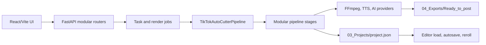

# OmniCut Pro Studio Architecture

เอกสารนี้อธิบายโครงสร้างที่ใช้งานจริงหลัง modular refactor commit `32198d0` ณ วันที่ 2026-09-05 หากสถานะงานหรือผลทดสอบต่างจากเอกสารนี้ ให้ยึด [TODO.md](TODO.md) และโค้ดปัจจุบันเป็นหลัก

## ภาพรวมระบบ

ค่ามาตรฐานของไฟล์โพสต์จริงคือ 1080x1920, H.264, AAC, 30 FPS และ `+faststart` ส่วน Draft ใช้ 720x1280 เพื่อทดสอบเร็วขึ้น

## Backend

Entry point คือ `scripts/api_server.py` ทำหน้าที่สร้าง FastAPI app, ตั้ง CORS และ mount router เท่านั้น ปัจจุบันมี 76 routes รวมหน้า OpenAPI

| กลุ่ม | โมดูล |
| :--- | :--- |
| Project, AI bridge, reroll | `scripts/api_phase1.py` |
| Editor filmstrip | `scripts/api_editor.py` |
| Video library, upload, media | `scripts/api_videos.py` |
| Product flow | `scripts/api_products.py` |
| Export gallery | `scripts/api_exports.py` |
| Voice and TTS preview | `scripts/api_voice.py` |
| Background tasks | `scripts/api_tasks.py` |
| Full render | `scripts/api_render.py` |
| Post log and metrics | `scripts/api_posts.py` |
| Token usage | `scripts/api_tokens.py` |
| Shared request schemas | `scripts/api_schemas.py` |
| Path checks and metadata | `scripts/media_service.py` |

การเปลี่ยน route, method, request หรือ response ต้องอัปเดต `tests/test_backend_api_contracts.py` และ route inventory ใน `tests/test_refactor_baseline_contracts.py`

## Pipeline

`scripts/pipeline.py` เป็น orchestrator ภายนอก ส่วน state ระหว่าง stage อยู่ใน `scripts/pipeline_context.py`

ลำดับหลัก:

1. `SourceResolutionStage` ตรวจและเตรียมวิดีโอ/รูปต้นทาง
2. `ScriptStage` สร้างหรือใช้สคริปต์ที่กำหนด
3. `VoiceStage` สร้างเสียงพากย์และ timing
4. `SubtitleStage` สร้าง cues, overlays และ ASS
5. `AudioMixStage` รวม Voice, BGM, SFX และ clip audio
6. `ShotMatchingStage` จับคู่ภาพกับบทด้วย AI เมื่อเปิดใช้
7. `VideoAssemblyStage` ประกอบและ export ผ่าน FFmpeg
8. `ProjectManifest` บันทึก state และ artifact paths แบบ atomic/versioned

Reroll ใช้ stage เดียวกับ Full Render ผ่าน `resume_from` จึงต้องรักษา `ProjectManifest.should_run()` และ artifact reuse contract ห้ามสร้าง branch ประมวลผลสำรองอีกชุด

## Editor state

`frontend/src/components/editor/EditorShell.jsx` เป็น composition shell งาน state และคำสั่งสำคัญแยกออกแล้ว:

| หน้าที่ | โมดูล |
| :--- | :--- |
| Manifest → Editor state / Save payload | `frontend/src/lib/editorProjectState.js` |
| Autosave, flush, page unload | `frontend/src/hooks/useProjectAutosave.js` |
| Latest-save-wins queue | `frontend/src/lib/projectSaveQueue.js` |
| Project loading and stale response guard | `frontend/src/hooks/useProjectLoader.js` |
| Render polling/resume/cleanup | `frontend/src/hooks/useRenderJob.js` |
| Undo/redo | `frontend/src/hooks/useEditorHistory.js` |
| Clip/caption/overlay commands | `frontend/src/hooks/useEditorCommands.js` |
| Selection and shortcuts | `useEditorSelection.js`, `useEditorShortcuts.js` |

Manual Save และ Autosave ต้องเรียก serializer เดียวกัน ห้ามประกอบ payload ซ้ำใน component การสลับโปรเจกต์ต้อง flush pending save ก่อน และ response เก่าต้องไม่เปลี่ยน state ของโปรเจกต์ใหม่

## Timeline และ keyframes

`frontend/src/lib/timelineSchema.js` กำหนด Timeline Document v2 พร้อม in-memory migration จาก manifest รุ่นเก่า โดยยังไม่เขียนทับไฟล์เก่าจนผู้ใช้บันทึก

- `timelineMath.js` เป็นเวลา, trim, split, transition, snap และ ripple math
- `timelineTrackModel.js` เป็น track layout และ audio/video/overlay track state
- `keyframeModel.js` และ `scripts/keyframe_engine.py` ต้องรักษาสูตร interpolation ให้ตรงกัน
- `Timeline.jsx` ประกอบ ruler, lanes, playhead และ context menu จาก component ย่อยใน `editor/timeline/`

## Preview และ render

ภาพเดียวกันมีสอง implementation:

- Preview: Canvas 2D ใน `frontend/src/components/SequencePlayer.jsx`
- Render: ASS/libass ใน `scripts/subtitle_engine.py` และโมดูลใต้ `scripts/subtitle/`

Overlay model มี mirrored pair คือ `frontend/src/lib/overlayModel.js` และ `scripts/overlay_model.py` การแก้ geometry, font, color, alpha, outline, motion, wrapping หรือ timing ต้องแก้ทั้งคู่และทำตาม `.agents/rules/preview_render_parity.md`

Subtitle modules ปัจจุบัน:

- `subtitle/font_metrics.py` วัด glyph advance และ font mapping
- `subtitle/translation_service.py` แปลและ wrap ข้อความ
- `subtitle/motion_effects.py` สร้าง ASS motion/keyframes
- `subtitle/overlay_events.py` สร้าง event สำหรับ hook/text overlays
- `subtitle/badge_plate_renderer.py` สร้าง plate/badge drawing

## ข้อมูลบนดิสก์

- `01_Raw/` และ `02_Assets/` คือข้อมูลต้นฉบับ ห้ามลบหรือเขียนทับโดยไม่ได้รับอนุญาต
- `03_Projects/<project>/project.json` คือ manifest หลัก ใช้ atomic temp-file replace
- `04_Exports/Ready_to_post/` เก็บไฟล์ export จริง
- `_Docs/post_log.json` เป็น runtime data และมักเปลี่ยนระหว่างใช้งาน อย่ารวมกับ refactor โดยไม่ตรวจ

## จุดเริ่มสำหรับ Agent รอบถัดไป

1. อ่าน `AGENTS.md`, `TODO.md` และ `.agents/rules/work_loop.md`
2. ตรวจ `git status` ก่อนแก้ เพราะ Round 3 subtitle/writer/easing ยังอยู่ใน Working Tree และยังไม่ commit
3. อ่านกฎเฉพาะงาน โดยเฉพาะ preview/render parity และ testing standard
4. เขียนแผนรอบใหม่ลง `TODO.md`
5. รัน gate ตามประเภทงานและบันทึกตัวเลขจริง

สถานะตรวจล่าสุด: Python compile ผ่าน, FastAPI 76 routes, Python 336 tests ผ่านพร้อม warning เดิม 5 รายการ, Frontend 51 tests ผ่าน และ Vite production build ผ่าน 1,953 modules
