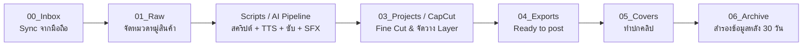

# 🎬 OmniCut Pro Studio — AI Video Production Suite (CapCut Automation Pipeline)

[](https://www.python.org/)
[](https://fastapi.tiangolo.com/)
[](https://vitejs.dev/)
[](https://ffmpeg.org/)
[](https://www.capcut.com/)

ระบบอัตโนมัติสำหรับสร้างและตัดต่อวิดีโอสั้นแนวตั้ง **9:16 (1080x1920, 30 FPS)** สำหรับ TikTok, YouTube Shorts และ Reels ครอบคลุมข้อมูลสินค้า, AI draft, เสียงพากย์, ซับไทย/อังกฤษ, BGM/SFX, Editor แบบ multi-track, keyframes, partial reroll และไฟล์ H.264/AAC พร้อมโพสต์ โดยยังส่งต่อไป CapCut PC ได้เมื่อจำเป็น

เริ่มทำงานกับโค้ดให้อ่าน [AGENTS.md](AGENTS.md), [TODO.md](TODO.md) และ [ARCHITECTURE.md](ARCHITECTURE.md) ก่อน สถานะใน `TODO.md` ใหม่กว่าเอกสารสรุปอื่นเสมอ

---

## 🚀 ฟีเจอร์หลัก (Core Features)

- 🛍️ **Product Scraper & Store:** สกัดข้อมูลสินค้า จุดขาย ราคา โปรโมชั่นจาก Marketplace / URL เพื่อนำมาเขียน Hook & CTA
- ✍️ **AI Script Generator:** สร้างบทพูดรีวิว/ขายสินค้าที่กระชับ ตรงกลุ่มเป้าหมาย มี Hook 3 วินาทีแรก และ CTA ปิดท้าย
- 🎙️ **Multi-Engine TTS:** 
  - **Edge-TTS:** รองรับเสียงภาษาไทยคุณภาพสูง (`th-TH-PremwadeeNeural`, `th-TH-NiwatNeural`) ปรับสปีด +15% สำหรับสไตล์ TikTok
  - **Gemini Flash TTS:** พากย์เสียง AI แบบมีอารมณ์และจังหวะธรรมชาติ
  - **gTTS Fallback:** ระบบสำรองเมื่อออฟไลน์
- 📝 **Thai Subtitle Engine & Auto-Burst:** ตัดแบ่งคำภาษาไทยด้วย `pythainlp` จัดการปัญหาสระลอย/วรรณยุกต์ และสร้างซับไตเติล 2 ภาษา (ไทย-อังกฤษ)
- 🎨 **Universal 3D Badges & Sticker Sheet:** ระบบสร้างป้ายรีวิว 6 แบบมาตรฐาน (Pros, Cons, Warning, Pro Tip, Score, Verdict) ขอบ Die-cut ใช้งานซ้ำได้ทุกคลิป
- 🎵 **Smart SFX & BGM Ducking:** จัดการเสียงเอฟเฟกต์ (Whoosh, Pop, Ding) และปรับระดับเพลงพื้นหลังอัตโนมัติขณะมีเสียงพูด
- 🖥️ **Web UI Control Center:** แดชบอร์ด React + Vite ควบคุมทุกขั้นตอนและพรีวิวงานได้แบบเรียลไทม์
- 🎞️ **Flexible Timeline Editor:** รองรับหลาย Video/Overlay/Audio tracks, trim, split, duplicate, transition, ripple, snap, mute/solo/visibility และ undo/redo
- 💾 **Safe Project State:** Manifest migration, autosave แบบ latest-write-wins, flush ก่อนสลับโปรเจกต์ และ atomic save
- 🔁 **Partial Reroll:** เปลี่ยน Hook, Subtitle, BGM, Voice หรือ Video โดย reuse artifact ของ stage ก่อนหน้า
- 🎚️ **Preview = Render Contracts:** Canvas preview และ ASS/libass renderer ใช้ model/constant ที่ mirror กัน พร้อม source, behavior และ FFmpeg regression tests

---

## 📁 โครงสร้างโฟลเดอร์มาตรฐาน (Directory Structure)

```text
Capcut/
├── 00_Inbox/               # พักไฟล์ดิบ ไอเดีย และไฟล์วิดีโอที่ sync จากมือถือ
├── 01_Raw/                 # วัตถุดิบต้นฉบับ แยกตาม YYYYMMDD_ชื่อสินค้า-ประเด็น/
├── 02_Assets/              # Media Assets ส่วนกลาง
│   ├── Fonts/              # ฟอนต์มาตรฐาน (Kanit, Prompt, etc.)
│   ├── Music/              # เพลงประกอบ BGM (ปลอดลิขสิทธิ์ / Trending)
│   ├── SFX/                # เสียงเอฟเฟกต์ (Whoosh, Ding, Click)
│   ├── Stickers_Memes/     # สติกเกอร์และป้าย Badge PNG โปร่งใส
│   └── LUTs_ColorPresets/  # ค่าพรีเซ็ตสี
├── 03_Projects/            # ไฟล์สคริปต์ ดราฟต์ และบันทึกงานแต่ละโปรเจกต์
├── 04_Exports/             # วิดีโอที่ตัดต่อเสร็จพร้อมเผยแพร่
│   ├── Ready_to_post/      # คลิปที่เรนเดอร์เสร็จ รอการโพสต์
│   └── Posted/             # คลิปที่โพสต์ลงช่องทางแล้ว
├── 05_Covers_Thumbnails/   # รูปหน้าปกคลิปและ Thumbnail สัดส่วน 9:16
├── 06_Archive/             # สำรองข้อมูลไฟล์ Raw และโปรเจกต์เก่าเกิน 30 วัน
├── frontend/               # เว็บแอปพลิเคชัน React + Vite UI
├── scripts/                # FastAPI routers, pipeline stages, TTS, subtitle และ renderer
├── tools/                  # สคริปต์ Utility (Font Downloader, Badge Generator, Asset Builder)
├── tests/                  # Backend, contract, parity, render และ compatibility tests
├── .agents/rules/          # กฎเฉพาะงานสำหรับคนและ AI Agent
├── AGENTS.md               # กฎเหล็กและคู่มือสำหรับ AI Coding Assistants
├── ARCHITECTURE.md         # แผนผังโมดูลและ data flow ปัจจุบัน
├── TODO.md                 # สถานะงานกลางและ handoff ระหว่างรอบ
├── requirements.txt        # รายการ Python dependencies
└── start_app.bat           # สคริปต์คลิกเดียวเพื่อเปิดใช้งาน Backend & Frontend
```

---

## 🔄 ลำดับการทำงาน (Pipeline Workflow)



1. **ต้นน้ำ (Input & Script):**
   - นำไฟล์จากมือถือเข้า `00_Inbox` แล้วจัดเข้า `01_Raw/YYYYMMDD_ชื่อสินค้า-ประเด็น/`
   - ใช้ AI Scraper & Script Generator สร้างโครงเรื่อง Hook/CTA ใน `03_Projects/`
2. **กลางน้ำ (Processing & Assembly):**
   - รันระบบเสียงพากย์ (TTS) + ตัดคำซับไตเติลภาษาไทย + ใส่ SFX และ Sticker
   - เปิดตรวจสอบและปรับแต่งความละเอียดใน **CapCut PC** หรือ Web UI
3. **ปลายน้ำ (Export & Publish):**
   - Export คลิปขนาด 9:16 ลงใน `04_Exports/Ready_to_post/`
   - สร้างปกคลิปใน `05_Covers_Thumbnails/`
   - เมื่อโพสต์เสร็จ ย้ายไป `04_Exports/Posted/` และเก็บเข้า `06_Archive/` เมื่อครบ 30 วัน

---

## 🛠️ ความต้องการของระบบ (Prerequisites)

1. **Python 3.10 ขึ้นไป**
2. **Node.js 20.19+ หรือ 22.12+ & npm** (Vite 8; เครื่องที่ตรวจล่าสุดใช้ Node 24)
3. **FFmpeg & FFprobe:** ต้องติดตั้งและเพิ่มลงใน System `PATH` เรียบร้อยแล้ว (ทดสอบด้วย `ffmpeg -version`)
4. **CapCut for PC (Windows):** แนะนำติดตั้งเพื่อเปิดไฟล์ Draft ได้สะดวก

---

## ⚙️ การติดตั้งและตั้งค่า (Installation & Setup)

### 1. ติดตั้ง Python Dependencies
```bash
python -m venv venv
# สำหรับ Windows
venv\Scripts\activate

pip install -r requirements.txt
```

### 2. ติดตั้ง Frontend Dependencies
```bash
cd frontend
npm install
cd ..
```

### 3. การตั้งค่า Environment Variables (`.env`)
คัดลอกไฟล์ `.env.example` เป็น `.env` และกรอก API Key:
```env
GEMINI_API_KEY=your_gemini_api_key_here
```

---

## 🚀 วิธีการเปิดใช้งาน (Running the Application)

### วิธีที่ 1: รันด้วย One-Click Script (แนะนำบน Windows)
ดับเบิลคลิกที่ไฟล์:
```text
start_app.bat
```
*ระบบจะเปิด FastAPI Backend (Port 8000) และ React Frontend (Port 5173) พร้อมเปิด Browser ให้อัตโนมัติ*

### วิธีที่ 2: รันแยกทีละส่วน (Manual Mode)

**Terminal 1 (Backend API):**
```bash
python scripts/api_server.py
# หรือ uvicorn scripts.api_server:app --host 0.0.0.0 --port 8000 --reload
```
- API Documentation: [http://localhost:8000/docs](http://localhost:8000/docs)

**Terminal 2 (Frontend UI):**
```bash
cd frontend
npm run dev
```
- Web Application: [http://localhost:5173](http://localhost:5173)

---

## 🧪 การตรวจระบบ

```powershell
python -m compileall -q scripts
python -c "import scripts.api_server as app; print(len(app.app.routes))"
python -m pytest tests/ -q -p no:cacheprovider --tb=short
Set-Location frontend
npm test
npm run build
```

ผลตรวจล่าสุด 2026-09-05: Python 336 tests ผ่าน, Frontend 51 tests ผ่าน, FastAPI 76 routes และ Vite build ผ่าน อ่านชนิด test และข้อห้ามที่ [.agents/rules/testing_standard.md](.agents/rules/testing_standard.md)

---

## 🏷️ Naming Conventions

- **Raw Footage Folder:** `YYYYMMDD_ชื่อสินค้า-ประเด็นสั้นๆ`  
  *(ตัวอย่าง: `20260812_ลิปสติกABC-รีวิว`)*
- **Export File:** `YYYYMMDD_ชื่อสินค้า_hookสั้นๆ_vN.mp4`  
  *(ตัวอย่าง: `20260812_ลิปสติกABC_ทาแล้วลื่นมาก_v1.mp4`)*
- **CapCut Draft Name:** ตั้งชื่อตรงกับโฟลเดอร์โปรเจกต์เสมอ เพื่อป้องกันการสับสนเวลาสลับเครื่อง

---

## ✅ Checklist ก่อนโพสต์คลิป (Pre-Publish Checklist)

- [ ] **Hook 3 วินาทีแรก:** ภาพและเสียงสะดุดตา หยุดนิ้วคนดูได้ทันที
- [ ] **Subtitles & Spacing:** ข้อความซับไตเติลภาษาไทยถูกต้อง ไม่มีปัญหาสระลอยหรือวรรณยุกต์ซ้อน
- [ ] **Price & CTA:** ราคา โปรโมชั่น และพิกัดสั่งซื้อขึ้นชัดเจนบนหน้าจอ
- [ ] **Audio Balance:** ตรวจ Voice/SFX/BGM ตามค่าใน `scripts/config.py` และลองฟัง mute/ducking ใน Preview ก่อน Export
- [ ] **Safe Zone 9:16:** ข้อความ/สติกเกอร์ไม่ถูกบังด้วยปุ่ม Like/Comment/Share ของ TikTok
- [ ] **Cover / Thumbnail:** ตัวหนังสือบนหน้าปกอ่านง่าย สีสันดึงดูด

---

## 📄 ใบอนุญาตและการพัฒนา (License & Guidelines)
- กฎหลัก: [AGENTS.md](AGENTS.md)
- สถานะงานและ handoff: [TODO.md](TODO.md)
- โครงสร้างระบบ: [ARCHITECTURE.md](ARCHITECTURE.md)
- กฎทดสอบ: [.agents/rules/testing_standard.md](.agents/rules/testing_standard.md)
