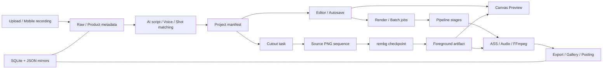

# OmniCut Pro Studio — System Audit 2026-09-15

ดำเนินการโดย: Codex (GPT-6)

รายงานจากรอบ Read-only ก่อนเริ่มแก้ไข บันทึกลงไฟล์ตามคำสั่งผู้ใช้วันที่ 2026-09-15
สถานะการแก้ไขติดตามใน [TODO.md](TODO.md); ผลการปิดแต่ละเฟสอยู่ใน [HISTORY.md](HISTORY.md)
เลขบรรทัดด้านล่างอ้างอิง snapshot ตอน Audit จึงอาจเลื่อนหลังแก้โค้ด

## 1. Executive Summary

ควรแก้ความปลอดภัยของข้อมูลก่อนเพิ่มฟีเจอร์ พบปัญหาที่ทำซ้ำได้ทั้งข้อมูลหาย งานค้าง ผลลัพธ์ผิด และการอ่านไฟล์ลับ

1. JSON mirror ว่างสามารถล้างข้อมูล SQLite ทั้งตาราง
2. Upload ชื่อซ้ำในวินาทีเดียวสามารถเขียนทับไฟล์ก่อนหน้า
3. Media endpoint อ่าน `.env` ได้เมื่อผ่าน auth
4. Batch dispatcher มี idle-exit race ทำให้งาน queued ไม่มี worker
5. Cutout ถูกขัดจังหวะระหว่าง publication อาจ retry ไม่สำเร็จตลอด

| การตรวจ | ผลจริง |
| --- | --- |
| Backend targeted tests | 298 passed / 1 failed / 3 skipped |
| Frontend tests | 232 passed |
| Source parity (รวมในยอด backend) | 21 passed |
| FFmpeg synthetic Draft | 720×1280, 30 FPS ผ่าน |
| Browser | ตรวจหน้า Analytics ที่เปิดอยู่ พบกราฟยอดวิวผิดจริง |
| git diff --check | ผ่าน; มีคำเตือน LF/CRLF |

Python tests ใช้ project `.venv` บนสำเนา scripts/tests/frontend source ใน Temp ที่แยกข้อมูลจริง หลังได้รับอนุญาต
รอบ Audit ไม่แก้โค้ด ไม่ติดตั้ง package ไม่ commit ไม่เปิด Raw/Assets และไม่แก้ CapCut draft

Working tree ตอนเริ่ม: `TODO.md`, `_Docs/post_log.json`, `.tmp/` มีงานค้างเดิม
ระหว่างตรวจมีงานคู่ขนานแก้ `TokenDashboard.jsx`, `AnalyticsHub.jsx`, `AreaLineChart.jsx`, `DonutChart.jsx`, `index.css`, `tailwind.config.js` เพิ่ม
ผล tests เป็นหลักฐานตาม snapshot/เวลาที่รัน ไม่รับรองการแก้คู่ขนานภายหลัง

## 2. System Map

| ส่วน | Source ตอนตรวจ |
| --- | --- |
| Backend routers | `scripts/api_server.py:164` |
| Frontend entry | `frontend/src/main.jsx:1` |
| Lazy modules | `frontend/src/App.jsx:12` |
| Pipeline 7 stages + manifest | `scripts/pipeline.py:45` |
| In-memory render registry / slot limit | `scripts/render_jobs.py:37` |
| Persistent tasks | `scripts/task_manager.py:72` |
| Durable batch queue | `scripts/batch_render.py:38` |
| SQLite document store | `scripts/db.py:181` |

Runtime บนสำเนามี 168 routes และ register 23 routers ขณะที่ `ARCHITECTURE.md:37` ยังระบุ 125 routes / 16 routers
Single points of failure: backend process, SQLite/JSON synchronization, registry ที่ initialize ตอน import และ Batch dispatcher

## 3. Critical Findings

### B01 — Critical / P0: JSON mirror ว่างล้าง SQLite

- Source: `scripts/db.py:280,288` — blank ถูกแปลงเป็น `[]` แล้ว DELETE ทั้งตารางก่อน import
- Reproduce: seed record 1 รายการ → blank mirror พร้อม mtime ใหม่ → load ได้ 0 รายการ
- ผลกระทบ: mirror ที่ถูก truncate/เขียนไม่ครบทำลายฐานข้อมูลหลัก
- แนวแก้: ปฏิเสธ blank/invalid schema, รักษาข้อมูลและหลักฐานเดิม; การล้างต้องผ่าน explicit mutation
- Regression: blank, whitespace, malformed JSON, invalid rows, concurrent mirror write ต้องไม่ลบข้อมูลเดิม

### B02 — High / P0: Upload เขียนทับชื่อซ้ำ

- Source: `scripts/api_videos.py:261,264,266` — ตรวจ collision ครั้งเดียว ใช้ timestamp วินาที แล้วเปิด `wb`
- Reproduce: upload `same.mp4` 3 ครั้งเวลาเดียวกัน ได้ 2 paths; payload ที่สามทับ payload ที่สอง
- ผลกระทบ: สูญเสียวัตถุดิบ; endpoint เขียนได้ทั้ง Inbox และ Raw
- แนวแก้: exclusive reservation/UUID, staging และ publication ที่ไม่ clobber
- Regression: sequential/concurrent same-name uploads, cancellation, write failure; ทุกไฟล์เดิมต้องอยู่ครบ
- พบ pattern เดียวกันใน asset upload ที่ `scripts/api_videos.py:639` แต่ตอน Audit ยังไม่ reproduce endpoint นั้นแยก

### B03 — High / P0: Media endpoint เปิดอ่าน config/secrets

- Source: `scripts/api_videos.py:922`, `scripts/media_service.py:112` — workspace-wide containment ไม่มี media-type allowlist
- Reproduce: `/api/media/.env` fixture ตอบ 200 และส่งข้อมูลจำลองกลับ
- Auth fixture: ไม่มี key ได้ 401, valid key อ่าน `.env` ได้ 200
- ผลกระทบ: client ที่ผ่าน API gate อ่าน provider secrets/ไฟล์อื่นใน workspace ได้
- แนวแก้: approved roots + file types, resolved containment, ปฏิเสธ config/database/hidden files
- Regression: legitimate media/font ยังอ่านได้; `.env`, SQLite, hidden paths, traversal/junction escape ต้องถูกปฏิเสธ
- ไม่ได้พิสูจน์ว่า live server เปิดโดยไม่มี auth; ไม่อ่าน secret จริงผ่าน endpoint

## 4. Bug Findings

| ID / Severity | Source และสาเหตุ | Reproduction / ผลกระทบ | แก้และ regression |
| --- | --- | --- | --- |
| B04 High | `scripts/task_manager.py:106,593`; ไม่ validate row ก่อน `.get()` และ initialize ตอน import | `{"bad":null}` ทำ initialize เกิด AttributeError; startup ล้มได้ | Validate/quarantine โดยรักษาต้นฉบับ; startup กับ malformed rows |
| B05 High | `scripts/batch_render.py:80,93`; dispatcher alive check แข่งกับ idle exit | Event-controlled repro: thread dead, queued 1, worked 0 | Condition/Event หรือ shared-lock handshake; enqueue ตรง exit boundary |
| B06 High | `scripts/background_isolation_sequence_worker.py:396`; target mkdir ปฏิเสธ partial directory เดิม | Retry 2 ครั้งได้ foreground_sequence_commit_failed; checkpoint ครบก็ยังติด | Recover abandoned publication โดยไม่ทับ ready artifact; crash ทุก publish boundary |
| B07 Medium | `scripts/api_background_isolation.py:247`; UUID ใหม่ทุก request | Payload เดียว 2 requests ได้ต่าง task IDs | Idempotency ตาม fingerprint; parallel requests ต้องใช้ worker เดียว; checkpoint write race จริงยังไม่ยืนยัน |
| B08 High | `frontend/src/hooks/useProjectAutosave.js:267`; unload fetch ข้าม key interceptor ใน `frontend/src/api.js:17` | Auth fixture ให้ 401 กับ request แบบ unload; pending save อาจหาย; ยังไม่ปิด Editor จริง | Shared auth header builder; pagehide + auth + pending/in-flight save |
| B09 High | `frontend/src/hooks/useRenderJob.js:69,153`; interval overlap และ guard แค่ project | Extracted callback harness: requests ซ้อน 2; old-job completion ล้าง new-job timer | Poll หลัง request จบ, job/generation guard; out-of-order, same project, A→B→A |
| B10 Medium | `frontend/src/lib/workspaceData.js:18`; old success เขียน cache หลัง invalidate | old → invalidate → new complete → old complete; cached value กลับเป็น old | Generation/token guard; invalidate/force refresh ระหว่าง request |
| B11 Medium | `frontend/src/components/SequencePlayer.jsx:2783`; cached error คืน null ตลอด | Loader harness เรียก 2 ครั้งแต่ request 1; frame ค้าง error | Retry/backoff/reconnect invalidation; same-frame recovery |
| B12 Medium | `scripts/media_service.py:144`; Range parser/validation ไม่ครบ | bytes=-4, beyond EOF, reversed ranges ให้ 500 | Validated parser; suffix/EOF/invalid/large stream regression |
| B13 Medium | `scripts/project_manifest.py:95`; early return ก่อนค้น bak1–3 | เหลือ valid .json.bak1 แต่ load คืน None | ตรวจ candidates ก่อน return; bak1/bak2/bak3-only fixtures |
| B14 Medium | `frontend/src/components/analytics/tabs/PerformanceAnalyticsTab.jsx:132,198`, `charts/AreaLineChart.jsx:10`; value/label ไม่ตรง tokens/date | Browser กราฟศูนย์ทั้งที่ตาราง 637/371/278 วิว | ระบุ valueKey/dateKey/unit หรือ schema กลาง; rendered points/tooltip test |

## 5. Performance Findings

### P01 — Readiness ตรวจทุกเฟรมซ้ำสองรอบต่อ request

`scripts/api_background_isolation.py:297` เรียก sequence_status และ is_sequence_ready; ทั้งคู่เข้าสู่ `_frames_complete` ใน `scripts/background_isolation_sequence_artifacts.py:459`
Fixture 30 frames × 30 requests = 60 full scans / 1,800 frame checks / 207.14 ms
ถ้าเล่นครบ N frames มีแนวโน้ม 2N² checks; N=1,800 คือ 6.48 ล้านรายการตรวจ ไม่ใช่เวลา benchmark ของวิดีโอจริง

### P02 — Preview image/blob cache ไม่จำกัด

`frontend/src/components/SequencePlayer.jsx:2734` เก็บ Map และ revoke URL ตอน unmount เท่านั้น
RGBA 1080×1920 ≈ 8.29 MB/frame; 900 frames ≈ 7.46 GB ของข้อมูลดิบตามสูตร ไม่ใช่ RAM จริงที่วัดได้
เสนอ cache budget + prefetch รอบ playhead และ eviction ที่ปลอดภัยต่อ requests กำลังโหลด

### P03 — Cutout เต็ม source แม้ใช้บางช่วง

`EditorShell.jsx:1287`, `scripts/api_background_isolation.py:150` ใช้ source ตั้งแต่ศูนย์ถึง EOF
ข้อดีคือ clips share artifact; ตัวอย่างใช้ 5s จาก source 5min อาจ inference มากกว่าช่วงใช้ 60 เท่า
เสนอ source-time chunks โดยรักษา fingerprint และ frame mapping; ยังไม่ได้ benchmark rembg จริง

### P04 — Export read path โตตาม workspace

`scripts/api_exports.py:185` สแกน exports, โหลด products และอ่านทุก project manifest ต่อ request
Dictionary lookup ลด nested loops แล้ว แต่ยังควรมี snapshot/index พร้อม invalidation

### P05 — Mutation เขียนทั้ง collection

`scripts/db.py:459` ยัง DELETE/reinsert ทั้งตารางและ mirror เมื่อเปลี่ยนข้อมูล
เสนอ mutation ราย record ทีละ API โดยคง compatibility

| ระดับ | แนวทาง | ผลคาดหวัง | ความเสี่ยง |
| --- | --- | --- | --- |
| Quick Win | ลบ readiness full scan ที่ซ้ำ | 2 scans/request → 1 | ต่ำ หาก validation ไม่ลด |
| Quick Win | Poll single-flight + generation | ลด requests ซ้อน/ข้อมูลย้อนกลับ | ต่ำ–กลาง |
| Medium | Ready validation cache + requested-frame validation | ลด N² checks | Invalidation ต้องถูกต้อง |
| Medium | Bounded Preview cache | Memory โตตาม window ไม่ใช่ทั้งคลิป | Fast seek/reconnect |
| Medium | Export snapshot | ไม่อ่านทุก manifest ทุก GET | Cache invalidation |
| Long-term | Cutout chunks / row mutations | ลด inference และ write amplification | Timing/migration |

## 6. Logic/Architecture Findings

- Lifecycle กระจาย: memory render registry (`render_jobs.py:7`), persistent TaskManager (`task_manager.py:100`), Batch (`batch_render.py:98`) และ Cutout checkpoint
- Import มี side effects: `task_manager.py:593`, `api_server.py:192`; ควรย้าย recovery ไป lifespan ที่ปิดได้ใน tests
- SQLite/mirror มี authority สองทาง ต้องกำหนดการ import/clear/restore ชัดเจน
- Cutout completion patch อยู่ที่ `EditorShell.jsx:1306`; backend ควรผูก task/project และ reconcile ได้หลัง reload
- เอกสารจำนวน routes และบางสถานะไม่ทันโค้ด
- Refactor ทีละ seam: lifecycle → idempotency → publication → reconciliation → storage authority; ไม่ rewrite ทั้งระบบ

## 7. Preview/Render Parity Findings

| Feature | ผลตรวจ / ต่างกัน | Test ที่ต้องเพิ่ม |
| --- | --- | --- |
| Hook/Caption sizing | Source contract ผ่าน; physical font ยังไม่วัด | Golden bounds ด้วย .venv + font จริง |
| English ratio / line advance | Selected source parity ผ่าน | Mixed bilingual multiline pixels |
| Color/alpha/outline/rotation | Selected contract ผ่าน | เข้า/ค้าง/ออก |
| Thai stacked marks | ยังไม่ยืนยันภาพจริง | 20 vowel/tone combinations |
| Emoji/mixed scripts | Font fallback ยังไม่ยืนยัน | Physical face/baseline/wrapping |
| Hook หลัง Subject | Compositor/integration tests ผ่าน | Pixel occlusion + transition |
| Master disable | Override per-clip ready ผ่าน | Browser + rendered frame |
| Trim/frame mapping | Contract tests ผ่าน | Speed/rotation/clip boundaries |
| Network failure | Preview cached error ค้าง; Render อ่าน local | Same-frame reconnect |
| Output | Synthetic Draft 720×1280 30 FPS ผ่าน | Post 1080×1920 fixture |

อ้างอิง: `tests/test_preview_render_parity.py:48`, `scripts/background_isolation_compositor.py:73`, `tests/test_preview_render_behavior.py:18`

## 8. Background Isolation Findings

| เหตุการณ์ | พฤติกรรม |
| --- | --- |
| Network disconnect | Worker อยู่ backend; UI backoff/deadline 30min |
| Reconnect | Task poll ต่อได้; Preview cached-error ไม่ retry |
| Server restart | Cutout requeue/recovery hook |
| Kill ระหว่าง inference | Retry valid checkpoint prefix; unpublished source extraction ต้องทำใหม่ |
| Kill ระหว่าง publish | B06 partial target ขวาง retry |
| Duplicate request | B07 task ใหม่ ไม่มี fingerprint dedupe |
| Ready artifact เดิม | Foreground publisher ไม่ clobber directory |
| Master off | Override ready per-clip ผ่าน tests |
| Mask quality | มี alpha coverage/mass gate |
| ขอบ/มือ/ผม/flicker | ยังไม่ทดสอบ rembg และ footage จริง |

หลักฐาน `sequence_worker.py:363`, `api_background_isolation.py:217`, `background_isolation_worker.py:133`
ยังต้อง reproduce: cancel ไม่ส่ง signal เข้า Cutout worker (`api_tasks.py:42`), cross-project completion ไม่มี generation guard (`EditorShell.jsx:1306`), progress event mapping (`api_background_isolation.py:141`), source cache corrupted/truncated frame (`background_isolation_sequence.py:431`)

## 9. UX Findings

| Journey | ก่อน | หลังที่เสนอ |
| --- | --- | --- |
| Upload/import | Collision/partial file | Staging → publish → ready |
| Editor close | Save/unload คนละ auth path | Shared contract + unsaved state |
| Cutout leave/return | พึ่ง UI callback | Project task reconciliation |
| Preview reconnect | Frame fallback ค้าง | Retry พร้อมสถานะ reconnect |
| Render | Old poll รับผลผิดงาน | queued/running/reconnecting/completed ตาม job ID |
| Export Gallery | Response เก่าย้อน cache | Generation guard |
| Analytics | กราฟไม่ตรงตาราง | Shared schema/date/หน่วยวิว |

`frontend/src/components/Sidebar.jsx:353`: QR modal ควรมี dialog semantics, focus management, Escape และ accessible name ของปุ่มปิด
Detector warning ที่ `PerformanceAnalyticsTab.jsx:352` เป็น false positive จาก conditional color branches จึงไม่นับเป็น contrast bug
ยังไม่ให้คะแนน accessibility/responsive ทั้งระบบ: keyboard/screen reader/mobile viewport ยังไม่ตรวจครบ

## 10. Security/Data Safety Findings

- พบ configured secrets ที่ `.env:1,2,7,12`, `frontend/.env:3` โดยไม่เปิดเผยค่า; git ls-files ไม่พบ env สามไฟล์ที่ตรวจเป็น tracked
- `frontend/src/api.js:17` ใช้ Vite key ใน client จึงไม่ใช่ multi-user authorization boundary
- `scripts/render_jobs.py:39`: default owner=local; routes ยังไม่ resolve tenant ต่อ request
- `scripts/api_background_isolation.py:69`: source path ไม่มี approved-root check; junction exploit ยังไม่ยืนยัน
- `scripts/backup_engine.py:101`: SQLite backup API ล้มแล้ว copy store.db ตรง; ความครบของ WAL หลัง restore ยังไม่ยืนยัน
- `scripts/api_videos.py:266`: chunked upload ไม่มี centralized size/content limit
- เส้นทาง FFmpeg ที่อ่านใช้ argv list; ไม่พบ injection ในเส้นทางเหล่านั้น แต่ยังไม่รับรองทุก subprocess

## 11. Testing Gaps

Failure: `tests/test_gemini_tts_retry.py:147` เตรียม errors ตาม retry เดิม แต่ `scripts/gemini_tts_engine.py:218` วน model ก่อน key และ multi-key 429 ข้ามทันที เหลือ responses 2 รายการ
เป็น test/implementation contract mismatch ยังไม่ใช่หลักฐานว่า production TTS สร้างเสียงผิด; ต้องตกลง failover contract ก่อนเปลี่ยน test

- `frontend/src/lib/renderJobController.test.js:42` จำลอง guard ใน test เอง จึงไม่จับ hook race
- `tests/conftest.py:36` auth off โดย default ต้องมี auth-on integration suite
- API imports recovery ก่อน fixtures
- `tests/test_preview_render_parity.py:1465,2206` อ่าน real Raw/Projects; ควรแยกจาก deterministic gate
- ยังไม่วัด coverage percentage

| Scenario | Regression |
| --- | --- |
| Happy path | Import → Save → Render → Export fixture |
| Invalid input | Upload/manifest/registry/Range/artifact |
| Timeout | FFmpeg no-progress/API timeout |
| Disconnect | Save/poll/frame recovery |
| Restart | Batch/Cutout/project-result reconciliation |
| Crash | ทุก checkpoint/publish boundary |
| Partial artifact | Missing/corrupt frame, target without manifest |
| Duplicate | Concurrent upload/Cutout/Render |
| Corrupted file | Blank mirror/null row/backup-only manifest |
| Concurrent job | Dispatcher exit/cache out-of-order |
| Parity | Thai/English/emoji/occlusion/transition golden frames |

## 12. Quick Wins

หลัง P0: แก้ chart field mapping, รวม auth headers, generation guards, readiness duplicate scan, backup candidate guard
ห้ามให้ cosmetic quick wins แซง data safety

## 13. Prioritized Roadmap

| Priority / งาน | Findings / แนวทาง | Dependency | Effort / Risk | Acceptance |
| --- | --- | --- | --- | --- |
| P0 Storage authority | B01 reject incomplete mirrors | ไม่มี | M / สูง | Invalid mirror ไม่ลบ records |
| P0 Safe uploads | B02 exclusive staging | ไม่มี | M / กลาง | Concurrent names ไม่ทับ |
| P0 Media boundary | B03 roots/types | Legitimate media inventory | M / กลาง | Secrets denied; media/font works |
| P1 Startup/recovery | B04/B13 validate/discover backups | Storage safety | M / กลาง | Invalid row ไม่ crash; backup-only load |
| P1 Durable dispatch | B05 handshake | ไม่มี | M / กลาง | ไม่มี stranded queue |
| P1 Cutout lifecycle | B06/B07 dedupe/recovery/cancel/reconcile | Lifecycle contract | L / สูง | Crash/retry result เดียว ไม่ clobber |
| P1 Client correctness | B08–B11 auth/generation/reconnect | Existing API contract | M / กลาง | Old results ignored; save/frame recover |
| P1 Media/analytics | B12/B14 parser/schema | ไม่มี | S / ต่ำ | Range ไม่ 500; chart ตรงตาราง |
| P2 Performance | P01–P05 bounded caches/index/chunks | Correct invalidation | L / กลาง | Benchmark + bounded work |
| P3 Architecture/testing | Lifespan/typed contracts/isolated fixtures/docs | P0/P1 | L / กลาง | Safe import/offline gate/current docs |

## 14. Suggested Commit Plan

1. fix(storage): reject incomplete JSON mirrors
2. fix(upload): publish uploads without filename collisions
3. fix(media): restrict served files to approved media roots
4. fix(tasks): validate registry rows before startup recovery
5. fix(projects): recover manifests from every backup candidate
6. fix(batch): prevent dispatcher idle-exit race
7. fix(cutout): deduplicate work by artifact identity
8. fix(cutout): recover abandoned publication safely
9. fix(editor): authenticate lifecycle saves
10. fix(render): reject stale polling responses
11. fix(cache): guard invalidation and retry failed preview frames
12. fix(media): validate byte ranges
13. fix(analytics): align chart data fields and units
14. test(tts): align retry cases with agreed failover contract
15. Performance changes แยกหลัง baseline benchmark

รายชื่อเป็นแผน ไม่ใช่คำสั่ง commit อัตโนมัติ; ยังไม่มี commit จากรอบ Audit

## 15. สิ่งที่ควรแก้ก่อน 5 รายการ

1. B01 JSON mirror → SQLite data loss
2. B02 upload overwrite
3. B03 media secret disclosure
4. B05/B06 Batch/Cutout recovery
5. B08/B09 pending save / wrong Render result

## 16. สิ่งที่ตรวจแล้วไม่พบปัญหา

ภายใต้ fixtures ที่รัน: auth gate ปฏิเสธ missing key, path-containment cases ผ่าน, master disable override ผ่าน, valid checkpoint resume ผ่าน, compositor layer contract ผ่าน, MediaProbeCache reuse ผ่าน, pipeline/backup/export-versioning targeted ผ่าน, synthetic Draft 30 FPS ผ่าน
ไม่ใช่การรับรองทุก source/font/failure mode

## 17. ข้อจำกัดและสิ่งที่ยังยืนยันไม่ได้

- Audit ไม่แก้ TODO/HISTORY, Raw/Assets, CapCut draft หรือ source
- ไม่รัน full suite/build/load test ในรอบ Audit
- ไม่เรียก Gemini/rembg จริง ไม่วัด production render latency
- Thai physical metrics/stacked marks/emoji/pixel parity ยังไม่ยืนยัน
- Mobile/keyboard/screen reader/all browser journeys ยังไม่ครบ
- Cancel/cross-project completion/junction/SQLite backup fallback ยังไม่พิสูจน์ end-to-end
- Frontend ถูกแก้คู่ขนาน; chart mismatch ยังอยู่หลัง font edits ที่ตรวจ
- 3 skips; warnings เป็น Starlette/httpx และ AnyIO deprecations

ผู้ใช้อนุมัติให้บันทึกรายงาน ลง TODO ครบ และเริ่มแก้ทีละเฟสแล้วในวันที่ 2026-09-15; รักษารายงานนี้เป็น baseline และบันทึกผลแก้ใน TODO/HISTORY

## Remediation update (2026-09-15)

- SQLite backup now uses the SQLite backup API plus an integrity check, preserving committed WAL pages.
- Raw-file fallback was removed; a snapshot failure aborts the backup and removes the temporary copy.
- Regression coverage: 10 backup/API tests passed.
- Agent: Codex (GPT-6).

## Remediation update: background isolation cancellation bridge (2026-09-15)

Task cancellation is now propagated from the task API to the in-process background-isolation worker through a per-task threading.Event. Extraction and foreground processing receive the event, stop at safe checkpoints, and the worker fails closed without publishing a ready artifact. Event entries are removed when the scheduler releases the task.

Evidence: focused background-isolation/API tests 37 passed, 3 skipped, 1 warning; TaskManager tests 33 passed; compileall passed.

## Remediation update: mask quality gate confirmation (2026-09-15)

The production rembg adapter already validates alpha coverage and alpha mass before committing each foreground PNG. Empty, sparse, almost full-frame, and dimension-invalid masks fail closed and preserve any existing output. The sequence-worker regression suite confirms that invalid output does not become a ready artifact and regeneration uses a new worker identity without clobbering the previous artifact.

Evidence: `tests/test_background_isolation_worker.py` and `tests/test_background_isolation_sequence_worker.py` — 33 passed. Agent: Codex (GPT-6).

## Remediation update: project readiness reconciliation (2026-09-15)

The editor now treats the project-level background-isolation marker as authoritative during reload. `processing` keeps stale ready clip artifacts from appearing complete, while `stale`, `error`, and `cancelled` markers surface a quality failure. Completed task rebinding is project-scoped and requires both artifact and source identity.

Evidence: `frontend/src/lib/backgroundIsolationPreview.test.js` and full frontend suite — 246 passed; Vite build transformed 2007 modules. Agent: readiness_audit (GPT-6).

Validation addendum: `tests/test_background_isolation_compositor.py` and `tests/test_background_isolation_render_integration.py` — 49 passed (2026-09-15).

## Remediation update: real rembg fixture measurement (2026-09-15)

Measured existing real rembg outputs under `.tmp/bg-isolation-investigation`. `u2net` produced 7.9174% visible alpha with 6.5538% alpha mass and a bounded subject box. `u2netp` produced 12.0644% visible alpha with 6.3803% alpha mass and a frame-edge bounding box, matching the known hand/background false-foreground observation. The project default remains `u2net`; no existing artifact or production threshold was changed. End-to-end video Preview/Render validation remains open.

Agent: Codex (GPT-6).

## Remediation update: P0 security regression recheck (2026-09-15)

P0 safety and P1 recovery suites were re-run with temporary fixtures: 50 passed, 1 skipped, 1 warning. `.env` and `frontend/.env` remain ignored and untracked; no credential values were read or changed during this round.

Agent: Codex (GPT-6).

## Remediation update: real video Render fixture (2026-09-15)

A read-only copy of the existing LOG02 project segment, audio, and subtitle was rendered in `.tmp/e2e-fixture`. Draft and post renders completed for 2.0 seconds. The post output is H.264/AAC at 1080×1920, 30 FPS, with a 2.000 second duration; the inspected frame contains the Hook and bilingual subtitle layers. Browser Preview pixel parity remains open, so no model or threshold was changed.

Agent: Codex (GPT-6).

## Remediation update: startup recovery lifecycle (2026-09-15)

`scripts.api_server` import and app construction no longer execute durable background-isolation or batch recovery. Recovery is now called by FastAPI `lifespan` through `recover_startup_work()`, stores counts in `app.state.startup_recovery`, and isolates failures per subsystem so one corrupt checkpoint cannot block startup.

Evidence: `tests/test_api_server_lifespan.py`, `tests/test_api_auth.py`, and `tests/test_backend_api_contracts.py` — 15 passed, 1 warning; `python -m compileall -q scripts/api_server.py` passed; scoped `git diff --check` passed.

Agent: Codex (GPT-6).

## Remediation update: full isolated gate and export read cache (2026-09-15)

The isolated clone gate completed with 1,470 passed, 21 failed, 14 skipped, and 24 warnings in 173.81 seconds. All failures were classified as missing fixtures/environment (fonts, typography presets, SFX, BGM, stickers), one stale dotenv monkeypatch expectation, or render/caption checks requiring omitted fonts/media assets; no safe production regression was found.

`api_exports.list_exports()` now caches decoded project metadata by manifest stat signature and invalidates when manifests are added, removed, or changed. P03 source-time chunking and P05 collection mutation rewrites remain deferred pending a real rembg benchmark and compatibility contract.

Evidence: matching lookup 9 passed; export-related regression 27 passed, 1 warning; compileall and scoped diff checks passed. Agents: Codex (GPT-6), Antigravity (GPT-5.6).

## Remediation update: Preview/Render scrim parity and export manifest cache (2026-09-15)

The Hook scrim opacity drift was fixed: FFmpeg now uses the same 0.75 peak opacity as SequencePlayer Canvas via `OVERLAY_SCRIM_OPACITY`. A regression assertion prevents future drift. Browser visual snapshots at 0s and 4s matched Render; direct Canvas pixel extraction is unavailable through CUA.

The export listing path now reuses decoded project metadata while manifest stat signatures remain unchanged and invalidates on add/remove/change. Source-time Cutout chunking and whole-collection mutation rewrites remain deferred pending benchmarks and compatibility contracts.

Evidence: preview parity 154 passed; preview behavior/compositor/integration 69 passed; matching lookup 9 passed; export regression 27 passed, 1 warning; compileall and scoped diff checks passed. Agents: Codex (GPT-6), Antigravity (GPT-5.6), preview_parity_audit (GPT-6).

## Remediation update: deterministic Gemini key tests (2026-09-15)

The isolated gate's one stale dotenv fixture was corrected in the test layer: key discovery tests now clear every `GEMINI_API_KEY*` environment variable and patch the config module's `.env` path to a temporary file. Production key loading behavior is unchanged.

Evidence: `tests/test_gemini_tts_engine.py` — 20 passed. Agent: Codex (GPT-6).
