# HyperFrames: AI → ส่งออก → ตั้งโพสต์

ดำเนินการโดย: Codex (GPT-6) + delegated agents (Codex GPT-6) · อัปเดต HF7 2026-10-12

## ขอบเขตที่ใช้งาน

โครงสร้าง backend รองรับสินค้า/Angle, Standalone และ Gadget sources เก็บ revision, render และ Registry/Gallery/Schedule ตามโฟลว์เดิม; หน้า standalone workflow ถูกถอดตามคำสั่งผู้ใช้ โปรดอ่านสถานะ UI ด้านล่าง

## สถานะ UI หลังผู้ใช้ยกเลิก workflow แยก — 2026-10-12

ถอดหน้าสร้าง/ตรวจรับ HyperFrames แยกออกแล้วตามคำสั่งผู้ใช้ เนื่องจากไม่เชื่อมกับ Tracker phases ที่ใช้จริง ใช้ Tracker เดิมติดตามงานและ Gallery ตรวจผลงานที่ลงทะเบียนแล้ว เมนู Creative Studio/HyperFrames ถูกถอดจาก desktop/mobile แล้ว; saved tab และ navigation เก่าจะกลับไป Tracker เครื่องมือ Studio ยังอยู่ใน workspace สำหรับ AI session/CLI

Backend authoring/render/finalize/backup และข้อมูลเดิมยังอยู่ เอกสารโฟลว์ด้านล่างเป็น reference สำหรับ API/CLI ไม่ใช่หน้าที่เปิดให้ผู้ใช้กรอกอีกต่อไป การถอด UI ไม่ได้เพิ่ม adapter ที่เชื่อม standalone/Gadget ทุกงานเข้า Tracker โดยอัตโนมัติ และไม่เปลี่ยนสถานะงานเก่าหรือ approved master

```mermaid
flowchart LR
  A[เลือกช่อง + สินค้า/Angle หรือ Standalone หรือ Gadget] --> B[บันทึก brief/เสียง/วัตถุดิบ/style]
  B --> C[เลือก AI ในแอป หรือส่ง handoff ให้ AI session]
  C --> D[Claim lease → เขียน composition → submit]
  D --> E[ยอมรับ immutable revision]
  E --> F[เรนเดอร์ guarded SDK → QC]
  F --> G[ผู้ใช้ตรวจคลิปและยืนยันส่งออก]
  G --> H[Registry + manifest + Gallery]
  H --> V{Gadget หรือไม่}
  V -->|ใช่| R[Review และอนุมัติ exact artifact ใน Gadget]
  R --> I
  V -->|ไม่ใช่| I
  I[ตั้งเวลาใน Schedule เดิม]
  I --> J[ผู้ใช้กดเริ่มใน extension]
  J --> K[scheduled_on_platform]
  K --> L[ตรวจ receipt/URL/เวลาเผยแพร่จริง]
  L --> M[publication observation → PostLog และประวัติ source ตัวเดิม]
```

## ขั้นตอน API/CLI เดิม (reference; standalone UI retired)

1. เลือกช่องและประเภทงาน: สินค้า/Angle ต้องเลือกข้อมูลจริง; Standalone ระบุชื่อและข้อมูลคลิป; Gadget เลือกโปรเจกต์จริงในช่องนี้ ไม่ต้องสร้างสินค้า/Angle ปลอม บันทึก brief และ style profile ที่มี version/tokens จริง เลือก narration, music_only หรือ silent ระบุไฟล์เสียงและวัตถุดิบใน workspace ตามสิทธิ์ของช่อง
2. เลือกวิธีสร้าง: กด “เริ่มสร้างด้วย AI ในแอป” เพื่อใช้ Gemini API key ที่ตั้งไว้ แอปจำกัดเวลา/จำนวน tokens และแสดงการยกเลิก/ข้อผิดพลาดตามจริง การกดเริ่มอาจมีค่าใช้จ่ายจากผู้ให้บริการ ไม่มี retry คำขอแบบเสียเงินโดยอัตโนมัติ หากไม่มี key/SDK ยังใช้ AI session ภายนอกได้: สร้างงาน AI แล้วคัดลอก handoff ให้ session ที่มีสิทธิ์เข้าถึง workspace ใช้ `tools/hyperframes_workflow.py --help` ดูวิธี claim/heartbeat/checkpoint/submit ต้องส่ง channel/job/generation/fence ตรงกับ lease ไม่แก้ฐานข้อมูลเอง
3. AI เขียนใน managed work directory ที่ handoff ระบุ ไฟล์เริ่มต้นเป็น `index.html` และ dependencies ต้องเป็นไฟล์ local ครบถ้วน ห้ามโหลด CDN, API หรือเว็บไซต์ตอนเรนเดอร์ เสียง narration/music ต้องถูกใช้เป็น audio track จริงและตรง hash ของเสียงที่บันทึกไว้
4. Submit แล้วแอปเก็บ dependency snapshot ที่แก้ย้อนหลังไม่ได้ ผู้ใช้ยอมรับ revision ปัจจุบันก่อนเรนเดอร์ หาก brief, วัตถุดิบ หรือข้อมูลสินค้าเปลี่ยน ต้องสร้าง/ยอมรับ revision ใหม่
5. ตรวจวิดีโอ QC ที่ 1080×1920, 30 FPS และระยะเวลาตาม brief ตั้ง caption/hashtags/ตะกร้า/ปกแล้ว finalize ด้วย hash และ revision ของงานที่ตรวจ คลิปลง `04_Exports/Ready_to_post/<channel>/` และใช้ export ID เป็นตัวอ้างอิง
   - Gadget: ส่งออกแล้วได้ render candidate ในโปรเจกต์ Gadget ตัวเดิม กดเปิด Review ตรวจและอนุมัติ artifact นี้ให้เป็น master ก่อนส่งคิว/เตรียมโพสต์ การ finalize ไม่อนุมัติเอง หาก master เปลี่ยน ไฟล์เปลี่ยน หรือ slot ไม่พร้อม ระบบจะบล็อกการเตรียมโพสต์
6. เปิด Gallery เพื่อเลือกคลิป ตั้งวันเวลาใน Schedule ปกที่เลือกเป็นคนละรายการกับ thumbnail จากเรนเดอร์ CoverStudio บันทึกปกแยกช่องตาม export ID และ hash จึงโหลดหน้าใหม่ได้โดยไม่เดาจากสินค้า/Angle ปัจจุบัน หากไฟล์ปกเปลี่ยนหรือหาย ต้องสร้างหรือเลือกปกใหม่ก่อนเตรียมโพสต์ การเลือกปกใหม่ไม่เปลี่ยนคิวและ receipt เดิม ถ้ายังไม่มีปกหรือข้อมูลที่ระบบโพสต์ต้องใช้ ให้เตรียมให้ครบก่อนส่งคิว
   - สร้างปกจากเฟรม raw หรือ timeline ได้ โดยภาพต้นทางยังคงตามที่เลือก และปกผูกกับ export เดิม คิวใหม่บันทึก hash ปกตั้งแต่สร้างคิว คิวเก่าที่ไม่มี hash คงเส้นทางปกเดิมไว้ แต่ไม่สามารถยืนยัน bytes ณ วันที่สร้างคิวได้ การอ่าน pending ของ extension ไม่เติมหรือเปลี่ยนปกย้อนหลัง
7. กดเริ่มใน extension ตามรูปแบบที่ตกลงไว้ ไม่มี scheduler ใหม่ที่เริ่มโพสต์เอง สถานะตั้งเวลาใน TikTok ไม่เท่ากับเผยแพร่จริง
8. เมื่อมี receipt ที่ระบุบัญชีและ video ID ให้เปิด “ตรวจว่าโพสต์จริงแล้ว” ระบุ URL ที่ตรง receipt และเวลาเผยแพร่จริง พร้อมยืนยันว่าเปิดตรวจแล้ว หากไม่มี ID ระบบจะรอ linkage ไม่เดาข้อมูลหรือโพสต์ซ้ำ
   - Gadget บันทึกผลลง artifact เดิม หากมี master รุ่นใหม่แล้วจะเก็บเป็นประวัติของคลิปเก่าและไม่เปลี่ยนสถานะ master ใหม่ การผูก campaign/slot ผ่าน API รองรับเฉพาะคู่ ID จริงที่ยังผูกกับโปรเจกต์และเนื้อหาเดิม; หน้า UI เลือกโปรเจกต์ Gadget ยังไม่มีตัวเลือก slot

## เพิ่มกราฟิกบน approved master

เลือกประเภท Gadget แล้วเปิด “เพิ่มกราฟิกบน approved master” กดตรวจ master และยืนยันการใช้ master ที่ตรวจ ระบุภาพนิ่ง PNG/JPG/WebP พร้อมตำแหน่ง ขนาด และเวลา แอปสำรองภาพ/เสียงต้นฉบับด้วย hash ก่อนสร้าง composition ใหม่ จากนั้นต้องรับ revision, เรนเดอร์, QC, ส่งออก และผ่าน Gadget Review ตามโฟลว์เดิม

รองรับไม่เกิน 24 ชั้น แต่ละภาพไม่เกิน 32 MiB/16 MP ขอบเขต X48–900/Y48–1500 รวมขนาดและเวลาอยู่ในความยาว master ภาพ เสียง ความยาว ฟอนต์และข้อความเดิมถูกล็อก ไม่รับ AI/HTML ใหม่มาเปลี่ยน protected master เส้นทางนี้สร้าง output ใหม่ ไม่เขียนทับ master

## Runtime และการกู้คืน

- ใช้ SDK ที่ตรึงไว้ใน `tools/hyperframes-runtime/package-lock.json` ติดตั้งด้วย `npm ci --ignore-scripts --prefix tools/hyperframes-runtime` พร้อม Node/Chrome/FFmpeg/FFprobe ที่เครื่องใช้ได้ ไม่มี global Python package ใหม่
- Worker เปิด composition หลังติดตั้ง request allowlist/CSP เท่านั้น อนุญาตเฉพาะ dependencies ใน snapshot และ raster frame injection ปฏิเสธ network/popup/worker/navigation ที่หลุดขอบเขต การตรวจ static source เพียงอย่างเดียวไม่ใช่ sandbox
- Audio/video tracks ต้องอยู่ root `index.html`; native `data-composition-src` ที่โหลด local `<template>` เป็น visual scene และ mount เข้า DOM รองรับจริง ส่วน iframe/object/worker และ nested audio/video ถูกปฏิเสธ
- เสียงที่บังคับใช้ต้องตรง hash และมี constant gain ที่ได้ยินจริง Group gain เป็นค่าคงที่มากกว่า 0 ใช้ได้ แต่ automation/FX ของ required tracks ถูกปฏิเสธใน MVP เพื่อไม่ให้ตรวจว่ามีเสียงแล้วเรนเดอร์ออกมาเงียบ
- งานเรนเดอร์ที่ process หยุดถูกแสดง interrupted และต้อง retry อย่างชัดเจน Finalize ที่ค้างมี intent เดิมให้ repair ไม่เรนเดอร์หรือสร้าง export ใหม่
- งาน AI ในแอปที่ process หยุด/lease หมดถูกแสดง interrupted ไม่เริ่มคำขอแบบเสียเงินเอง งาน external session คงเส้นทาง lease เดิม สถานะ configured ของ Gemini ยังไม่ใช่การยืนยัน key/model ด้วยคำขอจริง
- Backup มาตรฐานที่รวม Docs และ Projects เก็บ sealed revisions และไฟล์ review ที่งาน QC/finalize อ้างอิง พร้อมตรวจ hash หาก source หาย/เปลี่ยน backup จะหยุด แทนการรายงานว่า restore พร้อมทั้งที่ข้อมูลไม่ครบ
- หลัง restore งาน submitted อ่าน managed revision จาก workspace ใหม่ผ่าน canonical relative identity เท่านั้น รองรับ metadata เก่าที่มี absolute path โดยไม่ตามต้นทางเดิมและไม่แก้ archive hashes; pointers ที่ขัดกับ owner/project/revision หรือใช้ path alias ถูกปฏิเสธ
- HF7 เพิ่ม standalone, Gadget adapter, AI ในแอป และ approved-master raster overlays แล้ว ดู [แผนและโฟลว์ละเอียด](Plans/PLAN_HYPERFRAMES_HF7_20261012.md) ขอบเขตนี้ยังไม่ใช่ NLE อิสระเต็มรูปแบบหรือ scheduler ที่โพสต์เอง

การทดสอบใช้ข้อมูลชั่วคราวและ mock posting ไม่ใช่หลักฐานว่าล็อกอิน TikTok/selector จริงผ่าน และการเพิ่มโค้ดนี้ยังไม่ restart API production
