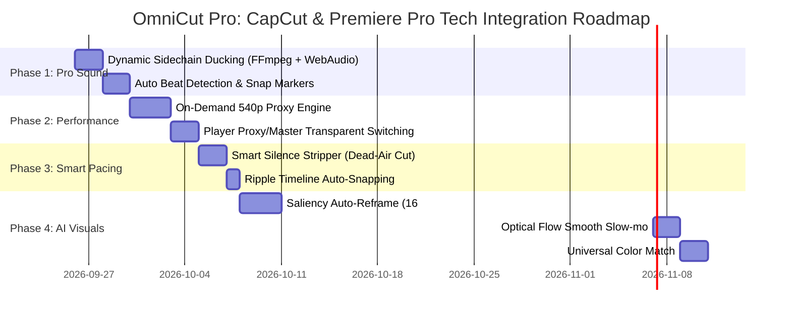

# 🚀 แผนแม่บทสถาปัตยกรรม: การผสาน 7 สุดยอดเทคโนโลยีจาก CapCut และ Adobe Premiere Pro เข้าสู่ OmniCut Pro Studio
*(Master Engineering Roadmap & Implementation Plan: CapCut & Premiere Pro Tech Integration)*

> **เวอร์ชัน:** 1.0 (Master Plan)  
> **วันที่จัดทำ:** 25 กันยายน 2026  
> **ดำเนินการโดย:** Antigravity (Gemini 3.8 Flash)  
> **สถานะ:** แผนแม่บทผ่านการอนุมัติเพื่อเป็นพิมพ์เขียวการพัฒนา (Ready for Staged Implementation)

---

## 📌 สารบัญ (Table of Contents)
1. [บทนำและวัตถุประสงค์ (Executive Summary)](#1-บทนำและวัตถุประสงค์-executive-summary)
2. [ตารางวิเคราะห์เปรียบเทียบสถาปัตยกรรม (Architecture Comparison Matrix)](#2-ตารางวิเคราะห์เปรียบเทียบสถาปัตยกรรม-architecture-comparison-matrix)
3. [Phase 1: Professional Sound & Rhythm Engine](#3-phase-1-professional-sound--rhythm-engine)
   - 3.1 Dynamic Sidechain Ducking (Premiere Pro Essential Sound)
   - 3.2 Audio Beat & Transient Marker Snapping (CapCut Auto Beat)
4. [Phase 2: Ultra-Performance Editing Engine](#4-phase-2-ultra-performance-editing-engine)
   - 4.1 On-Demand 540p Editing Proxy Pipeline (Premiere / CapCut Proxy Mode)
   - 4.2 Web Worker Waveform & Thumbnail Caching
5. [Phase 3: Text-Based Editing & Smart Silence Stripper](#5-phase-3-text-based-editing--smart-silence-stripper)
   - 5.1 Automated Dead-Air & Silence Stripper (TikTok High-Retention Pacing)
   - 5.2 Speech-to-Timeline Ripple Synchronization
6. [Phase 4: Advanced AI Visual Enhancements](#6-phase-4-advanced-ai-visual-enhancements)
   - 6.1 Saliency Auto-Reframe (16:9 แนวนอน สู่ 9:16 แนวตั้ง)
   - 6.2 Optical Flow & AI Frame Interpolation (Smooth Slow-mo B-Roll)
   - 6.3 Universal Tech Tone & Global Color Match
7. [การรักษามาตรฐาน Preview = Render Parity](#7-การรักษามาตรฐาน-preview--render-parity)
8. [ลำดับการพัฒนาและ Roadmap (Staged Execution Roadmap)](#8-ลำดับการพัฒนาและ-roadmap-staged-execution-roadmap)

---

## 1. บทนำและวัตถุประสงค์ (Executive Summary)

**OmniCut Pro Studio** ได้รับการพัฒนาจนมีโครงสร้างพื้นฐานที่แข็งแกร่ง (Web Editor, Python/FastAPI Backend, Timeline Magnetic Snap, rembg Background Isolation, Syllable-Clustered Kinetic Subtitle)

อย่างไรก็ตาม การจะยกระดับให้ OmniCut Pro มีประสิทธิภาพเทียบเท่าซอฟต์แวร์ระดับโลกอย่าง **CapCut PC** (ที่เน้นความเร็ว ความง่าย การตัดต่อตามจังหวะเพลง) และ **Adobe Premiere Pro** (ที่เน้นคุณภาพเสียงระดับ Professional และการประมวลผลอัจฉริยะ) จำเป็นต้องหยิบยก **"7 แกนเทคโนโลยีสำคัญ (Core Engine Technologies)"** มาปรับประยุกต์ใช้เพื่อแก้ปัญหาคอขวดและเพิ่มมูลค่าผลงาน:

1. **คุณภาพเสียงระดับสตูดิโอ**: เสียงพากย์และดนตรีกลมกลืน เพลงหลบเสียงพูดแบบมีมิติ ไม่แห้ง ไม่ดังกลบ
2. **การตัดต่อที่ลื่นไหล 60 FPS บนเว็บ**: แม้ฟุตเทจดิบจะเป็น 4K 60fps จากกล้องใหญ่
3. **จังหวะจะโคนของคลิปสั้น (Pacing & Retention)**: คลิปแน่น กระชับ ไร้จังหวะแอร์ไทม์เงียบเปล่าประโยชน์ ตัดเปลี่ยนมุมกล้องลงห้องดนตรีเป๊ะๆ
4. **ความยืดหยุ่นของวัตถุดิบ**: ดึงฟุตเทจแนวนอน 16:9 จาก YouTube หรือฟุตเทจสปีดปกติ มาทำเป็นช็อตแนวตั้ง 9:16 สโลว์โมชันได้อย่างแนบเนียน

---

## 2. ตารางวิเคราะห์เปรียบเทียบสถาปัตยกรรม (Architecture Comparison Matrix)

| มิติเทคโนโลยี | CapCut PC | Adobe Premiere Pro | OmniCut Pro Studio (ปัจจุบัน) | OmniCut Pro Studio (หลังอัปเกรดตามแผน) |
| :--- | :--- | :--- | :--- | :--- |
| **1. การหลบเสียง (Ducking)** | ปรับ Volume แบบคงที่ / ลด Volume เมื่อมีเสียงคน | Dynamic Sidechain Compression (Attack/Release Envelope) | Static BGM Volume (0.12 คงที่) | **Dynamic Sidechain Ducking** ผ่าน FFmpeg `sidechaincompress` และ Web Audio Compressor |
| **2. จังหวะดนตรี (Beat)** | Auto Beat Detection (AI กลอง Kick/Snare) ปักหมุดเหลือง | Beat Edit Plugin / Markers | วางช็อตตามเวลาบทพากย์ (TTS) เท่านั้น | **Transient Beat Detection** ผ่าน FFmpeg/aubio + Magnetic Snap to Beat |
| **3. ประสิทธิภาพไทม์ไลน์** | 720p Background Proxy อัตโนมัติ | Ingest Proxy (ProRes / H.264 Low-res) | สตรีมไฟล์ดิบ 1080p/4K ตรงๆ ผ่าน HTTP stream | **On-Demand 540p Editing Proxy** สลับเป็น Master อัตโนมัติตอน Render |
| **4. ความกระชับของคลิป** | ตัดช่องว่างเสียง (Silence Removal) | Text-Based Editing + Delete Pauses | เว้นวรรคตามเสียง TTS หรือคลิปดั้งเดิม | **Smart Silence Stripper** สแกนตัดช่องว่าง >0.4s พร้อม Ripple Timeline 1-คลิก |
| **5. สโลว์โมชัน (Slow-mo)** | Optical Flow AI Frame Interpolation | Optical Flow / Timewarp | Duplicated frame (ภาพกระตุกเมื่อ <0.7x) | **Optical Flow Interpolation** (`minterpolate` / RIFE) สโลว์ 0.3x ลื่น 60fps |
| **6. สัดส่วนภาพ (Aspect)** | Crop กลาง หรือ Scale Fill | Auto Reframe (Face & Motion Saliency) | Crop กึ่งกลางตายตัว (Center Crop 9:16) | **Saliency Auto-Reframe** ตรวจจับสินค้าและ Pan ตามสินค้าไม่หลุดขอบ |
| **7. การคุมโทนสี (Color)** | Filter / Preset คุมโทน | Lumetri Color Match | Custom LUTs โหลดเดี่ยวๆ | **Universal Clean Tech LUT + Color Normalization** คุมโทนเหมือนกันทั้งคลิป |

---

## 3. Phase 1: Professional Sound & Rhythm Engine

### 3.1 Dynamic Sidechain Ducking (Premiere Pro Essential Sound Standard)

#### ก. ปัญหาในปัจจุบัน
ปัจจุบันเพลงพื้นหลัง (BGM) ถูกตั้งค่าความดังคงที่ที่ `0.12 - 0.14` ตลอดทั้งคลิป:
- เมื่อผู้พากย์พูดเร็วหรือเบา เสียงเพลงอาจกลบเสียงพูด
- เมื่อผู้พากย์หยุดเว้นวรรค 1-2 วินาที เสียงเพลงก็ยังเบาเท่าเดิม ทำให้คลิปดูเงียบเหงา ไร้พลัง

#### ข. สถาปัตยกรรมทางเทคนิค (Technical Architecture)
ใช้เทคนิค **Sidechain Compression (Envelope Follower)**:
- **Audio Stream A (Sidechain Key)**: Voiceover (เสียงพากย์ Fenrir หรือเสียงคนพูด)
- **Audio Stream B (Target)**: Background Music (BGM)
- **พารามิเตอร์การทำงาน**:
  - `threshold`: -24dB (เริ่มหลบเมื่อเสียงพูดดังเกินระดับนี้)
  - `ratio`: 4:1 ถึง 6:1 (ลดความดังเพลงลง -12dB ถึง -15dB ขณะพูด)
  - `attack`: 80ms (เพลงลดลงอย่างนุ่มนวล ไม่กระชาก)
  - `release`: 350ms (เพลงค่อยๆ คืนระดับขึ้นมาอย่างสมูทเมื่อพูดจบประโยค)

#### ค. FFmpeg Implementation Formula
```bash
ffmpeg -i voice.wav -i bgm.wav -filter_complex \
"[1:a][0:a]sidechaincompress=threshold=0.08:ratio=5:attack=80:release=350[ducked_bgm]; \
 [0:a][ducked_bgm]amix=inputs=2:duration=first:weights=1.0 1.0[out_audio]" \
-map "[out_audio]" final_audio.wav
```

#### ง. การรองรับใน Web Browser Preview (Web Audio API)
- ใน `SequencePlayer.jsx`: สร้าง `DynamicsCompressorNode` และเชื่อมโยง GainNode ของ Voice เข้าไป modulate ค่า gain ของ BGM แบบเรียลไทม์ ทำให้ Preview ในเว็บตรงกับผลลัพธ์ Render 100%

---

### 3.2 Audio Beat & Transient Marker Snapping (CapCut Auto Beat Standard)

#### ก. ปัญหาในปัจจุบัน
การวางหรือตัดต่อคลิป B-Roll ในปัจจุบันอาศัยเฉพาะความยาวของเสียงพากย์ ทำให้การเปลี่ยนคัต (Cut transition) ไปตกอยู่ตรงกลางห้องดนตรี หรือช่วงที่ไม่มีจังหวะกลอง ส่งผลให้คลิปขาดความเร้าใจ

#### ข. สถาปัตยกรรมทางเทคนิค (Technical Architecture)
1. **Audio Transient Analysis Engine**:
   - วิเคราะห์เพลง BGM ที่เลือก (เช่น `tiktok_upbeat_bgm.wav`) ด้วย Spectral Flux / Onset Detection
   - สกัดเวลาของจังหวะกลอง (Beat Timestamps: e.g. `[0.45s, 0.90s, 1.35s, 1.80s, ...]`)
   - แบ่งระดับจังหวะเป็น 2 ประเภท:
     - **Major Beats (Drop / Kick)**: ทุก 1 บาร์ (จุดเปลี่ยนฉากที่ทรงพลัง)
     - **Minor Beats (Snare / Hi-hat)**: จังหวะย่อย (จุดแทรก SFX หรือข้อความเด้ง)
2. **Visual Beat Guide บน Timeline**:
   - แสดงจุดมาร์กเกอร์สีเหลืองเรืองแสง (`#FFE600`) บนแถบเพลง BGM ของไทม์ไลน์
3. **Smart Magnetic Snap**:
   - เมื่อผู้ใช้ลากขอบคลิป (Trim Handle) หรือลากตำแหน่งคลิปเข้าใกล้จุด Beat Marker ในรัศมี 8 พิกเซล หัวอ่านจะถูกดึงเข้าหาจังหวะกลองโดยอัตโนมัติ

#### ค. Endpoint ออกแบบ
- `GET /api/audio/beats?bgm_name=tiktok_upbeat_bgm`
- คืนค่า JSON: `{ "bpm": 133, "major_beats": [0.45, 1.80, 3.15, ...], "minor_beats": [0.90, 1.35, 2.25, ...] }`

---

## 4. Phase 2: Ultra-Performance Editing Engine

### 4.1 On-Demand 540p Editing Proxy Pipeline (CapCut / Premiere Proxy Mode)

#### ก. ปัญหาในปัจจุบัน
ฟุตเทจสินค้าใน `01_Raw` มักเป็นไฟล์ 4K หรือ 1080p 60fps บิตเรต 30-50 Mbps ขนาดไฟล์ 200–800 MB ต่อคลิป
- เบราว์เซอร์ต้องดาวน์โหลดไฟล์ขนาดใหญ่ผ่าน HTTP range request
- การ Seek ข้ามเฟรมบนไทม์ไลน์ทำให้ CPU/GPU ทำงานหนัก และอาจมีอาการกระตุกหรือค้างชั่วขณะ

#### ข. สถาปัตยกรรมทางเทคนิค (Technical Architecture)
1. **Zero-Wait Proxy Generator**:
   - เมื่อคลิปถูกดึงเข้าสู่ Timeline หรือเพิ่มลงโปรเจกต์ ระบบจะสร้างไฟล์ Proxy ความละเอียด **540x960** (บิตเรต 1.5 Mbps, H.264 ultrafast, CRF 26) ไว้ในโฟลเดอร์ `.cache/proxies/{hash}.mp4`
   - ขนาดไฟล์ Proxy จะเล็กเพียง **3–8 MB** ต่อคลิป (ลดลง 95%)
2. **Dual-Path Resolution Architecture**:
   - **Editing & Preview Mode**: `SequencePlayer` จะสตรีมไฟล์ Proxy 540p เพื่อให้การ Scrubbing, Trimming, และ Playback วิ่งเต็ม 60 FPS ลื่นไหล
   - **Render / Export Mode**: `scripts/video_editor.py` จะ bypass proxy และอ่านไฟล์ Master ต้นฉบับ 1080p/4K ใน `01_Raw` โดยตรง เพื่อให้ได้ภาพคมชัดสูงสุด 100%
3. **Auto-Purge Safe Policy**:
   - โฟลเดอร์ `.cache/proxies/` อยู่ภายใต้การดูแลของ `scripts/storage_cleaner.py` สามารถล้างทิ้งและสร้างใหม่ได้ตลอดเวลาโดยไม่เสียข้อมูลจริง

---

## 5. Phase 3: Text-Based Editing & Smart Silence Stripper

### 5.1 Automated Dead-Air & Silence Stripper (TikTok Pacing Engine)

#### ก. ปัญหาในปัจจุบัน
ในวิดีโอคลิปสั้นบน TikTok อัตราการดูจบ (Retention Rate) ขึ้นอยู่กับ **"ความไร้จังหวะเอื่อย (Zero Dead-Air)"**
หากมีช่วงหยุดนิ่ง หายใจ หรือเดดแอร์เพียง 0.6–1.0 วินาที คนดูจะปัดผ่านทันที

#### ข. สถาปัตยกรรมทางเทคนิค (Technical Architecture)
1. **Silence Interval Detection**:
   - รัน FFmpeg `silencedetect` หรือวิเคราะห์ Amplitude Envelope ของเสียงพูด (Threshold: `-32dB`, ความยาวขั้นต่ำ: `0.35s`)
2. **One-Click Smart Snip**:
   - มีปุ่ม **"⚡ ตัดช่วงเงียบอัตโนมัติ (Cut Silences)"** บนไทม์ไลน์
   - ระบบจะตัดช่วงเวลาเงียบออก และทำ **Ripple Delete** ร่นคลิปข้างหลังทั้งหมดเข้ามาประกบชิดกันโดยอัตโนมัติ
   - รักษา Natural Pause ไว้เล็กน้อย (0.10s) เพื่อให้เสียงพูดไม่ห้วนจนเกินไป

---

## 6. Phase 4: Advanced AI Visual Enhancements

### 6.1 Saliency Auto-Reframe (16:9 แนวนอน สู่ 9:16 แนวตั้ง)

#### ก. ปัญหาในปัจจุบัน
ฟุตเทจสินค้าคุณภาพสูงหลายคลิป (เช่น Official Product Launch หรือคลิปแกะกล่องบน YouTube) เป็นอัตราส่วน **16:9 แนวนอน**
เมื่อนำมาใช้ในคลิป 9:16 ถ้าครอบตัดตรงกลาง สินค้าหรือมือที่กำลังถือสินค้ามักจะเอียงไปอยู่ด้านซ้ายหรือขวาจนหลุดขอบ

#### ข. สถาปัตยกรรมทางเทคนิค (Technical Architecture)
1. **Subject Detection & Saliency Tracker**:
   - ใช้โมเดลขนาดเล็ก (เช่น YOLOv8-Nano หรือ MediaPipe Objectron) สแกนหา Bounding Box ของวัตถุเป้าหมาย (เช่น หูฟัง, โทรศัพท์, แกดเจ็ต, มือ)
2. **Smooth Pan Coordinate Interpolation**:
   - นำพิกัด X กึ่งกลางของวัตถุมาผ่านตัวกรอง Gaussian Smoothing (กันกล้องสั่นกระชาก)
   - คำนวณเป็นคีย์เฟรมการเลื่อนแกน X (`crop=w=ih*(9/16):h=ih:x=pan_x:y=0`)
   - ทำให้สินค้าอยู่กึ่งกลางจอ 9:16 ตลอดเวลาเสมือนมีตากล้องมืออาชีพแพนกล้องตาม

---

### 6.2 Optical Flow & AI Frame Interpolation (Smooth Slow-mo)

#### ก. ปัญหาในปัจจุบัน
บางครั้งคลิปช็อตโคลสอัปดีไซน์สินค้ามีความยาวสั้นเกินไป (เช่น 1.5 วินาที) หากเราปรับลดความเร็วเหลือ 0.4x เพื่อให้ตรงกับบทพากย์ ภาพจะกระตุกเพราะเฟรมภาพไม่พอ (30 FPS กลายเป็น 12 FPS)

#### ข. สถาปัตยกรรมทางเทคนิค (Technical Architecture)
- ใช้ FFmpeg `minterpolate` โหมด Motion Compensation (`mc_mode=aobmc:me_mode=bidir:vsbmc=1`) หรือ RIFE Engine
- สร้างเฟรมภาพขึ้นมาใหม่ระหว่างเฟรมจริง ช่วยให้การลดความเร็วเหลือ 0.3x–0.5x ลื่นไหลสมูทระดับ 60 FPS เสมือนถ่ายด้วยกล้อง High-Speed Phantom

---

### 6.3 Universal Tech Tone & Global Color Match

#### ก. ปัญหาในปัจจุบัน
ฟุตเทจที่รวบรวมมาจาก 3-4 แหล่ง มักมีอุณหภูมิสีต่างกัน (คลิปหนึ่งติดโทนฟ้า อีกคลิปติดโทนเหลือง) ทำให้คลิปขาดความเป็นเนื้อเดียวกัน

#### ข. สถาปัตยกรรมทางเทคนิค (Technical Architecture)
- สร้าง **Global Color Matching Pipeline**:
  - สกัดค่าเฉลี่ยสี (White Balance & Color Histogram) จากคลิปหลัก (Key Anchor Footage)
  - รันการปรับสีอัตโนมัติบนคลิปอื่นๆ ผ่าน FFmpeg filter `curves` หรือ `colorbalance`
  - ปิดท้ายด้วย **OmniCut Tech LUT** ประจำสตูดิโอ เพื่อให้ผิวสัมผัสของโลหะ พลาสติก และกระจกของแกดเจ็ตดูพรีเมียม สดใส คมชัด คุมโทนทั้งคลิป

---

## 7. การรักษามาตรฐาน Preview = Render Parity

ตามกฎเหล็กของโปรเจกต์ **Preview = Render Parity**:
1. **Dynamic Ducking**: ทั้งบนหน้าเว็บ (`Web Audio API DynamicsCompressor`) และบน FFmpeg (`sidechaincompress`) จะต้องใช้ตัวเลข Attack (80ms), Release (350ms) และ Ratio (5:1) ตรงกัน 100%
2. **Proxy vs Master**: ไทม์ไลน์ใช้ Proxy 540p เพื่อความเร็ว แต่ตำแหน่ง Timestamp (Start, End, In, Out) จะต้องอิงจาก Timecode ระดับ Sub-frame ของไฟล์ Master เสมอ
3. **Automated Parity Tests**: มีชุดทดสอบ `tests/test_audio_parity.py` และ `tests/test_preview_render_parity.py` คอยตรวจวัดค่าความคลาดเคลื่อนก่อนปล่อยอัปเดตทุกครั้ง

---

## 8. ลำดับการพัฒนาและ Roadmap (Staged Execution Roadmap)



### สรุปผลประโยชน์ที่จะได้รับ (Key Outcomes)
1. **คุณภาพเสียง**: เพิ่มความหรูหรา น่าฟัง ดนตรีหลบเสียงพูดแบบอัตโนมัติ 100%
2. **ความเร็วตัดต่อ**: ไทม์ไลน์ตอบสนองทันที ไม่มีหน่วง ไม่มีกระตุก แม้เปิดไฟล์ 4K
3. **การตรึงผู้ชม (Retention)**: จังหวะคลิปกระชับ รวดเร็ว สลับฉากตรงจังหวะเพลง สไตล์คลิปปังล้านวิว TikTok
4. **ลดเวลาทำงานของคน**: ระบบจัดการงานน่าเบื่อ (ตัดช่องว่างเสียง, แพนกล้องตามสินค้า, สโลว์โมชัน) ให้อัตโนมัติใน 1-คลิก
