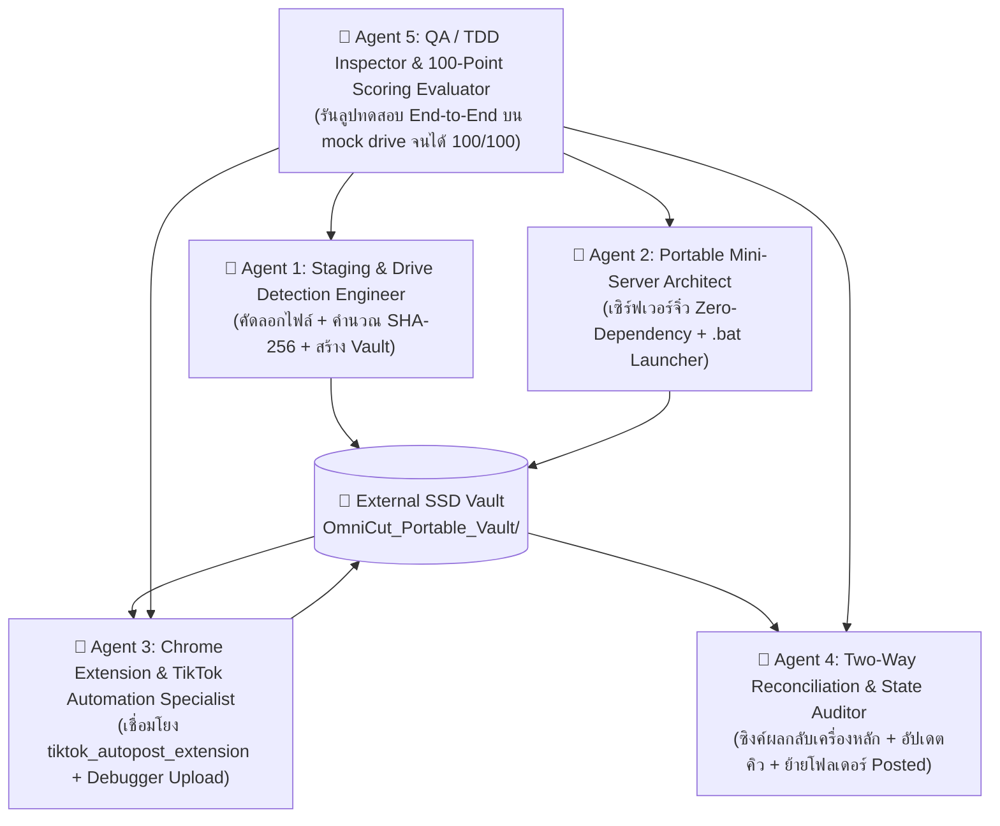

# ⏱️🚀 MASTER AUTONOMOUS PLAN: External SSD Backup & Cafe Chrome Extension Uploader Loop
# แผนแม่บทลูปรันทำงานอัตโนมัติ: ระบบ Backup ลง External SSD เพื่อนำไปอัปโหลดผ่าน Chrome Extension ที่คาเฟ่

> **รหัสแผนงาน:** `PLAN-SSD-SNEAKERNET-AUTONOMOUS-20261031`  
> **ดำเนินการโดย:** Antigravity (Gemini 3.8 Flash)  
> **เป้าหมาย:** สร้างระบบสำรองข้อมูลอัจฉริยะ (Offline Staging & Sneakernet Two-Way Sync) เชื่อมต่อเครื่องหลักที่บ้าน (Heavy Render) เข้ากับเครื่องโน้ตบุ๊กที่คาเฟ่ (Fast Upload) ผ่าน External SSD ให้พร้อมอัปโหลดผ่าน `tiktok_autopost_extension` ได้ทันทีแบบ 1-Click พร้อมเกณฑ์ประเมิน 100 คะแนนเต็ม

---

## 🎯 1. พันธกิจและโจทย์หลัก (Mission Directive)

1. **เครื่องหลักที่บ้าน (Home Heavy-Render Station):**
   - ทำหน้าที่เจนคลิปและเรนเดอร์วิดีโอ 1080x1920 60fps, แคปชัน, แฮชแท็ก, ปกคลิป (3:4 และ 9:16) และรหัสตะกร้าสินค้า TikTok จนเสร็จสมบูรณ์
   - จัดเตรียมระบบ 1-Click Backup ลง External SSD คัดลอกเฉพาะข้อมูลและมีเดียที่จำเป็นต่อการโพสต์
   - สร้าง SHA-256 Checksum รับรองความสมบูรณ์ของไฟล์ ป้องกันปัญหาไฟล์เสียจากการถอดสาย USB
2. **External SSD (Portable Staging Vault):**
   - บรรจุโครงสร้างไฟล์ที่ทำงานได้ด้วยตนเอง (Self-Contained) ไม่ผูกติดกับ Drive Letter (Drive-Letter Agnostic)
   - บรรจุโฟลเดอร์ Chrome Extension (`tiktok_autopost_extension/`), มีเดียคลิป, ข้อมูลคิวโพสต์ และเซิร์ฟเวอร์จิ๋วพกพา
3. **เครื่องโน้ตบุ๊กที่คาเฟ่ (Cafe High-Speed Upload Station):**
   - ไม่ต้องติดตั้ง PyTorch, CUDA, FFmpeg หรือโมเดลหนัก 20GB ใดๆ ทั้งสิ้น
   - เสียบ SSD แล้วดับเบิลคลิก `START_CAFE_UPLOADER.bat` เพียงครั้งเดียว เซิร์ฟเวอร์จิ๋วเปิดใน 1 วินาที พร้อมเปิด Chrome Extension
   - Extension สามารถอ่านคิวคลิป, แคปชัน, แฮชแท็ก, และรหัสตะกร้า แล้วสั่งยิงอัปโหลดขึ้น TikTok Studio อัตโนมัติผ่านเน็ตแรงของคาเฟ่
   - บันทึกผลและ URL ที่โพสต์แล้วลง SSD ทันทีทีละคลิป (Atomic Progress Logging) ป้องกันเน็ตหลุดหรือแบตหมด
4. **กลับถึงบ้าน (Two-Way Reconciliation & Merge):**
   - เสียบ SSD กลับเข้าเครื่องหลัก กด 1-Click Sync Back
   - อัปเดตสถานะคลิปเป็น `posted` ใน `_Docs/schedule_queue.json`, `_Docs/export_registry.json`, และ `_Docs/post_log.json`
   - ย้ายไฟล์ในเครื่องหลักเข้า `04_Exports/Posted/` ป้องกันการโพสต์ซ้ำ 100%

---

## 👥 2. การแบ่งบทบาท 5 เอเจนต์ผู้เชี่ยวชาญ (Delegated Multi-Agent Architecture)



### 🔹 Agent 1: Staging & Drive Detection Engineer
- **หน้าที่หลัก:** พัฒนาโมดูล `scripts/ssd_staging_engine.py` และ Endpoint สำหรับหน้า UI
- **สิ่งที่ต้องทำ:**
  1. สแกนหา Removable Drive หรือไดรฟ์ภายนอกที่เสียบอยู่กับ Windows อัตโนมัติ (พร้อมทางเลือกให้ระบุโฟลเดอร์เองได้)
  2. อ่าน `_Docs/schedule_queue.json` และ `_Docs/export_registry.json` กรองเฉพาะคลิปที่มีสถานะ `pending` หรือยังไม่ได้โพสต์
  3. คัดลอกไฟล์วิดีโอจาก `04_Exports/Ready_to_post/` และภาพปกจาก `05_Covers_Thumbnails/` ลงใน SSD อย่างเป็นระเบียบ
  4. คำนวณค่าแฮช SHA-256 ระหว่างคัดลอกไฟล์ เพื่อไม่ให้อ่านฮาร์ดดิสก์ซ้ำสองรอบ
  5. บันทึก `manifest.json`, `queue.json`, และ `checksums.sha256` ลงบน SSD
  6. รันคำสั่ง OS Disk Flush (`FlushFileBuffers` / `os.sync`) เพื่อรับประกันว่าข้อมูลถูกเขียนลงชิปความจำของ SSD จริงก่อนแจ้งเตือน "ปลอดภัยที่จะถอดสาย"

### 🔹 Agent 2: Portable Mini-Server Architect
- **หน้าที่หลัก:** พัฒนาเซิร์ฟเวอร์จิ๋ว `tools/portable_uploader_server.py` และไฟล์รัน `START_CAFE_UPLOADER.bat` บน SSD
- **สิ่งที่ต้องทำ:**
  1. ออกแบบเซิร์ฟเวอร์ HTTP/API ที่เบาที่สุด (Zero Heavy-Dependencies) กินแรม < 40MB เริ่มทำงานใน < 1 วินาที
  2. ให้บริการเฉพาะ Endpoints ที่ `tiktok_autopost_extension` ต้องใช้:
     - `GET /api/channels`: ดึงรายชื่อช่อง
     - `GET /api/exports`: ดึงรายการคลิป
     - `GET /api/schedule-queue`: ดึงคิวโพสต์พร้อมข้อมูลแคปชันและรหัสตะกร้า
     - `GET /api/tiktok-autopost/pending` & `POST /api/tiktok-autopost/prepare`: ส่งงานให้ Extension เตรียมยิง
     - `POST /api/tiktok-autopost/jobs/{id}/complete`: บันทึกเมื่อโพสต์เสร็จ
     - `GET /api/media/*`: เสิร์ฟไฟล์วิดีโอและภาพปกจากโฟลเดอร์บน SSD
  3. กำหนดให้พาธทั้งหมดเป็น Relative เทียบกับตำแหน่งบน SSD (Drive-Letter Independent) เสียบเป็นไดรฟ์ `D:`, `E:`, `F:`, `G:` ก็รันได้ทันที
  4. สร้างไฟล์ `START_CAFE_UPLOADER.bat` ที่ดับเบิลคลิกแล้วเปิดเซิร์ฟเวอร์จิ๋ว พร้อมเปิด Chrome ไปที่หน้า `https://www.tiktok.com/creator-center/upload` ทันที

### 🔹 Agent 3: Chrome Extension & TikTok Automation Specialist
- **หน้าที่หลัก:** ปรับแต่งและตรวจสอบความเข้ากันได้ของ `tiktok_autopost_extension`
- **สิ่งที่ต้องทำ:**
  1. คัดลอกโฟลเดอร์ `tiktok_autopost_extension/` ลงใน SSD พร้อมใช้งาน
  2. ตรวจสอบให้แน่ใจว่า Sidepanel ของ Extension สามารถเชื่อมต่อกับเซิร์ฟเวอร์จิ๋วที่พอร์ต `8000` ได้อย่างลื่นไหล
  3. ทดสอบระบบ `chrome.debugger` ให้แนบไฟล์วิดีโอและไฟล์ปกจากพาธ SSD เข้าช่อง Upload ของ TikTok ได้ 100%
  4. ระบบเติมแคปชัน, แฮชแท็ก, และรหัสสินค้าตะกร้า TikTok (`tiktok_product_id`) เข้าช่องป้อนข้อมูลอย่างแม่นยำ
  5. เมื่อโพสต์สำเร็จ Extension ต้องส่งผลลัพธ์กลับมาบันทึกที่ `state.json` บน SSD ทันที (บันทึก URL โพสต์, วันเวลา, และ Platform ID)

### 🔹 Agent 4: Two-Way Reconciliation & State Auditor
- **หน้าที่หลัก:** พัฒนาระบบ `scripts/ssd_reconcile_engine.py` เมื่อนำ SSD กลับมาเสียบที่บ้าน
- **สิ่งที่ต้องทำ:**
  1. สแกนตรวจจับโฟลเดอร์ Vault บน SSD และอ่านไฟล์ `state.json` เพื่อสรุปว่าคลิปไหนโพสต์เสร็จแล้วบ้าง
  2. อัปเดตสถานะใน `_Docs/schedule_queue.json` ของเครื่องหลักจาก `pending` เป็น `posted`
  3. บันทึกประวัติลง `_Docs/post_log.json` และอัปเดต `_Docs/export_registry.json`
  4. ย้ายไฟล์วิดีโอบนเครื่องหลักจาก `04_Exports/Ready_to_post/` ไปยัง `04_Exports/Posted/` อัตโนมัติ
  5. ป้องกันปัญหาการโพสต์ซ้ำ 100% (Idempotent Merge): แม้จะสั่ง Reconcile ซ้ำหลายครั้ง ข้อมูลจะไม่เบิ้ล
  6. จัดเตรียมตัวเลือกเคลียร์พื้นที่บน SSD เพื่อเตรียมพร้อมสำหรับรอบการผลิตถัดไป

### 🔹 Agent 5: QA / TDD Inspector & 100-Point Scoring Evaluator
- **หน้าที่หลัก:** เขียนชุดทดสอบ End-to-End ใน `tests/test_ssd_sneakernet_pipeline.py` และทำหน้าที่เป็นผู้คุมเกณฑ์ 100 คะแนน
- **สิ่งที่ต้องทำ:**
  1. จำลองการทำงานทั้ง 3 สภาพแวดล้อม (เครื่องบ้าน, Mock SSD, เครื่องคาเฟ่) บน Temporary Directory (`tmp_path`) โดยไม่แตะข้อมูลจริง
  2. รันการประเมินคะแนนตาม **100-Point Scoring Rubric** (ด้านล่าง)
  3. หากคะแนนไม่ถึง 100 คะแนน ให้ส่งรายงานจุดบกพร่องกลับไปยังเอเจนต์ที่รับผิดชอบเพื่อแก้ไขทันที และวนลูปทดสอบใหม่จนกว่าจะได้ 100/100

---

## 💯 3. เกณฑ์การให้คะแนน 100 คะแนนเต็ม (100-Point Scoring Rubric)

ระบบจะถือว่า **"เสร็จสมบูรณ์พร้อมส่งมอบ (Production-Ready)"** ก็ต่อเมื่อผ่านการทดสอบครบทั้ง 5 หมวด ได้ **100/100 คะแนนเต็ม** เท่านั้น:

| หมวดที่ | หัวข้อการประเมิน | คะแนนเต็ม | เกณฑ์การผ่าน (Passing Criteria) |
|---|---|:---:|---|
| **หมวด 1** | **การตรวจจับไดรฟ์และการสร้าง Vault บน SSD** | **20** | • ตรวจพบ Removable Drive / Target Path ถูกต้อง (5 คะแนน)<br>• คัดลอกเฉพาะคลิปและปกที่รอโพสต์ ไม่ติดไฟล์ขยะ (5 คะแนน)<br>• คำนวณค่าแฮช SHA-256 ตรงกับไฟล์ต้นฉบับ 100% (5 คะแนน)<br>• มีกลไก Disk Flush และส่งสัญญาณ Safe to Eject (5 คะแนน) |
| **หมวด 2** | **ความสมบูรณ์ของโครงสร้างข้อมูลและการไม่ยึดติด Drive Letter** | **20** | • โครงสร้างโฟลเดอร์บน SSD ครบถ้วนตามสเปก (5 คะแนน)<br>• ไม่มีการ Hardcode Drive Letter เสียบ D:, E:, F: รันได้หมด (5 คะแนน)<br>• `queue.json` บรรจุแคปชัน, แฮชแท็ก, ตะกร้าสินค้าครบถ้วน (5 คะแนน)<br>• บันทึกไฟล์ `state.json` แบบ Atomic ป้องกันไฟล์พังเมื่อถอดสาย (5 คะแนน) |
| **หมวด 3** | **ประสิทธิภาพและความเบาของเซิร์ฟเวอร์จิ๋ว (Mini-Server)** | **20** | • สตาร์ตเสร็จใน < 1.5 วินาที ใช้แรม < 40MB ไม่พึ่งพา CUDA/Torch (5 คะแนน)<br>• เสิร์ฟ API พื้นฐานที่ Extension ต้องการครบถ้วน 100% (5 คะแนน)<br>• เสิร์ฟไฟล์มีเดียผ่าน `/api/media/` ได้ถูกต้อง ไม่ติด CORS (5 คะแนน)<br>• มีสคริปต์ `START_CAFE_UPLOADER.bat` ที่เปิดทำงานได้ใน 1 ดับเบิลคลิก (5 คะแนน) |
| **หมวด 4** | **การทำงานร่วมกับ Chrome Extension & TikTok Upload** | **20** | • Extension Sidepanel เชื่อมต่อกับเซิร์ฟเวอร์จิ๋วบน SSD สำเร็จ (5 คะแนน)<br>• ระบบ Debugger รองรับการแนบไฟล์วิดีโอและปกจาก SSD (5 คะแนน)<br>• ส่งผ่านแคปชัน, แฮชแท็ก, และรหัสสินค้า TikTok แม่นยำ (5 คะแนน)<br>• บันทึกสถานะ `posted` และ URL โพสต์กลับลง SSD ทันที (5 คะแนน) |
| **หมวด 5** | **การซิงค์สถานะกลับและการป้องกันโพสต์ซ้ำ (Reconciliation)** | **20** | • เสียบ SSD กลับบ้าน อ่านผลโพสต์และอัปเดต `schedule_queue.json` สำเร็จ (5 คะแนน)<br>• อัปเดต `_Docs/export_registry.json` และ `post_log.json` ตรงกัน (5 คะแนน)<br>• ย้ายไฟล์ในเครื่องหลักเข้า `04_Exports/Posted/` อัตโนมัติ (5 คะแนน)<br>• ป้องกันการโพสต์ซ้ำ 100% (Idempotent) และเทสทุกตัวผ่าน 100% (5 คะแนน) |
| **รวม** | **คะแนนรวมทั้งหมด** | **100** | **ต้องได้ 100/100 คะแนนเต็ม ห้ามตกแม้แต่ข้อเดียว** |

---

## 🔄 4. ลูปการทำงานแบบอัตโนมัติ (Autonomous Iteration Loop)

การพัฒนาจะดำเนินการเป็นรอบวนซ้ำ (Cycle) ตามลำดับ จนกว่าผลการทดสอบจะได้ 100 คะแนนเต็ม:

```text
[เริ่มลูปปฏิบัติการ]
    │
    ▼
[รอบที่ 1: ติดตั้งรากฐานและ Data Contract]
    ├─ สร้าง Schemas และ Data DTOs สำหรับ SSD Vault
    └─ ตรวจสอบสัญญาข้อมูลระหว่าง Home Store, Vault, และ Extension
    │
    ▼
[รอบที่ 2: พัฒนา Agent 1 (Staging) & Agent 2 (Mini-Server)]
    ├─ พัฒนา scripts/ssd_staging_engine.py + Disk Flush
    ├─ พัฒนา tools/portable_uploader_server.py + START_CAFE_UPLOADER.bat
    └─ รันเทสรอบแรกบน mock drive
    │
    ▼
[รอบที่ 3: พัฒนา Agent 3 (Extension Bridge) & Agent 4 (Reconciliation)]
    ├─ ปรับแต่ง tiktok_autopost_extension ให้รองรับ SSD file mounting
    ├─ พัฒนา scripts/ssd_reconcile_engine.py ผสานสถานะกลับเข้าเครื่องหลัก
    └─ ตรวจสอบการย้ายไฟล์เข้า 04_Exports/Posted/
    │
    ▼
[รอบที่ 4: Agent 5 รันการประเมิน 100 คะแนนเต็ม (QA & TDD Gate)]
    ├─ รันชุดทดสอบ tests/test_ssd_sneakernet_pipeline.py
    ├─ คำนวณคะแนนตาม 100-Point Scoring Rubric
    │
    ├─► [คะแนน < 100]: พบจุดบกพร่อง ➔ แจกจ่ายงานให้ Agent 1-4 แก้ไขทันที ➔ วนกลับมารอบที่ 4
    │
    └─► [คะแนน = 100/100]: ทุกข้อผ่านสมบูรณ์ ➔ สรุปรายงานผล ➔ จบลูปพร้อมใช้งานจริง!
```

---

## 🛡️ 5. กฎเหล็กความปลอดภัย (Strict Project Rules)
1. ❌ **ห้ามแตะต้องโฟลเดอร์งานจริงระหว่างทดสอบ:** การรันเทสทั้งหมดต้องเกิดขึ้นในโฟลเดอร์ชั่วคราว (`tmp_path`) ห้ามสร้างไฟล์ขยะใน `04_Exports/` หรือ `_Docs/` เด็ดขาด (Rule 3.11 และ 4.15)
2. ❌ **ห้าม Hardcode Drive Letter:** พาธทุกอย่างบน SSD ต้องเป็น Relative หรือคำนวณจาก Root ของไดรฟ์ที่เสียบอยู่เท่านั้น
3. ❌ **ห้ามติดตั้ง Global Package บนโน้ตบุ๊ก:** เซิร์ฟเวอร์จิ๋วต้องรันได้ด้วย Python Standard Library หรือชุด Dependency ขนาดเล็กที่พกพาไปใน SSD ได้
4. ✔️ **Atomic Write เสมอ:** การเขียนไฟล์ `state.json` ต้องเขียนลงไฟล์ชั่วคราวแล้วเปลี่ยนชื่อ (Rename) เสมอ เพื่อป้องกันไฟล์เสียหายหากไฟดับหรือถอด SSD กะทันหัน
