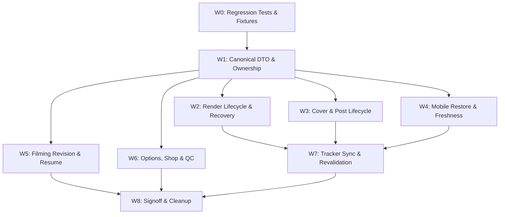

# แผนส่งต่องาน Mobile ↔ Desktop synchronization — Revision 2

ดำเนินการโดย: Codex (GPT-6) + 3 delegated agents (Codex GPT-6)
วันที่: 2026-10-04 · ปรับปรุงจากการตรวจละเอียดรอบสอง (Deep Audit)
รอบงาน: CODEX-MOBILE-SYNC-DEEP-AUDIT-20261004 · รอบเดิม: CODEX-MOBILE-DESKTOP-SYNC-20261004
สถานะ: ตรวจสอบและจัดทำแผนละเอียดแล้ว ยังไม่ได้แก้ไข implementation หรือแตะข้อมูลจริง
รายงานผลการตรวจอย่างละเอียด: [MOBILE_SYNC_DEEP_AUDIT_20261004.md](../Reports/MOBILE_SYNC_DEEP_AUDIT_20261004.md)

---

## 1. เป้าหมายและปัญหาหลัก (Objective & Core Problem)

การทำงานร่วมกันระหว่าง Mobile Quick Studio กับ Desktop (Content Tracker / Export Gallery / ProductStore) ยังมีจุดบกพร่องเชิงสถาปัตยกรรมและสัญญาข้อมูล (Contract Mismatch) ทำให้ข้อมูลไม่ซิงค์กันตลอดวงจรชีวิต:
`product` ↔ `angle/batch` ↔ `source/session` ↔ `project` ↔ `render attempt` ↔ `exact export` ↔ `cover/QC/posting metadata` ↔ `posted` ↔ `cross-device refresh`

เป้าหมายของแผนนี้คือการเชื่อมโยงระบบทั้งสองฝั่งให้ใช้สัญญาข้อมูลชุดเดียวกัน (Canonical Contract) ทั้ง DTO, เส้นทางจัดเก็บ (relative paths), วงจรชีวิตงานเรนเดอร์ (in_production / rendered / posted) และการรีเฟรชสถานะข้ามอุปกรณ์ โดยไม่พึ่งพาเพียงการจำลองหน้าจอหรือ flags ชั่วคราว

---

## 2. ข้อเท็จจริงจากการตรวจละเอียด (Key Findings M01–M24)

- ตรวจพบปัญหาจริง **24 กลุ่มปัญหา (M01–M24)** ครอบคลุมทั้ง Backend, Mobile Frontend และ Desktop Integration
- **ผลการทดสอบ Probe เบื้องต้น:**
  - Root API/Store defect probes: ผ่าน 14 ข้อ, 1 warning (ทดสอบบน mock/temp store ยืนยันว่าเกิดบั๊กจริง)
  - Root Browser defect probes: ผ่าน 5 ข้อ (Chromium 360×800 / 390×844 ยืนยัน state/payload mismatch)
  - Regression tests เดิม: ผ่าน 6 ข้อ (browser) และ 13 ข้อ (Node helper/cache)
- **ข้อสรุปสำคัญที่แก้ไขความเข้าใจเดิม:**
  1. **ไฟล์ปกไม่ได้ถูกลบจริง:** ปัญหาปกหายเป็นเรื่อง projection ตัดทิ้งใน API (M04) และ path relocation ในโฟลเดอร์ Posted (M05) ไม่ใช่ไฟล์สูญหายจากดิสก์
  2. **Pipeline จริง vs Mock:** Pipeline จริงคืน `export_id` เสมอทำให้เกิด path mismatch reject ใน `ProductStore` ส่วน mock ไม่มี `export_id` จึงเก็บ path ผิดสำเร็จ (M01 ต้องแก้ทั้งสองกรณี)
  3. **การรั่วไหลของ Footage ข้ามสินค้า:** การสลับสินค้าใน Quick Studio ไม่ได้ล้าง `uploadedVideoPath` และไม่มี ownership guard ทำให้คลิปของสินค้า A ติดไปใน payload ของสินค้า B (M03)
  4. **Posted Guard ทำงานแต่ Mobile ยังสั่งเรนเดอร์ได้:** `ProductStore` ป้องกันไม่ให้มุม posted ถูกลดสถานะอยู่แล้ว แต่ Mobile ขาด guard ทำให้ส่งงานเรนเดอร์ซ้ำซ้อนและได้ผลงานลอยที่ไม่ผูกกับมุมเดิม (M13)
  5. **QC Bypass:** ฟังก์ชัน `markPosted` ข้ามการตรวจ QC ทั้งบน Desktop และ Mobile (M23 ต้องตกลงนโยบายให้ชัดเจน)

---

## 3. สัญญาข้อมูลและสัจพจน์ของระบบ (System Invariants)

| เอนทิตี / ข้อมูล | เจ้าของความจริง (Source of Truth) | ข้อกำหนดและกติกา (Contract Rules) |
|---|---|---|
| `product_id` / `angle_id` / `batch` | `ProductStore` | ถือเป็นแกนหลักของงาน; API response ต้องแปลงเป็น DTO มาตรฐานเดียวกัน; ห้ามสับสนระหว่าง `id` กับ `angle_id` |
| `script` / `shot` / `session` revision | Store + Session snapshot | ตรวจสอบ hash/revision ก่อนถ่าย/เรนเดอร์; UI ต้องใช้ session ที่ตรงกับ revision ล่าสุด |
| `raw sources` / `manual_shot_map` | `angle` / `session` / `project` | มี ownership กำกับชัดเจน; ห้ามนำคลิปของสินค้าอื่นมาใช้ปนเด็ดขาด |
| `project_name` / `attempt identity` | Manifest + Task Association | สร้างชื่อเฉพาะเจาะจง; การ retry/rerender ต้องแยก attempt ชัดเจน |
| `export_id` | `ExportRegistry` | ระบุตัวตนผลงานเรนเดอร์อย่างเที่ยงตรง; Gallery / QR / Post ต้องอ้างอิง `export_id` จริง |
| `stored video/cover paths` | Relative paths ใน Store | บันทึกแบบ relative เทียบกับ `BASE_DIR` เสมอ; ห้ามมี `/api/media/` ปนในฐานข้อมูล |
| `browser media URLs` | API Projection | ให้ API เป็นผู้เติม prefix `/api/media/` ตอนส่งให้ Frontend เท่านั้น |
| `cover_3x4` / `cover_9x16` | Angle/Export metadata + Files | แยก variant ทั้ง 3:4 และ 9:16 ให้ชัดเจน; เมื่อย้ายไป Posted ต้องอัปเดตทั้งคู่ |
| `status` / `posted_at` / `QC` | Lifecycle Service / ProductStore | สะท้อนสถานะทางธุรกิจจริง (scripted ➡️ in_production ➡️ rendered ➡️ posted); ห้าม override เพียงเพราะมี video_url |
| `caption` / `hashtags` / `shop identity` | Metadata ของ Product/Angle/Export | ใช้ค่าที่ตั้งไว้จาก Desktop เป็นหลัก; มี fallback ตาม template |
| `task` / `job` state | Background TaskManager | งานเสร็จ (100%) ต้อง persist ข้อมูลลง store สำเร็จก่อน จึงจะถือว่า completed ได้ |

---

## 4. สถานะและกระบวนการทำงานปลายทาง (Target Workflow)

| ขั้นตอน | สภาพและพฤติกรรมที่ถูกต้อง |
|---|---|
| สร้างมุมด่วน (Quick Angle) | สถานะเริ่มต้นเป็น `scripted` พร้อม canonical identity; ปรากฏในคอลัมน์ของ Tracker ทันที |
| ถ่ายคลิป / Guided Take | มี Source Owner กำกับ; snapshot สคริปต์/ช็อตตรงกับบทล่าสุด |
| เริ่มเรนเดอร์ | ผูก Task กับ Project/Angle; อัปเดตสถานะเป็น `in_production` ทันที |
| ยกเลิก / ล้มเหลว (Fail/Cancel) | ไม่แจ้งเตือนสำเร็จหลอก (No Fake Success); คืนสถานะเดิม; เก็บไฟล์ดิบไว้ปลอดภัย |
| เรนเดอร์เสร็จสมบูรณ์ | สถานะเป็น `rendered`; มี `export_id` กำกับ; ได้ URL ปกและวิดีโอที่ถูกต้อง |
| เตรียมโพสต์ / ดูผลงาน | แสดงแคปชัน, แฮชแท็ก, ปกทั้งสองสัดส่วน และข้อมูลผลตรวจ QC ครบถ้วน |
| ทำเครื่องหมายโพสต์แล้ว (Mark Posted) | ย้ายไฟล์วิดีโอและปกไปยังโฟลเดอร์ Posted อย่างสมบูรณ์; อัปเดต path ใน store พร้อมแจ้งเตือนหากมี partial failure |
| สลับเครื่อง / รีเฟรช (Cross-device) | ดึงข้อมูลล่าสุดผ่าน Revalidation; URL และสถานะตรงกันทั้งสองฝั่ง |

---

## 5. แผนงานแบ่งตามช่วง (Work Packages: W0–W8)

### W0 — ปรับปรุง Baseline และ Probes ให้เป็น Regression Tests ถาวร
- **ผู้รับผิดชอบหลัก:** Integration / Test
- สำรวจ `AGENTS.md`, `TODO.md`, `git status` และตรวจความสะอาดของ working tree
- สร้าง shared fixture บน `tmp_path` เพื่อจำลอง Store, Registry, Cache และ stub ระบบ AI/TTS/FFmpeg
- แปลง defect probes ชั่วคราวให้เป็น behavioral regression tests ใน `tests/` เพื่อassert พฤติกรรมที่ถูกต้อง
- ปรับแต่ง mock pipeline ให้จำลองทั้งกรณีที่มี `export_id` และไม่มี `export_id` รวมถึงจำลอง store failure
- **ผลลัพธ์ที่ต้องได้:** Failing regression tests พร้อมรัน, shared DTO fixtures และ baseline metrics

### W1 — จัดทำ Canonical DTO, Identity และ Source Ownership
- **ผู้รับผิดชอบหลัก:** Backend Contract + Mobile Frontend (แก้ M01, M02, M03, M04, M06, M08, M14)
- ปรับปรุง DTO ให้เป็นมาตรฐานเดียวกันทั้ง Catalog, Create Angle, Create Product และ Task Result
- แก้ไขการ resolve `product` / `angle` / `batch` ให้สอดคล้องกันตลอดทุกชั้นของระบบ
- กำหนดให้ stored paths บันทึกเป็น relative path เสมอ และทดสอบการแปลงเป็น browser URLs
- Quick Angle ต้องสร้างด้วยสถานะ `scripted` ไม่ใช่ `draft` เพื่อให้ปรากฏบน Tracker Kanban
- เพิ่ม Media Ownership Key ใน `MobileQuickStudio.jsx` และล้าง state เมื่อสลับสินค้า ป้องกันคลิปสินค้าเดิมรั่วไหล
- ส่ง `selected_videos`, `manual_shot_map` และ `clip_list` จากคอมพิวเตอร์เข้าสู่ mobile render pipeline
- **Gate:** DTO ไป-กลับถูกต้องสมบูรณ์, การสลับสินค้าไม่ดึงคลิปเก่ามาใช้, Angle ID ไม่สูญหาย

### W2 — วงจรชีวิตการเรนเดอร์, การเสร็จสมบูรณ์ และการกู้คืน (Render Lifecycle)
- **ผู้รับผิดชอบหลัก:** Backend Lifecycle (แก้ M01, M06, M11, M12, M13, M22, M24)
- เพิ่ม Shared Preflight ตรวจสอบสิทธิ์, แหล่งวัตถุดิบ, สถานะ posted และพื้นที่ว่างบนดิสก์ก่อนเริ่มงาน
- กำหนดสถานะเป็น `in_production` ทันทีที่เริ่มเรนเดอร์ และ rollback หากเกิดข้อผิดพลาด
- บันทึกข้อมูลลง `ProductStore` และ `ExportRegistry` ให้สำเร็จก่อน จึงจะปรับ Task เป็น completed
- จัดการ Idempotency สำหรับการกดปุ่มซ้ำ (Double Submit) หรือ Network Retry
- จัดการกรณี Cancel: ยกเลิก worker ทันที, ไม่บันทึกผลลอย และไม่ลบไฟล์ดิบที่ยืนยันแล้ว
- เชื่อมต่อ Mobile Task Type เข้ากับระบบ Task Manager และ TaskContext Routing บน Desktop
- **Gate:** Tuple สถานะ (task, job, angle, export) สอดคล้องกัน 100%, การ cancel ไม่ทิ้งงานค้าง

### W3 — วงจรชีวิตของ Cover, Export และการโพสต์ (Cover & Post Lifecycle)
- **ผู้รับผิดชอบหลัก:** Backend Integration + Desktop/Mobile (แก้ M04, M05, M10)
- ปรับปรุงกระบวนการ Mark as Posted ให้ย้ายทั้งวิดีโอและไฟล์ปกทั้ง 3:4 และ 9:16 ไปยังโฟลเดอร์ `Posted/` พร้อมกัน
- ปรับปรุง `ProductStore` และ API ให้ resolve relative path ใหม่ของไฟล์ที่ถูกย้ายอย่างถูกต้อง
- ส่งคำเตือน (Status Warning) หากเกิดข้อผิดพลาดในการย้ายไฟล์บางส่วน และไม่กลืน error
- ให้หน้า Mobile Result สามารถพรีวิวปก, สลับปก หรือดาวน์โหลดปกไปใช้งานได้
- **Gate:** ปกทั้ง 3:4 และ 9:16 แสดงผลได้ถูกต้องทั้งก่อนและหลังโพสต์, QR Code และ Link ชี้ไปยังไฟล์ที่ย้ายแล้วอย่างแม่นยำ

### W4 — การกู้คืน State, การนำทาง และความสดใหม่ของข้อมูลบนมือถือ (Mobile Freshness)
- **ผู้รับผิดชอบหลัก:** Mobile Frontend (แก้ M02, M03, M09, M10, M22)
- ปรับปรุงฟังก์ชัน `rememberWorkflow` ให้อ่าน state ที่อัปเดตแล้วจริง และปรับ URL ให้ตรงกับ workflow ปัจจุบัน
- กู้คืน Task ได้แม้ไม่มี filming session (รองรับกรณีอัปโหลดคลิปเอง)
- จัดการหน้า Mobile Result ให้บันทึกข้อมูลผลงานลง `sessionStorage` เพื่อให้เปิดดูซ้ำหรือรีเฟรชได้โดยไม่อิง state ชั่วคราว
- จัดการ Cleanup/Unmount: หยุด polling ทันทีเมื่อเปลี่ยนหน้า ป้องกัน race condition
- **Gate:** ถ่ายงาน A ➡️ สลับไปเลือก B ➡️ รีเฟรชกลับมาต้องอยู่ที่ B อย่างถูกต้อง; เปิดดูผลงานที่โพสต์แล้วได้ต่อเนื่อง

### W5 — ปรับปรุง Guided Filming Revision, การบันทึกต่อ และความพร้อมของกล้อง
- **ผู้รับผิดชอบหลัก:** Mobile Filming + Backend Session (แก้ M15, M16, M17, M18)
- ตรวจสอบ Hash/Revision ของสคริปต์ระหว่าง Desktop กับ Mobile ไม่ให้ถ่ายคลิปบนแผนที่ล้าสมัย
- ปรับปรุงการจัดการ Batch Suffix ไม่ให้เกิด generator failure เมื่อขึ้น batch ใหม่
- รองรับการ Resume คลิปที่ถ่ายไว้แล้ว: กู้คืน confirmed takes และจัดลำดับช็อตถัดไปได้อย่างถูกต้อง
- ปรับปรุงการเชื่อมต่อ Video Stream และ Camera Ref ให้พร้อมก่อนเริ่มบันทึก และจัดการ error อย่างสุภาพ
- **Gate:** ถ่ายคลิปค้างไว้แล้วกลับมาถ่ายต่อได้, แก้บทบนคอมแล้วหน้าถ่ายคลิปแจ้งเตือนแผนเปลี่ยน

### W6 — ตัวเลือกเสียง, ข้อมูลร้านค้า, แคปชัน และการตรวจสอบ QC (Options & QC)
- **ผู้รับผิดชอบหลัก:** Backend Contract + Mobile Posting (แก้ M19, M20, M21, M23)
- เชื่อมต่อสวิตช์ BGM Toggle จากหน้า UI เข้าสู่ Render Options และ Manifest จริง (ปิดเสียงพื้นหลังได้จริง)
- ปรับปรุง Quick Add ให้เรียก `ProductScraper.scrape_url` อย่างถูกต้อง และเก็บ URL/TikTok ID/Specs สำหรับ deduplication
- ดึงแคปชันและแฮชแท็กที่คอมพิวเตอร์บันทึกไว้มาแสดงบนหน้า Mobile Quick Post เสมอ
- ส่งข้อมูลผลการตรวจ QC (ผ่าน/ไม่ผ่าน) ให้ Mobile แสดงผล และกำหนดนโยบายการโพสต์ให้ชัดเจน
- **Gate:** ปิด BGM แล้ววิดีโอที่ได้ไม่มีเสียงดนตรีจริง, เพิ่มสินค้าซ้ำด้วยลิงก์เดิมไม่สร้าง product ซ้ำซ้อน

### W7 — การค้นพบข้อมูลบน Tracker และการรีเฟรชข้ามอุปกรณ์ (Cross-device Sync)
- **ผู้รับผิดชอบหลัก:** Desktop Integration (แก้ M07, M08, M22)
- เพิ่ม Mutation/Revalidation Event: เมื่อ Mobile เรนเดอร์เสร็จ Desktop Tracker ต้องรับทราบและรีเฟรชข้อมูล
- รองรับการรีเฟรชเมื่อผู้ใช้สลับหน้าต่างกลับมา (Window Focus Revalidation) และ Polling ทุก 10 วินาทีขณะเปิดหน้าจอค้างไว้
- จัดการการกรองคอลัมน์บน Tracker Kanban ให้แสดงผลงานของ Quick Angle ได้ถูกต้อง
- **Gate:** สั่งเรนเดอร์บนมือถือแล้วหน้าจอคอมพิวเตอร์อัปเดตสถานะอัตโนมัติเมื่อเสร็จสิ้น

### W8 — ตรวจสอบระบบโดยรวม, ทำความสะอาด และส่งมอบงาน (Signoff & Cleanup)
- **ผู้รับผิดชอบหลัก:** Integration / Test + Reviewer
- ตรวจสอบ Acceptance Matrix A01–A28 ครบทุกข้อ
- ทดสอบบนเบราว์เซอร์ Responsive Viewports (360×800, 390×844, 1440×900)
- บันทึกผลการทดสอบลงใน `_Docs/Reports/MOBILE_DESKTOP_SYNC_VERIFICATION_20261004.md`
- ลบไฟล์ทดสอบ, คลิปตัวอย่าง และข้อมูล probe ใน `.tmp/` และฐานข้อมูลทดสอบออกทั้งหมด 100% ตามกฎระเบียบ

---

## 6. ลำดับการทำงานและการแบ่งความรับผิดชอบ (Execution Order & Ownership)

- **ลำดับความสำคัญสูงสุด (P0):** M01 (Render Fake Success), M02 (Angle ID หาย), M03 (Footage รั่วข้ามสินค้า), M05 (ปก 9:16 เสียหายหลังโพสต์)
- **การแบ่งโมดูลรับผิดชอบ:**
  - **Backend:** `scripts/mobile_quick_studio.py`, `scripts/api_mobile_studio.py`, `scripts/product_store.py`, `scripts/export_registry.py`, `scripts/render_jobs.py`, `scripts/task_manager.py`
  - **Mobile Frontend:** `frontend/src/components/MobileQuickStudio.jsx`, `frontend/src/components/MobileFilmingPage.jsx`, `frontend/src/lib/mobileStudioFlow.js`, `frontend/src/api.js`
  - **Desktop / Integration:** `frontend/src/components/ContentTrackerHub.jsx`, `frontend/src/components/ExportGallery.jsx`, `frontend/src/components/MobileQuickPostPage.jsx`, `frontend/src/context/TaskContext.jsx`, `frontend/src/App.jsx`
  - **Tests / Docs:** `tests/test_mobile_quick_studio.py`, `tests/motion_capture/test_mobile_studio_browser.py`, `TODO.md`, `HISTORY.md`

---

## 7. เกณฑ์การตรวจรับงาน (Acceptance Matrix: A01–A28)

| รหัส | สถานการณ์ทดสอบ (Test Scenario) | ผลลัพธ์ที่คาดหวัง (Expected Outcome) | ปัญหาที่ผูกพัน |
|---|---|---|---|
| **A01** | สร้าง Angle ด่วน / สินค้าด่วน แล้วส่งเรนเดอร์ | DTO, ID, สคริปต์ และ Hook ถูกส่งครบถ้วน ไม่เกิด 422 Unprocessable Entity | M02 |
| **A02** | เรนเดอร์ด้วย Pipeline จริงที่มี `export_id` | บันทึกลง Store สำเร็จ, path ไม่มี `/api/media/` ซ้ำซ้อน, Tracker มองเห็น | M01 |
| **A03** | จำลอง Store / Registry บันทึกล้มเหลว | Task ต้องล้มเหลวและแจ้งเตือน ห้ามรายงาน fake success เด็ดขาด | M01 |
| **A04** | อัปโหลดคลิปในสินค้า A แล้วสลับไปเลือกสินค้า B | สินค้า B ต้องไม่นำ path หรือคลิปของสินค้า A ไปใช้เรนเดอร์ | M03 |
| **A05** | อัปโหลดคลิปใหม่ขณะมีคลิปเดิมค้างอยู่ | บล็อกการเรนเดอร์จนกว่าคลิปใหม่จะอัปโหลดเสร็จสมบูรณ์ | M03 |
| **A06** | ตรวจสอบมุมที่มีสถานะ Posted หรือถูก Reject | Mobile ไม่แสดงผลเป็น Rendered และไม่ override สถานะทางธุรกิจ | M04, M06 |
| **A07** | เริ่มเรนเดอร์งานจากมือถือ | Tracker แสดงสถานะ `in_production` ทันที และคืนสถานะเดิมหากล้มเหลว | M06, M11 |
| **A08** | ส่งเรนเดอร์ซ้ำในมุมที่ Posted ไปแล้ว | ระบบปฏิเสธการเรนเดอร์เพื่อป้องกันการเขียนทับผลงานที่เผยแพร่แล้ว | M13 |
| **A09** | กดปุ่มเริ่มเรนเดอร์รัวๆ (Double Tap) หรือ Network Retry | ระบบประมวลผลเพียง Attempt เดียว ไม่สร้าง task ขยะซ้ำซ้อน | M12 |
| **A10** | กดยกเลิกงานเรนเดอร์ระหว่างประมวลผล | ยกเลิก Task และ Process ทันที ไม่บันทึกผลงานลอย และรักษาไฟล์ดิบไว้ | M11 |
| **A11** | เรนเดอร์คลิปที่มีหลาย Source และ Manual Shot Map | จัดวางช็อตตามแผนผังที่คอมพิวเตอร์เตรียมไว้ได้อย่างแม่นยำ | M14 |
| **A12** | มีการแก้ไขบทบนคอมพิวเตอร์ขณะมือถือเปิดค้างอยู่ | แจ้งเตือน Revision Mismatch และอัปเดตช็อตให้ตรงกับบทใหม่ | M15 |
| **A13** | สร้าง Angle ใน Batch 2 หรือ Legacy Batch | สร้างแผนการถ่ายและเริ่ม Session ได้สำเร็จ ไม่ล้มเหลวที่ Generator | M16 |
| **A14** | ถ่ายคลิปบางช็อตแล้วรีเฟรชหน้าจอ | กู้คืนช็อตที่ยืนยันแล้ว และสามารถถ่ายช็อตถัดไปต่อได้ทันที | M17 |
| **A15** | กล้องพร้อมก่อนที่ Session ข้อมูลจะโหลดเสร็จ | เชื่อมต่อ Camera Ref ได้อย่างถูกต้อง ไม่เกิด Error จอดำ | M18 |
| **A16** | เกิดข้อผิดพลาดในการโหลด Shot-list | แสดงปุ่ม Retry ชัดเจน และปิดปุ่มบันทึกจนกว่าข้อมูลจะพร้อม | M18 |
| **A17** | ออกจากหน้าถ่ายคลิป A ไปเลือกสินค้า B แล้วรีเฟรช | หน้าจอแสดงข้อมูลสินค้า B อย่างถูกต้อง URL และ Storage สอดคล้องกัน | M09 |
| **A18** | กู้คืนงานที่ไม่มี Session จากการถ่ายคลิป | กู้คืน Task ได้ตามปกติจาก Task ID ที่บันทึกไว้ | M09 |
| **A19** | ตรวจสอบปกทั้ง 3:4 และ 9:16 หลังเรนเดอร์และหลังโพสต์ | แสดง URL ปกถูกต้องทั้งสองสัดส่วน ทั้งบน Mobile, Gallery และ Tracker | M04, M05 |
| **A20** | มีการเปลี่ยนปกบนคอมพิวเตอร์ | หน้ามือถือแสดงภาพปกใหม่ที่อัปเดตแล้ว | M04, M05 |
| **A21** | เกิดข้อผิดพลาดบางส่วนระหว่างย้ายไฟล์ไป Posted | แสดงสถานะ Warning ชัดเจน และสามารถกด Retry เพื่อกู้คืนได้อย่างปลอดภัย | M10 |
| **A22** | สแกน QR Code หรือแชร์ลิงก์หลังโพสต์ | ชี้ไปยังไฟล์ในโฟลเดอร์ Posted อย่างถูกต้อง ไม่เกิด 404 | M10 |
| **A23** | งานเรนเดอร์ของมือถือเสร็จสิ้นหรือล้มเหลว | TaskContext บน Desktop นำทางไปยัง Export Gallery หรือแจ้งเตือนตามจริง | M22 |
| **A24** | ปิดสวิตช์ดนตรีประกอบ (BGM Toggle Off) | วิดีโอที่เรนเดอร์ไม่มีเสียงเพลง BGM มีเฉพาะเสียงพากย์และเสียงคลิป | M19 |
| **A25** | เพิ่มสินค้าผ่านลิงก์ร้านค้า TikTok เดิมซ้ำ | ดึงข้อมูลได้ถูกต้อง ไม่สร้างข้อมูลสินค้าซ้ำซ้อนในระบบ | M20 |
| **A26** | ดูข้อมูลในหน้าเตรียมโพสต์ (Quick Post) | แสดงแคปชัน, แฮชแท็ก และสถานะ QC ที่บันทึกไว้จากคอมพิวเตอร์ | M21, M23 |
| **A27** | เปิด Tracker บนคอมพิวเตอร์ทิ้งไว้แล้วเรนเดอร์บนมือถือ | ข้อมูลบนคอมพิวเตอร์อัปเดตอัตโนมัติเมื่อกลับมาโฟกัส หรือภายในรอบ Polling | M07, M08 |
| **A28** | พื้นที่ดิสก์ใกล้เต็มหรือเส้นทางไฟล์ไม่ถูกต้อง | บล็อกการเรนเดอร์ตั้งแต่ขั้นตอน Preflight และแจ้งเตือนผู้ใช้ชัดเจน | M24 |

---

## 8. กฎการทดสอบและการรักษาความปลอดภัยข้อมูล (Safety & Testing Standards)

1. **การทดสอบแบบ Offline & Isolated:**
   - รันการทดสอบทั้งหมดผ่าน `.venv/Scripts/pytest` ร่วมกับ `tmp_path` เสมอ
   - ห้ามแตะต้องฐานข้อมูลจริง (`docs/products.json`, `docs/store.db`) หรือโฟลเดอร์ผลงานจริง (`04_Exports/`, `01_Raw/`, `02_Assets/`)
2. **การทำความสะอาด 100% (Strict Cleanup):**
   - ทุกไฟล์ probe, วิดีโอชั่วคราว และดราฟต์ที่สร้างขึ้นในการทดสอบ ต้องถูกลบทิ้งทั้งหมดหลังทดสอบเสร็จ
3. **การตรวจสอบความเข้ากันได้:**
   - ต้องผ่านการรัน `compileall`, `npm test` และ `npm run build` ก่อนส่งมอบงาน

---

## 9. การตัดสินใจร่วมกับ Jev (TypeSafe Advisor)

- ในรอบตรวจประเมินก่อนหน้า Jev ประเมิน Scope ไว้ที่: Risk = 0.61, Confidence = 0.57
- แผนงานนี้จัดทำขึ้นตามคำขอที่ให้แยกเอเจนต์ตรวจและวางแผนทดแทนอย่างเป็นระบบ
- ในขั้นตอน Implementation เอเจนต์ผู้ลงมือปฏิบัติจะต้องเรียก `tools/jev_advisor.py --check` ในจุดตัดสินใจสำคัญ และปฏิบัติตาม Confidence Gate (`>= 0.80`) อย่างเคร่งครัด

---

## 10. ข้อความส่งต่องานสำหรับรอบถัดไป (Handoff Prompt)

> กรุณาอ่าน `AGENTS.md`, `TODO.md` และแผน [MOBILE_DESKTOP_SYNC_HANDOFF_20261004.md](_Docs/Plans/MOBILE_DESKTOP_SYNC_HANDOFF_20261004.md) ฉบับ Revision 2 นี้อย่างละเอียด
> เริ่มต้นดำเนินงานตามลำดับ Work Package:
> 1. เริ่มจาก **W0** สร้าง failing regression tests บน temp data เพื่อดักจับปัญหา M01–M03
> 2. ดำเนินการแก้ไข **W1 (Canonical DTO & Ownership)** และ **W2 (Render Lifecycle & Recovery)** เพื่อปิดช่องโหว่ระดับ P0 เรื่องการเชื่อมโยงข้อมูลผิดพลาด
> 3. ตรวจสอบให้แน่ใจว่าไฟล์ที่ถูกบันทึกลง store ใช้ relative path เสมอ และไม่มีการรั่วไหลของคลิประหว่างสินค้า
> 4. ปฏิบัติตามเกณฑ์ทดสอบ A01–A28 และทำการ Cleanup ข้อมูลทดสอบทั้งหมด 100% หลังเสร็จสิ้น
