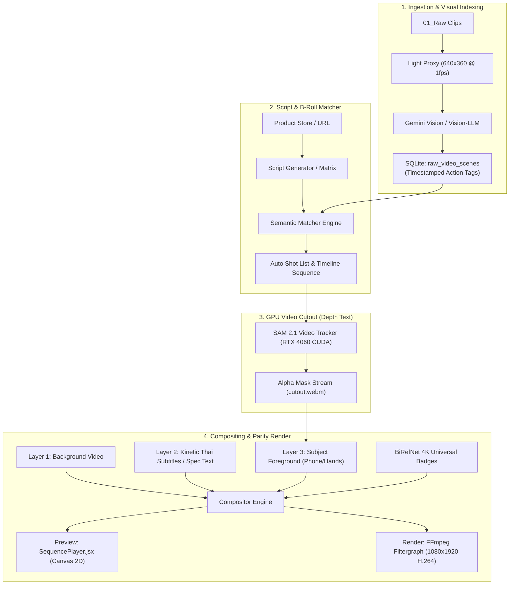

# 🚀 แผนพัฒนาเชิงลึก 3 ฟีเจอร์ยกระดับ Omnicut Pro Studio

เอกสารแผนแม่บทเชิงสถาปัตยกรรมและการลงมือพัฒนา (Implementation Blueprint) สำหรับโปรเจกต์ `D:\Programmer\All Project\Omnicut` โดยมุ่งเน้นการดึงศักยภาพของการ์ดจอ **NVIDIA GeForce RTX 4060 (8GB VRAM) + Intel Core i7-14700** มาขับเคลื่อนระบบตัดต่อวิดีโอสั้นอัตโนมัติ

---

## 🏗️ ภาพรวมสถาปัตยกรรมหลังการอัปเกรด (Target Architecture)

---

## 📌 ฟีเจอร์ A: ปลุกชีพ "Text Behind Product" (Depth Text ด้วย SAM 2 บน RTX 4060)

### 1. วัตถุประสงค์และปัญหาเดิม
* **ปัญหาเดิม:** ใน `TODO.md` รอบ `SAM2-CPU-FEASIBILITY-SPIKE-20260926` เคยรัน SAM 2 บน CPU พบว่าคลิป 2 วินาที ใช้เวลาเรนเดอร์ถึง 12 นาที (ช้ากว่าเวลาจริง 358 เท่า) ทำให้ต้องระงับไว้และถอยกลับไปใช้ `rembg` (u2net)
* **ข้อจำกัดของ rembg เดิม:** ตัดแบบ Frame-by-frame ขาด Temporal Consistency ทำให้ขอบวัตถุกระพริบ (Flickering jitter)
* **ทางแก้ใหม่:** รัน **SAM 2.1 (`sam2.1_hiera_tiny` หรือ `small`) บน RTX 4060 CUDA** โดยใช้โมเดล Checkpoint ที่โหลดไว้แล้วใน `external_repos/sam2/checkpoints/`
  * ผลทดสอบจริง (2026-09-29): รัน 60 เฟรมจบใน **7.78 วินาที** (เร็วขึ้น **92 เท่า**) ใช้ VRAM เพียง 1.39 GB
  * ขอบวัตถุนิ่งสนิทตลอดการขยับของมือและสินค้า เพราะ SAM 2 มี Memory Bank จดจำรูปร่างข้ามเฟรม

### 2. การออกแบบส่วนประกอบในโค้ด (Components Design)
1. **Runtime Isolation (`tools/cutout_runtime`):**
   * อัปเดต `tools/cutout_runtime/.venv` ติดตั้ง `torch==2.6.0+cu124` เชื่อมโยงกับ RTX 4060 พร้อมแพ็กเกจ `external_repos/sam2`
2. **Worker ตัวใหม่ (`scripts/background_isolation_sam2_worker.py`):**
   * รับอินพุตวิดีโอและ Point Prompt (จุดกึ่งกลางสินค้า)
   * สตรีม Mask + Source Frame เข้า FFmpeg เพื่อคอมไพล์เป็น `cutout.webm` (VP9 with Alpha)
3. **การเชื่อมต่อกับไทม์ไลน์และ Preview (`SequencePlayer.jsx` + `video_editor.py`):**
   * โค้ดฝั่ง `subject_layer` ที่มีอยู่แล้วจะรับ `cutout.webm` มาวาดทับเหนือเลเยอร์ข้อความซับไตเติล
   * **ลำดับการวาด (Z-Index):**
     * `Z=0`: วิดีโอดั้งเดิม (Background)
     * `Z=1`: ซับไตเติล Kinetic / ป้ายราคา / ตัวหนังสือสเปก (Text)
     * `Z=2`: วิดีโอ Mask สินค้า (`cutout.webm`) เฉพาะวัตถุสินค้าและมือที่ถือ
     * `Z=3`: Universal Badges / สติกเกอร์เตือน / โลโก้แบรนด์

---

## 📌 ฟีเจอร์ B: อัปเกรดระบบตัดฉากหลังสติกเกอร์ (BiRefNet แทน rembg เดิม)

### 1. วัตถุประสงค์และปัญหาเดิม
* **ปัญหาเดิม:** สติกเกอร์ Universal Badges 6 แบบ (ป้ายรีวิว, ป้ายสเปก, ป้ายโปรโมชั่น) และภาพสินค้าไดคัท ใช้ `rembg` (u2net) บน CPU ONNX Runtime ซึ่งมักเกิดปัญหาขอบสายไฟ/สายชาร์จ Type-C แหว่งหรือหาย ขอบกระจกหน้าจอสมาร์ทโฟนขุ่นมัว
* **ทางแก้ใหม่:** นำ **BiRefNet (Bilateral Reference Network)** จาก `external_repos/BiRefNet` เข้ามาเป็นเอนจินหลักในการตัดภาพนิ่งสินค้า
  * รองรับความละเอียดระดับต้นฉบับ (High-Resolution Matting)
  * ประมวลผลบน CUDA ใช้เวลาเพียง ~0.08 - 0.15 วินาทีต่อภาพ

### 2. การออกแบบส่วนประกอบในโค้ด (Components Design)
1. **Engine Adapter (`scripts/birefnet_engine.py`):**
   * สร้างคลาส `BiRefNetEngine` มีฟังก์ชัน `remove_background(image: Image.Image) -> Image.Image`
   * รองรับทั้งการรันบน CUDA (Default) และ Fallback ไปที่ rembg เดิมหากไม่มีการ์ดจอ
2. **การอัปเกรด Generator (`tools/build_3d_pro_badges.py`):**
   * สั่งเจนเนอเรตป้าย Universal Badges 6 แบบมาตรฐานใหม่ด้วย BiRefNet
   * เติมขอบ Die-cut ขาว `#FFFFFF` ความหนา 12-16px พร้อม Drop Shadow นุ่มตามกฎ `sticker_generation.md`

---

## 📌 ฟีเจอร์ C: Auto B-Roll Matcher ด้วย Vision-LLM (Semantic Video Indexing)

### 1. วัตถุประสงค์และปัญหาเดิม
* **ปัญหาเดิม:** ใน `ContentTrackerHub` หรือ `Gadget Media Product Studio` เวลาผู้ใช้อัดคลิปดิบ 3-5 นาทีลง `01_Raw` ผู้ใช้ยังต้องมานั่งดูคลิปเองว่า วินาทีไหนคือฉากโชว์กล้อง วินาทีไหนคือฉากเสียบสายชาร์จ
* **ทางแก้ใหม่:** สร้าง **Background Video Indexer** ทำงานแบบ Event-driven:
  * เมื่อมีคลิปใหม่ลง `01_Raw` ระบบจะสแกนและสร้าง **Semantic Action Map** เก็บลง SQLite
  * เมื่อ AI สร้างสคริปต์รีวิวเสร็จ ระบบจะจับคู่ประโยคสคริปต์เข้ากับช่วงคลิปที่ตรงกัน 100% โดยอัตโนมัติ

### 2. การออกแบบส่วนประกอบในโค้ด (Components Design)
1. **Lightweight Proxy Extractor (`scripts/media_service.py`):**
   * สกัดคลิปความละเอียดต่ำ 640x360 @ 1 FPS สำหรับส่งให้โมเดลดู
2. **Vision Ingestion Agent (`scripts/video_semantic_indexer.py`):**
   * ส่ง Proxy เข้า Gemini 2.5 Flash ผ่านโครงสร้างของ `scripts/gemini_vision_matcher.py` ที่มีอยู่แล้ว
   * บันทึก metadata ลงตาราง SQLite `raw_video_scenes` ใน `_Docs/store.db`
3. **Auto-Assembly Timeline (`scripts/pipeline.py` / `editorial_pacing.py`):**
   * เมื่อสคริปต์ท่อน Hook พูดถึงฟังก์ชันใด Semantic Matcher ค้นหาแท็กใน SQLite ดึงช่วงเวลามาตัดลง Track วิดีโอทันทีตามกฎ **J-Cut**
