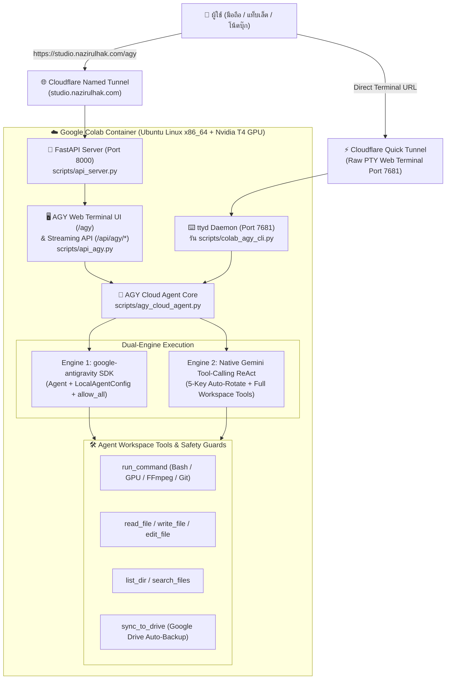

# 🗺️ แผนสถาปัตยกรรมและการดำเนินงาน: AGY Interactive Web Terminal & Autonomous Cloud Agent บน Google Colab

> **วันที่:** 2026-10-30  
> **รอบงาน:** `Round ANTIGRAVITY-AGY-COLAB-WEB-TERMINAL-20261030`  
> **ดำเนินการโดย:** Antigravity (Gemini 4 Argon)  
> **ผลตรวจ Jev Decision Layer:** `choice = C_dual_hybrid_terminal` (`confidence = 0.98`, `verdict = proceed`)

---

## 🎯 1. วัตถุประสงค์หลัก (Core Objectives)

เปลี่ยน **Google Colab Cloud Runner** จากเดิมที่เป็นเพียงเซิร์ฟเวอร์เรนเดอร์แบบรอรับคำสั่ง (Passive Server) ให้กลายเป็น **เซิร์ฟเวอร์ AI Agent อัตโนมัติเต็มรูปแบบ (Active Autonomous Cloud Agent)** ที่ผู้ใช้สามารถเปิดหน้าจอ **Interactive Web Terminal (`agy`)** จากสมาร์ตโฟน แท็บเล็ต หรือคอมพิวเตอร์เครื่องใดก็ได้ แล้วพิมพ์สั่งงานด้วยภาษาธรรมชาติ (ไทย/อังกฤษ) หรือคำสั่งระบบได้ทุกอย่าง 100% โดยไม่กินทรัพยากรเครื่องคอมพิวเตอร์ที่บ้าน (0% Local PC Hardware Load)

---

## 🏗️ 2. สถาปัตยกรรมระบบแบบ Dual-Hybrid (`C_dual_hybrid_terminal`)

---

## 🧩 3. รายละเอียดส่วนประกอบทั้ง 4 ชั้น (4-Layer Implementation)

### ชั้นที่ 1: `scripts/agy_cloud_agent.py` — AGY Cloud Agent Core (Dual-Engine)
- **Dual-Engine Design (รับประกันทำงานได้ 100% ทุกสภาพแวดล้อม):**
  1. **Engine 1 (`google-antigravity` SDK):** เรียกใช้ `google.antigravity.Agent` พร้อม `LocalAgentConfig(policies=[policy.allow_all()])` เมื่อติดตั้งและไบนารีรองรับบนคอนเทนเนอร์
  2. **Engine 2 (Native Gemini ReAct Tool-Calling Engine):** ระบบ Agentic Loop ในตัวที่เชื่อมต่อ Gemini API (`gemini-2.5-flash` / `gemini-2.5-pro`) พร้อมระบบ **Auto-Rotate 5 API Keys** อัตโนมัติเมื่อเกิด HTTP 429 Quota Exceeded
- **ชุดเครื่องมือมาตรฐาน (7 Built-in Tools):**
  1. `run_command(command, timeout_sec)`: รันคำสั่ง Shell/Bash ใน `/content/Omnicut` (หรือรากโปรเจกต์) เช่น สั่งเรนเดอร์ HyperFrames, รัน Whisper GPU, เช็ก `nvidia-smi`, หรือ `git pull/push`
  2. `read_file(path, start_line, end_line)`: อ่านโค้ดหรือไฟล์ JSON/Markdown
  3. `write_file(path, content)`: สร้างหรือเขียนไฟล์ใหม่
  4. `edit_file(path, target, replacement)`: แก้ไขโค้ดแบบแม่นยำ
  5. `list_dir(path)`: สำรวจไฟล์และโฟลเดอร์พร้อมขนาดไฟล์
  6. `search_files(pattern, path)`: ค้นหาข้อความหรือโค้ดทั่วทั้งโปรเจกต์
  7. `sync_to_drive(subpath)`: ซิงก์คลิปวิดีโอจาก `04_Exports/Ready_to_post/` และภาพปกไปยัง `/content/drive/MyDrive/Omnicut_Exports/`
- **Safety Guardrails (ตามกฎเหล็ก `AGENTS.md`):**
  - บล็อกคำสั่งทำลายล้าง เช่น `rm -rf /`, การลบไฟล์ใน `01_Raw/` หรือ `02_Assets/` โดยไม่ได้รับอนุญาต
  - โหลด System Prompt ที่ฝังบริบทของโปรเจกต์ OmniCut Pro Studio (โครงสร้างโฟลเดอร์, กฎ Couple Paper Chat #5 น้องนุ้ย & พี่บ่าว, คำสั่งเรนเดอร์ GPU) ให้ Agent รู้จักโปรเจกต์ตั้งแต่วินาทีแรก

### ชั้นที่ 2: `scripts/api_agy.py` — Built-in AGY Web Terminal & REST/SSE API (`/agy`)
- เชื่อมต่อเข้ากับ `scripts/api_server.py` โดยตรง ทำให้เข้าถึงผ่านโดเมนถาวร **`https://studio.nazirulhak.com/agy`** ได้ทันทีโดยไม่ต้องเปิดพอร์ตแยก
- **Endpoints:**
  - `GET /agy` — หน้าเว็บคอนโซล **AGY Cloud Terminal (Dark Obsidian / Cyberpunk Terminal UI)** รองรับทั้งมือถือและเดสก์ท็อป
  - `GET /api/agy/status` — ตรวจสอบสถานะ Agent, โมเดล, จำนวนคีย์ที่พร้อมใช้งาน, สถานะ GPU (`nvidia-smi`), พื้นที่ดิสก์ และสถานะ Google Drive
  - `POST /api/agy/chat` — ส่งคำสั่งภาษาคนให้ Agent ทำงาน (รองรับทั้งโหมดปกติและโหมด `/goal` ทำงานต่อเนื่องหลายขั้นตอน) พร้อมคืนประวัติ Thought + Tool Calls + Output
  - `POST /api/agy/stream` — ส่งคำสั่งแบบ **Server-Sent Events (SSE) Real-Time Streaming** เห็นทุกขั้นตอน (`thinking`, `tool_call`, `tool_result`, `answer`) สดๆ บนหน้าจอ Terminal
  - `POST /api/agy/exec` — รันคำสั่ง Shell ด่วน (`!command`) แล้วรับ `stdout`/`stderr` ทันที
  - `POST /api/agy/drive-sync` — สั่งซิงก์ไฟล์ Export ลง Google Drive ทันที
  - `GET /api/agy/sessions` & `DELETE /api/agy/sessions/{session_id}` — จัดการประวัติการสนทนา

### ชั้นที่ 3: `scripts/colab_agy_cli.py` — Interactive CLI (`agy`) สำหรับ Terminal & `ttyd`
- สคริปต์ Interactive CLI ที่รันได้ทั้งใน `ttyd` Web Terminal (พอร์ต 7681) และใน Colab Terminal
- รองรับ Slash Commands ครบครัน:
  - `/help` — แสดงคู่มือคำสั่งทั้งหมด
  - `/status` — แสดงสถานะ GPU, RAM, Disk, API Keys และ Google Drive
  - `/goal <เป้าหมาย>` — โหมด Autonomous ทำงานต่อเนื่องจนกว่าเป้าหมายจะสำเร็จ
  - `/keys` — ตรวจสอบสถานะ API Keys ทั้ง 5 ตัว
  - `/drive-sync` — ซิงก์ไฟล์วิดีโอเข้า Google Drive
  - `/clear` — ล้างประวัติบทสนทนา
  - `!<คำสั่ง>` — รันคำสั่ง Linux Bash โดยตรง (เช่น `!nvidia-smi`, `!git status`)

### ชั้นที่ 4: อัปเดต `scripts/build_colab_notebook.py` & `Omnicut_Cloud_Runner.ipynb`
- ติดตั้ง `google-antigravity` และ `ttyd` binary อัตโนมัติในขั้นตอน Setup บน Colab
- สร้างคำสั่งลัด `/usr/local/bin/agy` ให้เรียกใช้ `agy` ได้จากทุกที่ใน Linux Shell
- เปิดบริการ `ttyd` บนพอร์ต `7681` คู่กับ FastAPI พอร์ต `8000`
- อัปเดตการ์ด Dashboard บน Colab ให้มีปุ่มคู่:
  1. **`✨ เปิด OmniCut Pro Studio`** (`https://studio.nazirulhak.com`)
  2. **`🖥️ เปิด AGY Interactive Web Terminal (สั่งงาน AI อิสระ 100%)`** (`https://studio.nazirulhak.com/agy` + ลิงก์ `ttyd` สำรอง)
- อัปเดตระบบ Watchdog Keepalive ให้ดูแลทั้ง FastAPI และ `ttyd` อัตโนมัติ

---

## 🧪 4. แผนการตรวจสอบและทดสอบ (Verification Gate)

1. รัน `python -m compileall -q scripts tests` ตรวจสอบ Syntax 100%
2. รันชุดทดสอบ `pytest tests/test_agy_cloud_agent.py -q` ทดสอบ:
   - Safety Guard บล็อกคำสั่งลบ `01_Raw/` และ `02_Assets/`
   - การทำงานของ Workspace Tools (`read_file`, `write_file`, `edit_file`, `list_dir`, `search_files`, `run_command`)
   - การสลับคีย์อัตโนมัติ (Key Rotation) และการเรียก Agent Loop
   - FastAPI Endpoints (`/agy`, `/api/agy/status`, `/api/agy/exec`, `/api/agy/chat`, `/api/agy/stream`)
3. รัน `scripts/build_colab_notebook.py` เพื่อเจน `Omnicut_Cloud_Runner.ipynb` เวอร์ชันล่าสุดและตรวจสอบโครงสร้าง JSON ของ Notebook
