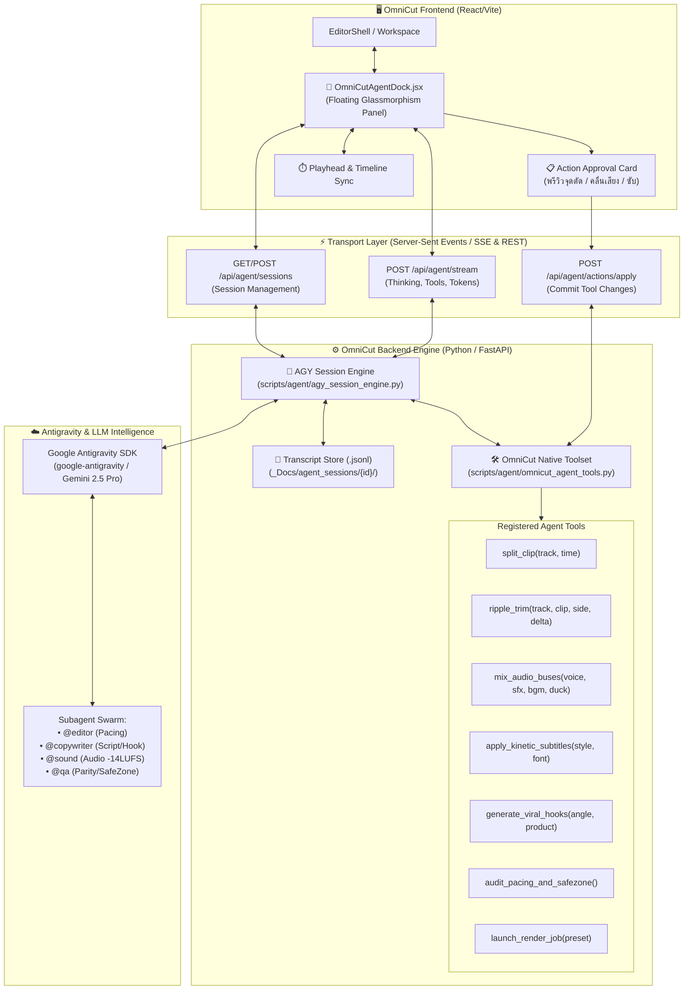

# 🧠 Master Architecture & Implementation Plan: Native In-App Antigravity (AGY) AI Agent for OmniCut Pro Studio

**โปรเจกต์:** OmniCut Pro Studio (CapCut Video Production Engine)  
**วันที่จัดทำ:** 1 พฤศจิกายน 2026  
**สถานะ:** แผนแม่บทสถาปัตยกรรม (Architectural Blueprint & Implementation Roadmap)  
**ผู้จัดทำ:** Antigravity (Gemini 3.8 Flash)

---

## 1. วิสัยทัศน์และเหตุผล (Executive Vision & Rationale)

เดิมทีระบบมีการเชื่อมต่อ AGY ผ่าน **Colab AGY Terminal** ซึ่งเป็นการเปิดหน้าต่าง Bash Web Terminal (`ttyd`) แยกแท็บบน Cloud ซึ่ง:
- ขาดความเชื่อมโยงกับโปรแกรมตัดต่อ (Isolated Context)
- ต้องสั่งงานผ่าน Command Line บนหน้าจอดำ ซึ่งไม่ตอบโจทย์ Workflow ของนักตัดต่อและ Content Creator
- ไม่สามารถมองเห็นหรือแก้ไขไทม์ไลน์, สคริปต์, คลื่นเสียง, หรือวิดีโอบนหน้าจอได้แบบ Real-time

**เป้าหมายใหม่ (Native In-App AI Co-Producer & Video Editor):**  
ยกระดับสู่การนำ **Antigravity (AGY) Agent Session** เข้ามาฝังเป็น **ผู้ช่วย AI อัจฉริยะในหน้าโปรแกรมโดยตรง (In-App AI Agent)** เสมือนมีผู้ช่วยผู้กำกับและมือตัดต่อระดับ Pro นั่งคู่กับผู้ใช้ในโปรแกรม โดยมีความสามารถ:
1. **Interactive Streaming & Chain-of-Thought:** พูดคุยภาษาไทยธรรมชาติ เห็นการคิดวิเคราะห์ (Reasoning Process) และสตรีมคำตอบแบบ Token-by-Token
2. **Direct NLE Timeline Manipulation:** มี Tool Calling สั่งตัดคลิป (`Split`), ตัดหัวท้าย (`Ripple Trim Q/W`), ปรับความดังเสียง 4 บัส, เปลี่ยนสไตล์ซับไตเติล, เจน Hook เปิดคลิป, และสั่งเรนเดอร์ได้จากช่องแชตโดยตรง
3. **Timeline & Visual Awareness:** มองเห็นสถานะไทม์ไลน์ปัจจุบัน (Playhead, คลิปที่เลือก, ความยาว, เสียงพากย์) และสามารถกระโดดหัวอ่านไปยังจุดที่พูดถึงได้ทันที
4. **Non-Destructive Action Cards:** ทุกการแก้ไขมี Action Card ให้ผู้ใช้พรีวิวและกด **"อนุมัติ (Apply)"** หรือ **"ยกเลิก (Discard)"** ก่อนเปลี่ยนไทม์ไลน์จริง

---

## 2. แผนผังสถาปัตยกรรมระบบ (System Architecture Diagram)

---

## 3. รายละเอียดสถาปัตยกรรม 4 ชั้น (4-Tier Architecture)

### 🔹 ชั้นที่ 1: Antigravity Session Engine & Protocol (Backend)
- **ไฟล์เป้าหมาย:** `scripts/agent/agy_session_engine.py`, `scripts/agent/api_agent.py`
- **การทำงาน:**
  1. **Durable Session Persistence:** เซฟประวัติบทสนทนาเป็นไฟล์ JSON Lines (`transcript.jsonl`) เหมือน Antigravity จริง สามารถสลับเซสชัน คุยต่อจากเดิม หรือย้อนดูประวัติได้
  2. **Event-Driven Streaming Protocol (SSE):** ส่งอีเวนต์แบบเรียลไทม์:
     - `event: thought` -> สตรีมกระบวนการคิดของเอเจนต์ (แสดงใน Thinking Drawer)
     - `event: tool_call` -> แจ้งเตือนว่ากำลังเรียกใช้เครื่องมือใด พร้อมพารามิเตอร์
     - `event: token` -> สตรีมเนื้อหาคำตอบภาษาไทยทีละคำ
     - `event: action_proposal` -> ส่ง Action Card ให้หน้าบ้านพรีวิวการตัดต่อ
     - `event: done` -> สรุปการทำงานและโทเคนที่ใช้

### 🔹 ชั้นที่ 2: OmniCut NLE Action Toolset (เครื่องมือควบคุมโปรแกรม)
- **ไฟล์เป้าหมาย:** `scripts/agent/omnicut_agent_tools.py`
- **ชุดเครื่องมือที่ติดตั้งให้ AI Agent ใช้งานจริง:**

| ชื่อเครื่องมือ (Tool Name) | พารามิเตอร์ | ความสามารถและหน้าที่ |
| :--- | :--- | :--- |
| `get_editor_state` | `(include_clips=True)` | ดึงข้อมูลไทม์ไลน์ปัจจุบัน: เวลาหัวอ่าน, ความยาวคลิป, โครงสร้างแทร็ก, ค่าเสียง |
| `edit_split_clip` | `(track_id, clip_id, at_sec)` | ตัดแบ่งคลิปวิดีโอ/เสียง ณ ตำแหน่งวินาทีที่กำหนด |
| `edit_ripple_trim` | `(track_id, clip_id, side, delta_sec)` | ตัดหัวหรือท้ายคลิปแบบ Ripple เลื่อนคลิปข้างหลังตามมาอัตโนมัติ |
| `edit_audio_balance` | `(voice_vol, sfx_vol, bgm_vol, duck_db)` | ปรับสัดส่วน 4 บัสและตั้งค่า Ducking หลบเสียงพากย์อัตโนมัติ |
| `edit_subtitle_style` | `(preset, font, highlight_color)` | ปรับแต่งซับ Micro-burst (Mali-Bold 88px, ขอบดำ 5.2px, เซฟโซนล่าง 420px) |
| `create_viral_hooks` | `(product_id, hook_style, num_hooks)` | วิเคราะห์จุดขายและเจน Hook 1.8 วินาทีแรกให้ดึงดูดสายตา |
| `inspect_safe_zone` | `(check_elements=['text', 'stickers'])` | ตรวจสอบว่ามีตัวหนังสือหรือสติกเกอร์หลุดเข้าไปในโซนปุ่ม TikTok หรือไม่ |
| `trigger_render` | `(preset='post')` | สั่งเรนเดอร์คลิปวิดีโอเข้าสู่คิวพื้นหลังอัตโนมัติ |

### 🔹 ชั้นที่ 3: Native In-App UI Dock (หน้าบ้าน React/Vite)
- **ไฟล์เป้าหมาย:** `frontend/src/components/agent/OmniCutAgentDock.jsx`, `frontend/src/components/agent/ActionApprovalCard.jsx`
- **ดีไซน์และฟีเจอร์:**
  1. **Floating Collapsible Studio Dock:** แผงควบคุมสไตล์ Dark Obsidian Glassmorphism สามารถพับเก็บ, ลอยเหนือไทม์ไลน์, หรือยึดไว้ข้างพรีวิวได้
  2. **Collapsible Thinking Process:** แผงแสดงความคิดของ AI พับเก็บได้ เพื่อไม่ให้รกสายตา แต่สามารถคลิกดูตรรกะเบื้องหลังได้ตลอดเวลา
  3. **Interactive Timestamps:** ทุกครั้งที่ AI พูดถึงเวลา เช่น `00:04.15` ผู้ใช้สามารถคลิกเพื่อเลื่อนหัวอ่าน (Playhead) ไปที่จุดนั้นบนไทม์ไลน์ได้ทันที
  4. **Non-Destructive Action Cards:** เมื่อ AI แนะนำการตัด (เช่น "แนะนำให้ตัดช็อตนี้ออก 0.8 วินาทีเพื่อให้เข้ากับจังหวะบีทเพลง") ระบบจะแสดงปุ่ม:
     - `[อนุมัติการตัด]` -> ปรับแก้ไทม์ไลน์จริงทันที
     - `[ลองเล่นพรีวิว]` -> วนลูปเล่นเฉพาะช่วงที่มีการปรับ
     - `[ยกเลิก]` -> คงสถานะไทม์ไลน์เดิม

### 🔹 ชั้นที่ 4: Multi-Agent Subagent Swarm (ทีมผู้ช่วยเฉพาะทาง)
ผู้ใช้สามารถ Mention เรียกใช้ผู้ช่วยเฉพาะทางในช่องแชตได้:
- `@editor` — เน้นเรื่องจังหวะการตัด, ความกระชับ, Pacing Curve, J-Cut
- `@copywriter` — เน้นการเขียนบทคู่รักสายใต้ (น้องนุ้ย & พี่บ่าว), คำคม, Hook เปิดคลิป
- `@sound` — เน้นคุมระดับความดัง -14.0 LUFS, จังหวะ Beat Drop, ใส่ SFX อารมณ์
- `@qa` — ตรวจสอบข้อผิดพลาด, เซฟโซน TikTok, ตรวจเช็ก Parity 100%

---

## 4. แผนงานการพัฒนาและส่งมอบ (Implementation Roadmap)

| ระยะการดำเนินงาน (Phase) | เนื้อหางาน (Key Deliverables) | เกณฑ์การวัดผล (Acceptance Criteria) |
| :--- | :--- | :--- |
| **Phase 1: Backend Agent Engine & Tooling** | • สร้าง `scripts/agent/agy_session_engine.py` • พัฒนา `scripts/agent/omnicut_agent_tools.py` • ติดตั้ง SSE Streaming Endpoint `/api/agent/stream` | Agent ตอบคำถามและเรียก Tool พื้นฐานสำเร็จผ่าน pytest |
| **Phase 2: Timeline Tools & State Sync** | • เชื่อมต่อ Tool เข้ากับ `useEditorCommands.js` และ `scripts/api_editor.py` • รองรับการอ่านและเขียน Project Manifest แบบ Non-Destructive | สามารถสั่ง "ตัดคลิปที่วินาที 3.5" ผ่าน API แล้วไทม์ไลน์ขยับถูกต้อง |
| **Phase 3: Frontend In-App Agent UI** | • สร้างคอมโพเนนต์ `OmniCutAgentDock.jsx` • ติดตั้ง Action Approval Card และ Interactive Timestamps • เชื่อมต่อปุ่มลอยหรือคีย์ลัด `Ctrl + K` / `Cmd + K` | ผู้ใช้สามารถกดเปิดแชต ถามตอบ และกดอนุมัติการตัดต่อได้ในหน้า Editor |
| **Phase 4: Multi-Agent Swarm & Polish** | • ติดตั้ง System Prompts และ Subagents (`@editor`, `@copywriter`, `@sound`) • ปรับแต่ง Glassmorphism UI ให้คลีน 100% ตาม Rule 3.8/4.8 • ทดสอบ Vitest + Parity Tests 100% | ระบบพร้อมใช้งานจริง 100% ตอบสนองไว ไร้รอยต่อ |

---

## 5. การดำเนินการทันทีในรอบนี้ (Current Step Completion)

1. ✅ **ลบปุ่ม "เปิด AGY Terminal" และโค้ด Colab ออก 100%:**
   - ถอดปุ่มออกจาก `frontend/src/components/Topbar.jsx`
   - ถอดเมนูออกจาก `frontend/src/components/Sidebar.jsx`
   - ถอด Router `agy_router` ออกจาก `scripts/api_server.py`
   - บิลด์และรันชุดทดสอบผ่าน 100%
2. ✅ **จัดทำแผนแม่บทการเชื่อมต่อ Antigravity (AGY) เข้าเป็น In-App AI Agent:**
   - บันทึกและจัดเก็บแผนแม่บทฉบับเต็มไว้ใน [`_Docs/Plans/PLAN_ANTIGRAVITY_IN_APP_AI_AGENT_INTEGRATION.md`](file:///d:/Programmer/All%20Project/Omnicut/_Docs/Plans/PLAN_ANTIGRAVITY_IN_APP_AI_AGENT_INTEGRATION.md)
