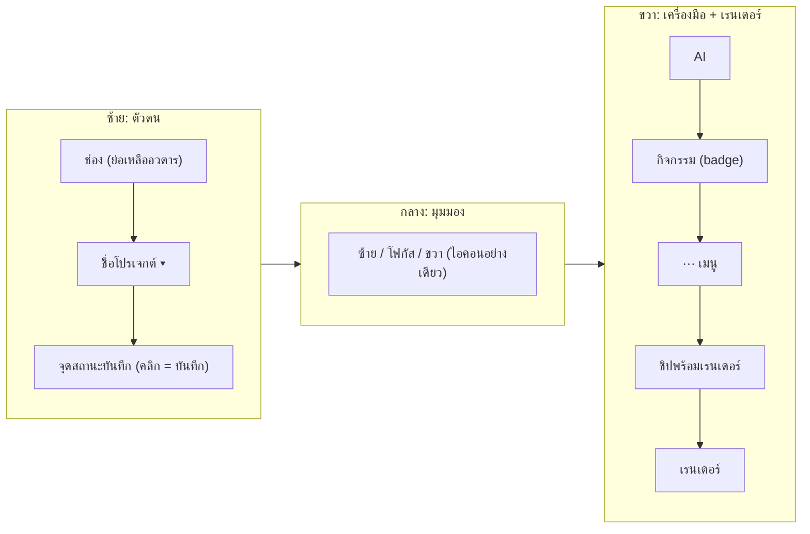

# แผนออกแบบ Navbar ห้องตัดต่อใหม่ (Editor Header Declutter)

ดำเนินการโดย: Antigravity (Claude Opus 5.5) · วันที่ 2026-11-08 · สถานะ: **รอผู้ใช้อนุมัติ (ยังไม่แตะโค้ด)**

ไฟล์เป้าหมาย: `frontend/src/components/editor/EditorHeader.jsx` (447 บรรทัด)

---

## 1. ปัญหาตอนนี้

ในแถวเดียวมี **ปุ่ม/ชิปทั้งหมด 16 ตัว** แถมแต่ละตัวมีกรอบและสีของตัวเอง เลยเต็มจนปุ่มเรนเดอร์ถูกดันตกขอบขวา

| # | ปุ่ม/ชิป | ปัญหา |
|---|---|---|
| 1 | ไอคอนกรรไกร | ไว้ตกแต่งอย่างเดียว ซ้ำกับโลโก้ที่แถบซ้าย |
| 2 | ตัวเลือกช่อง (@rizanntry) | ใช้ไม่บ่อย แต่กินที่ |
| 3 | ตัวเลือกโปรเจกต์ | จำเป็น |
| 4 | Timecode `00:09:20 / 00:00:...` | ซ้ำกับตัวเล่นวิดีโอ ไม่ใช่ข้อมูลระดับ navbar |
| 5 | ชิปสถานะบันทึก | **ซ้ำ** กับปุ่ม "บันทึก" (#11) |
| 6–8 | ซ้าย / โฟกัส / ขวา (มีข้อความ) | ควบคุมมุมมอง ใช้นาน ๆ ครั้ง แต่กินที่ ~180px |
| 9 | คลิปใหม่ | เป็นงานระดับโปรเจกต์ ไม่ใช่งานตัดต่อ |
| 10 | สั่งงาน AI Agent + `Ctrl+K` | ป้ายคีย์ลัดควรอยู่ใน tooltip |
| 11 | กิจกรรม 24 | ข้อความยาว ใช้แค่ตัวเลขแจ้งเตือน |
| 12 | `...` เมนูเพิ่มเติม | มีอยู่แล้วแต่ยังใส่ของไม่ครบ |
| 13 | บันทึก | มี autosave อยู่แล้ว |
| 14 | ปก | **เกี่ยวกับความพร้อมก่อนเรนเดอร์** |
| 15 | ข้อเตือนใจ | **เกี่ยวกับความพร้อมก่อนเรนเดอร์** |
| 16 | ลายน้ำ (checkbox) | เป็นค่าตั้งของโปรเจกต์ ไม่ใช่สิ่งที่กดบ่อย |
| 17 | ตรวจแผน 88/100 | **เกี่ยวกับความพร้อมก่อนเรนเดอร์** |
| 18 | เรนเดอร์ | ปุ่มหลัก ต้องเห็นชัดที่สุด |

สาเหตุหลักมี 3 อย่าง: (ก) ข้อมูลซ้ำ (สถานะบันทึก 2 จุด) (ข) ปุ่มเกี่ยวกับ "ความพร้อมเรนเดอร์" กระจายอยู่ 3 ปุ่ม (ค) ค่าตั้งที่นาน ๆ ใช้ครั้งถูกวางไว้ระดับเดียวกับปุ่มหลัก

---

## 2. Layout ใหม่ (3 โซน)

```
┌──────────────────────────────────────────────────────────────────────────────────────┐
│ [@ช่อง▾] COD01-โปรไฟลุ_1 ▾ ● บันทึกแล้ว │      [◧ ▣ ◨]       │ ✦ AI │ 🔔24 │ ⋯ │ [🛡 พร้อม 88 · 2]  [▶ เรนเดอร์ ▾] │
└──────────────────────────────────────────────────────────────────────────────────────┘
   ซ้าย: ตัวตนโปรเจกต์               กลาง: มุมมอง          ขวา: เครื่องมือ + เส้นทางเรนเดอร์
```

จาก 16 ตัว → **เหลือที่มองเห็น 8 ตัว**



### 2.1 โซนซ้าย: ตัวตนโปรเจกต์
- **ลบ** ไอคอนกรรไกร (#1)
- **ตัวเลือกช่อง** ย่อเหลืออวตารกับจุดสถานะ ชื่อเต็มไปอยู่ใน dropdown
- **รวม "สถานะบันทึก" กับ "ปุ่มบันทึก"** เป็นตัวเดียว: ชิปข้างชื่อโปรเจกต์ (`● บันทึกแล้ว` / `● มีการแก้ไข` / `⟳ กำลังบันทึก` / `⚠ บันทึกไม่สำเร็จ`) คลิกแล้วบันทึกทันที และ `Ctrl+S` ยังใช้ได้เหมือนเดิม
- **ย้าย "คลิปใหม่"** ไปเป็นรายการบนสุดของ dropdown ตัวเลือกโปรเจกต์ (`<Plus/> สร้างคลิปใหม่`)
- **ย้าย Timecode** ลงไปที่แถบตัวเล่น ถ้าตัวเล่นยังไม่มี ต้องเพิ่มที่นั่นก่อน จะลบจาก navbar หลังจากนั้นเท่านั้น

### 2.2 โซนกลาง: มุมมอง
- segmented 3 ปุ่ม (ซ้าย/โฟกัส/ขวา) **เหลือแค่ไอคอน** บอกชื่อผ่าน tooltip + `aria-label` ใช้สีเดิมตอนเปิดใช้ (cyan / amber / ส้ม)
- จัดไว้กึ่งกลาง ตรงกับคอลัมน์พรีวิว

### 2.3 โซนขวา: เครื่องมือ + เส้นทางเรนเดอร์
- **AI**: `<Sparkles/> AI` ป้าย `Ctrl+K` ย้ายไปอยู่ใน tooltip
- **กิจกรรม**: ไอคอนกับตัวเลข badge
- **เมนู `⋯`** แบ่งเป็นกลุ่มดังนี้

  | กลุ่ม | รายการ |
  |---|---|
  | มุมมอง | ขยายพรีวิวเต็มพื้นที่ · รีเซ็ตขนาดพาเนล |
  | ค่าตั้งโปรเจกต์ | **แสดงลายน้ำช่อง (สวิตช์)** ← ย้ายมาจาก #16 |
  | ช่วยเหลือ | **เปิดข้อเตือนใจ** ← ย้ายมาจาก #15 · ดูคีย์ลัด |
  | โปรเจกต์ | โหลดโปรเจกต์ใหม่ · ลบโปรเจกต์นี้ (danger) |

- **ชิปพร้อมเรนเดอร์ (ตัวใหม่)** รวม #14 ปก + #15 ข้อเตือนใจ + #17 ตรวจแผน เป็นตัวเดียว
  - แสดง `<ShieldCheck/> 88` และ badge จำนวนปัญหา
  - สีตามสถานะจริง: เขียว = พร้อม / เหลือง = มีคำเตือน / แดง = มี error **หรือยังไม่มีปก**
  - คลิกแล้วเปิด popover รายการเช็ก: `ภาพปก ✓/✗ [สร้างปก]` · `ตรวจแผน 88/100 [ดูรายละเอียด]` · `ข้อเตือนใจ N ข้อ [เปิด]`
  - ข้อมูลยังมาจาก `preflightReport`, `coverStatus`, `playbookNotes` เดิม ไม่แก้ backend
- **เรนเดอร์**: คงเดิม ยังเป็นปุ่มหลักสีส้มตัวเดียวในแถบ

### 2.4 ลดน้ำหนักทางสายตา
- ปุ่มรอง: **ไม่มีกรอบ** (ghost) จะมีพื้นหลังก็ต่อเมื่อ hover หรือ active
- ใช้สีเฉพาะเมื่อมีสถานะ (แดง/เหลือง/เขียว) เลิกใส่กรอบเหลืองถาวรให้ "ปก" และ "ข้อเตือนใจ"
- ความสูงเท่ากันทุกตัว `h-8` และ gap `1.5`

### 2.5 Responsive
| ความกว้าง | สิ่งที่เปลี่ยน |
|---|---|
| ≥ 1440 | แสดงครบตามแบบ ชิปพร้อมเรนเดอร์มีข้อความ "พร้อม" |
| 1024–1439 | ชิปพร้อมเรนเดอร์เหลือไอคอนกับตัวเลข · AI เหลือไอคอน |
| < 1024 | segmented มุมมองย้ายเข้าเมนู `⋯` |

---

## 3. ข้อขัดกับกฎที่ต้องตัดสินใจ

> `ui_clean_standard.md` §2.1 กำหนดว่า "ปุ่มต้องเป็น [Lucide Icon] + [ข้อความ] เสมอ"

แผนนี้เสนอให้ **toggle มุมมอง (ซ้าย/โฟกัส/ขวา) และกิจกรรม** เหลือแค่ไอคอน + tooltip + `aria-label` เพราะเป็นตัวควบคุมสถานะ ไม่ใช่ปุ่มแอ็กชัน ส่วนปุ่มแอ็กชัน (AI, เรนเดอร์, รายการในเมนู, ปุ่มใน popover) ยังเป็นไอคอน + ข้อความตามกฎ
→ **ต้องให้ผู้ใช้อนุมัติข้อยกเว้นนี้** และถ้าอนุมัติ ต้องเขียนข้อยกเว้นลง `ui_clean_standard.md` ด้วย

---

## 4. ขั้นตอนลงมือ (หลังอนุมัติ)

1. แยก component ย่อย: `SaveStatusChip.jsx`, `ViewToggleGroup.jsx`, `RenderReadinessChip.jsx` (+ popover)
2. เพิ่ม "สร้างคลิปใหม่" ใน `ProjectSelector`
3. ทำให้ `HeaderMenu` รองรับกลุ่ม/เส้นคั่น และรายการแบบสวิตช์ (ลายน้ำ)
4. ตรวจ/ย้าย timecode ไปที่ transport ของตัวเล่น
5. ลดขนาด `EditorHeader.jsx` ให้เหลือแค่ประกอบ 3 โซน
6. เทส:
   - Vitest: ปรับเทสเดิมที่หา `toggle-ai-agent-btn`, ปุ่มบันทึก, ปก, ลายน้ำ ให้ตรงกับตำแหน่งใหม่
   - เพิ่มเทส `RenderReadinessChip` ให้สีตรงกับสถานะ (ไม่มีปก = แดง, มี error = แดง, มีคำเตือน = เหลือง)
   - `npm run build` ต้องผ่าน
   - ตรวจด้วยสายตาผ่านเบราว์เซอร์ที่ 1366 / 1600 / 1920px
7. ไม่แตะ `SequencePlayer.jsx` (ส่วนพรีวิวเรนเดอร์) **ยกเว้น** ข้อ 4 ถ้าจำเป็น ซึ่งถ้าแตะต้องรัน parity test ตามกฎ

## 5. นอกขอบเขต
- ไม่แก้ backend, API, ตรรกะ preflight, ตรรกะเรนเดอร์
- ไม่เปลี่ยนฟอนต์หรือข้อความในวิดีโอ
