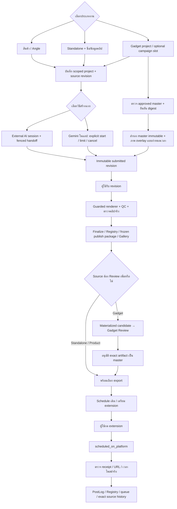

# HyperFrames HF7: ขยาย source และเชื่อม AI/approved master

ดำเนินการโดย: Codex (GPT-6) + delegated agents (Codex GPT-6) · 2026-10-12

สถานะ: ปิด HF7-A–F 2026-10-12 ด้วย tests/review/cleanup ดู [รายงานผล](../Reports/HYPERFRAMES_HF7_IMPLEMENTATION_20261012.md); ยังไม่เปิด production/paid live AI/TikTok

## โฟลว์ร่วม

## เฟสและเกณฑ์รับงาน

| เฟส | สิ่งที่ทำ | เกณฑ์ |
|---|---|---|
| HF7-A | Standalone source/metadata/finalize | ไม่ต้องมี ProductStore, identity/ชื่อเก่าไม่เปลี่ยนตาม brief ใหม่ |
| HF7-B | Gadget project/slot adapter | IDs และ facts จริง, candidate ไม่อนุมัติตัวเอง, exact master/slot readiness ก่อนโพสต์ |
| HF7-C | In-app Gemini | lease/fence/heartbeat/cancel/usage/limit/recovery; ไม่ retry paid request เอง; external session ยังใช้ได้ |
| HF7-D | Approved-master overlays | ยืนยัน digest, สำรอง, composition/media hash locked, audio/image/time parity, output ใหม่ |
| HF7-E | UI และเส้นทาง Review/Gallery | source picker จริง, missing key ตามจริง, manual accept/QC, scoped callbacks/unsaved/mobile |
| HF7-F | Main flow/backup/publication/gates | คิว/PostingJob เดิม, exact export SHA, publication artifact history ไม่ retarget, isolated tests/cleanup |

## ขอบเขต overlay และ AI

Overlay รับภาพนิ่ง PNG/JPG/WebP ไม่เกิน 24 ชั้น แต่ละภาพไม่เกิน 32 MiB/16 MP ภายใน X48–900/Y48–1500 รวมขนาด และอยู่ในระยะเวลาของ approved master ไม่แก้เสียง ฟอนต์ หรือข้อความเดิม ไม่รับ HTML/script/audio ใหม่ที่เปลี่ยน master

In-app AI ใช้ Gemini keys/SDK เดิม เริ่มจากการกดปุ่มชัดเจน มี deadline/token/payload limits และสถานะ usage ตาม response จริง การตรวจในรอบนี้ใช้ fake provider transport ไม่มี paid live call; configured ไม่เท่ากับยืนยัน key/model ด้วยคำขอจริงแล้ว

หน้า UI เลือก Gadget project จริง ส่วน optional campaign/slot binding ใช้ API กับคู่ ID จริงที่ยังตรง frozen content เท่านั้น ยังไม่มี slot selector ในหน้า UI

ไม่ restart API production ไม่โพสต์จริง ไม่กลับไปตรวจ TikTok/queue/Temp ที่ผู้ใช้ยกเลิกไว้ ไม่แก้ approved master ของจริง งานของเอเจนต์อื่นใน working tree คงเดิม

## โมดูลที่รับผิดชอบ

- Source: `hyperframes_sources.py` และ project/workflow/finalize เดิม
- AI: `hyperframes_ai_provider.py`, `api_hyperframes_ai.py`, startup recovery เดิม
- Overlay: `hyperframes_overlay.py`, `api_hyperframes_overlay.py`, worker guard
- Publishing: `hyperframes_publish_readiness.py`, Registry/Gallery/Schedule/prepare และ publication effects เดิม
- UI: Creative → HyperFrames, Gadget Review navigation และ helpers/source drafts เดิม

ผลปิดงาน: backend full3903/browser185/frontend1021/extension64/buildผ่าน; late shared237/source-publication-concurrency97/canonical-backup135/consumer52/actual-render74/backup+overlay61ผ่าน (ชุดต่าง ๆ มี cases ซ้ำ ไม่บวกเป็นยอดรวม). บันทึกรายละเอียด/skip/warnings/ข้อจำกัดในรายงานและ HISTORY; งานทดสอบไม่ใช่หลักฐาน live AI/TikTok
