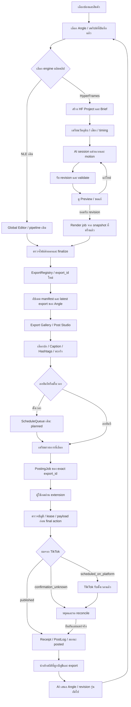
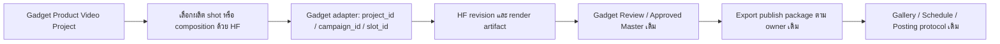
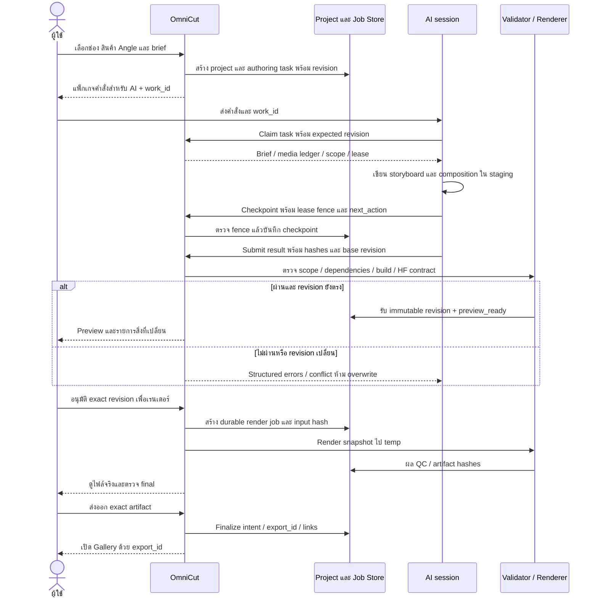
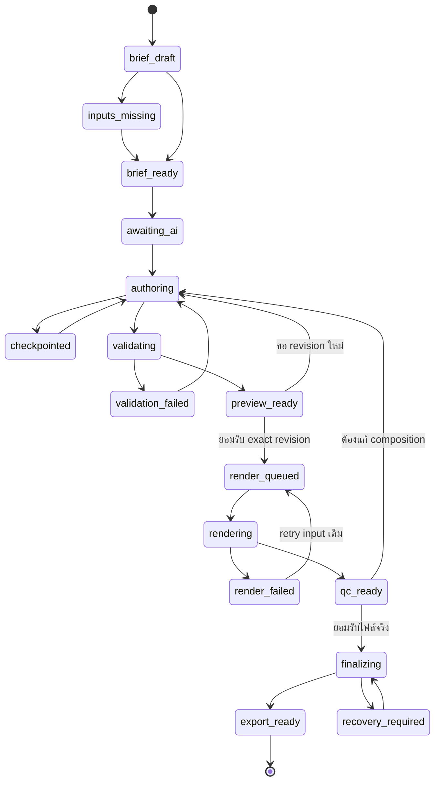
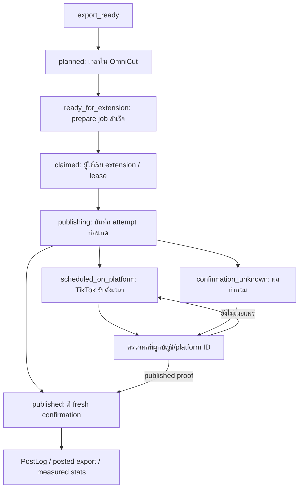
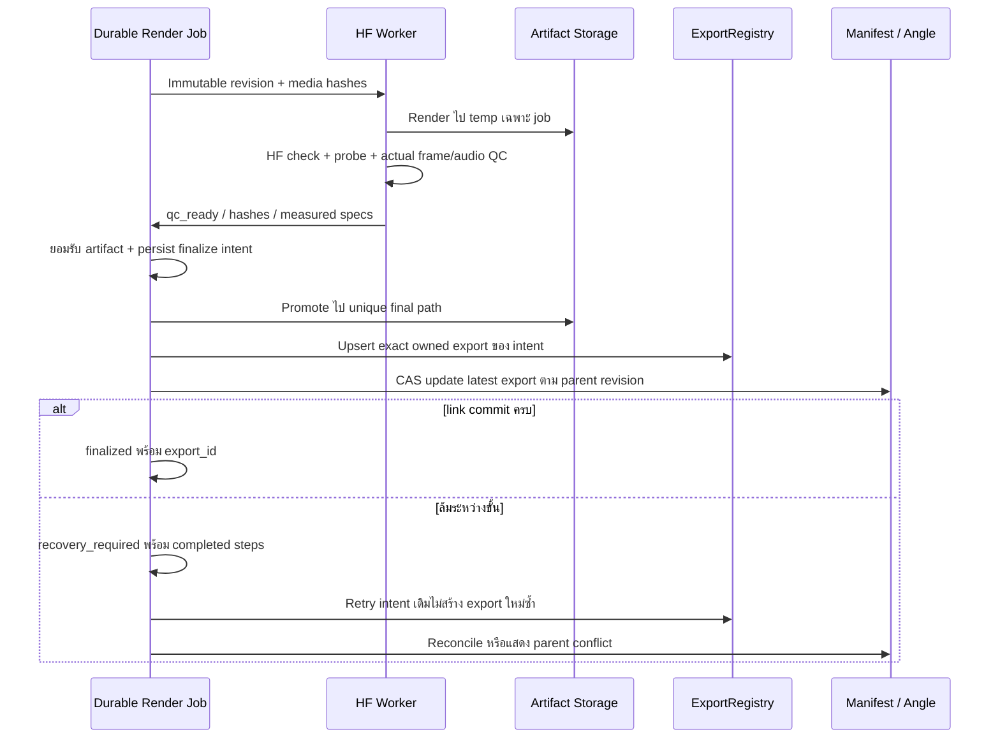

# HyperFrames เชื่อม AI กับ flow หลักของ OmniCut

ดำเนินการโดย: Codex (GPT-6) + hf_export_schedule_trace / hf_ai_handoff_trace (Codex GPT-6)

วันที่ออกแบบ: 2026-10-11 · ปิด implementation MVP: 2026-10-12 · HF0–6 ผ่าน tests/review; HF7 implementation ต่อแล้วตาม [แผน HF7](PLAN_HYPERFRAMES_HF7_20261012.md) ยังไม่เปิด production

Implementation ดำเนินการโดย: Codex (GPT-6) + delegated agents (Codex GPT-6) ดู [คู่มือ](../HYPERFRAMES_WORKFLOW_GUIDE.md), [ผล MVP](../Reports/HYPERFRAMES_IMPLEMENTATION_20261011.md) และ [ผล HF7](../Reports/HYPERFRAMES_HF7_IMPLEMENTATION_20261012.md) ส่วนผลตรวจแบบออกแบบท้ายเอกสารเป็นประวัติรอบออกแบบ ไม่ใช่สถานะโค้ดล่าสุด

## 1. ข้อสรุปและขอบเขต

ให้ HyperFrames เป็น **engine ผลิตคลิปอีกตัวใน flow เดิม** ใช้สินค้า/Angle, owner, ExportRegistry, Gallery, ScheduleQueue, PostingJobs และ PostLog ชุดเดียวกัน ไม่สร้างคิวโพสต์หรือคลังส่งออกแยก

AI session รับผิดชอบงานครีเอทีฟและสร้าง composition; แอปรับผิดชอบข้อมูลจริง การตรวจ revision การเรนเดอร์ การลงทะเบียนผลงาน และการส่งต่อคิว ผู้ใช้เลือกทิศทาง ตรวจคลิป และกด extension ตามโหมดที่ยืนยันแล้ว

เริ่ม MVP ที่ Product/Angle เดิมก่อน งาน standalone เป็นลำดับถัดไป ส่วน Gadget Media ต้องผ่าน adapter เฉพาะโดเมนและกฎ approved master ไม่แปลง Gadget project ID เป็น ProductStore ID

รอบนี้ออกแบบและ trace แบบอ่านอย่างเดียว ไม่สร้างคลิป ไม่เรนเดอร์ ไม่ตั้งคิว ไม่โพสต์ และไม่กลับไปทำ live TikTok/คิวเก่า/Temp cleanup ที่ผู้ใช้ยกเลิกแล้ว

### สิ่งที่มีอยู่และรอยต่อที่ยังขาด

| จุด | โค้ดปัจจุบัน | ผลที่ต้องแก้ก่อนเรียกว่าครบ flow |
|---|---|---|
| สร้างดราฟต์ | Hub ส่ง clip_id/product/script/style เท่านั้น `HyperFramesHub.jsx:478–481`; backend ต้องใช้ VO `api_hyperframes.py:413` | ต้องส่ง canonical parent IDs และ audio mode; เลือก/สร้างเสียงก่อนเฉพาะงานที่ต้องมี VO |
| สไตล์ | style มีใน request แต่ไม่ถูกใช้ใน generation command `api_hyperframes.py:425–429`; new_clip คัดลอก starter เดียว `kit/new_clip.py:88–90` | ให้ style เป็น versioned profile ที่ AI/template ใช้จริง ไม่ให้ UI สัญญาว่ากดเลือกแล้วภาพเปลี่ยนทันที |
| งาน no-VO | catalog POV Chat ระบุไม่มี narration แต่ CLI/API บังคับ VO | แยก narration/music_only/silent; timing และ duration ต้องมีโดยไม่สร้างเสียง dummy |
| พร้อม preview | CLAUSES ยังว่างและ timing.js ต้อง build ต่อ `kit/new_clip.py:30–34,87`; starter อ่าน timing.js | created/scaffolded ไม่เท่ากับ preview_ready |
| การผูกข้อมูล | product ถูกเดาจากชื่อไฟล์ `api_hyperframes.py:195` และ Hub แปลงเป็น product_id `:506` | ใช้ record IDs จาก source binding เท่านั้น ไม่ uppercase filename เป็น identity |
| manifest | HF export ใช้ `_HyperFrames_Studio/{comp_id}` `api_hyperframes.py:558`; posting ตรวจ ProjectManifest `api_tiktok_autopost.py:269` | ต้องมี manifest จริงและ owner ตรงกับ project_name ที่ลง registry; ห้าม bypass guard เพื่อโพสต์ช่องรอง |
| เข้าตาราง | Schedule รับ rendered Angle ที่มี video_url `ContentTrackerHub.jsx:3514`; HF ลง registry อย่างเดียว | final adapter ต้องเชื่อม latest export ของ Angle และให้ schedule เลือก export version ชัดเจน |
| revision/render | อ่าน metadata ก่อนเข้าคิว แต่ worker อ่าน HTML ที่แก้ได้ภายหลัง `api_hyperframes.py:475,508–517` | ต้อง freeze ทั้ง dependency closure ไม่ใช่ hash HTML อย่างเดียว |
| งานยาว | render รอ HTTP ผ่าน asyncio.to_thread `api_hyperframes.py:581`; ไม่มี durable HF job | เพิ่ม durable job/phase/cancel/recovery; reload หรือ session หมดไม่เท่ากับงานเสร็จ |
| QC/export | ตรวจ return code/fileexists `api_hyperframes.py:541`; thumbnail failure ไม่บล็อก | validate composition และตรวจ MP4 จริงก่อนลง registry |
| ตั้งเวลาบนแพลตฟอร์ม | receipt effects เขียน scheduled_on_platform `api_tiktok_autopost.py:539` แต่ queue enum/UI ยังไม่มี | ทำ status/filter/UI/analytics ให้ครบ; scheduled_on_platform ไม่ใช่ posted |
| สถิติ | stats import มีอยู่ แต่ trace ไม่พบ transition scheduled_on_platform → published ที่ครบวงจร | ออกแบบ reconcile ที่มีบัญชี/platform ID/หลักฐาน ไม่ใช้เวลาที่ผ่านไปเป็นการยืนยันว่าโพสต์แล้ว |

หลักฐานเป็น source trace ไม่ใช่ live readiness; tests เดิมที่ mock subprocess/dummy MP4 ไม่ยืนยัน authoring → render → schedule จริงทั้งเส้นทาง

## 2. Flow หลัก: หนึ่งสินค้า หลาย engine คลังส่งออกและคิวเดียวกัน

NLE และ HF ใช้ export-finalization contract เดียวกันในแบบเป้าหมาย ไม่บังคับย้าย engine เดิมหรือเปลี่ยนฟอนต์/เลย์เอาต์ของงานเก่า การเลือก engine ไม่ทำให้ Angle กลายเป็น rendered ก่อนมีผลงานจริง

### จุดต่อกับ Gadget Media

ยังไม่เปิด Gadget adapter ใน MVP; รักษา Brief → Sources → Evidence → Story → Cut → Review, หนึ่ง approved master และ materialized artifacts ของ Gadget เดิม ห้ามสั่ง HF export แล้วข้าม Review/approved_master หรือส่งข้อมูลเข้าระบบ Global Editor อัตโนมัติ

## 3. Flow ระหว่างแอปกับ AI session

### MVP ของ AI session

- เริ่มด้วย **external session** ที่มีอยู่ เช่น Codex/Claude/Gemini ไม่ต้องสร้าง AI chat/provider ใหม่ในแอปทันที
- ปุ่ม “เตรียมงานให้ AI” สร้าง handoff package; ผู้ใช้ส่ง work_id และคำสั่งให้ session ที่เลือก แอปไม่แสดง authoring จนมี executor claim จริง
- ออกแบบ CLI/API wrapper สำหรับ claim/read/checkpoint/submit ให้ AI ใช้ ไม่ให้ AI แก้ SQLite/JSON registry/queue โดยตรง
- ข้อมูลจริงอยู่ใน project/job store; chat history และชื่อ model เป็น audit context ไม่ใช่ primary key ของงาน
- รอบต่อไปค่อยเพิ่ม in-app AI executor ซึ่งต้องใช้ contract ชุดเดียวกัน ไม่สร้าง state/queue อีกชุด

Claim ต้องได้ executor generation/fencing token; heartbeat/checkpoint/submit/commit ต้องตรวจ token, lease expiry และ expected revision ทุกครั้ง Sessionเก่าที่หมดleaseห้ามsubmitแม้base_revisionยังตรง; หลังresumeให้executorใหม่ได้generationใหม่และcheckpointเดิม ไม่มีการถือleaseจากชื่อAI/modelอย่างเดียว

App validator ใช้ trusted build wrapper/kit กับ declarative scene/timing data เป็นค่าเริ่มต้น ไม่ execute arbitrary build.py ที่ AI submit โดยอัตโนมัติ งาน legacyที่ต้องใช้customPythonต้องมีtask executor contractแยก; authoring accessจำกัดmanagedworkingcopy/allowedassetrefs ไม่ส่งsecretหรือสิทธิ์แก้storeไปในhandoff

### Handoff package ที่ต้องอ่านต่อได้แม้ session หมด

| ส่วน | เนื้อหาและผู้รับผิดชอบ |
|---|---|
| Work identity | work_id/project_id/channel_id/source binding/base_revision; แอปสร้างและตรวจ |
| Brief | เป้าหมาย ผู้ชม hook CTA duration และ style profile/version; ผู้ใช้/AI เสนอ แอปบันทึก |
| Official script | เนื้อหาที่อนุมัติ แยกคำพูดออกจาก stage directions; อ้างอิงข้อเท็จจริงสินค้า |
| Storyboard | scene/เวลา/ภาพ/เสียง/คำบนจอ/source refs; AI ออกแบบ |
| Media ledger | relative path / SHA256 / owner / รุ่นสินค้า / แหล่งที่มา / สิทธิ์และผลตรวจภาพสะอาด |
| Audio/timing | audio_mode/voice settings/voice hash/timing version/total duration; แอปเตรียม dependency |
| Constraints | frozen channel identity, font/text contract, safe zones, 1080x1920/30FPS, output scope |
| Revision result | changed files/dependency hashes/commands/validation output/unresolved issues; AI submit |
| Checkpoint | phase/completed steps/next_action/tool versions/ข้อจำกัดที่ติดอยู่; session ใหม่ resume จากนี้ |

ห้าม AI เติม claim สเปกหรือผลทดสอบจาก template โดยไม่มี evidence เช่น watt/temperature/chip/ความเสถียร100%; script adaptation ปัจจุบันมีข้อความสำเร็จรูป ต้องเปลี่ยนเป็นโครงสร้างบทที่อ้าง fact ของสินค้า ค่าที่ไม่รู้ให้ระบุ missing ไม่แต่งขึ้น

AI เปลี่ยนช่อง ตัวตน target handle ตะกร้า สถานะ posted หรือ measured metrics จากข้อความคำสั่งไม่ได้ ช่องและ parent ผูกตั้งแต่สร้างงาน การข้ามช่องต้องสร้างงานใหม่ด้วย owner ใหม่และตรวจสิทธิ์ source ใหม่

## 4. ข้อมูลกลางและ version contract

| Identity | ความหมาย | กฎสำคัญ |
|---|---|---|
| channel_id | เจ้าของงานและผลงาน | จับ scope ตอนสร้าง job ไม่อ่าน active UI ภายหลัง |
| source_binding | product_angle / standalone / gadget_slot | ใช้ discriminated schema; MVP product_angle ต้องมี product_id + angle_id จริง |
| project_id/project_name | ตัวงานสร้างคลิปและ manifest ที่เปิดอ่านได้จริง | ไม่เดาจาก clip filename; project_name ลง registry ต้อง resolve ProjectManifest หรือ adapter ที่ owner guard รองรับ |
| brief_revision | input ครีเอทีฟที่บันทึกแล้ว | เปลี่ยน brief แล้วงานเก่าไม่ overwrite input ใหม่ |
| composition_revision | HTML/JS/CSS/timing/media/style dependency รุ่นหนึ่ง | ปิด revision ด้วย hash ของ dependency closure; คำขอแก้สร้าง revision ใหม่ |
| authoring_job_id/render_job_id | งานประมวลผลแต่ละครั้ง | idempotency และ lease ผูก input revision; UI reload ไม่สร้างซ้ำ |
| export_id | MP4 รุ่นหนึ่งใน Registry เดิม | path เป็น locator; re-render เป็น export ใหม่ ห้าม overwrite รุ่นที่คิว/โพสต์อ้าง |
| queue_id | แผนเวลาในแอป | ผูก exact export_id และ publish package version |
| posting_job_id | attempt พร้อม receipt/fence | ใช้ existing protocol ไม่ใช้ authoring/render job แทน |
| platform_video_id | identity ฝั่ง TikTok | เชื่อมบัญชี/export/receipt ไม่จับคู่จาก caption หรือ filename อย่างเดียว |

### โครงสร้างพื้นที่เก็บที่เสนอ

- Canonical business manifest ใช้ `03_Projects/<channel_id>/HF_<project_id>/project.json` ผ่าน ProjectManifest/adapter ที่กำหนด schema ชัดเจน; metadata engine=hyperframes และ source binding ไม่ปลอมเป็น NLE timeline
- เก็บ brief/storyboard/media ledger/revision refs ไว้กับ project; schema version และ owner ตรวจทุก read/write
- HF runtime assets/compositions ของเดิมยังอยู่ `_HyperFrames_Studio`; adapter resolve runtime paths จาก manifest แบบมี owner ไม่ rename/move legacy ทั้งชุด
- Revision ใหม่เก็บในโฟลเดอร์ที่ immutable และ runtime resolve ได้; worker มี entry composition/project root ของ revision นั้น ไม่ไปอ่าน HTML/CSS/timing ที่ยังแก้ใน working copy
- Dependency closure ต้อง resolve local imports/timing/fonts/media และ vendor+hash external imports/runtime ที่ใช้ เช่น GSAP จากCDNในstarterเดิม; unresolved dynamic/network reference ห้ามปิด revisionเป็นimmutable ให้ structured input error. version/hashเป็นส่วนinput ไม่ดึงlatestระหว่างrender
- Shared Raw/Assets อ้างด้วย path/hash ไม่ดาวน์โหลดหรือ copy ซ้ำเพื่อทุก session; worker ถ้าต้อง materialize ให้ทำ managed staging และ ledger ไม่เขียนทับต้นฉบับ
- AI working copy และ QA/render staging อยู่ `.tmp/hyperframes/<job_id>/`; final assets/artifacts ที่ต้องใช้ต่อย้ายเข้า managed project ก่อนปิด revision ไม่อ้าง temp ที่จะลบเป็น source ถาวร
- งาน/lease/finalize intents ต้อง durable ผ่าน store layer ที่ backup/recovery ครอบคลุม; เสนอ domain table `creative_jobs` ใน store.db + mirror ตาม DocumentTable ไม่ใช้ ACTIVE_JOBS ซึ่งเป็น dict ใน memory เป็น source of truth
- TaskManager เดิมใช้เป็น progress/ActivityCenter projection ของ creative job ไม่บิด recovery semantics ของ NLE เดิม; job/result ของ HF มี own persisted phase พร้อม adapter

การยอมรับ manifest/runtime schema ใหม่ต้องมี owner/path discovery tests ก่อนเชื่อม posting; ไม่มีการเสนอ hardcode absolute path หรือแอบย้าย production files

### Publish package ที่แอปต้องสร้างและเก็บ

`export_id`, channel_id, canonical project ref, product_id/angle_id หรือ typed source ref, video path+SHA256, cover path+SHA256+format, caption, hashtags, tiktok_product_id, script/style/revision refs และเวลาที่ผู้ใช้ยอมรับ package

ExportRegistry ปัจจุบันไม่เก็บ arbitrary fields ของ entry ทั้งหมด (`export_registry.py:438–451`); ต้องเพิ่ม explicit schema/adapter หรืออ่าน package จาก manifest/artifact table อย่าส่ง JSON เพิ่มแล้วสมมติว่า registry บันทึกให้แล้ว

Thumbnail WebP สำหรับ Gallery และ cover ที่ส่ง TikTok เป็นคนละ artifact/หน้าที่ ปกต้องผ่าน CoverStudio/PostStudio adapter ที่รองรับ ไม่ถือว่า thumbnail1.5วินาทีเป็นปกที่ผู้ใช้เลือกโดยอัตโนมัติ

## 5. State: แยกความพร้อมผลิต ส่งออก และเผยแพร่

ชื่อข้างบนเป็น domain state ที่เสนอ ไม่ stamp ลง Angle.status โดยไม่ทำ adapter; Angle คง script_ready → in_production → rendered ตามพฤติกรรมจริงของระบบ และเปลี่ยน rendered เมื่อ finalize เสร็จ มี canonical video_url/export_id เท่านั้น

Job cancellation เป็นสถานะงาน ไม่ทำลาย accepted revision/export ที่มีอยู่; request cancel หยุด subprocess ด้วย job-owned handle และบันทึก cancelled หลังหยุดจริง งานที่ finalizing ต้อง recovery ห้ามล้างไฟล์/registry แบบเหมารวม

### การตั้งเวลาและผลโพสต์

ไม่ใช้สถานะชุดนี้รวมเป็น enum เดียว: planned/ready เป็น queue, claimed/publishing/outcome เป็น PostingJob; UI สร้าง display state จากทั้งสองพร้อมความหมายชัดเจน

**เวลามี 3 ความหมายที่ต่างกัน:** วางแผนในแอป, TikTok รับตั้งเวลาแล้ว, เผยแพร่จริงแล้ว. เลือกวันใน Schedule ไม่ได้ทำให้ TikTok ตั้งเวลาให้เอง และเวลาที่ผ่านไปไม่ได้ทำให้รายการกลายเป็น posted

ใช้ Asia/Bangkok + ISO offset+07:00 ตาม parse_scheduled_at เดิม; grid5นาทีเป็นข้อกำหนดแอป ไม่อ้างว่าเป็น limit TikTok. ตรวจ future time/ช่วงเวลาที่แพลตฟอร์มรับ ณ ขั้น extension จริง ค่าแพลตฟอร์มต้อง capability/config ที่ตรวจได้ ไม่ hardcode ข้อมูลที่ยังไม่ได้ verify

ไม่มี unattended dispatcher ใน scope: ผู้ใช้เลือกรายการ → กดเตรียม → เปิด extensionและเริ่มงาน → final action/confirmation ตาม protocol ปัจจุบัน. ถ้าพลาดเวลาให้แสดง overdue และให้เลือกเวลาใหม่ ไม่ปล่อย backlog หรือเปลี่ยนลงทันทีเงียบ ๆ

scheduled_on_platform ต้องมี label/filter/schema/API และ analytics ครบ หากจะเลื่อน/ยกเลิกหลัง TikTok รับแล้ว ต้องตรวจผลและแก้ฝั่งแพลตฟอร์มด้วย แก้เวลาในแอปอย่างเดียวไม่ถือว่าเลื่อนสำเร็จ; ยังไม่ออกแบบ automated platform edit/cancel ใน MVP

### Publication observation หลัง TikTok รับตั้งเวลา

ไม่ใช้ `/ack` หรือ `/reconcile` เดิมเพื่อเลื่อน scheduled job เป็น published โดยสมมติว่าใช้ได้: `PostingJobs.acknowledge` ปัจจุบันยอมรับจาก publishing/confirmation_unknown (`posting_jobs.py:177`) และ receipt effects ที่ appliedแล้วจะskip (`api_tiktok_autopost.py:509`)

เสนอเพิ่ม `POST /api/tiktok-autopost/jobs/{id}/publication-observations` และ durable observation store/adapter สำหรับขั้นนี้โดยเฉพาะ:

1. รับ exact job/channel/source_account/platform_video_id, observed_published_at, evidence/source และ event idempotency key; validate linkage กับ schedule receipt/package ที่ freeze
2. เก็บ schedule-accepted receiptเดิมแบบimmutable; เก็บ observationแยกและ publication_status ของprojection ไม่ล้างeffects_appliedเดิม ไม่เปิดleaseหรือattemptใหม่
3. verified publication observation มี own effect phases/CAS/idempotency สำหรับ PostLog/ExportRegistry/queue/Angle ทำrepairซ้ำได้โดยไม่สร้างpostซ้ำ และใช้ competing-export guardเดิมก่อนแก้current Angle
4. ถ้า schedule receiptไม่มีplatform IDหรือexactlinkยังไม่ชัดให้ `waiting_linkage`; ใช้บัญชี+หลักฐานการเชื่อมที่ตรวจได้/ผู้ใช้review ไม่จับcaptionคล้ายหรือเวลาครบแล้วทำsuccess
5. Stats importอาจเสนอobservationจากverifiedlinkedrow แต่metricอย่างเดียวไม่แทนpublishedproof; duplicateimportsต้องไม่สร้างevent/postซ้ำ

Endpoint/storeข้างบนเป็นงาน HF5 ที่ต้องimplement+ทดสอบ ไม่ใช่ capabilityเดิมที่ยืนยันแล้ว; ไม่มีliveoperationในรอบออกแบบนี้

## 6. Render-finalization: ไม่ให้คลิปค้างหรือส่งซ้ำ

ไฟล์/หลาย store ไม่ได้มี transaction เดียว ต้องมี saga/intents ที่ replay ได้ ไม่อ้างว่า rename+registry+Angle atomic พร้อมกัน

- ก่อน render: freeze snapshot, ตรวจ inputs/owner/dependencies/fonts/assets/model cache และ version pin ที่ validate แล้ว งาน narration ใช้ approved script + audio timing จริง งาน no-VO ใช้ explicit beat duration
- QA: composition contract/check/runtime errors, ffprobe width1080/height1920/FPS30/duration/streams, actual sampled frames สำหรับ subtitle/font/safe zone/foreign subtitle และเสียงตาม profile. Frame sampling ไม่รับประกันทุกเฟรมสะอาด แยก automated report จาก human final review
- Caption contract ใช้ profile ที่ project เลือกและมี revision ไม่จับค่ามาตรฐานที่ขัดกันมาเปลี่ยนงานเก่าอัตโนมัติ; ใช้ parity checks ของ engine นั้น และไม่อ้าง SequencePlayer ว่าเหมือน HF preview
- Preview artifact และ test export ไม่ลง production Gallery/registry/queue; cleanup ของ job-owned temp ทำหลังไม่มี refs และผ่านนโยบาย ห้าม bypass rejection
- เก็บ finalize intent ก่อน promote, stable export reservation/key และไฟล์เป้าหมาย unique; ถ้าซ้ำ request ให้คืน job/export เดิม ไม่สร้าง `_v2_v3` โดยไม่รู้เหตุผล
- Gallery scan ต้องไม่ auto-adopt partial/new-HF output ที่ finalize intent ยังไม่ครบ; expose recovery status และห้าม schedule จน export_ready. Legacy adoption เดิมต้องไม่ถูกเปิดเผยข้ามช่อง
- ถ้า user แก้ Angle ระหว่าง render อย่า overwrite script/current export ใหม่; CAS conflict ต้องให้เลือก attach artifact เป็น history หรือเลือก current export โดยชัดเจน
- re-render สร้าง export ใหม่ คิว/job เก่าผูก exact export เดิม เปลี่ยนคิวเฉพาะ explicit replace ก่อน attempt และผ่าน owner/lease guard; หลัง attempt ใช้ receipt/reconcile ไม่ cancelแล้วโพสต์ใหม่
- MVP คงlatest-only guardเดิม (`api_schedule_queue.py:446–448`, `api_tiktok_autopost.py:279–283`): เมื่อexport2กลายเป็นcurrent คิวexport1คงIDแต่แสดง `stale_export/review_required` และblockedก่อนprepare ให้ผู้ใช้replaceกับexport2โดยชัดเจน ไม่สัญญาว่าคิวexport1ยังโพสต์ได้อัตโนมัติ. การเลือกโพสต์oldversionโดยตั้งใจต้องเพิ่มreviewed-version guardในphaseแยก; attempted/scheduled jobเดิมยังรับproof/repairของรุ่นเดิมได้โดยไม่ส่งซ้ำ
- Published proof เขียนก่อน local effects และ repair ใช้ exact job/export/queue ที่ freeze; ไม่เปลี่ยน current Angle ของรุ่นใหม่เพราะ callback งานเก่ามาถึงช้า

### Lifecycle, backup และไฟล์อ้างอิง

- Delete/archive projectหรือexportต้องตรวจrefsในrevisions/queue/PostingJob/receiptก่อน; ห้ามลบartifactที่activejobหรือคิวใช้ และห้ามarchiveprojectปัจจุบันจากreceiptเก่าที่ไม่มีexactprojectref
- Move/renameเป็นlocator changeที่ผ่านstore/manifest adapter; stableproject/export IDsคงเดิมและownerคงเดิม ไม่ใช้scan filenameเพื่อreparentข้ามช่อง
- เพิ่มcreative_jobs/publication_observations/acceptedrevisionrefs/finalizeintentsในbackup/migration inventoryและrestorehash/count/rebindtests; mirror/SQLiteต้องสอดคล้องกันและไม่เขียนrawJSONข้ามstore
- App restartต้องตรวจjobphase: authoringรอresume/leasegenerationใหม่; renderingที่processตายเป็นinterruptedและretryจากimmutableinput; finalizingใช้intentrepair ไม่รันrenderซ้ำเพื่อแก้registry; UIเปิดใหม่pollงานเดิม
- ไม่อ้างresuming videoบางเฟรมหากCLIไม่มีcapabilityดังกล่าว; MVP retry renderทั้งrevisionโดยบันทึกattemptและไม่สร้างexportใหม่ถ้าfinalizeintentเดิมมีผลแล้ว

## 7. หน้าจอที่ผู้ใช้เห็นและ API ที่ต้องต่อ

### ลำดับหน้าจอ

1. **Tracker / Angle** — เลือก “สร้างด้วย HyperFrames”; ส่ง owner/product/angle/project context ครบ ไม่ให้กรอก ID สินค้าเองจาก filename
2. **Brief** — style, duration, audio mode, approved script, facts, CTA, source completeness; แสดง missing inputs ก่อนเปิด AI task
3. **ทำงานกับ AI** — ปุ่มเตรียมงาน/คัดลอกคำสั่ง/resume, executor ที่ claimจริง, current revision, checkpoint, next_action, errors; ไม่มี progress ปลอมตาม timer
4. **Preview และแก้ไข** — ดู exact revision, source/timing readiness, ขอแก้เฉพาะฉาก; เปรียบเทียบ revision และเก็บรายการสิ่งที่เปลี่ยน
5. **Render และตรวจคลิป** — job phaseจริง, cancel/retry ที่เหมาะสม, actual MP4, QC findings, revision/exportที่จะสร้าง
6. **Gallery / Post Studio เดิม** — ปก caption hashtags basket; เลือกลงทันที/เพิ่มตาราง ผูก exact export_id
7. **Schedule เดิม** — planned/overdue/ready/TikTokรับเวลา/posted/unknown แยกกัน; ไม่ต้องกลับไป AI เพื่อย้ายเวลา

ใช้ปุ่มกริยาและคำไทยที่ตรงสถานะจริง ไม่แสดง “AIสร้างแล้ว”, “พร้อมโพสต์”, “โพสต์แล้ว” จากแค่ skeleton/fileexists/เลือกเวลา

### API contract: existing และ proposed

| ส่วน | Endpoint / กลไก | สถานะ |
|---|---|---|
| Catalog/compositions | GET /api/hyperframes/styles, /compositions, /status | มีแล้ว; readiness ต้องเพิ่ม capability evidence |
| Create/render เดิม | POST /api/hyperframes/create-clip, /render, /open-studio | มีแล้วแต่ scaffold/synchronous; ไม่แทน durable target โดยไม่มี adapter |
| HF project | POST /api/hyperframes/projects; GET/PATCH /projects/{id} | เสนอใหม่; expected_revision/source_binding/owner servervalidated |
| AI task | POST /projects/{id}/authoring-jobs; claim/checkpoint/submit | เสนอใหม่; lease/input hash/work paths structured, trusted wrapper |
| Revision | GET /projects/{id}/revisions; accept/validate | เสนอใหม่; dependency snapshot/CAS/check report |
| Render jobs | POST /projects/{id}/render-jobs; GET/cancel/retry /jobs/{id} | เสนอใหม่; 202/job_id และ durable phases |
| Finalize | POST /jobs/{id}/finalize | เสนอใหม่; idempotent exact artifact intent/export+parent links |
| Gallery | GET /api/exports และ PostStudio/CoverStudio เดิม | reuse พร้อม HF metadata/manifest adapter และ recovery readiness |
| Schedule | POST /api/schedule-queue; POST /{id}/prepare; templates/auto-fill เดิม | reuse; export-backed input + state completeness |
| Posting | prepare/claim/validate/attempt/ack/reconcile ของ /api/tiktok-autopost | reuse; engineไม่เกี่ยวกับบัญชี/receipt |
| Publication observation | POST /api/tiktok-autopost/jobs/{id}/publication-observations | เสนอใหม่; immutable scheduled receipt + exact linkage + own idempotent effect phases |
| Stats | POST /api/tiktok-stats/import + PostLog เดิม | reuse; เพิ่ม verified scheduled→published reconciliation แยก |

ชื่อ endpoint ใหม่เป็นข้อเสนอ ยังไม่มีให้เรียก ต้อง review routing/schema/auth/maintenance/ownership/backup policies ก่อน implementation

### สิทธิ์ตัดสินใจ

| การกระทำ | ผู้ใช้ | AI session | แอป/worker |
|---|---|---|---|
| เลือก owner/parent/brief | เลือกและบันทึก | เสนอแต่ไม่เปลี่ยน owner เอง | validateและfreeze |
| เขียน storyboard/composition | ขอแก้ได้ | ทำใน work scope | validate/accept revision |
| อนุมัติภาพและfinal | ตรวจ exact revision/artifact | รายงานข้อจำกัด | ตรวจ technical QC ไม่แทน human review |
| Render/export | เริ่ม/ยกเลิก/ยอมรับ final | เตรียมหรือ QA-temp ตาม task | durable render/finalize/registry |
| ตั้งเวลา | เลือก/ยืนยันเวลาและpackage | เสนอเวลาได้ | สร้าง queue เดิมอย่าง idempotent |
| โพสต์ | กด extension ตามโหมดเดิม | ไม่โพสต์จาก authoring task | protocol/guard/receipt effects |
| สถิติ | อ่านและเลือกพัฒนาต่อ | วิเคราะห์ measured evidence | import/identity match/reconcile |

## 8. แผนพัฒนาและ acceptance gates

| ลำดับ | งาน | เหตุผล/ความเร่งด่วน | เกณฑ์จบรอบ |
|---|---|---|---|
| HF0 | Contract/source binding/canonical manifest + baseline fixtures | P0 ก่อนต่อทุกอย่าง | main/secondary owner + parent resolve ไม่ใช้ชื่อไฟล์เดา |
| HF1 | Inputs/style/no-VO/asset preparation + fact-backed script | P0 ปุ่มสร้างปัจจุบันไม่ครบ prerequisites | narrationและPOV no-VOสร้าง valid scaffold/timingได้ใน temp |
| HF2 | External AI handoff/store/claim/checkpoint/submit/revisions | P0 AIกับแอปต้องอ่านงานเดียวกัน | sessionหมด/resume/concurrent conflictไม่เสียงาน |
| HF3 | Durable render adapter/QC/cancel/recovery | P0 ก่อนมีfinalจริง | disconnect/restart/retryไม่สร้างซ้ำ/render exactsnapshot |
| HF4 | Finalize registry/manifest/Angle/Gallery/publish package | P0 ก่อนต่อSchedule | HF finalปรากฏ Galleryและรายการเลือกตารางพร้อมID/cover/caption |
| HF5 | Schedule adapter/state completeness/receipt reconciliation | P0 ก่อนอ้างว่าตั้งเวลาโพสต์ครบ | planned/ready/accepted/published/unknownแยก; no retarget/no duplicate |
| HF6 | UI polish/capability status/ActivityCenter/cross-channel regression | P1 ทำประกบแต่ละรอบ ไม่รอท้ายทั้งหมด | statusesจริง/unsaved/errors/deep links/jobsในช่องเดิม |
| HF7 | Standalone/Gadget adapter/in-app AI/optional overlays | P2 หลัง MVPครบ | ผ่านโดเมนเฉพาะ; ไม่ใช้เพื่อเลี่ยง HF0–5 |

ไม่มีประมาณวันส่งมอบจากเอกสารอย่างเดียว; แบ่งงานตาม dependency และปิดรอบด้วยหลักฐานจริง ไม่รีบทำ in-app AI chat หรือ template catalog เพิ่มก่อน finalize/queue seam สมบูรณ์

### Test matrix สำหรับ implementation ในอนาคต

| กลุ่ม | Positive path | Failure / invariants ที่ต้องผ่าน |
|---|---|---|
| Parent/owner | mainและsecondary Product/Angle→HF | wrong channel/unknown ID/missing manifest/legacy alias ห้าม normalizeเป็นmain |
| Inputs | existing VO, TTSตามapprovedscript, no-VO | missingmedia/modelcache/timing/fonts/foreignsubtitle/ผิดรุ่น/ซ้ำ; ไม่มีdummyVO |
| Style/facts | selected style/profileมีผลต่อcomposition | unusedstyle/inventedfacts/pseudo compatibility percentageไม่ถือว่าผ่าน |
| AI handoff | external session claim→checkpoint→submit→resume | expiredlease/concurrentedit/ผิดpath/missingdependency/base revision staleไม่overwrite |
| Revision | immutable accepted sourceและrefs | editCSS/timing/assetขณะรอrenderไม่เปลี่ยนinputที่freeze; CDN/dynamicrefsที่resolve/hashไม่ได้ต้องreject |
| Render | actual isolated HF→1080x1920/30FPS MP4 | timeout/crash/noaudioเมื่อควรมี/invalidMP4/thumbnailfail/previewruntimeerror |
| Finalize | exactexport+manifest+Angle+Gallery | crashแต่ละขั้น/promoteorphan/registrydoneparentfailed/duplicate request/replayintent |
| Schedule | เลือกHFexportจากGalleryและTracker | ID/owner/hashผิด, เวลาอดีต, overdue, re-renderไม่retargetและstaleoldexportblocked/reselect, slot collisionแยกช่อง |
| Posting offline | extension mockedDOM/protocol accepted/published | accountmismatch/staleconfirmation/leasefence/unknownไม่publishซ้ำ/localreceipt repair |
| Reconciliation | publication-observationใหม่ verified scheduled→published exactplatform ID | oldack/reconcileไม่ถูกเรียกผิดphase, effects_appliedscheduledไม่กลืนpublicationeffect, missingplatformIDwaiting_linkage, duplicateimportไม่ซ้ำ |
| Version invariance | revision2/export2หลังrevision1ตั้งคิวแล้ว | queue1/job1/post1/identity1/artifact1ต้องคงเดิม |
| UI/recovery | reload/changechannel/AIresume/jobpoll | fakeprogress/unsavedloss/unknownstatus/deeplinkwrongowner/emptycapability |

Unit/mock tests ไม่แทน actual isolated render smoke. งานทดสอบทุกอย่าง temp storage และ cleanupตามpolicy; ไม่ใช้ข้อมูล/ผลงานจริง. TikTok live validation/production publish เป็นงานแยกที่ยังไม่ได้ขอทำในรอบนี้

## 9. ผลตรวจและข้อจำกัดของแบบออกแบบ

- Root + สอง trace agents อ่านเส้นทางจริง; ไม่ได้อิงแผนเก่าที่ติ๊กว่าง/คำกล่าวว่าพร้อมอย่างเดียว
- Existing jobs/queue/mainlegacyการตรวจจริงที่ผู้ใช้ยกเลิกยังไม่ดำเนินต่อ; ในเอกสารใช้เฉพาะ source contracts เพื่อออกแบบ flow ใหม่
- Jev scope text review score2.19บนช่วง0–3/confidence0.46 (`.tmp/codex-hf-flow-jev-scope.log`); ไม่ใช่หลักฐานถูกต้องของโค้ด ใช้ trace/reviewตาม user override ของการเชื่อมP4/P7/P8เดิม และรายงานความไม่มั่นใจไว้
- Jev final text review score2.09บนช่วง0–3/confidence0.68 (`.tmp/codex-hf-flow-jev-final.log`); ไม่ให้เหตุผลประกอบ ใช้independenttrace/reviewเป็นหลัก. ตรวจลิงก์ภายใน3รายการ/fences/encoding/handoffdiagramผ่าน; มีMermaid6แผนภาพ ยังไม่ได้เรนเดอร์ภาพหรือทดสอบimplementationจากเอกสารนี้
- Main account `@rizanntry`, secondary `@rizannntry` ใช้ channel IDs main/rizannntry เดิม; ไม่ถือว่า userconfirmationเป็นlive browserproof
- ยังไม่ได้ตรวจ platformlimits/selectors/actualCLI readinessในรอบนี้; readiness endpointครั้งก่อนtimeoutและค่าreadyในโค้ดยังเป็น dependency declaration
- Phase1 external AI sessionเป็นทางเลือกเริ่มต้นที่เล็กกว่าเพิ่มprovider/chat orchestrationใหม่ แต่ต้องมีstore/checkpoint/submitที่แอปตรวจได้ มิฉะนั้นยังเป็นคู่มือให้ผู้ใช้ต่อไฟล์เอง
- Independent reviewสองเอเจนต์พบและแก้5จุดในแบบ: AIcheckpointผ่านAPI, authoringleasefence, dependencyclosure/CDNfreeze, scheduledpublication observationแยกจากoldack, และstalequeue/latest-onlypolicy. ไม่มีimplementationeditจากรีวิวนี้

เอกสารนี้ต่อยอด [แผน Hybrid เดิม](PLAN_HYPERFRAMES_HYBRID_STUDIO_20261010.md), [แผนหลายช่อง](PLAN_MULTI_CHANNEL_20261010.md) และ [posting protocol](../MULTI_CHANNEL_POSTING_PROTOCOL.md); ไม่ทับหรืออ้างว่า proposalใหม่ถูก implementแล้ว
