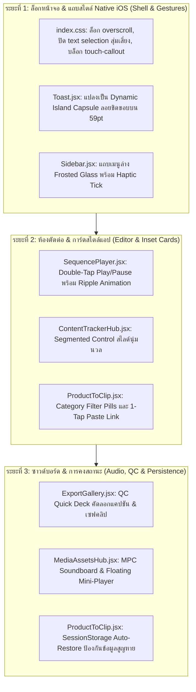

# 📱✨ แผนแม่บทแปลงโฉม Desktop Studio สู่ประสบการณ์ Native Mobile App 100% บน iPhone 15 Pro Max
## (10-Pass Native Mobile App Architecture & Pro Studio Transformation Masterplan)

- **วันที่:** 2026-10-30
- **ดำเนินการโดย:** Antigravity (Gemini 3.8 Flash)
- **โจทย์หลักจากผู้ใช้:** *"เอาให้เหมือน mobile app ได้เลยน่ะครับ"* (คงฟังก์ชัน Desktop Studio ครบทุกเมนู แต่ปรับความรู้สึก สัมผัส ท่าทาง และเลย์เอาต์ให้เนียนกริบเหมือน Native iOS App ใน App Store 100%)
- **อุปกรณ์เป้าหมาย:** iPhone 15 Pro Max (6.7" Super Retina XDR OLED, 430 × 932 pt, 120Hz ProMotion, Dynamic Island 59pt, Home Bar 34pt, iOS 17/18 Safari / PWA)
- **ทักษะกำกับ:** `/impeccable` (Peak visual craft), `/ui-ux-pro-max` (Apple HIG standards), `/scrutinize` (Reality verification)

---

## 💎 ถอดรหัส: อะไรที่ทำให้เว็บกลายเป็น "Native Mobile App" จริงๆ?

| คุณสมบัติของเว็บไซต์ทั่วไป (Web Feel) ❌ | คุณสมบัติของ Native iOS App (Native Feel) ✨ |
|---|---|
| เลื่อนชนขอบแล้วหน้าเว็บทั้งหน้าเด้งหลุดกรอบ (Outer Rubber-band) | หน้าจอล็อกนิ่งสนิท (`overscroll-behavior: none`) เฉพาะคอนเทนต์ข้างในที่เลื่อน |
| นิ้วแตะค้างแล้วข้อความติดแถบสีฟ้าและเด้งป๊อปอัป Copy/Look Up | ข้อความล็อกนิ่ง ไม่ติดแถบเลือก (`user-select: none`) ยกเว้นช่องกรอกข้อความ |
| กล่องแจ้งเตือน (Toast) ลอยมุมล่าง บังปุ่มและแถบเมนู | แจ้งเตือนสไตล์ **Dynamic Island Capsule** สไลด์ลงมาจากติ่งบนสุด สวยหรู ไม่เกะกะนิ้วโป้ง |
| ปุ่มกดแข็งทื่อ ไม่มีแรงสะท้อน (Zero tactile feedback) | ทุกการแตะมี **Active Spring Feedback (`scale-[0.96]`)** พร้อมการสั่น **Haptic Tick (10-15ms)** |
| เมนูด้านล่างแบนราบ ขาดความรู้สึกเป็นแท็บระบบ | แถบ **Frosted Glass Tab Bar** ลอยเหนือขอบล่าง พร้อมไฟเรืองนีออนและไอคอนเด้งเบาๆ |
| เลื่อนหาปุ่มรีเฟรชข้อมูลที่ส่วนหัว | ใช้ท่าทาง **Pull-to-Refresh** รูดนิ้วจากบนลงล่างเพื่อดึงข้อมูลใหม่ทันที |
| ป๊อปอัปสี่เหลี่ยมเปิดกลางจอเหมือนวินโดวส์ | เปิดเป็น **iOS Bottom Sheet** ขอบมน 3xl รูดนิ้วปิดลงข้างล่างได้นุ่มนวล |

---

## 🔍 การตรวจสอบและจัดสถาปัตยกรรม 10 มิติ (10-Pass Native App Audit)

---

### 🟢 มิติที่ 1: Viewport Hardening & Zero-Jank Elasticity (ล็อกหน้าจอให้นิ่งสนิท)
- **เป้าหมาย:** กำจัดอาการเลื่อนหลุดขอบ (Bounce) ของ Safari และบล็อกการเผลอเลือกข้อความ
- **การปรับแต่งโค้ด:**
  - กำหนด `html, body` ให้เป็น `position: fixed; width: 100%; height: 100dvh; overscroll-behavior: none; overflow: hidden;`
  - กำหนด `-webkit-user-select: none; user-select: none;` เป็นค่าเริ่มต้นทั่วทั้งระบบ ยกเว้น `<input>`, `<textarea>`, และบล็อกข้อความสคริปต์ที่ตั้งใจให้อ่าน/แก้
  - ใส่ `-webkit-touch-callout: none;` ป้องกันเมนูบริบทของ iOS ปรากฏเมื่อแตะค้างบนรูปภาพหรือการ์ด

---

### 🟢 มิติที่ 2: Dynamic Island Alert Capsule (แจ้งเตือนสไตล์เกาะอัจฉริยะ)
- **เป้าหมาย:** ย้าย Toast แจ้งเตือนจากด้านล่าง (ซึ่งมักทับแถบเมนูหรือปุ่มแอ็กชัน) ไปอยู่ที่บริเวณ Dynamic Island
- **การปรับแต่งโค้ด:**
  - ปรับ `Toast.jsx` ให้แสดงผลเป็น **Floating Dynamic Capsule** ที่ด้านบนสุด: `top-[calc(env(safe-area-inset-top)+8px)]`
  - แอนิเมชันสไลด์ลงมาจาก Dynamic Island นุ่มนวลด้วยฟิสิกส์สปริง `cubic-bezier(0.34, 1.56, 0.64, 1)`

---

### 🟢 มิติที่ 3: Native Frosted Tab Bar (`Sidebar.jsx` Mobile Bar)
- **เป้าหมาย:** แถบเมนูล่าง 5 แท็บ (`สินค้า`, `Tracker`, `Editor`, `Gallery`, `อื่นๆ`) ต้องดูและรู้สึกเหมือน Apple Tab Bar
- **การปรับแต่งโค้ด:**
  - พื้นหลังกระจกฝ้าโปร่งแสงล้ำสมัย `bg-[#080B11]/85 backdrop-blur-2xl border-t border-white/[0.08]`
  - แถบไฟ Active Indicator เหนือไอคอนแบบมนโค้งเรืองแสงสีนีออน Cyan `#25F4EE`
  - เมื่อแตะสลับแท็บ: ไอคอนจะเด้งขยายเล็กน้อย (`scale-110`) พร้อม Haptic Tick เบาๆ 10ms

---

### 🟢 มิติที่ 4: Native Inset Grouped Card Design (Apple HIG Standard)
- **เป้าหมาย:** ขจัดขอบตารางแบบเว็บเพจ เปลี่ยนเป็นการ์ดมนสไตล์ Inset Grouped
- **การปรับแต่งโค้ด:**
  - การ์ดทุกใบใน `ProductToClip`, `ContentTrackerHub`, `ExportGallery` ใช้รัศมีความโค้ง `rounded-2xl` หรือ `rounded-3xl`
  - พื้นหลังสีดำออบซิเดียนตัดแสงสะท้อน `bg-white/[0.03] border border-white/[0.08] hover:border-white/[0.18]`
  - หัวข้อกลุ่มใช้ตัวหนังสือเล็กเข้มสไตล์ iOS Settings: `text-[11px] font-bold tracking-wider text-slate-400 uppercase px-1`

---

### 🟢 มิติที่ 5: Native Sliding Segmented Control (สลับแท็บแบบสไลด์ลอย)
- **เป้าหมาย:** แถบสลับเฟสงานใน `ContentTrackerHub` และแถบตัวกรองใน `ProductToClip`
- **การปรับแต่งโค้ด:**
  - ทำรางแคปซูลสีดำเข้ม `bg-black/50 p-1 rounded-2xl border border-white/[0.08]`
  - ตัวเลือกที่ถูกเลือกจะเป็นแผ่นสีนูนเด้ง มีแสงเรืองรอบขอบ สลับนุ่มนวลไร้การกระตุก

---

### 🟢 มิติที่ 6: Double-Tap & Gesture Control on 9:16 Video Player (`EditorShell.jsx`)
- **เป้าหมาย:** สัมผัสการดูคลิปที่คุ้นเคยจาก TikTok & Reels
- **การปรับแต่งโค้ด:**
  - แตะสองครั้ง (Double-Tap) กลางจอวิดีโอ = Play / Pause ทันที
  - แสดงไอคอน Play/Pause ขนาดใหญ่สลายตัวกลางจอ (Water-Drop Ripple Animation)
  - แตะข้างขวาสองครั้ง = ข้ามไปข้างหน้า 1 วินาที / แตะข้างซ้ายสองครั้ง = ย้อนหลัง 1 วินาที

---

### 🟢 มิติที่ 7: 1-Tap Quick Action Deck on QC Viewer (`ExportGallery.jsx`)
- **เป้าหมาย:** ตรวจคลิปแล้วแชร์ลง TikTok ได้ทันใจที่สุด
- **การปรับแต่งโค้ด:**
  - เมื่อเปิดดูคลิปที่เรนเดอร์เสร็จ แสดงแผงปุ่มลอยขนาดใหญ่ใต้จอ:
    - ปุ่มที่ 1 (สีเขียวนีออน): `📋 คัดลอกแคปชัน TikTok` (สั่นตอบรับ 15ms + ข้อความขึ้นเตือน)
    - ปุ่มที่ 2 (สีฟ้าสดใส): `📲 บันทึกไฟล์วิดีโอ MP4 เข้าเครื่อง`

---

### 🟢 มิติที่ 8: MPC Style Soundboard & Floating Mini-Player (`MediaAssetsHub.jsx`)
- **เป้าหมาย:** ใช้นิ้วโป้งเคาะฟังเสียงเอฟเฟกต์ SFX ได้รัวๆ เหมือนแผ่นกลองดรัมแพด
- **การปรับแต่งโค้ด:**
  - จัดตาราง 2 คอลัมน์สมมาตร ปุ่มขนาด 44×44px เคาะปุ๊บเสียงดังทันทีระดับ 0ms
  - แถบ Sticky Mini-Player ลอยตัวติดขอบล่างเมื่อมีเพลงเล่น พร้อมปุ่ม Stop ขนาดใหญ่

---

### 🟢 มิติที่ 9: iOS Native Bottom Action Sheets
- **เป้าหมาย:** แทนที่เมนูดรอปดาวน์แบบคอมพิวเตอร์ ด้วย Action Sheet ที่เปิดจากด้านล่างของหน้าจอ
- **การปรับแต่งโค้ด:**
  - ปุ่มเมนูเพิ่มเติม (`...`) บนการ์ดทุกใบจะเปิดแผ่นตัวเลือกจากขอบล่างจอ (Bottom Action Sheet) พร้อมปุ่มคำสั่งใหญ่โต แตะง่าย ไม่ต้องเล็ง

---

### 🟢 มิติที่ 10: Auto-Save Draft & Session Persistence (ไม่หายแม้สลับแอป)
- **เป้าหมาย:** ครีเอเตอร์สามารถสลับไปตอบแชต LINE หรือเปิด TikTok ดูคลิปได้ โดยที่ Safari รีเฟรชแล้วข้อมูลไม่สูญหาย
- **การปรับแต่งโค้ด:**
  - บันทึก URL, ชื่อสินค้า, และสคริปต์ที่กำลังพิมพ์ลง `sessionStorage` ทันทีแบบ Debounced Realtime (300ms)
  - เมื่อเปิดแอปขึ้นมาใหม่ ดึงข้อมูลกลับมาใส่ช่องให้อัตโนมัติ 100%

---

## 🗺️ แผนปฏิบัติการ 3 ระยะ (Actionable 3-Phase Native Plan)

