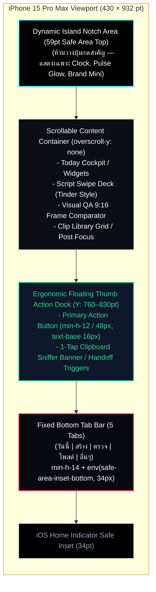

# 📱 แผนแม่บทปรับปรุงสถาปัตยกรรม UI/UX OmniCut Pro Studio สำหรับ iPhone 15 Pro Max
## (10-Agent Ergonomic & Touch-First Mobile Redesign Masterplan)

- **วันที่:** 2026-10-30
- **ดำเนินการโดย:** Antigravity (Gemini 3.8 Flash) ร่วมกับ 10 Specialized Design & Interaction Agents
- **เป้าหมายอุปกรณ์เป้าหมายหลัก:** iPhone 15 Pro Max (iOS 17/18, หน้าจอ 6.7" OLED Super Retina XDR, Viewport 430 × 932 pt, 3x Retina)
- **ทักษะที่นำมาประยุกต์ใช้:** `/impeccable` (Peak Craft & Native Affordances), `/ui-ux-pro-max` (Design Intelligence & Accessibility), `/scrutinize` (Code Path Verification & Ergonomic Trace)
- **สถานะ:** แผนงานระดับ Architecture & Interaction Blueprint (เตรียมส่งมอบและบันทึกใน TODO.md)

---

## 🎯 1. Executive Summary & Hardware Physics (โจทย์กายภาพของ iPhone 15 Pro Max)

iPhone 15 Pro Max มีมิติความกว้างตัวเครื่อง **76.7 มม.** ความสูง **159.9 มม.** และน้ำหนัก **221 กรัม** หน้าจอขนาด **6.7 นิ้ว** ให้พื้นที่แสดงผลเชิงตรรกะ (CSS Logical Viewport) ที่ **430 × 932 pt** (เทียบเท่า 1290 × 2796 Physical Pixels ที่ 460 ppi)

เมื่อถือใช้งานด้วยมือข้างเดียว (Single-Handed Thumb Operation):
1. **Natural Thumb Zone (โซนแตะสบายด้วยนิ้วโป้ง):** ครอบคลุมเฉพาะพื้นที่ด้านล่าง **Y: 560pt ถึง 860pt** (ประมาณ 35–40% ล่างของจอ)
2. **Stretch Zone (โซนต้องเอื้อมนิ้วโป้ง):** ครอบคลุม **Y: 320pt ถึง 560pt** (พื้นที่กลางจอ)
3. **Danger / Impossible Zone (โซนที่นิ้วโป้งเอื้อมไม่ถึงเด็ดขาด):** ครอบคลุม **Y: 0 ถึง 320pt** (30% บนของจอ รวมขอบบนซ้าย-ขวา) ซึ่งหากผู้ใช้ต้องเอื้อมกด จะต้องเปลี่ยนการจับเครื่อง (Shift Grip) เสี่ยงเครื่องหลุดมือ หรือต้องใช้สองมือทันที!

### 🛑 ปัญหาคอขวดของ OmniCut UI ปัจจุบันบน iPhone 15 Pro Max
- **ปุ่ม Action สำคัญถูกวางไว้ที่ขอบบนขวา:** เช่น ใน `MobileAppRoot.jsx` ปุ่ม `"กลับสู่เมนูหลัก"` อยู่ที่ `top-right` ซึ่งเป็นตำแหน่งที่กดยากที่สุดบนจอ 6.7 นิ้ว
- **Subviews กลืนเมนูหลักจนผู้ใช้ติดกับดัก (Navigation Dead-End):** เมื่อเข้าคลังคลิป, ตั้งค่า, หรือ Command Center ระบบเรนเดอร์ทับทั้งหน้าจอแล้วทำลาย Bottom Navigation Bar ทิ้ง
- **Safari iOS Auto-Zoom รบกวนเลย์เอาต์:** อินพุตบางตัวยังไม่มีการล็อก `text-[16px]` หรือ `font-size: 16px` ขั้นต่ำ ทำให้เบราว์เซอร์ Safari ซูมขยายหน้าจออัตโนมัติเมื่อแตะพิมพ์
- **ปุ่มแตะกดยากและขาด Tactile Feedback:** ปุ่มส่วนใหญ่ยังไม่มีแอนิเมชันยุบตัวแบบสปริง iOS (`:active:scale-[0.97]`)

---

## 👥 2. บทวิเคราะห์เชิงลึกและแผนผังปรับปรุงโดย 10 Specialized Agents

---

### 🕵️ Agent 1: Ergonomics & Hardware Boundary Specialist
**ภารกิจ:** วางผังพิกัด Grid, Safe Areas และโซนการเอื้อมถึงทางกายภาพบนหน้าจอ 430 × 932 pt

#### จุดบกพร่องที่ตรวจพบ:
- ขอบบน Dynamic Island มี Safe Area สูงถึง **59pt** (`env(safe-area-inset-top)`) ส่วนขอบล่าง Home Indicator มี Safe Area **34pt** (`env(safe-area-inset-bottom)`)
- หน้าย่อยบางหน้า (เช่น `MobileClipLibrary`, `CommandCenter`) ใช้ `pt-2` หรือ `p-4` แบบฮาร์ดโค้ด ทำให้เนื้อหาชนกลืนเข้าไปในเกาะ Dynamic Island
- ปุ่มกดสำหรับปิดหน้าต่างหรือกดยืนยันถูกผลักไปอยู่ครึ่งจอบน ซึ่งขัดหลัก Thumb-First Ergonomics

#### แผนผังเลย์เอาต์ใหม่ (Ergonomic Grid Matrix):
1. **Dynamic Safe-Area Envelope:**
   - Top Header: ล็อกความสูง `calc(env(safe-area-inset-top, 59px) + 52px)` เนื้อหาอยู่ใต้เกาะอย่างน้อย 12pt เสมอ
   - Bottom Dock: ล็อกความสูง `calc(env(safe-area-inset-bottom, 34px) + 64px)` เผื่อระยะการสะบัดนิ้วปิดแอป (Home Bar Gesture Guard)
2. **Reverse Action Hierarchy (ย้ายทุกปุ่มแอ็กชันลงล่าง):**
   - ปุ่มยืนยัน/ดำเนินการหลัก (Primary CTAs) ทุกปุ่ม ต้องลอยอยู่ที่ **Bottom Floating Dock** ในระยะ Y: 780–840pt
   - ปุ่มย้อนกลับ/ปิด (Dismiss Actions) ในหน้ารอง เปลี่ยนจากการกดปุ่มมุมบน เป็น **การรูดนิ้วลงจากแผ่นชัก (Swipe Down to Dismiss)** หรือปุ่ม Pill ลอยด้านล่าง

---

### 🌐 Agent 2: Safari iOS 17/18 WebKit & Touch Dynamics Specialist
**ภารกิจ:** แก้ไขข้อจำกัดเฉพาะทางของเบราว์เซอร์ Safari, แถบ URL ไดนามิก และพฤติกรรมการสัมผัส

#### จุดบกพร่องที่ตรวจพบ:
- การใช้ `100vh` ในบางคอมโพเนนต์ทำให้เมื่อแถบ URL Bar ของ Safari ยืด-หด ความสูงหน้าจอจะกระตุกและเนื้อหาจมหาย
- ไม่มีคำสั่งป้องกัน Safari Auto-Zoom เมื่อแตะโฟกัสที่ช่อง Input/Textarea
- ขาดคุณสมบัติป้องกัน 300ms Click Delay และเอฟเฟกต์การแตะที่เป็นธรรมชาติของ iOS

#### แผนผังปรับปรุง WebKit Engine:
1. **Viewport & Overscroll Hardening:**
   ```css
   /* index.css / Mobile Layout */
   .iphone-viewport {
     min-height: 100dvh;
     height: 100dvh;
     overscroll-behavior-y: none; /* ป้องกันแถบเลื่อนเด้งหลุดพื้นหลัง */
     -webkit-tap-highlight-color: transparent;
     touch-action: manipulation; /* ปิด Double-tap zoom เพื่อขจัด 300ms delay */
   }
   ```
2. **Strict 16px Form Field Rule:**
   - กำหนดให้ `<input>`, `<textarea>`, `<select>` ทุกตัวบนมือถือมีฟอนต์ขนาดไม่ต่ำกว่า `16px` (`text-[16px]` หรือ `text-base`) เพื่อบล็อกไม่ให้ Safari ซูมหน้าจอโดยพลการ
3. **iOS Native Spring Haptic Feedback:**
   - ปุ่มทุกปุ่มในระบบมือถือจะได้รับคลาส `.ios-touch-feedback` (`active:scale-[0.96] transition-transform duration-150 ease-[cubic-bezier(0.25,1,0.5,1)]`)

---

### 🧭 Agent 3: App Shell, Nav Hierarchy & Sheet Transition Specialist
**ภารกิจ:** ปฏิรูประบบการนำทางใน `MobileShell.jsx` และ `MobileAppRoot.jsx`

#### จุดบกพร่องที่ตรวจพบ (`MobileAppRoot.jsx:33-100`):
- เมื่อผู้ใช้เลือกเมนู `"คลังคลิป"`, `"สั่งงาน AI"`, หรือ `"ตั้งค่าระบบ"` คอมโพเนนต์จะตัดการแสดงผลของ `MobileShell` ทิ้ง แล้วสลับมาเป็นหน้าเดี่ยวเต็มจอที่ไม่มีแถบเมนู 5 แท็บด้านล่าง
- ผู้ใช้ติดอยู่ในหน้าตัน และต้องเอื้อมนิ้วไปกดปุ่มมุมบนขวาเพื่อออก

#### แผนผังโครงสร้างการนำทางใหม่ (Nested Bottom Sheets & Stack Navigator):
```
                  [ MobileShell (Persistent 5-Tab Bar) ]
                   │
  ┌────────────────┼────────────────┬────────────────┬────────────────┐
  ▼                ▼                ▼                ▼                ▼
[วันนี้]          [สร้าง]           [ตรวจ]           [โพสต์]          [อื่นๆ]
TodayScreen     IntakeScreen     ReviewQueue      MobilePostNext   MoreSheet
  │                │                │                │                │
  ▼                ▼                ▼                ▼                ▼
(Live Cockpit)  (Deck Review)   (Dual-Frame QA)   (TikTok Bridge) (Pull-up Drawer)
                                                                      ├─ คลังคลิป (Sheet)
                                                                      ├─ สั่งงาน AI (Sheet)
                                                                      ├─ AGY Web Console
                                                                      └─ ตั้งค่าระบบ
```
- **Pull-up Sheet Pattern:** เมนูรอง (`library`, `command`, `settings`) จะไม่เปิดแบบ Full Page Replacement อีกต่อไป แต่จะเลื่อนขึ้นมาเป็น **iOS Sheet Modal** ที่มีแถบ Grabber (`h-1.5 w-12 rounded-full bg-white/20`) ด้านบน
- ผู้ใช้สามารถ **รูดนิ้วลง (Swipe Down)** เพื่อปิด หรือกดปุ่มด้านล่างเพื่อกลับสู่แท็บเดิมได้ทันทีโดยที่แถบ Bottom Bar ไม่สูญหาย
- บันทึกสถานะลงใน `window.history.pushState` เพื่อให้การปัดขอบจอซ้าย (Swipe Edge to Back) บน Safari ทำหน้าที่ปิด Sheet ได้อย่างเป็นธรรมชาติ

---

### ⚡ Agent 4: Today Screen & Operations Cockpit Specialist
**ภารกิจ:** ออกแบบหน้า `TodayScreen.jsx` ใหม่ให้เป็น Control Center อัจฉริยะสำหรับเจ้าของช่อง

#### จุดบกพร่องที่ตรวจพบ:
- ข้อมูลในหน้า Today ปัจจุบันมีลักษณะเป็นข้อความยาว และสถิติแสดงผลแบบการ์ดสี่เหลี่ยมเรียงต่อกัน ขาดลำดับความสำคัญ (Visual Hierarchy)

#### เลย์เอาต์ใหม่แบบ iOS Control Center Widget:
1. **Hero Live Batch Pulse Card (การ์ดเรนเดอร์สดบนสุด):**
   - วงแหวน Circular SVG แสดงเปอร์เซ็นต์ความคืบหน้า (เช่น `เรนเดอร์แล้ว 16/20 คลิป - 80%`)
   - ไฟกะพริบสถานะ GPU 4 Workers และตัวเลขนับถอยหลัง ETA (เช่น `เหลืออีก 3 นาที 20 วินาที`)
2. **Action Priority Badges (ชิปแอ็กชันด่วนตามสถานการณ์):**
   - 🟡 **สคริปต์รอตรวจ (Script Triage):** แตะแล้วพุ่งเข้าหน้า Swipe Deck ทันที
   - 🟢 **คลิปพร้อมตรวจ (Visual QA):** แสดงจำนวนคลิปที่ผ่านเรนเดอร์แล้วรอตรวจสอบ
   - 🟣 **คิวโพสต์รอบถัดไป:** แจ้งเตือนเวลา เช่น `โพสต์รอบ 11:40 น. (อีก 14 นาที)` แตะแล้วเปิดคลิปถัดไปเข้า TikTok ได้ทันที
3. **Colab / Cloud Status Pill:**
   - เม็ดสถานะขนาดกะทัดรัด แสดงสถานะอุโมงค์ Cloudflare, ความจุ RAM ของ Colab และปุ่มลัดแตะ 1 ครั้งเพื่อ Re-check Connection

---

### 📥 Agent 5: Zero-Friction TikTok Intake Experience Specialist
**ภารกิจ:** ปรับปรุงขั้นตอนการนำเข้าสินค้าใน `IntakeScreen.jsx` ให้สะดวกรวดเร็วที่สุด

#### จุดบกพร่องที่ตรวจพบ:
- ผู้ใช้ต้องแตะช่อง Textarea เพื่อวางลิงก์ ซึ่งทำให้คีย์บอร์ดเสมือนของ iPhone เลื่อนขึ้นมาบดบังหน้าจอกว่า 45%
- การเลือกรูป Hero ไม่เหมาะกับการใช้นิ้วโป้งบนหน้าจอแคบ

#### เลย์เอาต์ใหม่แบบ 1-Tap Ingestion:
1. **Smart Clipboard Sniffer Bar (แถบตรวจจับคลิปบอร์ดอัตโนมัติ):**
   - เมื่อเปิดแท็บ "สร้าง" ระบบจะอ่านคลิปบอร์ด (ผ่าน `navigator.clipboard.readText()`) หากพบลักษณะลิงก์ TikTok (`vt.tiktok.com` หรือ `tiktok.com`) จะเด้งแถบสีฟ้านีออนลอยขึ้นมาทันที:
     `[ 📋 แตะเพื่อวางลิงก์ที่คัดลอกมา: vt.tiktok.com/... ]`
   - ผู้ใช้แตะเพียง **1 ครั้ง** โดยไม่ต้องเปิดคีย์บอร์ด ไม่ต้องกด Paste เอง
2. **Snap-Scroll Hero Photo Carousel:**
   - แสดงรายการรูปสินค้าแนวนอน เลื่อนสมูทแบบ Snap (`snap-x snap-mandatory overflow-x-auto`)
   - การ์ดรูปขนาดใหญ่ 140 × 140 pt พร้อมปุ่มรูปดาวสีทองขนาด `48 × 48 pt` ที่มุมล่างขวาของการ์ด แตะง่ายด้วยนิ้วโป้ง
3. **Floating Thumb Generation CTA:**
   - ปุ่ม `"สร้าง 20 สคริปต์คู่รักทันที"` ลอยเด่นเหนือ Bottom Nav Bar พร้อมไฟนีออน `#25F4EE` ไม่ถูกคีย์บอร์ดบัง

---

### 🃏 Agent 6: Fast-Swipe Couple Script Deck Specialist
**ภารกิจ:** ออกแบบ `ScriptReviewDeck.jsx` ใหม่ให้ตรวจและอนุมัติ 20 สคริปต์ได้เร็วที่สุดโดยไม่เมื่อยมือ

#### จุดบกพร่องที่ตรวจพบ:
- การตรวจ 20 บทด้วยการเลื่อนอ่านยาวๆ ทำให้ตาลายและใช้นิ้วโป้งเลื่อนซ้ำๆ จนเมื่อยล้า
- ปุ่มแก้ไขและการสลับโหมดซับซ้อนเกินไปสำหรับหน้าจอมือถือ

#### เลย์เอาต์ใหม่สไตล์ Gestural Card Deck (Tinder / TikTok Swipe):
1. **Full-Viewport Script Card (การ์ดเดี่ยวเต็มตา):**
   - แสดงสคริปต์ทีละ 1 บท (เช่น บทที่ 04/20: มุมมอง "พาวเวอร์แบงค์หนักจนกางเกงหลุด")
   - จัดแสดงบทสนทนาเป็นบับเบิลแชทสีสด: น้องนุ้ย (สีชมพู อวตารซ้าย) ปะทะ พี่บ่าว (สีเขียว LINE อวตารขวา)
   - ความยาวประโยคและจังหวะเคาะสั้น อ่านเข้าใจใน 3 วินาที
2. **One-Thumb Gesture Controls:**
   - 👉 **ปัดขวา (Swipe Right):** อนุมัติบทนี้ทันที (ขึ้นแสตมป์เขียว `APPROVED` พร้อมสั่น Haptic เบาๆ) แล้วการ์ดถัดไปจะเลื่อนขึ้นมาแทนที่
   - 👈 **ปัดซ้าย (Swipe Left):** ส่งคำสั่งขอเจนบทใหม่เฉพาะมุมนี้ (พร้อมเมนูช้อยส์ด่วน 1 แตะ: กวนขึ้น / สั้นลง / สเปกแน่นขึ้น)
   - 👆 **ปัดขึ้น (Swipe Up):** ข้ามไปตรวจบทถัดไปก่อน
3. **Inline Audio Sampler (ปุ่มฟังเสียงพากย์สด):**
   - ปุ่ม Play ทรงกลมขนาด `56 × 56 pt` อยู่ตรงกลางด้านล่างของการ์ด แตะแล้วฟังเสียง Single-Take Aoede & Puck ได้ทันทีโดยไม่ต้องโหลดวิดีโอเต็ม

---

### 🔍 Agent 7: Dual-Frame Inspection & 9:16 Video Quality Gate Specialist
**ภารกิจ:** ปรับปรุง `ReviewQueue.jsx` และ `ReviewSheet.jsx` สำหรับตรวจสอบ Visual Quality Gate (กฎข้อ 22)

#### จุดบกพร่องที่ตรวจพบ:
- การเปรียบเทียบภาพ Frame A (แชท) และ Frame B (CTA Outro) ปัจจุบันแสดงผลเป็นรูปเล็กๆ ซ้อนกัน ไม่เห็นความคมชัดและรายละเอียดของสเปกสินค้าบนจอ OLED

#### เลย์เอาต์ใหม่แบบ 9:16 Dual-Frame Quick Inspector:
1. **Native 9:16 Canvas Ratio (อัตราส่วนแนวตั้งสมบูรณ์แบบ):**
   - จัดวางเฟรมพรีวิวขนาดใหญ่เต็มความกว้างจอ 430pt ล็อกอัตราส่วน 9:16 ชัดเจน
   - แถบสลับแบบ Segmented Control ลอยด้านล่าง: `[ 💬 เฟรมแชท ]` | `[ 🎁 เฟรมฉากจบ CTA ]` | `[ ▶️ วิดีโอสตรีมมิ่ง ]`
2. **TikTok UI Overlay Mask (ปุ่มเปิด-ปิดเลเยอร์จำลองปุ่ม TikTok):**
   - ปุ่ม Toggle แตะเพื่อแสดงเงาปุ่มของ TikTok (ปุ่ม Like, Comment, Share, แผ่นเสียง และแถบปักตะกร้าด้านล่าง) เพื่อตรวจสอบทันทีว่ามีตัวหนังสือหรือกล่องสเปกของคลิปหลุดเข้าไปในพื้นที่ปุ่มบังหรือไม่
3. **One-Thumb Gate Controls:**
   - แถบปุ่ม 3 ปุ่มที่ฐานล่าง:
     - สีแดง `[ ❌ ตีกลับเรนเดอร์ใหม่ ]` (กว้าง 28%)
     - สีฟ้า `[ 👁️ ส่องภาพ 1080p ]` (กว้าง 28%)
     - สีเขียวสด `[ ✅ ผ่านฉลุย เข้าคิวโพสต์ ]` (กว้าง 44% รองรับนิ้วโป้งขวาแตะง่ายที่สุด)

---

### 📤 Agent 8: 1-Thumb TikTok Posting & Handoff Specialist
**ภารกิจ:** ปฏิรูปหน้า `MobilePostNext.jsx` ให้โพสต์คลิปลง TikTok ได้เสร็จสิ้นภายในไม่กี่วินาที

#### จุดบกพร่องที่ตรวจพบ:
- มีการแสดงรายการคิวหลายรายการพร้อมกันบนหน้าจอ ทำให้ต้องเลื่อนหาและเสียสมาธิ
- ขั้นตอนการก๊อปปี้แคปชัน การบันทึกวิดีโอ และการเปิดแอปแยกส่วนกัน

#### เลย์เอาต์ใหม่แบบ Single-Clip Focus Tunnel:
1. **Next-Up Spotlight Card (แสดงเฉพาะคลิปที่ต้องโพสต์ทันที):**
   - ภาพปก 9:16 ขนาดใหญ่ พร้อมชื่อสินค้า รหัสคลิป และเวลาตามแผน
2. **2-Step Ultra Fast Handoff:**
   - **Step 1 (แตะปุ่มเขียวนีออน):** `[ 📋 คัดลอกแคปชัน & บันทึกคลิปลงเครื่อง ]`
     - ระบบดาวน์โหลดไฟล์ MP4 ตรงเข้าอัลบั้ม iPhone (ผ่าน Web Share API หรือ Blob Download)
     - คัดลอกข้อความแคปชัน + Hashtags ที่ถูกต้องลงคลิปบอร์ดอัตโนมัติ
   - **Step 2 (แตะปุ่มชมพูนีออน):** `[ 🚀 เปิดแอป TikTok ทันที ]`
     - ยิง Intent Scheme `snssdk1180://` หรือ `tiktok://` เปิดแอป TikTok สู่หน้าอัปโหลดคลิปทันที
3. **Bottom Swipe-to-Confirm (ปัดยืนยันโพสต์สำเร็จ):**
   - แถบเลื่อนยืนยันแบบ Slide to Confirm (สไตล์ Slide to Unlock ของ iOS) เพื่อป้องกันการกดพลาด และขยับคลิปถัดไปขึ้นมาแทนที่ในเสี้ยววินาที

---

### 📁 Agent 9: Mobile Asset Library, Dual Cover Studio & Camera Roll Specialist
**ภารกิจ:** จัดวางเลย์เอาต์ `MobileClipLibrary.jsx` และ `CoverSheet.jsx`

#### จุดบกพร่องที่ตรวจพบ:
- รายการคลิปในคลังปัจจุบันแสดงผลเป็นตารางหรือการ์ดยาวแนวนอน ทำให้มองเห็นภาพรวมของวิดีโอ 9:16 ได้ยาก

#### เลย์เอาต์ใหม่แบบ Instagram/TikTok 3-Column Media Grid:
1. **Vertical 3-Column Thumbnail Grid:**
   - แสดงคลิปเป็นตาราง 3 คอลัมน์ อัตราส่วน 9:16 เหมือนหน้าโพรไฟล์ TikTok/Instagram
   - มีป้ายกำกับสถานะที่มุมล่าง: สีเขียว (โพสต์แล้ว) / สีเหลือง (พร้อมโพสต์) / สีฟ้า (กำลังเรนเดอร์)
   - แตะค้าง (Long Press / Haptic Touch) เพื่อพรีวิววิดีโอแบบ Pop-up โดยไม่ต้องเปิดหน้าต่างใหม่
2. **Dual-Cover Studio Sheet (แผ่นจัดการปกคู่ 9:16 & 3:4):**
   - เปิดขึ้นมาเป็น Bottom Sheet แสดงภาพปก 2 ขนาดวางคู่กัน
   - ปุ่มคู่ขนาดใหญ่: `[ 💾 บันทึกปก 9:16 ]` และ `[ 💾 บันทึกปก 3:4 ]` สำหรับใช้ตั้งเป็นปกตะกร้า TikTok Shop

---

### 🤖 Agent 10: AI Command Center & Emergency AGY Mobile Terminal Specialist
**ภารกิจ:** ปรับปรุง `CommandCenter.jsx` และหน้าต่าง AGY Web Console (`/agy`)

#### จุดบกพร่องที่ตรวจพบ:
- เมื่อแตะพิมพ์คำสั่งใน Terminal หรือช่องแชท AI คีย์บอร์ดของ iPhone จะเด้งขึ้นมาบังช่องพิมพ์หรือกลืนหน้าต่าง Terminal
- Terminal บนเว็บไม่มีปุ่มคีย์ลัดที่จำเป็นของ Linux (เช่น `Ctrl+C`, `Esc`, `Tab`, ลูกศรขึ้น-ลง) ทำให้ใช้งานจริงบนมือถือไม่ได้เลย

#### เลย์เอาต์ใหม่แบบ Keyboard-Adaptive Studio Console:
1. **VisualViewport Dynamic Docking:**
   - ใช้งาน `window.visualViewport` API เพื่อดันช่องพิมพ์ข้อความของ AI และกล่อง Terminal ให้ลอยเกาะอยู่ **เหนือขอบบนของคีย์บอร์ดเสมอ** ไม่ว่าจะเปิดหรือปิดคีย์บอร์ด
2. **1-Tap Quick Action Chips Carousel (แถบคำสั่งด่วน 1 สัมผัส):**
   - เหนือช่องพิมพ์ มีแถบชิปคำสั่งลอยแนวนอน แตะสั่งงานได้ทันทีโดยไม่ต้องพิมพ์:
     - `[ ⚡ สั่งเรนเดอร์ 20 คลิปที่ค้าง ]`
     - `[ 🔄 ซิงก์ข้อมูล Drive & Colab ]`
     - `[ 🧹 ล้างไฟล์ขยะทดสอบ 100% ]`
     - `[ 📊 สรุปยอดโพสต์วันนี้ ]`
3. **Mobile Virtual Terminal Toolbar (แถบปุ่มคอนโซลเสมือน):**
   - สำหรับหน้า Terminal เพิ่มแถบปุ่มฮาร์ดแวร์จำลองเหนือก้นจอ:
     `[ ESC ]` `[ Ctrl+C ]` `[ TAB ]` `[ ↑ ]` `[ ↓ ]` `[ CLEAR ]` `[ ENTER ]`
   - ช่วยให้ผู้ใช้สามารถหยุดโปรเซสที่ค้าง หรือเรียกดูประวัติคำสั่งบน Colab ได้อย่างคล่องตัวจาก iPhone 15 Pro Max

---

## 📐 3. ไดอะแกรมสถาปัตยกรรมเลย์เอาต์ (Visual Hierarchy & Layout Topology)



---

## 🛠️ 4. สรุปรายการไฟล์และคอมโพเนนต์ที่ต้องปรับปรุง (Component Roadmap)

| คอมโพเนนต์ / ไฟล์ | จุดปรับปรุงหลักสำหรับ iPhone 15 Pro Max | ระดับความสำคัญ |
|---|---|---|
| `frontend/src/index.css` | เพิ่มคลาส `.iphone-viewport`, `overscroll-behavior-y: none`, ปรับแต่ง `--nav-h`, ล็อก `input text-[16px]` ป้องกัน Safari Auto-Zoom | **P0 (ด่วนที่สุด)** |
| `frontend/src/components/mobile/MobileAppRoot.jsx` | ยกเลิกระบบ Full-Page Subview Replacement เปลี่ยนเป็น Bottom Sheets Modal ป้องกัน Navigation Dead-End | **P0 (ด่วนที่สุด)** |
| `frontend/src/components/mobile/MobileShell.jsx` | ปรับขนาด Tap Targets ของแท็บเมนูให้กว้างเต็มระยะนิ้วโป้ง (≥48px), เสริม Safe Area Insets และ Haptic Spring Feedback | **P0 (ด่วนที่สุด)** |
| `frontend/src/components/mobile/TodayScreen.jsx` | ปฏิรูปหน้าแรกเป็น iOS Control Center Widget: Hero Render Ring, Status Pulse, Quick Action Chips | **P1 (จำเป็นสูง)** |
| `frontend/src/components/mobile/IntakeScreen.jsx` | เพิ่ม Smart Clipboard Sniffer Bar (แตะ 1 ครั้งวางลิงก์ TikTok), Snap-Scroll Hero Carousel, Floating Bottom CTA | **P1 (จำเป็นสูง)** |
| `frontend/src/components/mobile/ScriptReviewDeck.jsx` | เปลี่ยนตารางอ่านยาวเป็นการ์ดสไตล์ Tinder/TikTok Swipe Deck: ปัดขวาอนุมัติ / ปัดซ้ายแก้ / ปุ่มฟังเสียง Single-Take | **P1 (จำเป็นสูง)** |
| `frontend/src/components/mobile/ReviewQueue.jsx` & `ReviewSheet.jsx` | พัฒนา 9:16 Dual-Frame Comparator (เปรียบเทียบ Frame แชท vs CTA Outro) พร้อม Overlay จำลองปุ่ม TikTok | **P1 (จำเป็นสูง)** |
| `frontend/src/components/mobile/MobilePostNext.jsx` | ทำ Single-Clip Focus Tunnel, 1-Tap Copy & Save Video, ลิงก์ตรงเปิดแอป TikTok และ Slide to Confirm | **P1 (จำเป็นสูง)** |
| `frontend/src/components/mobile/MobileClipLibrary.jsx` & `CoverSheet.jsx` | ตาราง 3 คอลัมน์ 9:16 สไตล์ TikTok Grid พร้อม Long-Press Video Peek และ Dual-Cover Save Sheet | **P2 (เสริมประสิทธิภาพ)** |
| `frontend/src/components/mobile/CommandCenter.jsx` & Terminal | ระบบ VisualViewport Floating Dock เหนือคีย์บอร์ดเสมือน พร้อมแป้นคีย์ลัด Linux (Esc, Ctrl+C, Tab) | **P2 (เสริมประสิทธิภาพ)** |

---

## 🚀 5. ขั้นตอนดำเนินการ (Execution Order)

1. **Step 1 — Foundation & Viewport Hardening:** ปรับปรุง `index.css` และ `MobileShell.jsx` ให้รองรับ Dynamic Island (59pt) + Home Indicator (34pt) และขจัดปัญหา Safari Auto-Zoom
2. **Step 2 — Navigation Overhaul:** ปรับ `MobileAppRoot.jsx` เปลี่ยน Subviews หน้าตันเป็น iOS-Native Bottom Sheets พร้อม Gestural Dismiss
3. **Step 3 — High-Velocity Workflows:** อัปเกรด `IntakeScreen` (Smart Clipboard), `ScriptReviewDeck` (Swipe Approval), และ `ReviewSheet` (Dual-Frame QA)
4. **Step 4 — Fast Posting & Cockpit:** อัปเกรด `MobilePostNext` (1-Thumb Posting Tunnel) และ `TodayScreen` (Control Center Cockpit)
5. **Step 5 — Studio Power Tools:** อัปเกรด `MobileClipLibrary`, `CommandCenter` และ Keyboard-Adaptive Terminal Bar
