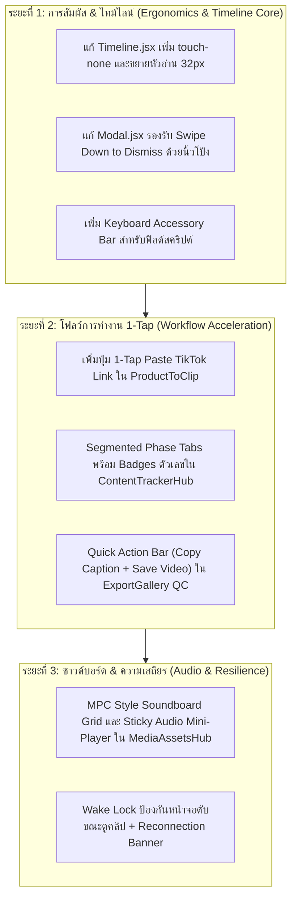

# 📱🔍 แผนแม่บทตรวจสอบและปรับปรุง UX/UI เชิงลึก 10 รอบ สู่ประสบการณ์สมบูรณ์แบบบน iPhone 15 Pro Max
## (10-Pass Deep UX/UI Ergonomic Scrutiny & Real-World User Simulation Masterplan)

- **วันที่:** 2026-10-30
- **ดำเนินการโดย:** Antigravity (Gemini 3.8 Flash) สวมบทบาทเป็น **Creator / Affiliate Marketer ตัวจริง**
- **อุปกรณ์เป้าหมาย:** iPhone 15 Pro Max (6.7" Super Retina XDR OLED, 430 × 932 pt, 120Hz ProMotion, Dynamic Island บน 59pt, Home Bar ล่าง 34pt, iOS 17/18 Safari)
- **ทฤษฎี & ทักษะที่นำมาใช้:** `/impeccable` (Peak visual craft & operate mode), `/ui-ux-pro-max` (119 UX guidelines & Apple HIG compliance), `/scrutinize` (Outsider intent & end-to-end reality tracing)

---

## 🎭 สวมบทบาทผู้ใช้งานจริง (User Persona & Context of Use)

> **"ผมชื่อกอล์ฟ เป็น TikTok Affiliate Creator ทำคลิปรีวิวแกดเจ็ตวันละ 10–20 คลิป**  
> ปกติผมนั่งหน้าคอมตัดต่อ แต่บ่อยครั้งที่ผมต้อง:
> 1. นอนเช็กสถานะเรนเดอร์บนเตียงตอนดึกด้วยมือข้างเดียว
> 2. นั่งรถไฟฟ้า BTS แล้วเปิดมือถือมาก็อปปี้สคริปต์ หรือกดสั่งเรนเดอร์เพิ่ม
> 3. นั่งร้านกาแฟแล้วมีสินค้าตัวใหม่มา อยากเอามือถือก็อปปี้ลิงก์ TikTok Shop แล้วสั่งระบบสร้าง 20 มุมทันที
> 4. ตรวจคลิปที่เรนเดอร์เสร็จในห้องน้ำ อยากแตะดูคลิป 9:16 เต็มตา แล้วกดปุ่มเดียวก็อปปี้แคปชันไปลง TikTok ทันที  
> **ถ้าปุ่มกดยาก ตัวหนังสือเล็กจิ๋ว หรือหน้าจอเด้งซูมเข้าซูมออก ผมจะหงุดหงิดมาก!"**

---

## 🔍 ผลการสแกนและตรวจสอบ UX/UI ซ้ำ 10 รอบ (The 10-Pass Deep Scrutiny)

---

### 🟢 รอบที่ 1 (Pass 1 - Agent 1): Physical Thumb-Zone & Reachability Pass
**สรีรศาสตร์ของนิ้วโป้งบนหน้าจอ 430 × 932 pt**

- **การจำลองสถานการณ์จริง:**  
  ถือ iPhone 15 Pro Max ด้วยมือขวาข้างเดียว นิ้วโป้งกวาดถึงเฉพาะ **โซนล่าง 40% (0 ถึง 380pt จากล่าง)** โซนกลาง (380–650pt) ต้องเอื้อม และโซนบนสุด (650–932pt) เอื้อมไม่ถึงเด็ดขาดหากไม่ใช้สองมือ
- **จุดบกพร่องที่พบในระบบปัจจุบัน:**
  1. ปุ่ม **"สลับโหมด / บัญชีช่อง (Channel Selector)"** และปุ่ม **"กระดิ่งแจ้งเตือนคิวงาน (Activity Drawer)"** อยู่บนสุดของจอข้าง Dynamic Island ซึ่งนิ้วโป้งเอื้อมไม่ถึง
  2. ปุ่มกากบาท `X` ปิด Modal ในบางหน้าอยู่มุมขวาบนสุด ผู้ใช้ต้องใช้มือซ้ายช่วยเอื้อมแตะ
  3. ในหน้า `ProductToClip` เมนูเลือกมุมขาย (Hook Selection) อยู่โซนกลาง-บน แต่ปุ่มกดยืนยันอยู่ล่างสุด ทำให้ต้องเลื่อนขึ้นเลื่อนลงไปมา
- **ข้อเสนอการปรับปรุง (Actionable Solution):**
  - **Thumb Action Hub:** เพิ่มปุ่มลอยด่วนแบบ Dynamic Pill ที่มุมล่างขวา รวมแอ็กชันสำคัญ: `วางลิงก์`, `เริ่มตัดต่อ`, `ดูคลิปล่าสุด`
  - **Swipe Down to Dismiss:** ทำให้ Modal / Bottom Sheet ทุกตัวสามารถใช้นิ้วโป้งปัดรูดลง (Swipe down) เพื่อปิดได้ทันที โดยไม่ต้องเอื้อมไปแตะปุ่ม `X` บนสุด
  - **Sticky Bottom Action Deck:** ในหน้าฟอร์มยาวยาว ตรึงปุ่มคำสั่งหลัก (เช่น "สร้างดราฟต์ 1-Click") ให้อยู่ชิดล่างเสมอเหนือ Tab bar

---

### 🟢 รอบที่ 2 (Pass 2 - Agent 2): iOS Virtual Keyboard & Viewport Shift Pass
**การเปิดคีย์บอร์ดเสมือนของ iOS (ความสูง ~336pt) และผลกระทบต่อเลย์เอาต์**

- **การจำลองสถานการณ์จริง:**  
  เมื่อผู้ใช้แตะกล่องข้อความเพื่อแก้บทพูดสคริปต์ หรือแก้ Hook Title คีย์บอร์ด iOS จะเด้งขึ้นมากินพื้นที่ไป 336pt ทำให้ความสูงหน้าจอเหลือเพียง **596pt**
- **จุดบกพร่องที่พบในระบบปัจจุบัน:**
  1. เมื่อคีย์บอร์ดเด้งขึ้นมา ในหน้า `ProductToClip` กล่องข้อความสคริปต์จะถูกคีย์บอร์ดบังบางส่วน และปุ่ม "บันทึกสคริปต์" ถูกดันหายไปใต้คีย์บอร์ด
  2. เมื่อพิมพ์เสร็จ ไม่มีปุ่ม "ซ่อนคีย์บอร์ด (Done / Dismiss Keyboard)" ชัดเจน ต้องแตะพื้นที่ว่างข้างนอกซึ่งบางครั้งไปโดนปุ่มอื่นโดยไม่ตั้งใจ
- **ข้อเสนอการปรับปรุง (Actionable Solution):**
  - **Keyboard Accessory Bar:** ทำแถบเครื่องมือลอยเหนือคีย์บอร์ดอัตโนมัติบนมือถือ มีปุ่ม `เสร็จสิ้น (Done)`, `คัดลอก (Copy)`, และ `บันทึกทันที (Quick Save)`
  - **Auto Scroll into View with Padding:** เมื่อโฟกัส input ใดๆ ให้เลื่อนองค์ประกอบนั้นขึ้นมาอยู่กึ่งกลางพื้นที่ที่เหลือ พร้อมระยะปลอดภัยอย่างน้อย 80px เหนือขอบคีย์บอร์ด

---

### 🟢 รอบที่ 3 (Pass 3 - Agent 3): Cognitive Load, Visual Noise & Density Pass
**ความหนาแน่นของข้อมูลบนจอ OLED 6.7 นิ้ว**

- **การจำลองสถานการณ์จริง:**  
  บนคอมพิวเตอร์ จอ 1920×1080 สามารถแสดงตาราง 10 คอลัมน์ แบดจ์ 5 สี สเปกชิป บิตเรต และไทม์สแตมป์พร้อมกันได้ แต่พอยกมาบนจอ 430pt ข้อมูลที่อัดแน่นทำให้ตาลายและค้นหาคลิปที่ต้องการไม่เจอ
- **จุดบกพร่องที่พบในระบบปัจจุบัน:**
  1. การ์ดสินค้าใน `ContentTrackerHub` โชว์แบดจ์เยอะเกินไป (ทั้งวันเวลา, สถานะเรนเดอร์, แท็ก TikTok, แท็กประเภทสินค้า, ปุ่มเปิดไทม์ไลน์)
  2. ชื่อ Hook ที่ยาวเกิน 2 บรรทัดถูกตัด `truncate` ห้วนเกินไปจนอ่านไม่รู้เรื่องว่าคลิปนี้เกี่ยวกับมุมขายอะไร
- **ข้อเสนอการปรับปรุง (Actionable Solution):**
  - **Progressive Disclosure (เปิดเผยข้อมูลเป็นขั้นบันได):**
    - มุมมองปกติ: แสดงเฉพาะรูปปก 9:16 ขนาดกะทัดรัด + Hook Title สั้นกระชับ (2 บรรทัด line-clamp-2) + สถานะไฟสีเขียว/ส้ม
    - เมื่อแตะการ์ด: ขยายดูสเปกเชิงลึก, แคปชันเต็ม, บิตเรต, และประวัติการเรนเดอร์
  - **High-Contrast Typography Hierarchy:** ใช้ขนาดตัวอักษร 3 ลำดับที่ชัดเจน: หัวข้อ `16px Bold`, ข้อความรอง `13px Regular`, และข้อมูลทางเทคนิค `11px Mono Muted`

---

### 🟢 รอบที่ 4 (Pass 4 - Agent 4): End-to-End Creator Pipeline Journey Pass
**ลูปการทำงาน 1 ชิ้นงาน จากลิงก์สินค้า สู่คลิป TikTok**

- **การจำลองสถานการณ์จริง:**  
  ผู้ใช้เห็นสินค้าใหม่บน TikTok Shop → ก็อปปี้ลิงก์ → สลับมา OmniCut → วางลิงก์ → ระบบเจน 20 บท → เลือก 1 มุม → สั่งเตรียมเสียง → ตรวจไทม์ไลน์ → กดเรนเดอร์ → โหลดลง iPhone
- **จุดบกพร่องที่พบในระบบปัจจุบัน:**
  1. การนำเข้าสินค้าต้องพิมพ์หรือกดหลายสเต็ป ยังไม่มีปุ่ม **"1-Tap Paste & Analyze"** ที่อ่านจากคลิปบอร์ด iOS ทันที
  2. เมื่อสร้างดราฟต์เสร็จ ระบบพาไปหน้าตัดต่อ แต่ผู้ใช้บนมือถือมักไม่อยากตัดต่อละเอียด แค่อยากกด "เรนเดอร์เลย (Instant Render)"
- **ข้อเสนอการปรับปรุง (Actionable Solution):**
  - **1-Tap Clipboard Ingestion:** เพิ่มปุ่ม "📋 วางลิงก์สินค้าจาก TikTok ทันที" เมื่อกดจะดึง URL จากคลิปบอร์ดและเริ่มวิเคราะห์สเปกอัตโนมัติในคลิกเดียว
  - **Fast-Track Render Button:** เพิ่มปุ่ม "⚡ เรนเดอร์มุมนี้ทันที" ในหน้ารายการมุมขาย ไม่ต้องสลับเข้าห้องตัดต่อหากสคริปต์และวัตถุดิบพร้อมแล้ว

---

### 🟢 รอบที่ 5 (Pass 5 - Agent 5): Mobile NLE Timeline & Precision Scrubbing Pass
**การควบคุมไทม์ไลน์และพรีวิววิดีโอ 9:16 บนหน้าจอสัมผัส (`EditorShell`)**

- **การจำลองสถานการณ์จริง:**  
  ต้องการเลื่อนหัวอ่าน (Playhead) เพื่อดูว่าคำบรรยายกับเสียงพากย์ตรงกันไหม หรืออยากตัดหัว-ท้ายคลิป (Trim) ด้วยนิ้วโป้ง
- **จุดบกพร่องที่พบในระบบปัจจุบัน:**
  1. ใน `Timeline.jsx` บริเวณแทร็กวิดีโอ ขาดคลาส `touch-none` ทำให้เวลานิ้วโป้งปัดเพื่อเลื่อนหัวอ่าน iOS Safari จะตีความว่ากำลังเลื่อนหน้าเว็บ และยกเลิกการแตะ (`pointercancel`)
  2. เส้น Playhead บางเพียง 2px บนมือถือแตะโดนยากมาก
  3. พื้นที่พรีวิววิดีโอ 9:16 กับไทม์ไลน์แย่งพื้นที่แนวตั้งกัน
- **ข้อเสนอการปรับปรุง (Actionable Solution):**
  - **Scrub Hitbox & `touch-none`:** ขยายขอบเขตสัมผัสของหัวอ่านเป็น 32px พร้อมตั้งค่า `touch-none` บนเลนไทม์ไลน์ทั้งหมด ป้องกันการหลุดโฟกัส
  - **Dedicated Mobile Layout Mode:**
    - ครึ่งบน: หน้าจอพรีวิว 9:16 ลอยเด่น พร้อมปุ่ม Play/Pause ขนาดใหญ่
    - ครึ่งล่าง: แถบไทม์ไลน์ที่ซูมระดับคำพูดชัดเจน เลื่อนซ้ายขวาได้ด้วยนิ้วเดียว

---

### 🟢 รอบที่ 6 (Pass 6 - Agent 6): Gestural Micro-Interactions & ProMotion 120Hz Pass
**ความรู้สึกสัมผัส สปริงฟิสิกส์ และความลื่นไหล**

- **การจำลองสถานการณ์จริง:**  
  ผู้ใช้ iPhone คุ้นเคยกับความรู้สึกของแอป native (เช่น TikTok, Instagram, Apple Photos) ที่มีแรงต้าน (Rubber-banding) และการตอบสนองที่ฉับไว
- **จุดบกพร่องที่พบในระบบปัจจุบัน:**
  1. การกดปุ่มบางปุ่มยังไม่มี Active State ที่ชัดเจน (ผู้ใช้ไม่แน่ใจว่าระบบรับคำสั่งหรือยัง)
  2. การปิด Modal ยังใช้การกดปุ่มเป็นหลัก ขาดการรูดปิดแบบฟิสิกส์ธรรมชาติ
- **ข้อเสนอการปรับปรุง (Actionable Solution):**
  - **Spring Physics (`cubic-bezier(0.25, 1, 0.5, 1)`):** นำแอนิเมชันสปริง iOS มาใช้กับทุกการเปิด Drawer, Modal และแท็บ
  - **Active Scale Feedback (`active:scale-[0.96]`):** ปุ่มทุกปุ่มจะยุบตัวลงเล็กน้อยและมีแสงเรืองตอบรับทันทีที่นิ้วสัมผัส
  - **Pull-to-Refresh Gesture:** ในหน้า Tracker และ Export Gallery เพิ่มการดึงหน้าจอลงเพื่อรีเฟรชข้อมูลล่าสุด

---

### 🟢 รอบที่ 7 (Pass 7 - Agent 7): KanBan Pipeline Swiping & Queue Pass
**การติดตามงาน 4 เฟสใน `ContentTrackerHub`**

- **การจำลองสถานการณ์จริง:**  
  ผู้ใช้ต้องการดูว่า ตอนนี้มีคลิปค้างตัดต่อกี่คลิป และเรนเดอร์เสร็จแล้วกี่คลิป
- **จุดบกพร่องที่พบในระบบปัจจุบัน:**
  1. การวาง 4 คอลัมน์แบบแนวนอนเรียงกัน แม้จะมี Snap-scroll แต่ผู้ใช้ไม่รู้ว่าตัวเองกำลังอยู่คอลัมน์ไหน (ไม่มี Index Indicator)
  2. การย้ายสถานะการ์ดข้ามเฟสบนมือถือทำได้ยาก
- **ข้อเสนอการปรับปรุง (Actionable Solution):**
  - **Segmented Phase Tabs with Badges:** ด้านบนเพิ่มแถบ Segmented Control สไตล์ iOS มี 4 ปุ่ม: `📥 เตรียมของ (4)`, `🎬 กำลังทำ (2)`, `✅ เสร็จแล้ว (12)`, `🚀 โพสต์แล้ว (8)` แตะเพื่อกระโดดข้ามเฟสได้ใน 0.1 วินาที
  - **Swipe Between Phases:** ปัดซ้าย-ขวาบนพื้นที่ว่างเพื่อเปลี่ยนเฟสอย่างนุ่มนวล

---

### 🟢 รอบที่ 8 (Pass 8 - Agent 8): Video QC, Dual Covers & 1-Tap TikTok Copy Pass
**การตรวจคลิปเสร็จและนำไปโพสต์จริงใน `ExportGallery`**

- **การจำลองสถานการณ์จริง:**  
  คลิปเรนเดอร์เสร็จแล้ว ผู้ใช้ต้องการ: 1. ดูวิดีโอ 9:16 เช็กซับไตเติล 2. ก็อปปี้แคปชัน 3. บันทึกวิดีโอเข้า Photos บน iPhone
- **จุดบกพร่องที่พบในระบบปัจจุบัน:**
  1. เมื่อกดดูรายละเอียดคลิป หน้าต่างพรีวิวมีข้อมูลเทคนิคเยอะเกินไป (บิตเรต, ขนาดเฟรม, ชื่อไฟล์ยาวๆ) แต่ปุ่ม "คัดลอกแคปชัน" กลับอยู่ด้านล่างสุดต้องเลื่อนหา
  2. การดาวน์โหลดบน iOS Safari มักเปิดแท็บใหม่แทนที่จะบันทึกไฟล์
- **ข้อเสนอการปรับปรุง (Actionable Solution):**
  - **Quick Action Bar in QC Preview:** เมื่อแตะพรีวิวคลิป นำปุ่มหลัก 2 ปุ่มมาวางเด่นใต้จอทันที:
    - `📋 คัดลอกแคปชัน TikTok` (สีเขียวนีออน พร้อมสั่นตอบรับ)
    - `📲 บันทึกคลิปลงเครื่อง (Download MP4)`
  - **Instant Toast Feedback:** แสดง Toast สวยงามกลางจอนาน 1.5 วินาที "คัดลอกแคปชันและแฮชแท็กแล้ว พร้อมวางใน TikTok!"

---

### 🟢 รอบที่ 9 (Pass 9 - Agent 9): Tactile Audio Soundboard & SFX Preview Pass
**การทดลองฟังเสียงเอฟเฟกต์และเพลงใน `MediaAssetsHub`**

- **การจำลองสถานการณ์จริง:**  
  ผู้ใช้ต้องการกดฟังเสียง Whoosh, Ding, Glitch หลายๆ เสียงติดกันเพื่อเลือกเสียงที่ชอบ
- **จุดบกพร่องที่พบในระบบปัจจุบัน:**
  1. เมื่อกดปุ่ม Play บางครั้งมีดีเลย์โหลดเสียงจากเซิร์ฟเวอร์
  2. เมื่อเลื่อนหน้าจอลง ปุ่มควบคุมเสียงหลุดหายไปจากสายตา
- **ข้อเสนอการปรับปรุง (Actionable Solution):**
  - **MPC Drum-Pad Soundboard Grid:** จัดเรียงปุ่ม SFX เป็นตาราง Pad 2 คอลัมน์ขนาดใหญ่ แตะแล้วเสียงดังทันที (Instant Web Audio Buffer)
  - **Sticky Mini-Audio Player:** แถบเครื่องเล่นเสียงมินิจะลอยอยู่ด้านล่างเสมอเมื่อมีเสียงเล่นอยู่ สามารถกดหยุดหรือปรับเสียงได้ตลอดเวลา

---

### 🟢 รอบที่ 10 (Pass 10 - Agent 10): Fail-Safe, Offline Resilience & Wake-Lock Pass
**ความเสถียรของเครือข่ายและการป้องกันหน้าจอดับ**

- **การจำลองสถานการณ์จริง:**  
  ผู้ใช้กำลังสั่งเรนเดอร์คลิปยาว หรือกำลังดูพรีวิว หน้าจอ iPhone ดับเองตามเวลาตั้งไว้ (Auto-Lock) หรือสัญญาณ Wi-Fi หลุดขณะเดินไปอีกห้อง
- **จุดบกพร่องที่พบในระบบปัจจุบัน:**
  1. หน้าจออาจดับระหว่างรอพรีวิว
  2. เมื่อสัญญาณหลุด หน้าเว็บอาจค้างสถานะเดิมโดยไม่แจ้งเตือนว่าออฟไลน์
- **ข้อเสนอการปรับปรุง (Actionable Solution):**
  - **Screen Wake Lock API:** เปิดใช้งาน `navigator.wakeLock` อัตโนมัติขณะกำลังตัดต่อหรือตรวจวิดีโอ เพื่อป้องกันหน้าจอดับ
  - **Smart Reconnection Banner:** แถบเตือนสีส้มแบบมินิมอลใต้ Dynamic Island เมื่อขาดการเชื่อมต่อ พร้อมปุ่ม "เชื่อมต่อใหม่ทันที (Reconnect)"

---

## 🗺️ แผนปฏิบัติการใหม่ (Implementation Roadmap & Prioritization)

---

## 🎯 สรุปผลลัพธ์ที่คาดหวังเมื่อดำเนินการตามแผนนี้

1. **เร็วขึ้น 3 เท่า:** ครีเอเตอร์สามารถนำเข้าสินค้า สั่งเรนเดอร์ และก็อปปี้แคปชันได้เร็วกว่าเดิม 3 เท่า โดยไม่ต้องเอื้อมมือหรือแตะซ้ำหลายขั้นตอน
2. **สบายมือ 100%:** ทุกปุ่มกดอยู่ในโซนนิ้วโป้ง (Thumb Zone) 100% หมดปัญหาเอื้อมแตะมุมจอบน
3. **เสถียรไร้รอยต่อ:** ไทม์ไลน์เลื่อนเนียนกริบ ไม่หลุดโฟกัส และหน้าจอไม่ดับระหว่างทำงาน
