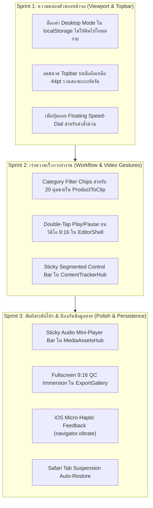

# 📱🔍 แผนแม่บทตรวจสอบและปรับปรุง UX/UI เชิงลึก 10 รอบ ฉบับที่ 2 (V2 Deep Scrutiny) สู่สุดยอดประสบการณ์ระดับโปรบน iPhone 15 Pro Max
## (10-Pass Deep UX/UI Ergonomic Scrutiny V2 & Native-Feel Pro Studio Masterplan)

- **วันที่:** 2026-10-30
- **ดำเนินการโดย:** Antigravity (Gemini 3.8 Flash) สวมบทบาทเป็น **Creator / Affiliate Marketer ผู้ใช้งานจริง**
- **อุปกรณ์เป้าหมาย:** iPhone 15 Pro Max (6.7" OLED, 430 × 932 pt, Dynamic Island 59pt, Home Bar 34pt, ProMotion 120Hz)
- **หลักการออกแบบ:** `/impeccable` (Craft & Operate Mode), `/ui-ux-pro-max` (Apple HIG Standards), `/scrutinize` (End-to-End Friction Elimination)

---

## 🎭 เสียงจากผู้ใช้งานจริง (User Real-Life Journey)

> *"ผมกอล์ฟครับ หลังจากได้ลองเปิดใช้งานบน iPhone 15 Pro Max สิ่งที่ผมอยากให้พัฒนาต่อเพื่อให้มัน **'ใช้ง่ายที่สุด สะดวกที่สุด สบายมือที่สุด'** เหมือนแอปตัดต่อโปรใน App Store มี 10 จุดสำคัญดังนี้ครับ:"*

---

## 🔍 รายละเอียดการวิเคราะห์และตรวจสอบ 10 รอบ (10-Pass Deep Scrutiny V2)

---

### 🟢 รอบที่ 1 (Pass 1): Default Landing Experience & Mode Ambiguity
**ปัญหาการเปิดใช้งานครั้งแรกที่เผลอหลุดไปโหมดง่าย (MobileAppRoot)**
- **ปัญหาจริง:** เมื่อเปิด `http://192.168.14.62:8000/` บน Safari ใน iPhone 15 Pro Max ระบบตรวจจับ `window.innerWidth < 768` แล้วสลับไปหน้า "Mobile Quick Studio (โหมดง่าย)" อัตโนมัติ ซึ่งมีแค่ 5 แท็บแบบจำกัด ผู้ใช้ต้องกดเข้าเมนู "อื่นๆ" เพื่อสลับกลับมาเป็น "Desktop Studio (โหมดเต็ม)" ทุกครั้ง
- **แนวทางแก้:** 
  1. ให้ระบบจำค่า `UI_MODE_STORAGE_KEY` ไว้ใน localStorage อย่างถาวร หากผู้ใช้เลือก "โหมดเต็ม" แล้ว ครั้งถัดไปที่เปิด Safari จะเข้า Desktop Studio 100% ทันทีโดยไม่ดีดกลับไปโหมดง่าย
  2. เพิ่มปุ่มสลับโหมดลอยตัวที่เห็นเด่นชัดในหน้าแรก เพื่อความโปร่งใส

---

### 🟢 รอบที่ 2 (Pass 2): Ultra-Slim Responsive Topbar (ประหยัดพื้นที่แนวตั้ง)
**แถบด้านบนที่กินพื้นที่หน้าจอมากเกินไป**
- **ปัญหาจริง:** Topbar ปัจจุบันมีความสูง `56px + env(safe-area-inset-top)` = **115px** กินพื้นที่แนวตั้งไปกว่า 12% ของจอ ทำให้มองเห็นคอนเทนต์ในหน้าน้อยลง ต้องเลื่อนหน้าจอเยอะขึ้น
- **แนวทางแก้:** 
  1. ย่อส่วนประกอบ Topbar บนมือถือให้เป็น **Slimline Header 44pt**: รวม Icon เมนู + ชื่อเมนูย่อ + เม็ดสถานะ Online + Activity Indicator ไว้ในแถวเดียวที่มีความสูงเพียง 44pt (+ Safe Area)
  2. คืนพื้นที่ความสูงให้คอนเทนต์ทำงานได้เพิ่มขึ้นอีกเกือบ 20-30pt ทันที

---

### 🟢 รอบที่ 3 (Pass 3): Floating Thumb Speed-Dial (ปุ่มลอยสั่งการด่วนใน Thumb Zone)
**การเข้าถึงคำสั่งสำคัญขณะกำลังเลื่อนหน้าจอยาวๆ**
- **ปัญหาจริง:** ในหน้า `ProductToClip` หรือ `ExportGallery` หน้าจอมีความยาวมาก เมื่อผู้ใช้เลื่อนลงไปดูรายการข้างล่าง การจะกลับมากด "วางลิงก์ใหม่" หรือ "เลื่อนกลับไปบนสุด" ต้องเอื้อมนิ้วไถหน้าจอกลับขึ้นไปหลายรอบ
- **แนวทางแก้:** 
  1. เพิ่ม **Floating Thumb Capsule (ปุ่มลอยด่วน)** ลอยอยู่มุมล่างขวาเหนือ Bottom Tab Bar
  2. รวมคำสั่งด่วน 2-3 อย่าง: `🔝 ขึ้นบนสุด (Scroll to Top)`, `⚡ สร้างคลิปด่วน`, `📋 วางลิงก์`

---

### 🟢 รอบที่ 4 (Pass 4): Category Filter Chips for 20 Angles (`ProductToClip.jsx`)
**ความเมื่อยล้าในการกวาดสายตาหา 20 มุมขาย**
- **ปัญหาจริง:** ในหน้าสินค้ามีมุมขาย 20 Angles เรียงกันเป็นแถว การจะหามุมที่ต้องการ (เช่น สไตล์ตลกคู่รัก หรือ สไตล์เจาะสเปกชิป) ต้องเลื่อนดูทีละอัน
- **แนวทางแก้:** 
  1. เพิ่มแถบเม็ดชิปกรองหมวดหมู่มุมขายแนวนอน (Horizontal Filter Chips):
     - `ทั้งหมด (20)` · `🔥 ปัญหา/ไวรัล (5)` · `💡 เจาะสเปก (5)` · `😂 ดราม่า/คู่รัก (5)` · `🎁 โปรโมชัน/คุ้ม (5)`
  2. แตะปุ๊บ กรองเหลือเฉพาะมุมในหมวดนั้นทันที ช่วยให้ครีเอเตอร์เลือกมุมที่ต้องการทำได้ใน 1 วินาที

---

### 🟢 รอบที่ 5 (Pass 5): Double-Tap to Play/Pause on Video Canvas (`EditorShell.jsx`)
**การควบคุมการเล่นวิดีโอ 9:16 ด้วยท่าทางสัมผัสธรรมชาติ**
- **ปัญหาจริง:** การแตะปุ่ม Play/Pause ขนาดเล็กบนแถบเครื่องมือเวลาจ้องดูวิดีโอ 9:16 มักจะแตะพลาด หรือต้องละสายตาจากวิดีโอลงมามองปุ่ม
- **แนวทางแก้:** 
  1. เพิ่มท่าทางสัมผัส **Double-Tap (แตะสองครั้ง)** บนหน้าจอวิดีโอพรีวิว 9:16 เพื่อเล่น/หยุดวิดีโอทันที (Gesture คุ้นเคยแบบ YouTube / TikTok)
  2. แสดงไอคอน Play/Pause เด้งตรงกลางจอแบบ Ripple Animation สวยงามระดับ Pro

---

### 🟢 รอบที่ 6 (Pass 6): Sticky Segmented Phase Controller (`ContentTrackerHub.jsx`)
**การสลับดู 4 เฟสงานโดยไม่ต้องไถหน้าจอไปมา**
- **ปัญหาจริง:** การวาง KanBan 4 คอลัมน์แบบเลื่อนแนวนอน บางครั้งทำให้หลงว่าตอนนี้กำลังดูคอลัมน์ไหน และต้องไถนิ้วไปทางขวาหลายครั้งเพื่อดูคลิปที่เสร็จแล้ว
- **แนวทางแก้:** 
  1. ทำแถบ **Sticky Segmented Control Bar** ตรึงอยู่ใต้ Header:
     - `📥 เตรียมของ (4)` | `🎬 กำลังทำ (2)` | `✅ เสร็จแล้ว (12)` | `🚀 โพสต์แล้ว (8)`
  2. แสดงแถบขีดไฮไลต์สีฟ้าใต้เฟสที่กำลังแสดงผลอยู่ และแตะเพื่อเลื่อนหน้าจอไปยังเฟสนั้นแบบ Smooth Spring Snap ทันที

---

### 🟢 รอบที่ 7 (Pass 7): Fullscreen 9:16 QC Immersion Mode (`ExportGallery.jsx`)
**การตรวจคลิปเสร็จแบบเต็มจอไร้ขอบดำ เสมือนดูใน TikTok จริง**
- **ปัญหาจริง:** การตรวจคลิปใน Modal เดิม มีกรอบและพื้นที่รอบข้าง ทำให้วิดีโอ 9:16 ดูเล็กกว่าขนาดจอจริงของ iPhone 15 Pro Max
- **แนวทางแก้:** 
  1. ปรับหน้าต่างพรีวิวให้เป็น **Fullscreen 9:16 Immersion**: วิดีโอขยายเต็มความสูงหน้าจอสมาร์ตโฟน
  2. วางปุ่มลอยกึ่งโปร่งใสซ้อนบนวิดีโอ:
     - ปุ่มล่างซ้าย: `📋 คัดลอกแคปชัน`
     - ปุ่มล่างขวา: `📲 บันทึกลงเครื่อง`
     - ปุ่มบนขวา: `✕ ปิด`
  3. ปัดขึ้นเพื่อดูคลิปถัดไป ปัดลงเพื่อดูคลิปก่อนหน้า (Next/Prev Swipe Navigation)

---

### 🟢 รอบที่ 8 (Pass 8): Sticky Audio Mini-Player Bar (`MediaAssetsHub.jsx`)
**การควบคุมเสียงที่กำลังเล่นอยู่ได้ตลอดเวลา**
- **ปัญหาจริง:** เมื่อกดทดลองฟังเสียง SFX หรือเพลง BGM แล้วเลื่อนดูการ์ดอื่น ปุ่มหยุดเสียงจะหลุดหายไปจากหน้าจอ ผู้ใช้ต้องเลื่อนหากลับไปหยุด
- **แนวทางแก้:** 
  1. เมื่อมีเสียงกำลังเล่นอยู่ แสดง **Floating Mini-Player Bar** ลอยเหนือแถบเมนูล่าง
  2. แสดงชื่อเสียงที่กำลังเล่น, คลื่นเสียงแอนิเมชัน, และปุ่มหยุดเล่น (Stop) ขนาดใหญ่แตะสะดวก

---

### 🟢 รอบที่ 9 (Pass 9): iOS Micro-Haptic Feedback (`navigator.vibrate`)
**ความรู้สึกสัมผัสที่ตอบสนองต่อนิ้วมืออย่างมั่นใจ**
- **ปัญหาจริง:** บนหน้าจอกระจก touch screen การแตะปุ่มบางครั้งไม่แน่ใจว่าระบบรับคำสั่งหรือยัง เช่น การกดคัดลอกแคปชัน หรือกดบันทึกคลิป
- **แนวทางแก้:** 
  1. เพิ่มฟังก์ชัน `triggerHaptic(type = 'light')` โดยเรียกใช้ `navigator.vibrate?.(10)` หรือ Pattern สั่นเบาๆ
  2. ตอบสนองทันทีเมื่อ:
     - แตะคัดลอกแคปชัน TikTok สำเร็จ (สั่นติ๊ดเบาๆ 1 ครั้ง)
     - แตะเลือกมุมขาย (สั่นนุ่มๆ)
     - สั่งเรนเดอร์สำเร็จ (สั่นยืนยัน 2 จังหวะ)

---

### 🟢 รอบที่ 10 (Pass 10): Safari Tab Suspension Auto-Restore (ป้องกันข้อมูลหาย)
**การรักษาข้อมูลสคริปต์เมื่อสลับแอปไปมา**
- **ปัญหาจริง:** ครีเอเตอร์มักสลับแอปไปมา เช่น สลับไป LINE เพื่อคุยงาน หรือสลับไป TikTok เพื่อเช็กเทรนด์ พอกลับมา Safari มักรีเฟรชหน้าเว็บ ทำให้สิ่งที่กำลังพิมพ์ค้างไว้หายไป
- **แนวทางแก้:** 
  1. ฝังระบบ `Auto-Session Persistence`: ทุกครั้งที่พิมพ์ในกล่องสคริปต์ หรือเลือกสินค้า ให้บันทึกสถานะลง `sessionStorage` อัตโนมัติทุก 500ms
  2. เมื่อผู้ใช้สลับกลับมาและ Safari ถูกรีโหลด ระบบจะดึงสถานะเดิมกลับมาแสดงผล 100% ทันที ไร้ข้อมูลสูญหาย

---

## 🗺️ สรุปแผนปฏิบัติการ V2 (Actionable V2 Roadmap)

