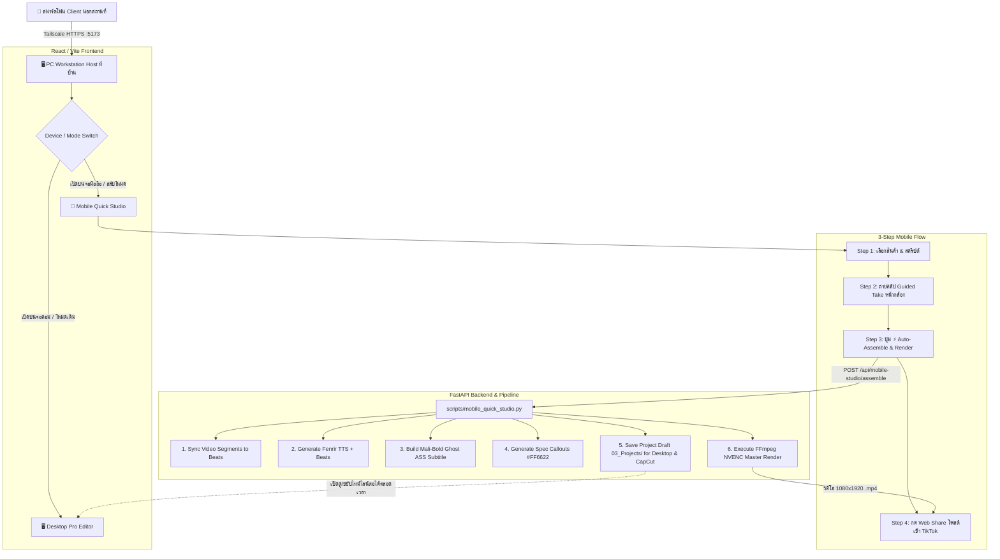

# 📱 แผนงานสถาปัตยกรรม: OmniCut Mobile Quick Studio (End-to-End Mobile Pipeline)

> **เอกสารแผนงานโครงการ:** `_Docs/Plans/PLAN_MOBILE_QUICK_STUDIO_20261003.md`\
> **วันที่:** 2026-10-03\
> **ผู้เสนอแผน:** Antigravity (Gemini 3.8 Flash)\
> **Jev Advisory Score:** Noul 0.79 (ใกล้เกณฑ์ 0.80 — ปฏิบัติตามกฎ Escalation รายงานตัวเลขและเสนอแผนให้ผู้ใช้พิจารณาอนุมัติ)

---

## 🎯 1. วิสัยทัศน์และเป้าหมาย (Executive Summary)

เปลี่ยนสมาร์ตโฟน (iOS / Android) ให้เป็น **"สตูดิโอผลิตและโพสต์คลิปรีวิวแกดเจ็ตครบวงจร"** ผ่านระบบเชื่อมต่อระยะไกลความเร็วสูง Tailscale โดยที่:
1. **ทำงานจบได้ในมือถือ 100%:** จากการเลือกสินค้า ➔ ถ่ายคลิปแบบ Guided Take ➔ กดปุ่มเดียวให้ AI ประกอบและเรนเดอร์ ➔ โพสต์ขึ้น TikTok
2. **ไม่ทำลายระบบเดิม (100% Dual-Mode Guarantee):** หน้าต่าง Desktop Pro Editor เดิมยังคงอยู่ครบทุกแทร็กและฟังก์ชัน ไม่มีการลบโค้ด และโปรเจกต์ที่ทำจากมือถือสามารถเปิดต่อบนคอมพิวเตอร์เพื่อปรับแต่งขั้นสูงใน CapCut ได้อย่างสมบูรณ์แบบ
3. **คุณภาพระดับ Master SOP:** คลิปที่เรนเดอร์อัตโนมัติจากมือถือจะต้องได้มาตรฐานเดียวกับคู่มือ `_Docs/GADGET_VIDEO_PRODUCTION_SOP.md` ทุกประการ (ซับ Mali-Bold Ghost Reveal, กล่องสเปกสีส้ม `#FF6622`, เสียง Fenrir, และเพลง Upbeat BGM)

---

## 🏗️ 2. สถาปัตยกรรมระบบ Dual-Mode (System Architecture)



---

## 📋 3. รายละเอียดกระบวนการ 3+1 สเต็ปบนมือถือ

### สเต็ป 1: เลือกสินค้าและยืนยันสคริปต์ (Product & Script Selector)
* **หน้าจอ:** การ์ดสินค้าแนวตั้งเรียบหรูขนาดพอดีจอมือถือ
* **การทำงาน:**
  * แตะเลือกสินค้าจากคลัง เช่น `Xiaomi Pad 8`, `Logitech Lift`
  * ระบบแสดงสรุปจุดขาย 3 ข้อ และสคริปต์สั้น 60 วินาที
  * มีปุ่ม *"สุ่ม Hook ใหม่"* และปุ่ม *"ยืนยันสคริปต์ (ไปหน้าถ่ายทำ) ➔"*

### สเต็ป 2: ถ่ายคลิปแบบ Guided Take (Enhance `MobileFilmingPage.jsx`)
* **หน้าจอ:** หน้าต่างกล้องแนวตั้งแบบ Fullscreen 9:16
* **การทำงาน:**
  * พัฒนาต่อยอดจาก `MobileFilmingPage.jsx` ที่มีอยู่แล้ว
  * มี **Teleprompter ลอยเหนือภาพกล้อง** แสดงบทพูดช็อตต่อช็อต
  * มีแถบความยาวเสียงไกด์พากย์ (Fenrir Beat pacing) บังคับจังหวะการถือสินค้า
  * ถ่ายทีละท่อน (Hook, Pain Point, Feature 1, Feature 2, CTA) ผิดท่อนไหนกดถ่ายซ่อมเฉพาะท่อนนั้นได้ทันที
  * เมื่อถ่ายครบ วิดีโอจะถูกอัปโหลดสตรีมมิ่งเข้า `01_Raw/` บน PC ทันที

### สเต็ป 3: สั่งประกอบและเรนเดอร์ในคลิกเดียว (⚡ Auto-Assemble & SOP Render)
* **ปุ่มกด:** ปุ่มนีออนขนาดใหญ่เด่นชัด **"⚡ Auto-Assemble & Render"**
* **เบื้องหลังอัตโนมัติ 100%:**
  1. นำคลิปที่ถ่ายมาตัดแต่งเข้าจังหวะคำพูดอัตโนมัติ (Dynamic Match)
  2. ใส่เสียงพากย์ **Fenrir** (`commercial_premium`)
  3. ใส่ซับไตเติล **Mali-Bold** ขนาด 88px ขอบดำ 5.2px เทคนิค Progressive Ghost Reveal คำข้างหน้าโปร่งใส คำที่กำลังพูดเด้งสีเขียวนีออน `#66FF00`
  4. ใส่กล่องสเปกหัวข้อขาว + สเปกล่างส้ม `#FF6622` (`Prompt-Black` 94px)
  5. มิกซ์ดนตรี `tiktok_upbeat_bgm.wav` ความดัง 0.14 และ SFX Whoosh จังหวะเปลี่ยนคัท
  6. เรนเดอร์ด้วยฮาร์ดแวร์ GPU (NVENC บน PC) ใช้เวลาเพียงไม่กี่นาที
  7. **สำคัญ:** บันทึกโครงสร้างทั้งหมดลง `03_Projects/` เป็นไฟล์ดราฟต์มาตรฐาน ทำให้หากวันหลังอยากปรับแต่งบนคอม ก็เปิดแก้ต่อได้ทันที!

### สเต็ป 4: ดาวน์โหลด & โพสต์เข้า TikTok (Publishing)
* เมื่อเรนเดอร์เสร็จ หน้าจอมือถือจะแสดงคลิปพรีวิวพร้อม 2 ตัวเลือก:
  * **ปุ่ม 1: "📤 แชร์เข้า TikTok ทันที" (Web Share API):** กดแล้วเปิดแอป TikTok บนมือถือพร้อมแนบคลิปทันที สามารถเลือกเพลงฮิต ใส่สติกเกอร์ หรือเปิดตะกร้า TikTok Shop ได้สะดวกที่สุด
  * **ปุ่ม 2: "💾 บันทึกลง Camera Roll":** เซฟไฟล์ตรงเข้าอัลบั้มรูปของมือถือ
  * **ปุ่ม 3 (เสริม): "🤖 สั่ง PC โพสต์ให้อัตโนมัติ":** สำหรับเวลาที่ไม่สะดวกเปิดแอปเอง ให้ Playwright บน PC ดำเนินการอัปโหลดขึ้น TikTok Studio ให้เบื้องหลัง

---

## 👥 4. การแบ่งงานแยกตามเอเจนต์ (Multi-Agent Work Division)

เพื่อความแม่นยำ ไม่สับสน และทำรอบเดียวผ่านตามกฎของโปรเจกต์ เราจะแบ่งหน้าที่ออกเป็น 3 บทบาทชัดเจน:

### 🤖 เอเจนต์ 1: Backend Core & Auto-Assembly Engineer
* **เป้าหมาย:** สร้างเอนจินประกอบคลิปอัตโนมัติทางฝั่ง Backend
* **ไฟล์ที่รับผิดชอบ:**
  * `scripts/mobile_quick_studio.py` (เอนจินหลักในการแมปช็อตเข้ากับ SOP Layout)
  * `scripts/api_mobile_studio.py` (FastAPI Router สำหรับรับคำสั่งจากมือถือ)
  * Mount router ใน `scripts/api_server.py`
* **กฎเหล็ก:** ห้ามแก้ไขไฟล์ `scripts/video_editor.py` หรือ `SequencePlayer.jsx` โดยเด็ดขาด ให้ใช้การสร้างโครงสร้าง JSON ดราฟต์ที่เข้ากันได้กับระบบเดิม

---

### 🎨 เอเจนต์ 2: Frontend Mobile UI & Web Share Specialist
* **เป้าหมาย:** สร้างหน้าจอ Mobile Quick Studio ที่ใช้งานง่าย สวยงาม ลื่นไหล
* **ไฟล์ที่รับผิดชอบ:**
  * `frontend/src/components/MobileQuickStudio.jsx` (หน้าหลัก 3 สเต็ป)
  * ปรับปรุงการส่งต่อจาก `frontend/src/components/MobileFilmingPage.jsx`
  * เพิ่ม Web Share API (`navigator.share`) ใน `frontend/src/api.js`
  * เพิ่มปุ่มสลับโหมด `Mobile Quick` / `Desktop Pro` ที่แถบ Header ของ `App.jsx`
* **กฎเหล็ก:** ห้ามแก้ไขโครงสร้างการทำงานเดิมของ `Desktop EditorShell` หรือไทม์ไลน์ ให้เป็นทางเลือกสลับโหมดเท่านั้น

---

### 🛡️ เอเจนต์ 3: QA, Regression & SOP Compliance Guardian
* **เป้าหมาย:** ทดสอบความถูกต้อง ตรวจสอบความเข้ากันได้ย้อนหลัง และตรวจสเปก SOP
* **ไฟล์ที่รับผิดชอบ:**
  * `tests/test_mobile_quick_studio.py` (Unit Tests ครอบคลุมการประกอบคลิปและบันทึกดราฟต์)
  * รันชุดทดสอบความเข้ากันได้เดิม: `pytest tests/` (ต้องผ่าน 100%)
  * รัน `npm run build` ตรวจสอบความถูกต้องของ Frontend
  * ลบไฟล์และคลิปทดสอบทั้งหมดหลังการทดสอบเสร็จสิ้น (Cleanup 100% ตามกฎข้อ 11 และ 15)

---

## 📝 5. พรอมพ์คำสั่งพร้อมใช้งานสำหรับแต่ละรอบ (Execution Prompts)

### 📌 Prompt สำหรับเริ่มงานรอบนี้ (เมื่อคุณอนุมัติ):
```text
ดำเนินการเริ่มรอบ MOBILE-END-TO-END-QUICK-STUDIO-20261003 ตามแผนใน _Docs/Plans/PLAN_MOBILE_QUICK_STUDIO_20261003.md:
1. สร้าง backend engine: scripts/mobile_quick_studio.py และ scripts/api_mobile_studio.py
2. สร้าง frontend: frontend/src/components/MobileQuickStudio.jsx พร้อม Web Share API
3. เชื่อมต่อโปรเจกต์ดราฟต์ร่วมกับ Desktop Pro Mode แบบ 100% backward compatible
4. รันชุดทดสอบ pytest และ npm run build ให้ผ่านทุกตัว
```
