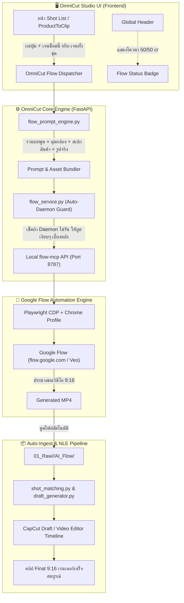

# 🎬 แผนงานสถาปัตยกรรม: ระบบสร้างวิดีโอ AI Google Flow (Veo) แบบไร้รอยต่อ จบใน OmniCut Studio 100%
**รหัสแผนงาน:** `PLAN_OMNICUT_NATIVE_GOOGLE_FLOW_E2E_20261114`  
**วันที่:** 2026-11-14  
**เป้าหมาย:** ออกแบบและวางระบบให้กระบวนการสร้าง B-roll ด้วย Google Flow (โมเดล Veo) เชื่อมต่อเป็นเนื้อเดียวกับ OmniCut Pro Studio (Zero-Context Switching: ไม่ต้องเปิด CMD, ไม่ต้องสลับหน้าต่าง, เจนช็อตต่อช็อต และดูดเข้าไทม์ไลน์ตัดต่ออัตโนมัติ)  
**ดำเนินการโดย:** Antigravity (Gemini 3.8 Flash High)

---

## 🎯 1. วิสัยทัศน์และ Pain Points เดิม (Vision & Problem Statement)

### ปัญหาของโฟลว์ปัจจุบัน (Friction Points):
1. **ต้องรัน Service แยกมือ:** ผู้ใช้ต้องคอยคลิกเปิด `Flow Studio.cmd` หรือกดปุ่มเปิด Service ใน Modal
2. **Generic Generation:** หน้าต่าง Modal เดิมเป็นแบบกล่องกว้างๆ ผู้ใช้ต้องคิด Prompt และเลือกรูปเอง ทั้งที่ OmniCut มีข้อมูลช็อตลิสต์ (Shot List), สเปกสินค้า และบทพูดอยู่แล้วในระบบ
3. **Manual Ingestion:** เมื่อวิดีโอเจนเสร็จ ผู้ใช้ต้องกดปุ่ม "นำเข้าไทม์ไลน์" ทีละคลิป และยังไม่ถูกนำไปประกบลงไทม์ไลน์จริงของดราฟต์ CapCut ในทันที
4. **ขาด Batch Automation:** หากต้องการทำวิดีโอ 1 คลิปที่มี 5-8 ช็อต B-roll ผู้ใช้ต้องมานั่งกดทีละช็อต

### เป้าหมายของโฟลว์ใหม่ ("จบใน OmniCut 100%"):
```
[ เลือกสินค้า / เขียนบท ] 
         ⬇
[ สร้าง Shot List & เสียงพากย์ ] 
         ⬇
[ ⚡ 1-Click: เจน AI B-roll อัตโนมัติทุกช็อตที่ขาดคลิป ] (หรือกดเจนเฉพาะช็อตที่ต้องการ)
         ⬇ (OmniCut สั่ง Veo เบื้องหลัง + แนบรูปสินค้าจริง + รัน Pacing)
[ Auto-Ingest & Auto-Slot ] (คลิปถูกดูดเข้า 01_Raw/<id>/AI_Flow และจับคู่ลงไทม์ไลน์ตรงวินาทีที่พูดทันที)
         ⬇
[ กดปุ่ม "ผลิตจนเรนเดอร์เสร็จ" ] ➡ วิดีโอ 9:16 สวยสมบูรณ์พร้อมซับ Kinetic และเสียงพากย์ 100%
```

---

## 🧭 2. ผังกระบวนการทำงานระบบ (Architecture Workflow)



---

## 📋 3. รายละเอียดแผนงาน 5 เฟส (5-Stage Implementation Plan)

### 🔹 เฟส 1: Zero-Config Daemon & Global Status Bar (ไม่ต้องเปิดโปรแกรมเสริมเอง)
* **เป้าหมาย:** ตัดขั้นตอนที่ผู้ใช้ต้องเปิด `Flow Studio.cmd` หรือกดเปิด Service ออกไป 100%
* **สิ่งที่ต้องทำ:**
  1. **FastAPI Lifespan Integration (`scripts/api_server.py`):**
     * เมื่อรัน backend OmniCut ให้มี background task ตรวจจับพอร์ต 8787 อัตโนมัติ หากยังไม่รัน ให้สั่ง `flow_client.start_service_daemon()` แบบ headless เบื้องหลังทันที (ซ่อนหน้าต่าง CMD ไม่รบกวนสายตา)
     * มี Auto-Recovery หากเซอร์วิสดับ ให้ชุบชีวิตขึ้นมาใหม่ทันที
  2. **OmniCut Header Flow Badge (`frontend/src/components/Header.jsx`):**
     * แสดงไอคอน Google Flow พร้อมสถานะแบบเรียลไทม์ เช่น `⚡ Flow: 50/50 cr` (สีเขียว = พร้อมใช้งาน, สีส้ม = กำลังสร้าง, สีเทา = ออฟไลน์/เครดิตหมด)
     * วางเมาส์ชี้เพื่อดูรายละเอียด: บัญชีที่ล็อกอิน, เครดิตคงเหลือประจำวัน, ประวัติงานล่าสุด

---

### 🔹 เฟส 2: Per-Shot Smart Generator ใน Shot List (เจนตรงจุดช็อตต่อช็อต)
* **เป้าหมาย:** เปลี่ยนจากการนั่งพิมพ์ Prompt เอง เป็นการกด 1-Click จากช็อตในสตอรี่บอร์ด
* **สิ่งที่ต้องทำ:**
  1. **ยกระดับแถวช็อตใน `ShotListModal.jsx`:**
     * เพิ่มปุ่ม **`[⚡ เจน B-roll (Flow)]`** ในทุกแถวช็อตที่มีบทพูดหรือระบุว่าเป็น B-roll
     * แสดงพรีวิววิดีโอขนาดเล็ก (Mini-Player) ทันทีที่ช็อตนั้นมีวิดีโอ AI สร้างเสร็จแล้ว
  2. **Context-Aware Prompt Synthesis (`scripts/flow_prompt_engine.py`):**
     * ดึงข้อมูล 4 ชั้นอัตโนมัติ:
       - **ชั้นที่ 1 (Product Context):** ชื่อสินค้า, ฟังก์ชันเด่น, ดีไซน์หลัก
       - **ชั้นที่ 2 (Script & Beat):** สิ่งที่เสียงพากย์กำลังพูดในวินาทีนั้น (เช่น "แท่นชาร์จแม่เหล็กดูดติดหนึบ")
       - **ชั้นที่ 3 (Cinematic Direction):** มุมกล้องที่วางไว้ในช็อต (CU, Orbit 360, Dolly-in) และแสงสตูดิโอ
       - **ชั้นที่ 4 (Reference Image Selection):** สแกนภาพสินค้าใน `01_Raw/<product_id>/` อัตโนมัติ เลือกรูปที่คมชัดที่สุดส่งเป็น Start Frame หรือ Image Reference ให้ Veo รักษาดีไซน์ของสินค้าจริง
  3. **ปุ่ม "⚡ สร้าง B-roll อัตโนมัติทุกช็อต" (Batch Auto-Gen):**
     * ปุ่มบนหัว Shot List: กดครั้งเดียว ระบบจะคำนวณเครดิตคงเหลือ และทยอยส่งคิวสร้าง B-roll สำหรับทุกช็อตที่ยังไม่มีคลิปจริงให้ครบถ้วน

---

### 🔹 เฟส 3: Background Worker & Seamless Auto-Ingest (ดูดไฟล์เข้าคลังอัตโนมัติ)
* **เป้าหมาย:** วิดีโอที่สร้างเสร็จ ต้องไหลเข้าสู่ระบบทันทีโดยผู้ใช้ไม่ต้องกดดาวน์โหลดหรือกด Ingest
* **สิ่งที่ต้องทำ:**
  1. **Background Polling Service (`scripts/flow_service.py`):**
     * ทำงานเป็น Asynchronous Task ใน FastAPI คอยเช็คคิวงานที่กำลังเจนอยู่ทุก 5-10 วินาที
  2. **Auto-Download & Ingestion Pipeline:**
     * เมื่อ Veo เจนเสร็จ: ดูดคลิป MP4 ความละเอียดสูงลง `01_Raw/<product_id>/AI_Flow/` ตั้งชื่อตามมาตรฐาน `flow_<timestamp>_beat<index>_<label>.mp4`
     * ป้องกันไฟล์ซ้ำด้วย SHA-256 Checksum (Rule 3.13)
     * อัปเดตข้อมูลลง `03_Projects/<product_id>/episodes.json` หรือ Shot Matching Registry ว่าช็อตที่ N มีวัตถุดิบคลิปพร้อมแล้ว

---

### 🔹 เฟส 4: Auto-Slotting เข้าสู่ CapCut Draft & Editing Timeline
* **เป้าหมาย:** คลิป AI ที่ได้ ต้องถูกนำไปวางตัดต่อบนไทม์ไลน์ 9:16 แบบตรงจังหวะเสียงพูด
* **สิ่งที่ต้องทำ:**
  1. **Shot Matching Priority (`scripts/shot_matching.py`):**
     * ปรับลำดับความสำคัญของวัตถุดิบ:
       `คลิปวิดีโอถ่ายจริง > คลิป AI Flow B-roll ที่ตรงช็อต > ภาพนิ่งซูมโมชั่น (Ken Burns)`
     * หากช็อตนั้นมีคลิป AI Flow ระบบจะนำคลิปมาตัด (Trim) ให้พอดีกับระยะเวลา `start` ถึง `end` ของเสียงพากย์ในประโยคนั้นทันที (Strict Topic Hold ตาม Rule 4.17)
  2. **CapCut Draft Injection (`scripts/draft_generator.py`):**
     * วางคลิปลงบนแทร็กวิดีโอหลัก/แทร็ก B-roll ซ้อน พร้อมตัดต่อแบบ J-Cut (Rule 4.7) เสียงมาก่อนภาพ 150-250ms เพื่อความลื่นไหลเป็นธรรมชาติ
     * สำเนา Backup `draft_content.json.bak` เสมอก่อนเขียนทับ (Rule 3.3)

---

### 🔹 เฟส 5: One-Press Chain ("ผลิตจนเรนเดอร์เสร็จ") & Fallback Guard
* **เป้าหมาย:** สอดรับกับปุ่ม "ผลิตจนเรนเดอร์เสร็จ" ของ OmniCut พร้อมระบบเตือนเมื่อโควตาหมด
* **สิ่งที่ต้องทำ:**
  1. **Smart Quota & Fallback Guard:**
     * หากเครดิต Google Flow วันนี้หมด (เหลือ < 7 เครดิต):
       - UI แจ้งเตือนสวยงาม: *"โควตาฟรีประจำวันหมดแล้ว (50/50 cr) ระบบจะใช้ภาพนิ่งสินค้าโมชั่นทดแทนให้อัตโนมัติ"*
       - ไม่ทำให้กระบวนการตัดต่อสะดุดหรือล้มเหลว
  2. **Full Pipeline Test & Parity Verification:**
     * รัน Integration Test ทดสอบการสร้าง Prompt, การรับส่งข้อมูล, การ Ingest ไฟล์ลง `01_Raw/` และการประกอบลงดราฟต์
     * ทำความสะอาดไฟล์ทดสอบ 100% ตามกฎ Rule 3.11 และ 4.15

---

## 📊 4. สรุปความเปลี่ยนแปลงก่อนและหลัง (Before vs After)

| ฟีเจอร์ / ขั้นตอน | ก่อนปรับปรุง (Current) | หลังปรับปรุง (Native OmniCut E2E) |
|---|---|---|
| **การเปิด Service** | ต้องดับเบิ้ลคลิก `Flow Studio.cmd` หรือกดปุ่มใน Modal | **อัตโนมัติ 100%** (OmniCut เปิด Daemon เบื้องหลังทันทีที่เปิดแอป) |
| **การเขียน Prompt** | ผู้ใช้ต้องคิดและพิมพ์ภาษาอังกฤษเองในกล่องข้อความ | **AI วิเคราะห์อัตโนมัติ** ดึงบทพูด + มุมกล้อง + แสง + รูปสินค้าจริง แปลงเป็น Cinematic Veo Prompt |
| **การเลือกจุดเจน** | มีหน้าต่าง Modal กลางหน้าเดียว | **ปุ่มเจนตรงช็อตใน Shot List** (เลือกเจนเฉพาะช็อตที่ขาดคลิป หรือกดปุ่มเดียวเจนทั้งคลิป) |
| **การดูดคลิปเข้าโปรเจกต์** | เจนเสร็จแล้วต้องกดปุ่ม "นำเข้าไทม์ไลน์" ทีละคลิป | **Auto-Ingest ทันที** ที่เจนเสร็จ เข้าโฟลเดอร์ `01_Raw/<id>/AI_Flow/` อัตโนมัติ |
| **การนำไปตัดต่อจริง** | ต้องเลือกคลิปมาหยอดลงไทม์ไลน์เอง | **Auto-Slotting ลงดราฟต์ CapCut** ตรงช่วงเวลาวินาทีของเสียงพากย์ทันที |
| **สถานะโควตา** | ต้องเปิดดูใน Modal ย่อย | **Badge ที่ Header กลาง** แสดง `⚡ Flow: 50 cr` ตลอดเวลา |

---

## 🛠️ 5. ลำดับคิวงานสำหรับการเปิดรอบพัฒนา (Execution Steps for Next Rounds)

1. **Step 1:** เพิ่มฟังก์ชัน Auto-Start Background Daemon ใน `scripts/api_server.py` + เพิ่ม Badge แสดงสถานะโควตา Flow บน Global Header
2. **Step 2:** พัฒนาฟังก์ชัน Context-Aware Prompt & Image Bundler ใน `scripts/flow_prompt_engine.py`
3. **Step 3:** ปรับปรุง UI ใน `frontend/src/components/ShotListModal.jsx` เพิ่มปุ่ม `⚡ เจน B-roll ช็อตนี้` พร้อมแถบ Mini-Player พรีวิว
4. **Step 4:** เชื่อมต่อ Auto-Ingest เข้า `scripts/shot_matching.py` ให้ตรวจจับคลิป AI Flow และนำไปวางใน CapCut Draft
5. **Step 5:** ทดสอบ End-to-End Pipeline พร้อมทำความสะอาด Test Artifacts 100%
