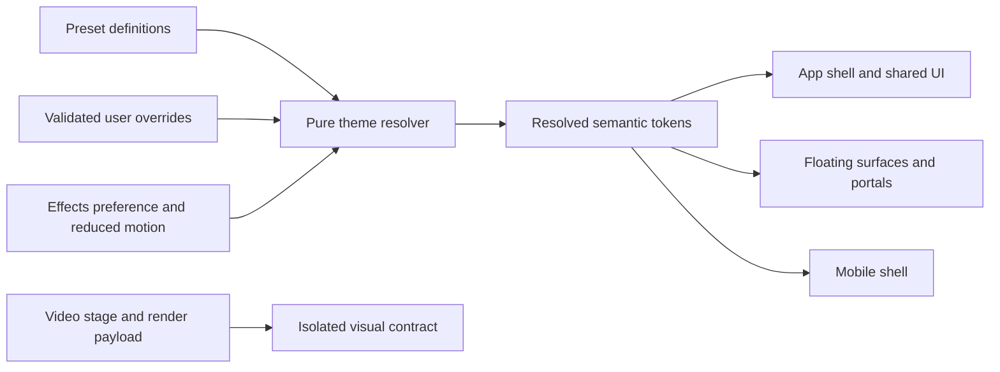

# แผนระบบธีม — PulseHub-inspired Glass × Professional SaaS

ดำเนินการโดย: Codex (GPT-6) · วันที่ 2026-10-31 (Asia/Bangkok)

สถานะ: **แผนพร้อมพิจารณา — ยังไม่เริ่ม implementation และยังไม่อนุมัติแนวทางภาพ**

อัปเดตการดำเนินงาน 2026-10-31: ผู้ใช้สั่งแยกเอเจนต์ลงมือ และอนุญาตพัฒนาหลัง feature flag ระหว่าง browser/native host unavailable โดยยังไม่เปิดใช้จนตรวจภาพจริงผ่าน ใช้ C Balanced และค่าตั้งต้นที่แนะนำเป็น candidate สำหรับตรวจรับ ไม่ถือว่า visual QA ผ่านหรือได้รับอนุมัติ rollout

หลักฐาน: [Theme source audit](../Reports/THEME_GLASS_SAAS_AUDIT_20261031.md)

## 1. ผลลัพธ์ที่ต้องการ

OmniCut ต้องดูเป็นโปรแกรมทำงานระดับ Professional SaaS ที่มีเอกลักษณ์กระจกของ Pulse-Hub: มองเห็นชั้นพื้นผิว ขอบรับแสงละเอียด และความโปร่งที่ปรับได้จริง ผู้ใช้หาเครื่องมือ อ่านข้อมูล และตัดต่อได้ต่อเนื่องโดยฉากหลังไม่แย่งความสนใจ

ปัญหาที่ต้องแก้ก่อนเพิ่มความสวยคือ ownership: theme catalog, material recipe, component colors และ settings ต้องอ้างข้อมูลชุดเดียวกัน เปลี่ยนค่าแล้วรู้ว่ามีผลกับส่วนไหน ไม่เกิด slider ที่เปลี่ยนตัวเลขแต่รูปลักษณ์บางส่วนถูก selector อื่นล็อกไว้

เป้าหมายรอบลงมือไม่ใช่ทำทุกส่วนโปร่งเท่ากัน แต่ให้วัสดุแต่ละระดับทำหน้าที่ชัด: shell เป็นกระจก, ข้อมูลเป็นพื้นผิวอ่านง่าย, floating controls มีความทึบที่ปลอดภัย, preview/video ไม่ได้รับ UI color treatment

## 2. ขอบเขตและสิ่งที่คงไว้

- ปรับระบบสีของ UI, วัสดุพื้นผิว, border/shadow/glare, theme state/persistence และตัวปรับแต่ง appearance
- คง navigation, workflow, keyboard shortcuts, hit targets, panel geometry, track semantics และข้อมูลผู้ใช้
- ฟอนต์ family/size/weight, line-height, wrapping, UI scale และตำแหน่งข้อความเดิมคงไว้ ไม่รวมในงานธีม
- สีข้อความ interface มี semantic mapping ได้เพื่อให้อ่านง่าย แต่สี/ฟอนต์/outline/ตำแหน่ง caption, hook, callout และข้อมูลที่ส่ง render ห้ามเปลี่ยน
- Radius/spacing tokens ระยะแรกเป็น alias ให้ค่าเดิมตาม component ไม่เปลี่ยนสัดส่วนการ์ด/ปุ่มทั้งโปรแกรมโดยเงียบ ๆ
- ไม่แตะ scripts/subtitle*, render engine, raw assets, manifests หรือ export registry
- ไม่สร้าง PRODUCT.md/DESIGN.md ที่รากและไม่แก้ docs ของ workflow อื่นในรอบนี้ เอกสารแผนอยู่ _Docs/Plans ตามกฎผู้ใช้ล่าสุด
- ไม่เพิ่ม UI framework, shader, noise texture หรือ dependency ใหม่เพื่อให้ดูเหมือนกระจก; เริ่มจาก CSS และ React ที่มีอยู่
- ไฟล์ร่วมกับ agent อื่น เช่น ExportGallery.jsx ต้อง sync ownership และเก็บ delta เฉพาะธีมก่อนแก้

## 3. Reference authority และ gate ก่อนเริ่ม

Reference หลักคือ source ของ `Pulse-Hub/public/index.html` ที่ผู้ใช้ระบุ โดยเฉพาะ material mode definitions ช่วง 124–211, surface consumers ช่วง 242–320 และ overrides per mode ช่วง 2022–2070 แยก stylesheet ใน preview-themes.html เป็น experiment/reference รอง เพราะฟอนต์และรายละเอียดต่างจากแอปจริง

สิ่งที่นำมาใช้: layered tint, top rim, controlled sheen, contrast ระหว่าง canvas/surface, per-mode overrides

สิ่งที่ไม่คัดลอกตรง ๆ: ทุกชั้นมี blur, เน้นหลาย accent พร้อมกัน, animation ต่อเนื่อง, !important เป็นสถาปัตยกรรมหลัก, font stack ของหน้า showcase และข้อความที่กล่าวอ้าง physical refraction

**ข้อจำกัดรอบนี้:** browser/native tools ใช้ไม่ได้ ผู้ใช้อนุญาตให้ทำ source-based plan ต่อแล้ว ดังนั้นค่าภาพด้านล่างเป็น starting values ไม่ใช่ค่าที่ visually approved หรือผ่าน contrast/performance แล้ว

Phase 0 ต้องเปิดทั้งสองแอปจริง เทียบ source revision กับ build และจับภาพใน viewport/scale เดียวกันก่อนแตะ UI หากยังเปิดดูไม่ได้ ให้หยุด implementation ที่จุดนี้; ไม่ต้องหยุดการทบทวนเอกสาร

## 4. สามแนวทางที่ต่างกันจริง

ทั้งสามแนวทางใช้ workflow/ตำแหน่ง component/typography เดิม ความต่างคือการกระจายวัสดุและความลึก ไม่ใช่แค่เปลี่ยน palette

### A — Clear Glass Studio

บุคลิก: กระจกใสเด่นและใกล้ภาษาวัสดุ Crystal ของ Pulse-Hub มากที่สุด แสงรองพื้นเห็นผ่าน shell และกลุ่มการ์ดหลัก

- Canvas #070B13; accent #67E8F9; ambient cyan + indigo แบบนิ่ง
- Sidebar/Header เป็นกระจกชัด; dashboard group panels มี rim ต่อเนื่องหนึ่งเส้น
- Data cards ภายในยังมี reading fill; forms/modal ทึบกว่า shell; Editor workspace matte
- Starting recipe: shell tint 0.34, blur 16px, saturation 150%, rim alpha 0.42, ambient opacity 0.28; data fill 0.90, floating fill 0.97
- เงา: dark outer shadow + top inset เส้นเดียว ใช้สีสะท้อนเฉพาะขอบ shell; ไม่ใส่ halo ทุก KPI
- จุดเด่น: วัสดุกระจกอ่านออกชัดตั้งแต่ shell; ใกล้ความต้องการต้นฉบับ
- ข้อแลกเปลี่ยน: ฉากหลังมีผลต่อ contrast มากกว่า; ต้องป้องกัน glare ใกล้ข้อมูลและตรวจ compositing เพิ่ม
- ต่างจากปัจจุบัน: glass ไม่กระจายเป็นสูตรเดียวทุกการ์ด; preset/control เปลี่ยน recipe ทั้งชุด ไม่เปลี่ยน tint อย่างเดียว

### B — Professional SaaS Glass

บุคลิก: เน้นข้อมูลและความแม่นยำ กระจกเป็น accent ของ navigation/menus แทนการเป็นวัสดุหลักทั้งหน้า

- Canvas #0B1220; accent #7DD3FC; ambient ปิดเป็นค่าเริ่มต้น
- Shell มี smoked glass บางส่วน; cards/tables/forms เป็น solid surfaces พร้อม divider ที่ชัด
- ความลึกเกิดจาก tonal steps และ elevation เฉพาะ floating surfaces แทนขอบสีหรือเงาฟุ้ง
- Starting recipe: shell tint 0.82, blur 8px, saturation 110%, rim alpha 0.14, ambient 0; data fill 1.0, floating fill 1.0
- จุดเด่น: อ่านง่าย พื้นหลังคาดเดาได้ เหมาะกับข้อมูลหนาแน่นและใช้เวลานาน
- ข้อแลกเปลี่ยน: ความเป็นกระจกของ Pulse-Hub จะเบากว่า A อย่างชัดเจน
- ต่างจากปัจจุบัน: เลิกใช้ decorative glass เป็น card default; primary action/selection มีบทบาทสีชัดโดยไม่เพิ่มแสง

### C — Balanced Glass Workspace (แนะนำ)

บุคลิก: เห็นเอกลักษณ์ Pulse-Hub ที่กรอบและ navigation แต่ภายในเป็นพื้นที่ทำงาน Professional SaaS

- Canvas #080E18; accent #67D7E7; ambient cyan/indigo เบาและนิ่ง
- Shell/navigation ใช้ clear-smoked glass; dashboard section ใช้ low-sheen surface; card ย่อยและ table เป็น matte
- Floating menu/modal มี reading fill เกือบทึบและ rim เบา; ไม่ทำให้เห็นรายละเอียด thumbnail ทะลุตัวหนังสือ
- Editor: inspector เป็น matte, timeline solid, บริเวณรอบ preview neutral; shell glass อยู่ภายนอก video boundary
- Starting recipe: shell tint 0.60, blur 12px, saturation 125%, rim alpha 0.24, ambient 0.14; data fill 0.96, floating fill 0.98
- จุดเด่น: ยังคงความรู้สึกกระจก แต่ hierarchy และ controls คาดเดาได้กว่าเดิม
- ข้อแลกเปลี่ยน: ต้องกำหนด surface roles อย่างมีวินัย; ทดสอบ shell/card boundary มากกว่าเปลี่ยน global CSS ครั้งเดียว
- ต่างจากปัจจุบัน: ปรับแต่งตามหน้าที่ของพื้นผิว, settings แสดงผลจริง, ไม่มี glow หลายสีรอบทุก component

### ตารางวัสดุต่อ component

| Component | A Clear | B SaaS | C Balanced |
|---|---|---|---|
| Sidebar/Header | clear glass เด่น | smoked glass สงบ | glass เป็น signature หลัก |
| Dashboard section | glass group | solid group | low-sheen group |
| KPI/Data card | reading fill สูง + ขอบบาง | solid ไม่มี blur | matte ไม่มี nested blur |
| Table/Form | reading fill ≥0.96 | solid | reading fill ≥0.98 |
| Dropdown/Tooltip | เกือบทึบ + rim | solid elevated | เกือบทึบ + rim เบา |
| Modal | เกือบทึบ + scrim | solid + scrim | เกือบทึบ + scrim |
| Editor/Timeline | matte/solid | matte/solid | matte/solid |

Opacity เป็น alpha ของ fill ที่ระบุ ไม่ใช่ CSS opacity บน container ซึ่งจะทำให้ข้อความลูกจางตาม ห้ามใช้ container opacity เพื่อปรับความใส

## 5. สถาปัตยกรรมธีมที่เสนอ



แยก 3 ระดับ: foundation palette → semantic roles → component recipes ไม่ให้แต่ละหน้าเลือก hex/blur recipe เอง และไม่ให้ user overrides เขียน CSS arbitrary strings

### 5.1 เจ้าของข้อมูลและไฟล์

| ไฟล์เดิม/ใหม่ที่เสนอ | หน้าที่ |
|---|---|
| `lib/themeManager.js` เดิม | compatibility facade สำหรับ API เดิม; bridge storage migration |
| `lib/themeCatalog.js` ใหม่ | legacy ids, new family ids, palettes, material defaults; ไม่มี DOM/storage |
| `lib/themeResolver.js` ใหม่ | validate, clamp, resolve preset + overrides + effects + fallback; pure |
| `lib/themeStorage.js` ใหม่ | read/migrate/write versioned preferences; ตรวจ corruption และ quota |
| `context/ThemeContext.jsx` ใหม่ | single reactive state สำหรับ desktop/mobile/settings; apply/cancel และ listener |
| `styles/theme-tokens.css` ใหม่ | default semantic tokens และ family definitions |
| `styles/theme-surfaces.css` ใหม่ | surface roles/state recipes/fallback; import ผ่าน index.css |
| `components/settings/AppearanceSettings.jsx` ใหม่ | ย้าย appearance section ออกจาก SystemSettings เมื่อพร้อม ไม่ย้าย paths/engine |
| `components/settings/ThemePreview.jsx` ใหม่ | scoped preview ใช้ consumer/recipes ชุดเดียวกับแอป |

ชื่อไฟล์ใหม่เป็นข้อเสนอสำหรับ implementation ไม่ได้สร้างในรอบแผน หาก themeManager ยังเล็กหลังออกแบบจริง ไม่ต้องแยก facade/storage เป็นหลายไฟล์โดยไม่มีประโยชน์ หลีกเลี่ยงสองแหล่งนิยาม default/range

### 5.2 CSS ownership และ boundary

- ใช้ prefix `--oc-ui-*` สำหรับ interface tokens ใหม่; ไม่ reuse ชื่อ `--primary-color` หรือ video style fields
- ใส่ semantic surface roles/class ให้เฉพาะ UI; ห้าม selector กว้างแบบ `div`, `button *`, `* { color: ... }` ใต้ preview wrapper
- ตั้ง `data-ui-theme` ที่ root สำหรับการสืบทอด vars และ portal ไป body พร้อม mapping; รักษา `data-theme` เดิมตลอดช่วง migration
- Custom preview ใช้ vars ที่ preview container เท่านั้น; ไม่เขียน documentElement ระหว่างลากค่าใน draft
- วิดีโอ stage/caption/overlay ไม่ consume `--oc-ui-*`; outer editor chrome ใช้ได้ แต่ห้าม filter/tint/opacity บน ancestor ที่ครอบ video pixels
- Modal ที่ portal ไป document.body ต้องใช้ theme snapshot เดียวกับ app; local theme scope อย่างเดียวจะไม่ครอบ portal
- จัด CSS precedence เดียว: defaults → preset variables → validated user overrides → semantic component styles; component ไม่ใช้ !important เพื่อแย่ง theme
- เก็บ legacy selectors เป็น adapter จนทุก consumer ใน migration wave ถูกย้ายแล้ว จึงถอนทีละชุด ห้าม global search/replace hex colors
- backdrop fallback ต้องเป็น readable solid surface ตั้งแต่ base rule; @supports เพิ่ม blur เฉพาะเมื่อรองรับ ไม่ใช้ blur เป็นเงื่อนไขการอ่านได้

## 6. Semantic tokens และ surface hierarchy

### 6.1 Starting values สำหรับ C

ค่าต่อไปนี้เป็นร่างรอภาพจริง; ratios/สี final ต้องทดสอบบน composited surface

| Token group | ตัวอย่างค่า/บทบาท |
|---|---|
| `--oc-ui-bg-canvas` | #080E18 พื้นหลังสุด |
| `--oc-ui-bg-workspace` | #0E1726 พื้นงานหลัก |
| `--oc-ui-surface-data` | #142033; data/table/inspector |
| `--oc-ui-surface-elevated` | #19283B; solid fallback ของ floating |
| `--oc-ui-overlay-scrim` | rgba(0,0,0,.64); ไม่เปลี่ยน opacity ของ modal content |
| `--oc-ui-text-primary` | #F1F5F9 |
| `--oc-ui-text-secondary` | #C0CDDD |
| `--oc-ui-text-muted` | #A3B4C9; ยังต้องตรวจ worst-case background |
| `--oc-ui-accent` | #67D7E7; action/selection ไม่ใช่สีสถานะทุกชนิด |
| `--oc-ui-on-accent` | #07131B; ข้อความบน primary button |
| `--oc-ui-accent-hover` | #8BE4EF |
| `--oc-ui-selection-fill` | derived accent tint บนพื้น matte; ต้องคุม contrast |
| `--oc-ui-focus-ring` | accent-derived ที่ผ่าน adjacent contrast; outline ไม่ใช้ glow อย่างเดียว |
| `--oc-ui-border-default` | rgba(182,204,226,.18); ใช้ตกแต่ง/แบ่ง section |
| `--oc-ui-border-control` | สี solid/alpha ที่ระบุ control ได้ ≥3:1; derive และวัดก่อนล็อกค่า |
| `--oc-ui-divider` | rgba(182,204,226,.12); ไม่ใช้แทน control boundary ที่จำเป็น |
| `--oc-ui-success/warning/error/info` | คง semantics เดิม; candidate #6EE7B7/#FCD34D/#FDA4AF/#93C5FD พร้อมพื้นของแต่ละ state |
| `--oc-ui-glass-tint` | tint RGB แยกจาก alpha; starting dark blue-neutral |
| `--oc-ui-glass-shell-alpha` | .60 |
| `--oc-ui-glass-shell-blur` | 12px; data descendants 0px |
| `--oc-ui-glass-saturation` | 125% |
| `--oc-ui-glass-rim` | rgba(255,255,255,.24); specular multiplier ใช้กับ rim/highlight ใน recipe เดียว |
| `--oc-ui-glass-sheen` | gradient alpha สูงสุด .06; ไม่พาดใต้ data text ที่มีข้อมูลมาก |
| `--oc-ui-shadow-floating` | 0 16px 40px rgba(0,0,0,.35); ค่ารอวัดจริง |
| Radius / spacing | semantic alias ต่อ existing component dimensions; ไม่ unify ค่าโดยบังคับในเฟสนี้ |
| Motion | color/opacity 120–180ms; ไม่ transition:all; reduced-motion ปิด ambient animation และ movement |

แบรนด์/selection, semantic status, chart series และ Timeline track colors เป็นคนละ namespace เปลี่ยน accent แล้วไม่เปลี่ยนความหมาย track voice/BGM/SFX และไม่เปลี่ยน exported video style_preset

### 6.2 Surface roles

| Role | ใช้กับ | วัสดุและข้อจำกัด |
|---|---|---|
| base | canvas | solid + optional stationary ambient, ไม่ blur |
| workspace | main work area, Editor center | solid/neutral, ไม่มี sheen หลัง preview |
| shell-glass | Sidebar/Header/outer navigation | primary glass layer; blur หนึ่งชั้นเป็นค่าเริ่มต้น |
| section | dashboard group/settings section | low-sheen; ปิด blur เมื่อมี ancestor blur |
| data | cards/table/inspector | matte/reading fill สูง; ไม่มี animated glow |
| control | input/button | stable fill, states ชัด, no nested backdrop โดยปริยาย |
| floating | menu/tooltip/popover/modal | high-opacity reading surface; elevation; blur เป็น optional enhancement |

เป้าหมายเชิงโครงสร้างคือไม่เกินหนึ่ง active backdrop-filter บน ancestor chain ของพื้นที่ข้อมูล ยกเว้น floating surface ที่มีเหตุผลและวัดผลแล้ว จำนวน declaration ใน source ไม่ใช่ layer count

## 7. Theme Customizer ที่เสนอ

### 7.1 ประสบการณ์ใช้งาน

Settings → รูปลักษณ์ → เลือก family → ดูตัวอย่าง → ปรับทั่วไป/ขั้นสูง → ใช้ธีม หรือ ยกเลิก

ตัวอย่างต้องมี navigation item, primary/secondary button, input, selected card, badge, table row และ floating menu โดยใช้ shared components/recipes จริง ไม่ใช้การ์ด showcase สูตรแยก

- ค่าที่ลากยังเป็น draft; preview ตอบสนองทันทีภายในกรอบ ไม่ persist ทุก input event
- ใช้ธีม: validate → resolve → persist หนึ่งชุด → apply global → แสดง saved status ตามจริง
- ยกเลิก/ปิดหน้า: ทิ้ง draft กลับค่าที่ใช้จริง ไม่เขียน storage; ถ้ามี dirty state ใช้ inline action ให้เลือกกลับ/ทิ้งตาม pattern เดิม
- คืนค่า preset: คืน default ของ family ปัจจุบันใน draft; กดใช้จึงบันทึก
- คืนค่าทั้งหมด: reset preference v2 ที่ใช้จริงหลัง review; ไม่ลบ localStorage ทั้ง origin หรือ key อื่น
- บันทึกเป็นธีมส่วนตัว: name/id/baseFamily/overrides; ทำสำเนา ไม่เขียนทับ builtin; builtins ลบไม่ได้
- ถ้า storage เขียนไม่ได้ ให้ใช้ใน session ได้พร้อมสถานะ “ใช้ชั่วคราว”; ห้ามแสดง “บันทึกแล้ว”

### 7.2 ตัวเลือกและขอบเขต

| ระดับ | ตัวเลือกที่ผู้ใช้เห็น | ขอบเขตผล/validation |
|---|---|---|
| ทั่วไป | ชุดธีม | 3 directions เป็น candidates; implement เฉพาะที่อนุมัติ ไม่ต้องเปิดทุกอันเป็น preset |
| ทั่วไป | สีหลัก | curated accessible choices ก่อน; custom hex เป็น advanced พร้อม validation |
| ทั่วไป | ความโปร่งของกรอบโปรแกรม | shell only; recipe resolver คุม gradient+tint ให้สัมพันธ์ ไม่กระทบ data/floating floor |
| ทั่วไป | แสงพื้นหลัง: ปิด/เบา/ปกติ | ค่าเริ่มนิ่ง; zero ต้องใช้ได้จริง; effective state แสดงตรง family |
| ทั่วไป | เอฟเฟกต์: เต็ม/เบา/ปิด | explicit preference; ปิด = no blur/no ambient; ไม่เดาสเปกจาก user agent |
| ขั้นสูง | ความเบลอ | 0–24px step2; ไม่บังคับทุก component เท่ากัน |
| ขั้นสูง | ความเข้มพื้นหลัง | ปรับ neutral canvas ใน safe range ที่ resolver กำหนด; ไม่เปลี่ยน UI text opacity |
| ขั้นสูง | ขอบสะท้อน/เงา | 0–100 sliders → bounded recipe; ไม่รับ box-shadow string |
| ขั้นสูง | ความสดของแสง | saturation 100–180%; คุม material ไม่เพิ่ม saturation ให้ภาพวิดีโอ |

Slider ความโปร่งใช้ค่า 0–100 เป็น normalized material strength ไม่เรียก “ใส 84%” ว่าคือ optical transparency ถ้ายังมีหลาย gradient layers ค่าทุกช่องมี label ที่ผูก control, keyboard stepping, reset รายค่า และ disabled reason เมื่อ family ไม่รองรับ

Theme family ไม่รองรับ ambient/blur ให้ซ่อน control ที่ไม่เกี่ยวหรือ disable พร้อมเหตุผล ห้ามเปิด toggle แล้ว CSS ซ่อนผลเงียบ ๆ Effective values ต้องเป็นข้อมูลจาก resolver ตัวเดียวกับ app/preview

### 7.3 Persistence และ backward compatibility

เสนอ key ใหม่ `omnicut_ui_preferences_v2`:

```json
{
  "schemaVersion": 2,
  "activePresetId": "balanced-glass",
  "legacyThemeId": "glassmorphism",
  "overridesByPreset": {
    "balanced-glass": {
      "accent": "#67D7E7",
      "shellTransparency": 50,
      "blurPx": 12,
      "rimStrength": 24,
      "shadowStrength": 35,
      "ambientStrength": 14,
      "saturationPct": 125
    }
  },
  "effects": "full",
  "ambientMotion": false,
  "customPresets": []
}
```

JSON เป็นตัวอย่าง format ไม่ใช่ผลการ migrate ผู้ใช้จริง ค่า default ต้องมาจาก catalog ไม่ hardcode ซ้ำใน UI

Migration ขั้นตอน:

1. ถ้ามี v2 ที่ valid ใช้ทันที; schema สูงกว่าที่รองรับให้ fallback แบบอ่านอย่างเดียวและไม่เขียนทับข้อมูลอนาคต
2. ถ้าไม่มี v2 อ่าน keys เดิมทั้ง 3 แบบ defensive; JSON null/array/object ผิดชนิด/NaN/Infinity/out-of-range/unknown keys ต้อง normalize ด้วย schema
3. เก็บ 4 legacy ids เป็น compat profiles; ไม่ auto-switch ผู้ใช้เดิมเข้า C เมื่ออัปเดตครั้งแรก
4. map glass config เดิมเป็น override เฉพาะ compat profile ที่ active เดิม; ไม่กระจายชุดเดียวไปทุก family; orbs preference เดิมเก็บไว้เป็น intent แต่ resolve ตาม capability
5. mapping glare → rim และ opacity → new material strength เป็น migration approximation ต้องจับภาพเทียบ; หากไม่เท่ากัน ให้ legacy renderer ใช้ recipe เดิมจนผู้ใช้เลือก family ใหม่
6. เขียน v2 เมื่อกดใช้หลัง migration หรือหลังยืนยัน successful initialization ตาม policy ที่เลือก; key เดิมไม่ลบทิ้ง
7. new/legacy modes ใช้ kill switch ที่ชัด ไม่ dual-write ทุก slider event; ระบุว่าการกลับ legacy จะคืนค่าธีมเดิม ไม่รองรับทุก v2 custom feature
8. storage event ข้ามแท็บ: ถ้าไม่มี draft ให้อัปเดต; ถ้ามี dirty draft ให้แจ้งว่าค่าถูกเปลี่ยนจากอีกแท็บและให้เลือกโหลดใหม่/ใช้ draft ของตน ไม่แอบทับ

v2 เก็บ preferences ไม่ใช่ secret; ไม่ต้องแตะ API/backend เพิ่มเพียงเพื่อ sync ข้ามเครื่องในเฟสนี้

## 8. แผนลงมือเป็นเฟส

### Phase 0 — ยืนยันภาพและ baseline (ประมาณ 0.5–1 วัน)

- แก้ข้อจำกัด browser tooling ให้เปิดทั้ง OmniCut และ Pulse-Hub ได้ด้วยการเข้าถึงที่มีอยู่ ไม่ปิดระบบ auth หรือเปลี่ยน security เพื่อจับภาพ
- ระบุ source/build hash, URL, browser/version, viewport, DPR, UI scale และ preset/effects ปัจจุบัน
- Capture shell, Dashboard/Analytics, Editor/Timeline, Gallery, Settings, modal/dropdown และ mobile; freeze decorative animation เฉพาะ QA context
- เทียบ 3 directions บน representative Settings + Editor chrome ด้วย isolated preview ภายหลังอนุมัติทำ prototype; ยังไม่ย้ายทั้งโปรแกรมก่อนเลือก
- Acceptance: มีภาพ baseline ที่ตรวจ freshness ได้, contrast/performance baseline และเจ้าของเลือก direction; ไม่มีคำว่า pixel parity โดยไม่มี side-by-side
- Rollback: ไม่มี application change; ปิดเฉพาะ tab/server ที่เปิดเพื่อ audit; ไม่ปิด server คนอื่น

### Phase 1 — Tokens, resolver, state และ compatibility (ประมาณ 1–2 วัน)

- ไฟล์: themeManager.js/test.js, new catalog/resolver/storage/context, theme-tokens.css และ App.jsx integration เฉพาะ theme state
- รวม default/ranges และ capability definitions; มี per-preset overrides; คง facade exports เดิม
- เพิ่ม candidate recipe หลัง flag เท่านั้น; ไม่เปลี่ยน default สำหรับ user เดิม
- Acceptance: normalization/persistence/migration/rollback tests ผ่าน; fresh legacy profile ยังได้ state เดิม; storage unavailable ไม่ crash; switching themes ไม่เปลี่ยน manifest/render payload
- Tests: node tests ของ resolver/storage/theme manager ที่ตรวจ edge cases ข้างต้น ไม่เขียน test ที่แค่คัดลอก implementation
- Risk: initialization flash, StrictMode side effect, state divergence ระหว่าง mobile/desktop
- Rollback: flag กลับ legacy renderer + ใช้ keys เดิมที่เก็บไว้; ไม่ git reset หรือ clear storage

### Phase 2 — Shared components และ app shell (ประมาณ 1–2 วัน)

- ไฟล์: index.css, theme-surfaces.css, Sidebar.jsx, Topbar.jsx, ui/Button.jsx, ui/Input.jsx, ui/Modal.jsx
- ย้าย material styling เข้าสู่ roles ทีละ component; รักษาขนาด padding radius font และ callbacks เดิม
- แก้ portal inheritance และ fallback ก่อนอาศัย glass visuals; เพิ่ม control names ที่ขาดโดยไม่เปลี่ยน visible copy เก่า
- Acceptance: shell/button/input/modal consume semantic tokens จริง; state matrix ผ่าน; modal บน background สว่าง/thumbnail ละเอียดยังอ่านได้; keyboard/Escape/focus return/touch sheet ไม่ regress
- Risk: cascade specificity และ pseudo-elements; focus ring ถูก overflow clip; nested blur
- Rollback: revert เฉพาะ isolated theme commit/flag ของ wave; เก็บ compatibility classes ไม่ถอนทั้งหมดพร้อมกัน

### Phase 3 — ย้ายหน้าจอเป็น waves (ประมาณ 2–4 วันตามจำนวนหน้าจริง)

| Wave | ไฟล์/บริเวณ | เป้าหมายและ acceptance |
|---|---|---|
| 3A ข้อมูล | analytics/AnalyticsHub.jsx, analytics/components/MetricKpiCard.jsx, ContentTrackerHub.jsx | KPI/table/filter ใช้ data/control surfaces; status/series แยกจาก accent |
| 3B Library | ExportGallery.jsx, MediaAssetsHub.jsx, MediaPickerModal.jsx | thumbnail ไม่ถูก tint; card menus/selection/states ถูกต้อง; sync Cloud Archive ownership ก่อน |
| 3C Creation | ProductToClip.jsx, hyperframes/HyperFramesHub.jsx และ modal ที่เรียกจริง | ย้ายเฉพาะ UI chrome; content previews/template colors คงเดิม |
| 3D Editor | editor/EditorShell.jsx, EditorHeader.jsx, AssetPanel.jsx, Timeline.jsx และ inspector chrome | matte workspace/neutral stage surround; track/clip colors และ render controls semantics เดิม |
| 3E Mobile | mobile/MobileAppRoot.jsx, MobileShell.jsx และ child screens ที่ inventory พบ | shared theme state, safe areas/scroll/keyboard/bottom sheet ไม่เปลี่ยน |

แต่ละ wave มี list จุดที่ migrate/ยกเว้นพร้อมเหตุผล ไม่ใช้จำนวน hex ที่ลดลงเป็นตัววัดคุณภาพเพียงอย่างเดียว ตรวจเมนูที่ lazy-load ไม่ใช่ตรวจเฉพาะหน้าแรก

Risk สูงสุดคือ SequencePlayer/inspector อาจเก็บสีสำหรับวิดีโออยู่ใกล้ UI styles; ไม่แตะ SequencePlayer.jsx หากไม่จำเป็น ถ้าจำเป็นต้องแตะ render-critical path ต้องใช้กฎ preview/render parity คู่ backend และ probe เฟรมจริงตาม repo

Rollback เป็นราย wave และต้องรักษางาน agent อื่นที่ merge ระหว่างทาง ขอบเขต theme commit ต้อง review ก่อน revert

### Phase 4 — Theme Customizer (ประมาณ 1–2 วัน)

- ย้าย appearance section อย่างเดียวจาก SystemSettings.jsx; เชื่อม draft/applied state และ ThemePreview
- ทำ normal/advanced controls, preset comparison ทุก effective field, effective capability state, reset และ custom preset lifecycle
- Acceptance: cancel ไม่มี storage write; apply หนึ่ง transaction; override ราย preset ไม่ปน; reload คืนค่าที่ใช้จริง; save failure บอกตามจริง; dirty draft ข้ามแท็บไม่หาย
- Tests: pure transaction/storage tests + browser user journeys; ไม่ต้องเพิ่ม backend หรือ global dependency
- Rollback: เปิด customizer เดิมผ่าน flag พร้อม keys เดิม; UI migration กลับได้โดยไม่ทำลาย v2

### Phase 5 — ตรวจรับและถอน adapters ที่ไม่ใช้ (ประมาณ 0.5–1.5 วัน)

- รัน gates ใน §9, capture compare desktop/mobile หนึ่งรอบรวม แก้ข้อบกพร่องเป็นชุด แล้ว confirm อีกไม่เกินหนึ่งรอบ
- ถ้า critical issue ยังอยู่ ไม่ประกาศผ่าน; บันทึก issue ที่เหลือและพัก rollout แทนวน polish ไม่สิ้นสุด
- ถอน legacy selectors เฉพาะส่วนที่ยืนยันไม่มี consumer; legacy preset support คงจนมีแผน sunset ที่อนุมัติ
- Acceptance: ไม่มี regression ที่จำเป็นต่อการทำงาน, visuals approved, contrast/performance ตามงบ, doc/current tokens ตรงกัน
- บันทึกการตัดสินใจที่อนุมัติใน _Docs และ HISTORY พร้อม agent/model; ไม่บันทึกว่าได้คะแนนเต็มโดยไม่มี rubric

ช่วงเวลารวมประมาณ **6–12 วันทำงาน** เป็นการประเมินจาก source coverage ไม่ใช่ commitment; Phase 0 ต้องปรับ estimate ตามภาพจริง จำนวน legacy consumers และงาน agent อื่น

## 9. Verification และเกณฑ์ตรวจรับ

### 9.1 Logic และ integration

- Baseline ที่รันแล้วในรอบแผน: `node --test frontend/src/lib/themeManager.test.js` → 4 passed / 0 failed
- หลัง implementation: รัน targeted tests ก่อน แล้ว `npm test` ภายใน frontend และ `npm run build -- --outDir ../.tmp/theme-glass-saas-build` เพื่อไม่ทับ dist ของ agent อื่นระหว่าง review
- ตรวจคำสั่ง/flags กับ Vite ที่ติดตั้งก่อนรันจริง; temporary build ไม่ใช่ production release
- ใช้ backend parity suite เฉพาะเมื่อแตะ path ที่ repo บังคับ; ห้ามอ้าง full pytest ผ่านถ้าไม่ได้รัน
- ทุก phase ใช้ fixtures/temp storage ไม่แตะข้อมูลจริงหรือสร้าง demo project/export registry records
- ใช้ impeccable detector กับ UI targets ที่แก้จริงเมื่อจบ implementation ไม่รัน detector แล้วตีความว่าแทน browser inspection ได้

### 9.2 Browser matrix และ state matrix

| Scenario | เกณฑ์ตรวจ |
|---|---|
| Desktop 1440×900 / 1920×1080, DPR/scale คงที่ | ไม่มี geometry/text wrapping drift; accent/material ครบทุก shared component |
| Mobile 390×844 / 430×932 | no horizontal overflow, safe-area เดิม, touch controls/keyboard/sheet ใช้ได้ |
| Chromium และ Safari/iOS ถ้ามีเครื่องจริง | fallback/effects/state consistency; emulation ไม่แทน compositor ของ Safari |
| Legacy 4 presets + family ที่เลือก + custom preset | อ่านค่าถูก, capability ตรง control, reload/switch ไม่ปน override |
| hover/active/selected/focus/disabled/loading/error | แยกได้โดยไม่ใช้สีอย่างเดียว; ไม่เปลี่ยน callback/สถานะจริง |
| Bright/white/detailed background หลัง modal/menu | ข้อความปกติ ≥4.5:1 บน background ที่ composite จริง |
| Meaningful control/focus/selection cues | adjacent contrast ≥3:1 ตามชนิด visual information ที่จำเป็น |
| reduced-motion + effects off + no backdrop support | ไม่มี ambient movement, solid fallback อ่านได้, control ไม่ทำงานหลอก |
| Storage blocked/corrupt/old/newer schema, multi-tab | ไม่มี crash/overwrite future data/dirty-draft loss |

ไม่เพิ่มขนาดหรือ weight เพื่อแก้ contrast ในรอบนี้ ใช้ fill/text UI colors หรือ disable unsafe accent combination; ถ้าจำเป็นต้องเปลี่ยน typography ให้แยกขออนุมัติ

### 9.3 Performance budget (ข้อเสนอ ต้องวัด Phase 0)

- ใช้เครื่อง/browser/data set/resolution/DPR/power mode เดียวกันทั้งก่อน–หลัง; warm-up 1 ครั้ง + วัด 3 รอบ รายงาน median และความแปรปรวน
- Scenarios: scroll Gallery, เปิด/ปิด modal, drag timeline, playback preview และลาก customizer sliders
- เป้าหมายเริ่มต้น p95 frame time ระหว่าง scroll/drag ไม่แย่ลงเกิน 10% ของ baseline; ถ้าเกิน ให้ลด ambient/blur/layers ก่อนปรับเกณฑ์
- Preview dropped frames ไม่เพิ่มอย่างมีนัยเมื่อเทียบ 3 รอบ; รายงานจริงเป็น count/total/duration ไม่อ้าง GPU เร็วพอจากสเปกอย่างเดียว
- Apply preview slider update ให้ coalesce ผ่าน animation frame ไม่ render ทั้ง App ทุก input event; persist เมื่อ apply เท่านั้น
- Effects off ต้องตัด backdrop-filter/ambient layers จริง และต้องไม่ทำให้ contrast แย่ลง
- ไม่จำลองผล performance หรือใช้ขนาดไฟล์ build แทน compositing measurement

### 9.4 Video/text isolation

- Freeze theme changes ไว้ที่ UI namespace; compare render request/manifest ก่อน–หลังด้วย fixture
- ตรวจ computed font family/size/weight/line-height/letter-spacing และ bounding boxes ของตัวแทน UI; ต้องตรง baseline ตามข้อคงเดิม
- ตรวจ stage/caption pixels บน frozen frame เดียวกันเมื่อเปลี่ยนธีม: ไม่มี tint/filter/opacity leak; current source frame/scale ต้องตรงกัน
- ถ้าแก้ SequencePlayer/subtitle path ต้องทำคู่และทดสอบตาม font_text_visual_contract/preview_render_parity ของ repo; ไม่ bypass ด้วยคำว่าเป็นงานธีม

## 10. Rollout, rollback และการส่งต่องาน

- แยก commit ตาม theme foundation/shared UI/page wave/customizer/QA; ห้ามรวม dist หรือ Cloud Archive changes ของคนอื่น
- Feature flag คุม renderer/material recipe; ยังเก็บ legacy path จน first rollout ผ่าน
- Rollback คืน recipe/legacy preferences ได้จาก UI flag/config ที่กำหนด ห้าม clear storage, hard reset หรือ revert งานรวมที่มีของคนอื่นโดยไม่แยก scope
- ไม่มี production deploy/commit ในรอบวางแผนนี้
- ภาพทดสอบเก็บ .tmp ระหว่างตรวจ; หลังปิด verification ให้ cleanup เฉพาะไฟล์ที่งานนี้สร้าง รายงานเก็บ viewport/hash/results แทนการพึ่งไฟล์ชั่วคราวที่ลบแล้ว
- อนุมัติ reference/gates ไม่ใช่อนุมัติแก้ข้อความ ฟอนต์ layout หรือ exported video

## 11. ลำดับความสำคัญสำหรับเริ่มจริง

1. ยืนยันภาพ baseline + เลือก direction C/A/B
2. แก้ material/control ownership และ ranges/preset effective state (T01–T08/T12)
3. ทำ shell + primitives + portal/fallback (T09–T10/T14–T15)
4. ย้ายหน้าเป็น waves และแยก video boundary (T10–T11)
5. ทำ customizer transaction และ same-renderer preview (T05/T13)
6. Visual, contrast, performance และ regression gates (T16)

## 12. เรื่องที่เจ้าของต้องเลือกก่อนเริ่ม implementation

มีเพียง 4 เรื่อง; การวางแผนนี้ยังไม่ถือว่าเลือกแทน:

1. **แนวทางหลัก:** A กระจกเด่น / B SaaS เรียบ / **C Balanced (แนะนำ)**
2. **แสงพื้นหลังเริ่มต้น:** **นิ่งและเบา (แนะนำ)** / เคลื่อนไหวเบา / ปิด
3. **สี action หลัก:** **cyan ลดความนีออนแบบ #67D7E7 (แนะนำ)** / รักษา #25F4EE / เลือกใหม่หลังดูตัวอย่าง
4. **ลำดับหน้าทดลอง:** **Settings + App shell และ Editor chrome (แนะนำ)** / Dashboard + Gallery ก่อน

ค่าตั้งต้นที่ไม่ต้องถามเพิ่ม: ไม่เปลี่ยนฟอนต์/ขนาด/ตำแหน่ง, รักษา user เดิมบน legacy profile, ไม่เปลี่ยน track/status meanings, customizer มี draft/apply/cancel และไม่แตะ export engine

## 13. สถานะส่งมอบรอบวางแผน

- [x] ตรวจ source ของ OmniCut และ Pulse-Hub พร้อมแหล่งอ้างอิงจริง
- [x] ระบุปัญหา 16 ข้อแยกจากข้อเสนอรสนิยม
- [x] เสนอ 3 directions, tokens, surface roles, customizer/persistence/migration
- [x] แผน Phase 0–5 พร้อมไฟล์ dependency acceptance tests risks rollback
- [x] baseline themeManager tests 4/4
- [ ] ภาพจริง/contrast/compositing/performance — ค้างตามข้อจำกัด tooling; gate ก่อน implementation
- [ ] เจ้าของเลือก direction และสั่งเริ่มแก้ UI

Jev ตรวจจากสรุป scope: noul 0.93, confidence null, escalate; ผู้ใช้ยืนยันให้จัดทำแผนต่อพร้อมข้อจำกัดแล้ว ไม่ใช้ผลนี้รับรองคุณภาพภาพหรืออนุมัติ implementation

การประเมิน coverage หลังเขียนจากสรุปเท่านั้น: Jev score 2.62/3, confidence 0.61, escalate; ยังต่ำกว่า gate จึงส่งให้เจ้าของพิจารณาและไม่ใช้ผลนี้เลือก direction หรือเริ่ม implementation

อ้างอิงเกณฑ์ contrast/fallback: ดูลิงก์ W3C/MDN ในรายงาน audit §9; ค่าทั้งหมดในแผนเป็นข้อเสนอจนกว่าจะตรวจบนแอปจริง
