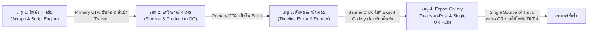

# 📑 แผนงานปรับปรุงสถาปัตยกรรม UI/UX และความต่อเนื่องของลูปงาน (เมนู 1 → 2 → 3 → 4)
**OmniCut Pro Studio: UI/UX & Flow Continuity Overhaul Plan**  
*อ้างอิงมาตรฐาน:* `/impeccable` · `/ui-ux-pro-max` · `/unslop` · OmniCut Golden Master Standards  
*เอกสารแผน:* `_Docs/Plans/PLAN_UI_UX_FLOW_OVERHAUL_MENU_1_TO_4_20261109.md`  
*วันที่เริ่มจัดทำ:* 2026-11-09  
*ดำเนินการโดย:* Antigravity (Gemini 3.8 Flash)

---

## 🎯 1. วัตถุประสงค์และภาพรวม (Executive Objective)

ยกระดับประสบการณ์ผู้ใช้ (UX) และความประณีตของส่วนติดต่อผู้ใช้ (UI Craft) ของ 4 ลำดับเมนูหลักใน OmniCut Studio:
1. **[เมนู 1] สินค้า → คลิป (`ProductToClip`)**
2. **[เมนู 2] แทร็กเกอร์ 4 เฟส (`ContentTrackerHub`)**
3. **[เมนู 3] ตัดต่อ & สร้างคลิป (`EditorShell` & `SequencePlayer`)**
4. **[เมนู 4] Export Gallery (`ExportGallery`)**

### ปัญหาหลักที่ต้องแก้ไข (Core Problems)
- **Role Ambiguity (บทบาททับซ้อน):** เมนู 2 และ เมนู 4 มีเครื่องมือสแกน QR Code สำหรับ TikTok Quick Post ซ้ำซ้อนกัน แย่งกันเป็นจุดปล่อยคลิป
- **Missing Flow Continuity (รอยต่อสะดุด):** เมื่อเสร็จขั้นตอนในเมนู 1 ไม่มีปุ่มก้าวถัดไปที่ชัดเจน (Primary Next CTA) ผู้ใช้ต้องเดาเพื่อสลับแท็บเอง เช่นเดียวกับหลังเรนเดอร์ในเมนู 3
- **AI Slop & Visual Congestion (ความรกแบบ Vibecoded):** ป้ายแท็กสีรุ้ง 7 สี, การ์ด Kanban บรรจุปุ่มเบียดเสียด 8-10 ปุ่ม, การใช้อีโมจิในปุ่มและป้ายกำกับ, และ Modal ซ้อนกันถึง 11 หน้าต่าง

---

## 🗺️ 2. แผนผังการเดินทางของผู้ใช้เป้าหมาย (Target User Journey)



---

## 📋 3. รายละเอียดการดำเนินการทีละเฟส (Phased Action Plan)

---

### 🔹 Phase 1: การแยกบทบาทและขจัดความซ้ำซ้อน (Role Decoupling — P0)
**เป้าหมาย:** สถาปนา **เมนู 4 (Export Gallery)** ให้เป็น Single Source of Truth สำหรับการแจกจ่าย/โพสต์คลิป และคืนบทบาท **เมนู 2 (Tracker)** ให้เป็นศูนย์ควบคุมการผลิต 100%

* **ไฟล์เป้าหมาย:**
  - `frontend/src/components/ContentTrackerHub.jsx`
  - `frontend/src/components/ExportGallery.jsx`
* **รายละเอียดงาน:**
  1. **ถอด QR Quick Post Modal และปุ่มโพสต์ TikTok ออกจากการ์ดใน `ContentTrackerHub.jsx`:**
     - ในคอลัมน์ `rendered` และ `posted` ให้ตัดปุ่ม QR Code Icon และปุ่มเตรียมโพสต์ TikTok ออก
     - ปรับปุ่มปลายทางในคอลัมน์ `rendered` เมื่อตรวจผ่าน QC ให้เป็นปุ่ม: `[เปิดใน Export Gallery (เมนู 4)]` เพื่อส่งต่อคลิปอย่างเป็นทางการ
  2. **ปรับปรุงการซิงก์สถานะ `rendered` และ `posted`:**
     - เมื่อคลิปถูกโพสต์จาก Export Gallery ให้ส่ง Event หรือเรียก API `markPosted` เพื่อให้อัปเดตสถานะใน Tracker เป็น `posted` อัตโนมัติ โดยไม่ต้องมีปุ่มโพสต์ค้างใน Tracker
* **เกณฑ์การตรวจรับ (Acceptance Criteria):**
  - เมนู 2 ไม่มีปุ่ม Quick Post QR หลงเหลืออยู่
  - คลิกปุ่มจากการ์ดที่เรนเดอร์เสร็จในเมนู 2 แล้วสามารถสลับแท็บไปไฮไลต์คลิปนั้นในเมนู 4 ได้ทันที

---

### 🔹 Phase 2: การสร้างสะพานเชื่อมต่อข้ามขั้นตอน (Flow Continuity Bridges — P0)
**เป้าหมาย:** สร้างตัวนำทาง "ก้าวถัดไปที่ชัดเจน (Clear Next Step)" เชื่อมระหว่าง 1 → 2 และ 3 → 4 เพื่อลดภาระทางสมอง (Cognitive Load)

* **ไฟล์เป้าหมาย:**
  - `frontend/src/components/ProductToClip.jsx`
  - `frontend/src/components/editor/EditorShell.jsx`
* **รายละเอียดงาน:**
  1. **Sticky Primary Action Bar ในเมนู 1 (`ProductToClip.jsx`):**
     - เมื่อผู้ใช้เลือกมุมมองหรือตรวจสอบสคริปต์ที่พอใจแล้ว ให้มีแถบ Sticky Action Bar ลอยตัวที่ด้านล่างของการ์ดสคริปต์:
       - **ปุ่มหลัก (Primary CTA - Accent นีออน):** `[ส่งมุมนี้เข้าสู่กระบวนการถ่ายทำ (Tracker) →]` (คลิกแล้วบันทึกสถานะ `scripted` และสลับไปยังแท็บ Tracker พร้อมเลือกสินค้าตัวนั้นให้ทันที)
       - **ปุ่มรอง (Secondary):** `[เปิดตัดต่อทันที (Editor)]` สำหรับกรณีที่มีฟุตเทจพร้อมตัดแล้ว
  2. **Post-Render Navigation Bridge ในเมนู 3 (`EditorShell.jsx`):**
     - ในกล่องแจ้งเตือนเรนเดอร์สำเร็จ (`animate-fadeIn` บริเวณล่างจอ):
       - เพิ่มปุ่มหลักเด่นชัด: `[ไปที่ Export Gallery เพื่อโพสต์คลิป →]` (`onClick={() => setActiveTab('gallery')}`)
       - คงปุ่มเปิดโฟลเดอร์ไฟล์ (`Reveal in Folder`) ไว้เป็นปุ่มรอง
* **เกณฑ์การตรวจรับ (Acceptance Criteria):**
  - ผู้ใช้กดคลิกเดียวจากเมนู 1 สามารถไปโผล่ในบอร์ดเมนู 2 ได้ทันทีโดยไม่ต้องคลิก Sidebar หาเอง
  - หลังเรนเดอร์เสร็จในห้องตัดต่อ มีปุ่มพาข้ามไปเมนู 4 ได้ทันที

---

### 🔹 Phase 3: การกวาดล้าง UI รกในเมนู 1 (Unslopping Product & Script Engine — P1)
**เป้าหมาย:** ลบสีรุ้ง (Rainbow Chips), กำจัดอีโมจิในปุ่ม/ข้อความ, และจัดระเบียบ 11 Modals

* **ไฟล์เป้าหมาย:**
  - `frontend/src/components/ProductToClip.jsx`
* **รายละเอียดงาน:**
  1. **ล้างสีรุ้งใน `CONTENT_TYPE_CATALOG`:**
     - เปลี่ยนป้ายประเภทสคริปต์ทั้งหมด (Problem-Solution, Specs, Unboxing ฯลฯ) จากสี Rose, Cyan, Amber, Sky, Emerald สู่ **Monochromatic Neutral Palette**:
       - *Default State:* `bg-white/[0.04] border-white/10 text-zinc-300`
       - *Active/Selected State:* `bg-[#25F4EE]/10 border-[#25F4EE]/40 text-[#25F4EE] font-semibold`
  2. **กำจัด Emojis และจัด Microcopy ปุ่มตามกฎเหล็กข้อ 8:**
     - แทนที่อีโมจิ `💡`, `⚠️`, `⚡` ด้วย Lucide Icons (`Lightbulb`, `AlertTriangle`, `Zap`) ขนาด 14px สี Neutral Muted
     - ตรวจสอบปุ่มให้ขึ้นต้นด้วยกริยาเสมอ และไม่มีไอคอนซ้ำความหมาย
  3. **รวม Modals ที่ทำงานเกี่ยวเนื่องกัน (Consolidate Modals):**
     - รวม `HookVariationModal` และ `HookHeaderModal` ให้เป็นหน้าต่างเดียวที่มีแท็บสลับ `[ตัวเลือก Hook]` และ `[พาดหัวปก]`
     - แก้ไข Text Encoding ที่เพี้ยนใน `GEMINI_VOICE_OPTIONS`
* **เกณฑ์การตรวจรับ (Acceptance Criteria):**
  - ไม่พบอีโมจิในปุ่มคำสั่งหรือข้อความช่วยเหลือ
  - ป้ายแท็กสคริปต์คุมโทน Quiet Chrome คลีน สะอาดตา อ่านง่าย

---

### 🔹 Phase 4: จัดระเบียบการ์ดและหัวคอลัมน์ในเมนู 2 (Tracker Ergonomics — P1)
**เป้าหมาย:** ลดความหนาแน่นของการ์ด Kanban จาก 8-10 ปุ่มเหลือ 2 ปุ่มหลัก และปรับแต่งหัวคอลัมน์แบบ Quiet Header

* **ไฟล์เป้าหมาย:**
  - `frontend/src/components/ContentTrackerHub.jsx`
* **รายละเอียดงาน:**
  1. **สถาปัตยกรรมปุ่มบน `KanbanCard` ใหม่ (2-Tier Action Hierarchy):**
     - **Tier 1 (ปุ่มหลักติดการ์ด):**
       1. `[พรีวิววิดีโอ/ตรวจคลิป]` (หรือเปิดพรีวิวแบบ Hover)
       2. `[ปุ่มขับเคลื่อนเฟส]` เช่น ในเฟสถ่ายทำเป็น `[ส่งตัดต่อ →]` ในเฟสตัดเสร็จเป็น `[QC ผ่าน / ส่ง Export →]`
     - **Tier 2 (ปุ่มรอง):** ยุบปุ่มแก้ไขสคริปต์, จัดการปก, คัดลอกแคปชัน, ตรวจ Studio เข้าไปอยู่ในดรอปดาวน์เมนู `•••` (More Actions) มุมขวาบนของการ์ด
  2. **Quiet Header สำหรับ 4 Pipeline Columns:**
     - เปลี่ยนหัวคอลัมน์ที่ใช้กรอบสีจ้า (Cyan/Amber/Blue/Emerald) ให้ใช้พื้นหลังการ์ดสี Neutral เข้ม `#0E131E` พร้อมขอบบาง `border-white/[0.08]`
     - ใช้ **Status Indicator Dot ขนาด 6px** แสดงสีประจำเฟสอย่างสุภาพแทนการระบายสีทั่วกรอบ
* **เกณฑ์การตรวจรับ (Acceptance Criteria):**
  - การ์ดใน Kanban อ่านง่าย สบายตา ไม่รู้สึกแน่นเหมือนแผงวงจร
  - ปุ่มรองทั้งหมดเข้าถึงได้ง่ายผ่านเมนู `•••`

---

### 🔹 Phase 5: ความแม่นยำ Safe Zone และพื้นที่ทำงานในเมนู 3 (Editor Polish — P1)
**เป้าหมาย:** ปรับปรุงพื้นที่แสดงผล Timeline ให้กว้างขึ้น และเพิ่ม Overlay สำหรับตรวจสอบ TikTok Safe Zone

* **ไฟล์เป้าหมาย:**
  - `frontend/src/components/editor/EditorShell.jsx`
  - `frontend/src/components/editor/SequencePlayer.jsx`
* **รายละเอียดงาน:**
  1. **เพิ่ม TikTok Safe Zone Overlay Toggle บนหน้าพรีวิว (`SequencePlayer.jsx`):**
     - เพิ่มปุ่ม Toggle รูปไอคอน `Smartphone` หรือ `Grid` บนแถบควบคุมพรีวิว
     - เมื่อเปิด: แสดงเส้นไกด์โปร่งแสง (Grid Overlay):
       - เว้นขอบล่าง 420px (พื้นที่แสดงชื่อเพลง, แคปชัน, และแถบความคืบหน้าของ TikTok)
       - เว้นขอบขวา 120px (พื้นที่แสดงปุ่มหัวใจ, คอมเมนต์, เซฟ, แชร์)
       - เว้นขอบบน 180px (พื้นที่แสดงแท็บค้นหาและกำลังติดตาม)
  2. **Auto-Collapse Asset Panel เมื่อเล่นวิดีโอ (Smart Workspace Density):**
     - เพิ่มตัวเลือกย่อแผง Assets ฝั่งซ้ายอัตโนมัติเมื่อกด Playback เพื่อให้ Timeline และ Preview มีพื้นที่แสดงผลเต็มที่บนหน้าจอความละเอียด 1080p
  3. **Typography & Tabular Numbers:**
     - บังคับใช้คลาส `font-mono tabular-nums` สำหรับตัวเลขนับเวลา Timecode และ FPS เพื่อป้องกันตัวเลขดิ้นไปมาขณะเล่นคลิป
* **เกณฑ์การตรวจรับ (Acceptance Criteria):**
  - มีปุ่มเปิด/ปิด Safe Zone และเส้นไกด์แสดงผลแม่นยำตามสัดส่วน 1080x1920
  - Timecode ตัวเลขแสดงผลนิ่ง ไม่ขยับสั่นขณะ Playhead เคลื่อนที่

---

### 🔹 Phase 6: ยกระดับ Export Gallery สู่ศูนย์ส่งมอบงานระดับโปร (Gallery Craft — P1)
**เป้าหมาย:** จัดระเบียบการ์ดวิดีโอ 9:16 ให้เน้นที่การส่งคลิปไปโพสต์ และแยกคลิปที่โพสต์แล้วให้ชัดเจน

* **ไฟล์เป้าหมาย:**
  - `frontend/src/components/ExportGallery.jsx`
* **รายละเอียดงาน:**
  1. **การ์ดวิดีโอแบบ Quiet Chrome & 1 Bright Action:**
     - **Bright Action (ปุ่มหลักโดดเด่น):** `[📱 สแกน QR โพสต์ TikTok]` (ปุ่มสว่างนีออน/เขียวเด่นชัดเจน)
     - **Secondary Action:** `[คัดลอกแคปชัน & แท็ก]` (ปุ่มเรียบ Neutral)
     - ยุบปุ่ม SSD Sync, Cloud Archive, Reveal in Folder, Delete, Enhance เข้าสู่เมนูดรอปดาวน์ `•••`
  2. **Dimmed State สำหรับคลิปที่โพสต์แล้ว (`posted`):**
     - หากคลิปถูกบันทึกว่าโพสต์แล้ว ให้ปรับความสว่างของการ์ดลง (`opacity-65 hover:opacity-100 transition-opacity`)
     - ติดป้ายกำกับสีเทาสุภาพ: `✓ โพสต์แล้ว [วัน/เวลา]`
     - คลิปที่ยังไม่ได้โพสต์จะเด่นสะดุดตา ช่วยให้ผู้ใช้หยิบคลิปใหม่ไปลงช่องได้ทันทีโดยไม่สับสน
* **เกณฑ์การตรวจรับ (Acceptance Criteria):**
  - การ์ดใน Export Gallery สะอาด คลีน ไม่มีปุ่มรกรุงรัง
  - มองเห็นความแตกต่างระหว่างคลิปที่ "พร้อมโพสต์" กับคลิปที่ "โพสต์ไปแล้ว" ได้ทันทีใน 1 วินาที

---

### 🔹 Phase 7: การทดสอบความถูกต้องและการถดถอยทั้งระบบ (Regression & Verification — P0)
**เป้าหมาย:** ตรวจสอบความถูกต้องของการทำงานทุกส่วน ไม่ให้มี Error หรือฟังก์ชันเดิมเสียหาย

* **รายละเอียดงาน:**
  1. รันชุดทดสอบ Frontend Unit/Component Tests: `npm run test` (Vitest)
  2. รันการทดสอบ Parity: ตรวจสอบความสอดคล้องระหว่าง `SequencePlayer.jsx` และ `subtitle_engine.py`
  3. ตรวจสอบการ Build สำหรับ Production: `npm run build` ใน `frontend/`
  4. ทำการทดสอบ Interactive Flow แบบครบวงจร: สแครปสินค้า (1) → เข้าแทร็กเกอร์ (2) → เปิดตัดต่อ (3) → เรนเดอร์ → ข้ามไป Export Gallery (4) → เปิด QR โพสต์
* **เกณฑ์การตรวจรับ (Acceptance Criteria):**
  - Test suites ผ่าน 100%
  - Production build ผ่านโดยไม่มีข้อผิดพลาด

---

## 📅 4. ลำดับการลงมือปฏิบัติ (Execution Roadmap)

```
[Phase 1: Role Decoupling] 
  └──> [Phase 2: Flow Continuity Bridges]
        └──> [Phase 3: Unslopping เมนู 1]
              └──> [Phase 4: Unslopping เมนู 2]
                    └──> [Phase 5: Editor Safe Zone & Polish เมนู 3]
                          └──> [Phase 6: Export Gallery Refinement เมนู 4]
                                └──> [Phase 7: Full System Regression]
```

---
*เอกสารนี้จัดทำตามมาตรฐานความประณีตระดับงานฝีมือ (Zero-Slop Production Standard) พร้อมดำเนินการตามขั้นตอนทันทีเมื่อได้รับคำสั่งยืนยัน*
