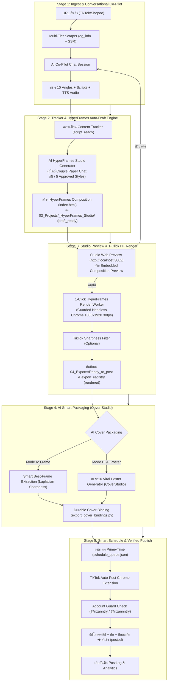

# แผนผังและสถาปัตยกรรมระบบ: โฟลว์ผลิตคลิป AI รวมศูนย์ (Unified AI Production Pipeline)

ดำเนินการโดย: Antigravity (Gemini 3.8 Flash High)
วันที่: 2026-10-12
อ้างอิง: [ARCHITECTURE.md](../../ARCHITECTURE.md) · [TODO.md](../../TODO.md) · [AGENTS.md](../../AGENTS.md)

---

## 1. วิสัยทัศน์และเป้าหมาย (Vision & Objective)

ปรับเปลี่ยนกระบวนการผลิตคลิปของ OmniCut Pro Studio จากเดิมที่ต้องเปิดสลับ 5-6 หน้าจอ (ProductToClip ➔ ContentTracker ➔ Editor/HyperFrames ➔ ExportGallery ➔ CoverStudio ➔ Schedule) ให้กลายเป็น **"One Unified AI Production Loop"** ที่ทำงานรวดเร็ว ไร้รอยต่อ และเป็นระบบอัตโนมัติ (Zero-Friction Co-Pilot Loop):

```
[1. Ingest สินค้า] ➔ [2. คุยใน AI Session] ➔ [3. AI เจนมุม+สคริปต์+เสียง]
       ↓
[4. เข้า Tracker 4 เฟส] ➔ [5. AI สร้าง Draft อัตโนมัติ] ➔ [6. พรีวิว & เรนเดอร์ 1080p]
       ↓
[7. เข้า Track ตัดต่อเสร็จ] ➔ [8. AI สกัดเฟรม/สร้างปก 9:16] ➔ [9. ตั้งเวลา & โพสต์ TikTok]
```

---

## 2. โครงสร้างสถาปัตยกรรม 5 สเตจหลัก (Unified 5-Stage Architecture)



---

## 3. รายละเอียดการทำงานของแต่ละสเตจ (Detailed Functional Specs)

### สเตจที่ 1: Ingest & Conversational Co-Pilot (ดึงข้อมูล + แชทสร้างมุม/สคริปต์/เสียง)
* **User Interface**: 
  - ส่วนขยาย Drawer หรือ Tab ในหน้า `ProductToClip.jsx`: **"ผู้ช่วย AI ผลิตคลิป (AI Creative Co-Pilot)"**
  - มีช่องวาง URL ด้านบน พร้อมหน้าต่าง Chat ทางขวา หรือกล่องสนทนากลาง
* **Backend Services**:
  - `scripts/product_scraper.py`: สกัดชื่อสินค้า, ราคา, สเปก, และรูปภาพ 9+ รูป
  - `scripts/api_copilot.py` (โมดูลใหม่): รองรับ `POST /api/copilot/chat` รับส่งข้อความพร้อม context ของสินค้า
* **Prompting & Capabilities**:
  - ผู้ใช้สามารถพูดคุยบรีฟทิศทาง เช่น:
    - *"ขอคลิป 30 วิ สไตล์คู่รักสายใต้น้องนุ้ยกับพี่บ่าว เน้นความฮาเรื่องพัดลมลมแรงจนเอกสารปลิว"*
    - *"ขอแนว Tech สเปกชาร์จไว 240W ดึงจุดเด่น 4 ข้อ"*
  - AI ดำเนินการ 3 อย่างในรอบเดียว:
    1. **Angles & Hook**: สรุปมุมมองการเล่าเรื่อง (Angles Matrix 4-10 แบบ)
    2. **Script**: เขียนบทพูดจัดคำเป็น Kinetic Syllable Clusters, ตัดจุดไข่ปลาออก 100%, คุม Safe Zone
    3. **Voice Synthesis (TTS)**: 
       - ถ้าพากย์เดี่ยว: เจนเสียง **Fenrir** (`commercial_premium`)
       - ถ้าพากย์คู่รัก: เจนเสียง **Aoede** (น้องนุ้ย) + **Puck** (พี่บ่าว) ตัดแบ่งคำตามจังหวะเงียบอัตโนมัติ

---

### สเตจที่ 2: Content Tracker & HyperFrames Auto-Draft (เข้า Tracker ➔ สร้าง HyperFrames Composition)
* **การส่งต่องาน**:
  - เมื่อผู้ใช้หรือ AI ตกลงเลือก Angle และสคริปต์เรียบร้อย ระบบจะ Commit ข้อมูลลง `ProductStore`
  - สร้างเรคอร์ดใน [`ContentTrackerHub.jsx`](file:///d:/Programmer/All%20Project/Omnicut/frontend/src/components/ContentTrackerHub.jsx) ในสถานะ **เฟส 1: สคริปต์พร้อม (`script_ready`)**
* **ระบบประกอบ HyperFrames Composition อัตโนมัติ (HyperFrames Native Builder)**:
  - ดึงข้อมูลบทสนทนา, สเปกสินค้า, รูปภาพทางการ และไฟล์เสียงพากย์ (WAV + Whisper timing)
  - สร้างโฟลเดอร์ Composition ใน `03_Projects/_HyperFrames_Studio/clips/{clip_slug}/` (เช่น `hat01-paper-chat-30s/` หรือ `els6-couple-paper/`)
  - **ใช้สไตล์หลักของช่อง — Couple Paper Chat #5 (พี่บ่าว & น้องนุ้ย)** หรือ 1 ใน 5 Approved Styles:
    - พื้นหลังวิดีโอกระดาษยับ `assets/shared/paper_bg.mp4` (`playbackRate: 0.5`)
    - ฟอนต์ Anuphan-Bold / Mali-Bold, อวตารชมพู "น" (น้องนุ้ย) ↔ อวตารฟ้า "บ" (พี่บ่าว)
    - กล่องข้อความแชท LINE (ขาว / เขียว) พร้อม Dynamic Bubble Pacing ตามความยาวคำ
    - การ์ดโชว์สินค้าทางการขอบขาวพุ่งเข้าจอ พร้อม SFX `paper.mp3`
  - ตรวจสอบความถูกต้องผ่าน `hyperframes check` (WCAG AA Contrast Pass, 0 error)
* **ผลลัพธ์**: ได้ไฟล์ `index.html` พร้อมเปิดพรีวิว และเลื่อนสถานะใน Content Tracker เป็น **เฟส 3: กำลังตัดต่อ / มีดราฟต์ (`draft_ready`)**

---

### สเตจที่ 3: Studio Web Preview & 1-Click HyperFrames Render (พรีวิว ➔ เรนเดอร์ ➔ เข้า Track ตัดต่อเสร็จ)
* **หน้าพรีวิว (Zero-Lag Studio Preview)**:
  - พรีวิวบนเว็บแอปได้ทันทีผ่าน HyperFrames Studio Preview (`http://localhost:3002` หรือ iframe preview ในหน้า Content Tracker)
  - สามารถสั่งปรับข้อความในแชท Co-Pilot ได้แบบเรียลไทม์
* **1-Click HyperFrames Render**:
  - ปุ่มเด่นชัด: **"🚀 เรนเดอร์คลิปนี้ด้วย HyperFrames (1080x1920 30fps)"**
  - รันเบื้องหลังผ่าน HyperFrames Worker (`tools/hyperframes_render_worker.mjs` / Chrome Headless)
  - เรนเดอร์ไฟล์เสร็จสมบูรณ์ลง `04_Exports/Ready_to_post/{YYYYMMDD}_{product}_{angle}_v1.mp4`
  - สร้างภาพปก WebP Thumbnail อัตโนมัติ
  - รองรับตัวกรอง TikTok Sharpness Enhancer (`scripts/tiktok_enhancer.py`)
  - ลงทะเบียนผลงานเข้าสู่ `_Docs/export_registry.json`
* **อัปเดต Tracker**: ขยับสถานะใน Content Tracker เข้าสู่ **เฟส 4: ตัดต่อเสร็จ (`rendered`)** ทันที

---

### สเตจที่ 4: AI Smart Packaging (AI เลือกช่วงเฟรมเด็ด หรือ สร้างปกใหม่)
เมื่อคลิปเรนเดอร์เสร็จสิ้น ระบบจะเปิดแถบแนะนำปกอัตโนมัติ (Cover Packaging Panel):
* **Mode A: AI Best-Frame Selector (เลือกช็อตปังจากคลิป)**:
  - FFmpeg สกัดภาพทุก 0.5s จากช่วง 0-5s แรก (ช่วง Hook)
  - ประเมินคะแนนความคมชัด (Laplacian Variance Score) คัดเฉพาะเฟรมที่ภาพไม่เบลอ ตัวสินค้าชัดเจน ไม่มีภาพหลับตา
* **Mode B: AI Viral Poster Generator (เจนภาพโปสเตอร์ 9:16)**:
  - ดึงภาพแคตตาล็อกสินค้า + ข้อมูลสเปกทางการ + ข้อความพาดหัว Hook
  - ส่งให้โมเดล AI เจนภาพโปสเตอร์โฆษณา TikTok 9:16 สไตล์ Cinematic
* **Durable Binding**: บันทึกภาพปกที่เลือกลง [`scripts/export_cover_bindings.py`](file:///d:/Programmer/All%20Project/Omnicut/scripts/export_cover_bindings.py) ล็อกคู่กับ Export ID ถาวร

---

### สเตจที่ 5: Smart Schedule & Verified Publish (ตั้งเวลา ➔ โพสต์ขึ้น TikTok)
* **Smart Prime-Time Scheduling**:
  - เมื่อได้คลิปและปกเรียบร้อย ระบบจะแนะนำเวลาโพสต์ที่ดีที่สุดประจำวัน เช่น:
    - มื้อเที่ยง: 11:30 น.
    - เลิกงาน: 18:00 น.
    - ก่อนนอน: 20:30 น.
  - กดปุ่ม **"📅 ส่งเข้าตารางคิวโพสต์"** ➔ บันทึกข้อมูลลง [`_Docs/schedule_queue.json`](file:///d:/Programmer/All%20Project/Omnicut/_Docs/schedule_queue.json)
* **TikTok Auto-Post via Chrome Extension**:
  - Extension ตรวจพบคิวงานของช่องปัจจุบัน
  - **Account Guard Check**: ตรวจสอบบัญชี TikTok ที่ล็อกอินอยู่ในเบราว์เซอร์จริง (เช่น `@rizanntry` หรือ `@rizannntry`) ว่าตรงกับ Channel ID ป้องกันโพสต์ผิดช่อง 100%
  - อัปโหลดคลิป MP4 + แนบภาพปก + ใส่แคปชั่นและแฮชแท็ก + แนบลิงก์ตะกร้า TikTok Shop
  - เมื่อโพสต์เสร็จ ดึง Platform Post ID และ Receipt ส่งกลับมาบันทึกลง `PostLog`
  - ปรับสถานะงานเป็น **`posted`** ทันที

---

## 4. แผนที่การเชื่อมต่อไฟล์โค้ด (Code Architecture Map)

| หน้าที่ในโฟลว์ | ไฟล์ Frontend ที่เกี่ยวข้อง | ไฟล์ Backend ที่เกี่ยวข้อง | สถานะปัจจุบัน |
| :--- | :--- | :--- | :--- |
| 1. Ingest & Chat Co-Pilot | `frontend/src/components/ProductToClip.jsx` | `scripts/product_scraper.py`, `scripts/api_copilot.py` (ใหม่) | Scraper มีแล้ว / Chat Co-Pilot ต้องสร้างใหม่ |
| 2. Angles & Script & Voice | `frontend/src/components/ProductToClip.jsx` | `scripts/api_phase1.py`, `scripts/api_voice.py` | มีฟังก์ชันแล้ว / ต้องทำ Adapter ให้เรียกพร้อมกัน |
| 3. Tracker Registration | `frontend/src/components/ContentTrackerHub.jsx` | `scripts/product_store.py`, `scripts/api_products.py` | มีแล้ว 100% |
| 4. Auto-Draft Builder | `frontend/src/components/editor/EditorShell.jsx` | `scripts/pipeline.py`, `scripts/pipeline_context.py` | มีแล้ว / ต้องเชื่อม Trigger สร้างอัตโนมัติ |
| 5. Preview & Render | `frontend/src/components/editor/SequencePlayer.jsx` | `scripts/api_render.py`, `scripts/video_editor.py` | มีแล้ว 100% |
| 6. Sharpness Enhancer | `frontend/src/components/ExportGallery.jsx` | `scripts/tiktok_enhancer.py`, `scripts/api_exports.py` | เพิ่งติดตั้งเสร็จสมบูรณ์ |
| 7. AI Cover Packaging | `frontend/src/components/CoverStudioModal.jsx` | `scripts/api_covers.py`, `scripts/export_cover_bindings.py` | มีแล้ว / ต้องเชื่อม Auto-Trigger หลัง Render |
| 8. Schedule Queue | `frontend/src/components/ScheduleAgenda.jsx` | `scripts/api_schedule_queue.py`, `schedule_queue.json` | มีแล้ว 100% |
| 9. Auto-Post Extension | `tiktok_autopost_extension/` | `scripts/api_tiktok_autopost.py`, `posting_jobs.py` | มีแล้วพร้อม Account Guard 100% |

---

## 5. แผนการพัฒนาทีละเฟส (Phased Implementation Roadmap)

* **Phase 1 (Co-Pilot Core Service & Backend Hub)**:
  - สร้าง `scripts/copilot_engine.py` และ `scripts/api_copilot.py`
  - ทำ Endpoint สรุปงาน 1-คลิก: รับ URL ➔ เจน Angles ➔ สคริปต์ ➔ เสียง TTS (Fenrir หรือ คู่รัก Aoede+Puck) ➔ บันทึกลง ProductStore
* **Phase 2 (Co-Pilot Chat UI Integration)**:
  - เพิ่มคอมโพเนนต์ `AICoPilotChat.jsx` ในหน้า `ProductToClip.jsx`
  - ให้ผู้ใช้พิมพ์บรีฟโต้ตอบ และกด "ยืนยันนำไปตัดต่อ" ได้ในคลิกเดียว
* **Phase 3 (Auto-Draft & 1-Click Render Pipeline)**:
  - ทำ Bridge เชื่อมจาก ProductStore ➔ สร้างดราฟต์ไทม์ไลน์อัตโนมัติ (NLE หรือ Paper Chat)
  - เพิ่มปุ่ม "Render & Prepare Post" ในหน้าพรีวิว
* **Phase 4 (Cover Auto-Trigger & Quick Schedule Handoff)**:
  - เมื่อ Render เสร็จ ให้ระบบเสนอ Best Keyframe และตัวเลือก AI Poster ทันที
  - กดยืนยันปุ๊บ ส่งเข้า Schedule Queue ทันที
* **Phase 5 (End-to-End Regression & Verification)**:
  - ทดสอบเดินโฟลว์ตั้งแต่ต้นจนจบ 1 รอบเต็ม
  - ตรวจสอบความถูกต้องของซับไตเติล, สเปกเสียง, Multi-Channel isolation และการคลีนขยะทดสอบ 100%
