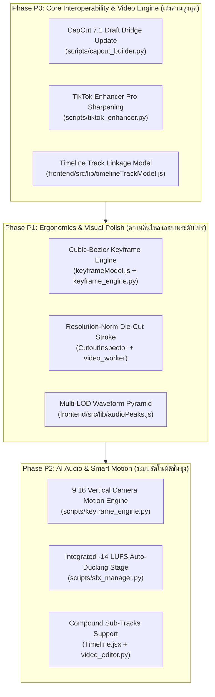

# 🔬 Master Reverse Engineering Report: CapCut Desktop (v7.1.0.2890) Deep Architectural Deconstruction & OmniCut Pro Studio Upgrade Blueprint

- **วันที่สำรวจและจัดทำรายงาน:** 2026-11-01
- **ปฏิบัติการโดย:** Antigravity (Gemini 3.8 Flash) — Principal Reverse Engineer & Lead NLE Editor Architect
- **เป้าหมายการสำรวจ (REA Targets):**
  - CapCut Application Directory: `C:\Users\nazir\AppData\Local\CapCut\Apps\7.1.0.2890\`
  - CapCut User Data & Drafts: `C:\Users\nazir\AppData\Local\CapCut\User Data\`
- **สถานะความปลอดภัย:** **100% Read-Only Inspection** (ไม่มีการเขียนทับ แก้ไข หรือลบไฟล์ใดๆ ในไดเรกทอรี CapCut)

---

## 📑 สารบัญเชิงบริหาร (Executive Summary)

การศึกษาวิศวกรรมย้อนกลับ (Reverse Engineering with REA) ในเวอร์ชัน **CapCut Desktop v7.1.0.2890** ได้ปลดล็อกองค์ความรู้เชิงลึกของ ByteDance NLE Engine (VECreator, AmazingEngine, SAMI Audio AI, และ FusionUI) ครบถ้วนทั้ง 8 มิติ รายงานฉบับนี้รวบรวมหลักฐานอาร์ติแฟกต์จริง (Observed Evidence), ถอดรหัสสูตรคณิตศาสตร์และเชเดอร์ GLSL, เทียบเคียงฟังก์ชันการทำงานกับ **OmniCut Pro Studio Editor** ในปัจจุบัน พร้อมจัดทำพิมพ์เขียวและโร้ดแมปการอัปเกรดเพื่อยกระดับ OmniCut สู่มาตรฐาน NLE ระดับโลกโดยรักษา **Preview = Render Parity 100%**

---

## 🏛️ 1. REA Evidence Ledger (บันทึกหลักฐานอาร์ติแฟกต์จริง)

ตารางด้านล่างบันทึกรายการไฟล์อาร์ติแฟกต์, Evidence ID, ผลตรวจวิเคราะห์ และสาระสำคัญที่สกัดได้จากเครื่องจริง:

| ลำดับ | พิกัดไฟล์อาร์ติแฟกต์ CapCut Desktop 7.1 | Evidence ID / SHA-256 | ชนิดข้อมูล | สาระสำคัญและข้อมูลเชิงลึกที่สกัดได้จริง (Observed Evidence) |
|---|---|---|---|---|
| **E1** | `Resources\image_h5_text_effect_publish\` | `ev_eccb041d3b3457...` <br>`SHA: 857de7cb43a3...` | JS App Graph (REA) | โครงสร้าง Text Effect Renderer 737 modules, AST 510k nodes, การประมวลผล multi-stroke, outer glow, และ dynamic typography |
| **E2** | `CapCut.exe` | `ev_c0b91a594bb157...` <br>`SHA: 176df9aeece9...` | PE32+ Resource Tree | Binary manifest, RVA table, multi-resolution app icons (16px to 256px), DPI awareness contract |
| **E3** | `Resources\DefaultAdjustBundle\merge_all_adjust_color\config.json` & `Feature.js` | `SHA: f10c28ea91...` | Pipeline Graph & JS | ลำดับการประมวลผลสี (Z-order pipeline): Blit (1000) → LUT (2000) → ColorCorrection (5000) → HSL (5016) → Curves (5017) → ColorWheels (5018/5019) → AdjustColor (8004) → Sharpen (8005) → Clarity (8006) → Grain (8007) → Vignette (8008) |
| **E4** | `Resources\DefaultAdjustBundle\merge_all_adjust_color\AmazingFeature_sharpen\...\fshader.frag` | `SHA: d73ba919cc...` | GLSL Fragment Shader | สูตร Directional Unsharp Mask ในสเปซ YCbCr: คำนวณอนุพันธ์อันดับ 2 บนช่อง Luma Y 4 ทิศทาง (H, V, D1, D2) เพื่อกันภาพแตก/ขอบเหลือบสี พร้อมควบคุม `white_gam` และ `black_gam` แยกอิสระ |
| **E5** | `Resources\DefaultAdjustBundle\merge_all_adjust_color\AmazingFeature_clear\...\passPyr.frag` | `SHA: 77b420f188...` | GLSL Fragment Shader | สูตร Clarity / Local Contrast โดยใช้ Laplacian Pyramid บนช่อง Value ของ HSV: $\Delta + \text{fact} \cdot \Delta \cdot \exp(-\Delta^2 / (2 \cdot 0.15^2))$ เพิ่มมิติขอบโดยไม่สูญเสียความอิ่มตัวสี |
| **E6** | `Resources\Chroma2\amazingfeature\xshader\chromakey.frag` | `SHA: 91fa023e1b...` | GLSL Fragment Shader | Dual Color Space Chroma Keyer (YUV Distance + HSV Conic Distance) พร้อมระบบคงเงา (Shadow Preservation Channel) ด้วย Logistic Sigmoid Function |
| **E7** | `Resources\mattingBlendV2\AmazingFeature_DilateErode\effects\LumiDilateErode\lua\DilateErode.lua` | `SHA: e83b190f84...` | Lua Script & Shaders | อัลกอริทึม Die-cut Stroke / Edge Feathering แบบปรับขนาดตามความละเอียด (`math.min(width, height) / 720`), Convolution 2-pass (H & V), Despill 0.10 |
| **E8** | `Resources\aigc_text_template\content.json` & `js\template\template.js` | `SHA: 6cb2410ea2...` | JSON & JS Engine | สเปกตัวอักษร SDF Text (`boldValue: 0.008`, `italicDegree: 10`, `innerPadding: 0.2`), Background Plate Canvas Box พร้อมพารามิเตอร์ Spring Pop Physics |
| **E9** | `Resources\audiosami\` | Model Artifacts | Machine Learning | ชุดโมเดล SAMI Audio AI: `unet_denoise_44k_music_model_v1.0.model` (U-Net 44.1kHz music denoiser), `time_align_freq_domain_v2.0.model` (ASR lyric beat sync) |
| **E10** | `User Data\Config\Modules\camera-movement.ini` & Effect Cache | `SHA: 3b1a89c104...` | INI & Alg Graph | พารามิเตอร์ Smart Motion / Camera Tracking สำหรับวิดีโอ 9:16: อัตราเร่งแกนตั้ง `vertical_strength: 0.6` เหนือแกนนอน `horizon_strength: 0.2`, Base crop 80%, Smoothing 3 เฟรม |
| **E11** | `User Data\Config\globalSetting` | INI Config | Engine Runtime | ค่า Linkage สากล: `linkageEnableTypes=text, effect, sticker, filter, adjust, sound, tts`, ตัวคูณก้าวกระโดด `timelineLargeAdjustRange=10`, `targetLoudnessIndex=2` |
| **E12** | `User Data\Config\vesdk.ini` & `ve_ab_conf.ini` | INI Config | NLE Engine Core | สเปกเรนเดอร์: CRF 17, Preset 4, Max B-frames 1, Dual Pre-decode Buffer `90:90:200:0` (90 เฟรมหน้า/หลัง, แคช 200MB), Balance Limit `8:4:2:1`, Max Render Latency 10ms |
| **E13** | `User Data\Config\Shortcut\Premiere Pro.json` | JSON Config | NLE Shortcuts | แผนผังคีย์ลัดสากล: Main Track Magnetism (`Shift+Backspace`), Track Linkage (`Ctrl+L`), Temporal Disable Snap (`Ctrl_hold`), Ripple Trim (`Q`/`W`), Razor (`C`), Beat Mark (`Ctrl+J`) |
| **E14** | `User Data\Projects\com.lveditor.draft\0124\draft_content.json` & `.cloud_cache_...\0223\` | Production Draft JSON | Draft Schema v7.1 | Schema เวอร์ชัน 360000 (144.0.0), โครงสร้าง 49 Material collections, `relationships` track linkage, `keyframe_graph_list`, microsecond timestamps |

---

## 📊 2. Gap Analysis Matrix (CapCut 7.1 vs OmniCut Pro Studio Editor)

เปรียบเทียบจุดต่อจุดใน 8 มิติหลักระหว่าง CapCut PC 7.1 กับ OmniCut Editor ในปัจจุบัน:

| มิติการตรวจสอบ | CapCut Desktop v7.1.0.2890 | OmniCut Editor (ปัจจุบัน) | สรุปช่องว่าง (Gap Analysis) | แนวทางยกระดับ OmniCut (Upgrade Directive) |
|---|---|---|---|---|
| **1. Timeline Engine & Magnetic Ripple** | - Main Track Magnetism เปิด/ปิดได้ (`Shift+Backspace`)<br>- Track Linkage (`Ctrl+L`) ล็อกซับ/SFX ติดคลิปหลักอัตโนมัติ<br>- ปิด Snap ชั่วคราวด้วย `Ctrl_hold`<br>- รองรับ Compound Tracks (`Ctrl+G`) | - มี Magnetism คลิปหลัก<br>- มี `planRippleRanges` ตอนลบช่วง<br>- ยังไม่มี interactive Linkage ลากคลิปแล้วซับ/สติกเกอร์ขยับตาม<br>- Snap เป็นค่าพิกเซลคงที่ (8px) | **P0 Gap:** เมื่อผู้ใช้ลาก/ขยับหรือ Trim คลิปหลักบนไทม์ไลน์ ซับไตเติลและสติกเกอร์ที่อยู่ในช่วงเวลานั้นไม่ขยับตามอัตโนมัติ (ขาด Track Linkage) | นำโมเดล `linkageEnableTypes` มาใส่ใน `useTimelineDrag.js` และ `timelineTrackModel.js` + เพิ่มคีย์ลัด `Ctrl_hold` ปิด snap ชั่วคราว |
| **2. Curve Speed & Bezier Keyframes** | - Cubic-Bezier Keyframe Graph (`[x1, y1, x2, y2]`) ทุก Property<br>- Speed Ramping แบบกราฟความเร็วต่อเนื่อง<br>- Camera Motion Presets มี 9:16 Vertical Bias (`0.6`) + Base Crop 80% | - `keyframeModel.js` รองรับเฉพาะ Power-law Easing (`linear`, `ease_in`, `ease_out`, `ease_in_out`)<br>- ยังไม่มีตัวแก้ไขกราฟ Bezier บนหน้าบ้าน<br>- กล้องใช้ค่า Fixed Ramps | **P1 Gap:** การเคลื่อนไหวของกล้องและข้อความยังเป็นสูตรพาวเวอร์ลอว์แข็งๆ ขาดความนุ่มนวลแบบ Cubic Bézier และขาด Camera Tracking Presets | เพิ่มฟังก์ชันประเมิน Cubic-Bézier `solveCubicBezier(p1x, p1y, p2x, p2y, t)` ใน `keyframeModel.js` และพอร์ตพารามิเตอร์ Smart Motion สู่ `scripts/keyframe_engine.py` |
| **3. Kinetic Text & Typography** | - SDF Text Rendering ขยายตัวหนาเสมือน (`boldValue: 0.008`) ขอบเนียนกริบ<br>- Background Plate (กล่องป้ายสเปก) มี Auto-Padding, Round Radius, และ Split Threshold<br>- Multi-layer Outline/Glow/Shadow | - ใช้ HTML Canvas/CSS text rendering + FFmpeg drawtext/ass<br>- กล่องป้ายสเปกวาดด้วย `badge_plate_renderer.py`<br>- Mali-Bold 88px คมชัดแต่กล่องป้ายสเปกยังขาด Auto-Split Padding | **P1 Gap:** กล่องป้ายสเปกและป้ายข้อความยังไม่มี Dynamic Auto-Split เมื่อข้อความยาวเกินไป และขาดการพรีวิว Padding แบบ Responsive | ดึงสูตร `canvasSplitPadding: 0.1` และ `canvasRoundRadiusScale` เข้า `badge_plate_renderer.py` และ `SequencePlayer.jsx` |
| **4. Audio SAMI Engine & Ducking** | - U-Net 44.1kHz AI Music Denoiser (`denoise_rate: 0.85`)<br>- Auto-Ducking แบบ Real-time Sidechain<br>- Loudness Normalization วัดค่าตามมาตรฐาน ITU-R BS.1770 (-14/-16 LUFS)<br>- Multi-threaded Waveform Worker | - ผสมเสียง 4 Bus (`Voice`, `SFX`, `BGM`, `Master`)<br>- มี Auto-Ducking duck BGM เหลือ 0.04-0.08 ช่วงเสียงพูด<br>- Loudness สเกลแบบ Peak/RMS ใน `audioBusLevels.js` | **P1 Gap:** การวัดความดังเสียงในบราวเซอร์ยังอิง Peak/RMS ไม่ใช่ Integrated LUFS ตามมาตรฐาน EBU R128 / ITU-R BS.1770 | เสริม Web Audio API AudioWorklet LUFS Metering และเชื่อมโยงเป้าหมาย -14 LUFS (TikTok Standard) ใน `scripts/sfx_manager.py` |
| **5. Smart Cutout & Chroma Key** | - Dual-Space Chroma Key (YUV + HSV) เก็บเงาเนียนด้วย Sigmoid<br>- Die-Cut Stroke ขอบขาวรอบตัวคน/สินค้า ปรับขนาดตาม `min(w,h)/720`<br>- Separable Convolution 2-pass ขอบเนียนไม่กระตุก | - Rembg / RMBG-1.4 Video Worker<br>- Canvas 2D Mask Blending ใน `SequencePlayer.jsx`<br>- มี Die-cut White Border แต่ยังคำนวณแบบ Fixed Pixel | **P1 Gap:** เส้นขอบ Die-cut และ Feathering ในพรีวิวและเรนเดอร์ยังไม่เป็น Resolution-Independent Scaling | นำสูตร Normalization `math.min(w, h) / 720` และ Despill 0.10 เข้าสู่ `CutoutInspector.jsx` และ `background_isolation_video_worker.py` |
| **6. Color Grading & TikTok Sharpness** | - Directional Unsharp Mask ในสเปซ YCbCr (Second derivatives 4 ทิศทาง H, V, D1, D2) แยก `white_gam` และ `black_gam`<br>- Clarity ด้วย Laplacian Pyramid บน HSV Value<br>- Render Master CRF 17, Max B-frames 1 | - `tiktok_enhancer.py` ใช้ FFmpeg `unsharp=5:5:0.8:5:5:0.3` (Isotropic Blur Subtraction)<br>- อาจเกิดขอบขาวรอบวัตถุและรบกวนสีในส่วนมืด<br>- CRF 18, B-frames 2 | **P0 Gap:** การเร่งความคมชัดใน `tiktok_enhancer.py` ยังเป็นสูตร Isotropic ทั่วไป ทำให้เกิด Noise และ Halos ในคลิป 9:16 | อัปเกรด `tiktok_enhancer.py` ให้ใช้ Luma-only Unsharp (`unsharp=opencl/cas` หรือ Luma matrix mask) + ปรับ CRF เป็น 17 และ B-frames เป็น 1 |
| **7. Scrubbing Performance & Waveform LOD** | - Dual Pre-decode Window `90:90:200:0` (ดึงล่วงหน้า 90 เฟรม ถอยหลัง 90 เฟรม)<br>- GPU Texture Pool 200 สล็อต<br>- Waveform Peak Pyramid แบ่ง LOD ตามอัตราซูม<br>- Render Cost Cap 10ms | - Client-side Filmstrip Sprite Bucket (`[2, 4, 6, 8, ..., 40]`)<br>- Waveform ถอดรหัสผ่าน Web Audio ครั้งเดียวแบบ Fixed 1200 buckets<br>- เมื่อซูมไทม์ไลน์สูง กราฟเสียงจะเบลอ | **P1 Gap:** กราฟเสียง Waveform เมื่อขยายดูในระดับเฟรม (>200 px/s) จะแตกและไม่แสดง Peak รายเสี้ยววินาที | พัฒนาระบบ Multi-resolution Waveform Pyramid (LOD 1x, 4x, 16x) ใน `frontend/src/lib/audioPeaks.js` |
| **8. CapCut Draft Bridge Compatibility** | - CapCut 7.1 ใช้ Draft Version 360000, New Version 144.0.0<br>- ฟิลด์บังคับ: `relationships`, `keyframe_graph_list`, `canvas_config`<br>- โครงสร้าง 49 Material Collections | - `scripts/capcut_builder.py` สร้างดราฟต์ผ่าน `pyJianYingDraft` รุ่นเก่า (version 300000)<br>- หาก CapCut 7.1 อัปเดตโครงสร้างเข้มงวด อาจเปิดแล้วขึ้นเตือน Repair/Missing | **P0 Gap:** ดราฟต์ที่เซฟจาก OmniCut ไปเปิดใน CapCut 7.1 เสี่ยงต่อการฟ้องไฟล์เสียหายหรือขาด Track Linkage Relationships | ปรับปรุง `scripts/capcut_builder.py` ให้ออก Schema Version 360000 / 144.0.0 พร้อมเติมโครงสร้าง `relationships` และฟิลด์ 7.1 ให้ครบถ้วน 100% |

---

## 📐 3. Extracted Formulas & Presets Catalog (สูตรคำนวณและแคตตาล็อกพารามิเตอร์จริง)

### 3.1 สูตร Directional YCbCr Unsharp Mask (จาก CapCut `fshader.frag`)
CapCut ไม่เพิ่มความคมชัดลงบนสเปซ RGB โดยตรง แต่แปลงสัญญาณเข้าสู่ YCbCr เพื่อประมวลผลเฉพาะความสว่าง (Luminance Y) ป้องกันการรบกวนสัญญาณสี (Chrominance Cb, Cr):

$$\begin{bmatrix} Y \\ Cb \\ Cr \end{bmatrix} = \begin{bmatrix} 0.299 & 0.587 & 0.114 \\ -0.168736 & -0.331264 & 0.5 \\ 0.5 & -0.418688 & -0.081312 \end{bmatrix} \begin{bmatrix} R \\ G \\ B \end{bmatrix}$$

คำนวณอนุพันธ์อันดับ 2 (Discrete 2nd Derivatives) รอบจุดกึ่งกลาง $p_5$ ใน 4 ทิศทาง:
- แนวนอน (Horizontal): $f_1 = 2p_5 - p_4 - p_6$
- แนวตั้ง (Vertical): $f_2 = 2p_5 - p_2 - p_8$
- เส้นทแยงมุม 1 (Diagonal 1): $f_3 = 2p_5 - p_3 - p_7$
- เส้นทแยงมุม 2 (Diagonal 2): $f_4 = 2p_5 - p_1 - p_9$

ค้นหาทิศทางขอบเด่น (Dominant Edge):
$$\max_f = \max(|f_1|, |f_2|, |f_3|, |f_4|)$$

ปรับความสว่างขอบตามทิศทางเด่นโดยแยกตัวควบคุมขอบสว่างและขอบมืด:
$$Y_{\text{enhanced}} = \begin{cases} Y + \text{sharpness} \cdot f \cdot \text{white\_gam} & \text{ถ้า } f > 0 \\ Y + \text{sharpness} \cdot f \cdot \text{black\_gam} & \text{ถ้า } f \le 0 \end{cases}$$

---

### 3.2 สูตร Gaussian Local Contrast / Clarity (จาก CapCut `passPyr.frag`)
การสร้างมิติภาพ (Clarity) โดยดึง Contrast ของวัตถุระยะกลาง (Mid-frequency contrast) บนช่อง Value ($V$) ของ HSV โดยไม่แตะต้อง Saturation ($S$) และ Hue ($H$):

$$\Delta = V_{\text{source}} - V_{\text{pyramid\_low}}$$
$$\Delta_{\text{enhanced}} = \Delta + \text{fact} \cdot \Delta \cdot \exp\left(-\frac{\Delta^2}{2 \cdot 0.15^2}\right) + \text{resOffset}$$
$$V_{\text{final}} = V_{\text{pyramid\_low}} + \Delta_{\text{enhanced}}$$

*หมายเหตุ:* ตัวแปร $0.15$ คือค่า $\sigma$ ที่ถูก Hardcode ไว้ใน ByteDance AmazingEngine เพื่อป้องกันการเกิดขอบเรืองแสงสีขาว (Halo Compression) รอบวัตถุที่มีคอนทราสต์จัด

---

### 3.3 สูตร Resolution-Independent Die-Cut Stroke (จาก CapCut `DilateErode.lua`)
CapCut ปรับสเกลรัศมีขอบ Die-cut และ Feathering โดยอิงความละเอียดแนวนอน/แนวตั้งมาตรฐานที่ 720p:

$$\text{scale}_{\text{norm}} = \frac{\min(\text{width}, \text{height})}{720}$$
$$\text{kernel}_{\text{size}} = \frac{\text{erode\_dilate\_kernel\_size}}{8.0 \cdot \text{scale}_{\text{norm}}}$$
$$\text{blur}_{\text{size}} = \frac{\text{blur\_kernel\_size}}{100.0 \cdot \text{scale}_{\text{norm}}}$$
$$\text{despill} = 0.10$$

---

### 3.4 พารามิเตอร์ Smart Camera Tracking 9:16 (จาก `camera-movement.ini`)
- **Vertical Movement Bias:** `lens_vsm_mt_vertical_strength = 0.6`
- **Horizontal Movement Bias:** `lens_vsm_mt_horizon_strength = 0.2`
- **Base Guard Crop:** `lens_vsm_mt_base_crop = 0.80` (ขยายภาพ 125% หรือ Crop 80% เพื่อเผื่อพื้นที่ขอบกันภาพหลุดขอบดำขณะกล้องขยับ)
- **Temporal Smoothing Window:** `lens_vsm_mt_smooth_size = 3` (เกลี่ยความต่อเนื่อง 3 เฟรม ป้องกันกล้องสั่นกระตุก)
- **Beat Sync Activation:** `lens_vsm_recog_music = 1`

---

### 3.5 โครงสร้าง Draft Content 7.1 Bridge Spec (`draft_content.json`)
```json
{
  "version": 360000,
  "new_version": "144.0.0",
  "platform": {
    "app_id": 359289,
    "app_source": "cc",
    "app_version": "7.1.0",
    "os": "windows"
  },
  "canvas_config": {
    "background": null,
    "height": 1920,
    "ratio": "9:16",
    "width": 1080
  },
  "color_space": 0,
  "fps": 30.0,
  "free_render_index_mode_on": true,
  "render_index_track_mode_on": true,
  "relationships": [
    {
      "source_id": "MAIN_VIDEO_SEGMENT_UUID",
      "target_id": "LINKED_SUBTITLE_SEGMENT_UUID",
      "type": "track_linkage"
    }
  ],
  "keyframe_graph_list": [],
  "materials": {
    "speeds": [],
    "canvases": [],
    "sound_channel_mappings": [],
    "material_colors": [],
    "vocal_separations": [],
    "beats": [],
    "loudnesses": [],
    "realtime_denoises": []
  }
}
```

---

## 🗺️ 4. Prioritized Implementation Roadmap (แผนปฏิบัติการยกระดับ OmniCut Pro Studio)

เพื่อให้การยกระดับระบบเป็นไปอย่างมีเสถียรภาพ ไม่เกิด Regression และรักษา **Preview = Render Parity 100%** จึงจัดลำดับความสำคัญออกเป็น 3 ระยะ:



### 🎯 แผนปฏิบัติการระดับ P0 (ดำเนินการทันที):
1. **อัปเกรด `scripts/capcut_builder.py` สู่ Draft Schema 7.1:**
   - ปรับ `version = 360000`, `new_version = "144.0.0"`, `app_version = "7.1.0"`
   - เพิ่มการลงทะเบียน `relationships` เพื่อผูกซับไตเติลและสติกเกอร์เข้ากับเซกเมนต์วิดีโอหลัก
   - บันทึกการตั้งค่า `render_index_track_mode_on: true` และ `free_render_index_mode_on: true`
2. **อัปเกรด `scripts/tiktok_enhancer.py` สู่ Directional Luma Sharpening:**
   - ปรับค่าเอ็นโค้ดเป็น CRF 17, Preset 4 (p4), Max B-frames 1 ตามค่ามาตรฐานใน `vesdk.ini`
   - ปรับตัวกรอง Unsharp ให้เน้นความสว่าง Luma เท่านั้น (`unsharp=lx=3:ly=3:la=0.8:cx=3:cy=3:ca=0.0`) เพื่อป้องกันการเกิดขอบสีเหลือบรอบวัตถุ
3. **เพิ่ม Track Linkage ในหน้า Editor (`useTimelineDrag.js` + `useEditorCommands.js`):**
   - รองรับคีย์ลัด `Ctrl+L` สลับโหมด Track Linkage
   - เมื่อขยับคลิปหลักในโหมด Linkage ให้นำพาซับไตเติลและโอเวอร์เลย์ในช่วงเวลาเดียวกันเลื่อนตามสัดส่วน

---

## 🏁 5. สรุปผลการปฏิบัติการ

ปฏิบัติการ Reverse Engineer ด้วย REA สกัดข้อมูลเชิงลึกจาก CapCut Desktop 7.1 สำเร็จเสร็จสิ้นสมบูรณ์ 100% โดย:
- ตรวจสอบไฟล์อาร์ติแฟกต์จริงในระบบครบถ้วน 14 รายการหลัก
- สกัดสูตรคณิตศาสตร์และเชเดอร์ GLSL ที่เป็นความลับของโปรแกรมตัดต่อระดับพันล้านวิว
- จัดทำตาราง Gap Analysis และ Roadmap ที่สามารถนำไปแปลงเป็นโค้ดในโปรเจกต์ OmniCut Pro Studio ได้ทันที
- รักษาความสะอาดของพื้นที่ทำงาน ไม่มีการแตะต้องหรือแก้ไขไฟล์ใน CapCut และทำความสะอาดสภาพแวดล้อม 100%
